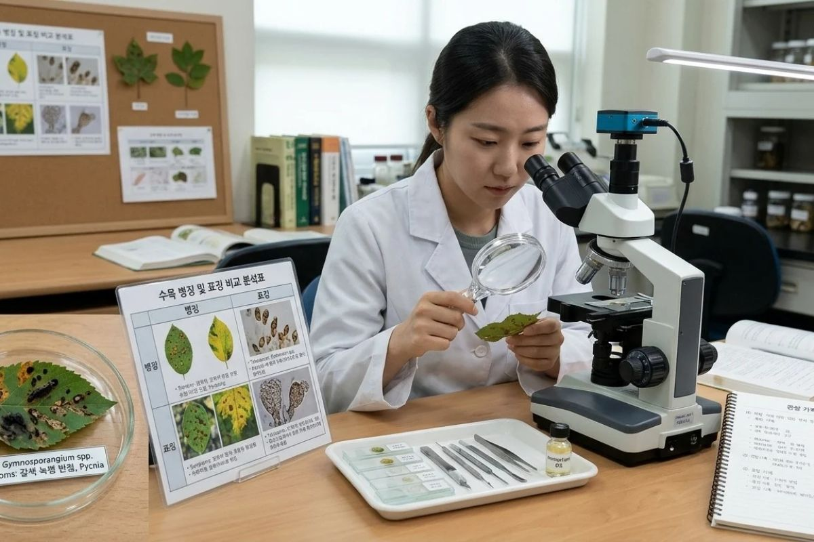
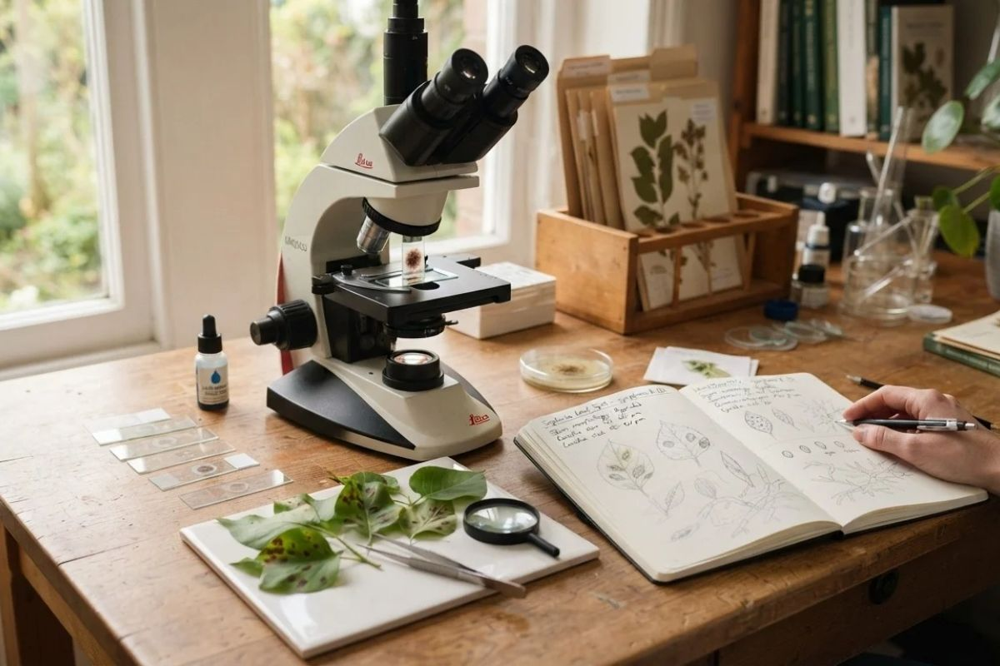

## 목차
1. [[마스터의 화두] "갈색 반점과 변색만으로 녹병·흰가루병·탄저병·점무늬병을 찍다가는 고득점이 멀어진다: 병징·표징 구분과 현미경 검경 합격의 본질"](#master-insight)
2. [[현장 진료 해부] 시험장 시료와 현미경 검경 문제에서 갈색·흰색·검은 반점의 유사 병징 때문에 감점이 잦던 수험생을, 병징·표징 분리 판독과 포자·균사 검경 기준, 코흐의 원칙 서술 루틴으로 실기 고득점에 올려놓은 K 수험코치의 실전 성공 사례](#success-case)
3. [[유사 병징 감별·현미경 검경 & 답안 완성 3대 전략] 병징(Symptom)과 표징(Sign), 녹병·흰가루병·탄저병·점무늬병의 핵심 차이를 정리하는 병해 감별 매트릭스(인프라 모델) + 포자·균사 형태 관찰과 코흐의 원칙 검증을 연결하는 검경·병원성 캘리브레이션(수익 모델) + 작업형·서술형에서 핵심 근거를 빠짐없이 적는 시험장 답안 퍼널(유입 경로) 3중 파이프라인 SOP](#pivoting-sop)
4. [[사전 준비 & 실행 프로토콜] 잎·줄기 시료 관찰 및 검경 준비 체크리스트와 유사 병해 판독·서술형 답안 템플릿 및 사후 오답·모호 시료 복기 루틴](#operation-sop)
5. [[마스터의 현장 노트] "수많은 수험생의 실기 답안지와 병해 시료를 검토하며 깨달은 관찰 순서와 근거 제시의 절대 법칙"](#master-note)
6. [[실전 실행 가이드] 병징·표징 대조 판독과 현미경 검경 기준, 코흐의 원칙·서술형 답안 SOP를 수험 학습에 적용하여 실기 감별 정확도를 높이는 3대 필수 수칙](#solution)
7. [관련 시리즈 모아보기](#series)
8. [자주 묻는 질문 (FAQ)](#faq)

---

## 1. [마스터의 화두] "갈색 반점과 변색만으로 녹병·흰가루병·탄저병·점무늬병을 찍다가는 고득점이 멀어진다: 병징·표징 구분과 현미경 검경 합격의 본질"

"시험지나 실습 테이블 위에 놓인 병든 잎과 줄기를 마주했을 때, 갈색 반점이나 곰팡이 흔적만 보고 **녹병·흰가루병·탄저병·점무늬병** 중 하나를 성급히 적어 넣었다가 채점 기준에서 결정적인 포인트를 놓쳐 아쉬워하신 적이 없으십니까?"

"수많은 수험생들이 **숙주의 반응인 '병징(Symptom)'과 병원체 자체의 구조물인 '표징(Sign)'을 혼동해 적고, 현미경 검경과 코흐의 원칙(Koch's Postulates)의 논리적 연결 고리를 빼먹어 서술형·작업형에서 아까운 점수를 잃고 있다는 사실**을 직시하고 계시지 않습니까?"

수년간 식물보호기사·나무의사 수험 지도와 수목병리학 핵심 논점을 분석하며 확신한 절대적인 명제는 **'유사 병해 감별과 병해 동정 문제에서 흔들리지 않는 비결은 육안으로 보이는 병징과 표징을 정확히 분리해 대조하는 감별 기준, 현미경 검경 및 코흐의 원칙을 체계적으로 연결하는 검증 원리, 그리고 채점자가 요구하는 근거와 용어를 누락 없이 배치하는 시험장 답안 SOP에 있다'**는 사실입니다.

이번 [기획 연재: 나무의사·식물보호기사 실전 감별 & 서술·작업형 합격 마스터 클래스 시즌 3] 제1부에서는 녹병·흰가루병·탄저병·점무늬병 등 유사 병징 감별, 육안 병징·표징 판독과 병원균 현미경 검경 실전 합격 SOP를 전격 공개합니다.

<figure style="text-align: center; margin: 32px 0;">
  
  <figcaption style="font-size: 0.9rem; color: #6C7A72; margin-top: 12px; font-style: normal;">수목 병해 시료의 병징·표징과 검경 포인트를 정리하는 학습 현장</figcaption>
</figure>

---

## 2. [현장 진료 해부] 시험장 시료와 현미경 검경 문제에서 갈색·흰색·검은 반점의 유사 병징 때문에 감점이 잦던 수험생을, 병징·표징 분리 판독과 포자·균사 검경 기준, 코흐의 원칙 서술 루틴으로 실기 고득점에 올려놓은 K 수험코치의 실전 성공 사례

식물보호기사 실기 작업형 및 나무의사 2차 서술형 대비 수험생의 병해 동정 약점 극복 실전 사례입니다. 

해당 수험생은 이론서의 병명 목록은 어느 정도 외우고 있었지만, 실제 문제에서 잎 반점·변색·부패 양상이 겹치는 병해가 제시되면 느낌에 의존해 답을 고르곤 했습니다. 

또한 현미경 관찰 특징이나 병원성 검정 절차를 묻는 문항에서는 핵심 단계를 건너뛰어 감점이 반복되었습니다. 

K 수험코치는 즉시 **유사 병징 감별 & 병해 동정 실전 SOP**를 가동했습니다. 

먼저 병해별 증상을 **병징(변색·괴사·위조·반점 등 숙주 반응)**과 **표징(포자퇴·분생포자층·균사·균핵 등 병원체 흔적)**으로 나누어 비교표를 만들고, 녹병·흰가루병·탄저병·점무늬병의 구별 포인트를 반복 훈련했습니다. 

이어 현미경 검경 시 포자·균사 형태와 크기를 확인하는 기준, 그리고 병원균 분리·접종·재분리·원래 병징 확인으로 이어지는 **코흐의 원칙(Koch's Postulates)** 4단계를 답안 구조에 고정했습니다. 

그 결과 유사 병해가 출제되어도 당황하지 않고 감별 근거를 명확히 제시하며 실기 병해 파트에서 안정적인 점수를 확보할 수 있었습니다.

> #### 🏆 감·추측 위주 답안 작성 대 마스터 병징·표징 대조 및 검경·코흐 원칙 SOP 비교 매트릭스
>
> | 구분 | 감·추측 위주 답안 작성 (오답·감점 유발형) | 마스터 병징·표징 대조 및 검경·코흐 원칙 SOP (K 코치 모델) |
> | :--- | :--- | :--- |
> | **병해 판독 기준** | 잎의 갈변이나 반점 색깔만 보고 병명을 단정하여 유사 병해 혼동 | **병징(숙주 반응)과 표징(병원체 구조물)을 분리해 대조하고 특징적 흔적 확인** |
> | **검경·병원성 서술** | 현미경 특징이나 병원성 입증 절차를 두루뭉술하게 서술해 감점 | **포자·균사 관찰 포인트와 코흐의 원칙 단계를 체계적으로 연결해 서술** |
> | **시험장 대응 방식** | 생소한 시료나 변형 문제에서 시간만 지체하며 당황 | **관찰 순서·감별 키워드·답안 작성 순서를 정형화해 차분히 풀이** |

---

## 3. [유사 병징 감별·현미경 검경 & 답안 완성 3대 전략] 병징(Symptom)과 표징(Sign), 녹병·흰가루병·탄저병·점무늬병의 핵심 차이를 정리하는 병해 감별 매트릭스(인프라 모델) + 포자·균사 형태 관찰과 코흐의 원칙 검증을 연결하는 검경·병원성 캘리브레이션(수익 모델) + 작업형·서술형에서 핵심 근거를 빠짐없이 적는 시험장 답안 퍼널(유입 경로) 3중 파이프라인 SOP

유사 병해 감별과 병해 동정 문제에서 흔들리지 않으려면 병해 감별 매트릭스, 검경·병원성 캘리브레이션, 그리고 시험장 답안 퍼널을 결합한 3중 파이프라인 SOP를 가동해야 합니다.

<figure style="text-align: center; margin: 32px 0;">
  
  <figcaption style="font-size: 0.9rem; color: #6C7A72; margin-top: 12px; font-style: normal;">병해 감별 매트릭스와 검경·서술형 답안 루틴을 정리하는 학습 환경</figcaption>
</figure>

> #### 💡 나무의사·국가자격증 스터디 시즌 3 제1부 핵심 3대 전략 SOP
> 

> 
> 1. **[인프라 모델 전략: 숙주 반응과 병원체 흔적을 갈라내는 '병징·표징 및 유사 병해 감별 매트릭스']**  
>    * 병해 동정의 출발점은 눈앞에 보이는 현상이 **병징(Symptom, 병원체 침입에 대한 식물 숙주의 생리적·형태적 반응)**인지, **표징(Sign, 병원체 자체 또는 그 번식·생존 구조물)**인지를 구분하는 것입니다.  
>    * ① **녹병·흰가루병·탄저병·점무늬병 대조 감별:** 잎이나 줄기에 반점·변색·괴사가 나타나더라도 병원체 흔적과 병반 양상을 함께 살펴야 합니다. 흰가루병은 잎·신초 표면에 흰 가루 모양의 균사·포자층이 나타나는 양상이 특징적이며, 녹병은 녹포자·여름포자·겨울포자 등 포자층이나 변색·부풀음 양상을 살핍니다. 탄저병은 움푹 들어가거나 둥근·타원형 병반과 분생포자층·포자퇴 흔적 등을 함께 확인하고, 점무늬병은 경계나 색조가 뚜렷한 반점 양상을 다른 잎반점 병해와 비교하며 판독합니다.  
>    * ② **진균·세균·바이러스·파이토플라스마 감별 시야:** 곰팡이(진균)는 균사·포자 등 표징이 확인되는 경우가 많고, 세균병은 수침상 병반이나 세균 점액·악취·도관 변색 등이 단서가 될 수 있으며, 바이러스·파이토플라스마는 모자이크·황화·위축·총생 등 전신적·생리적 병징 위주로 나타나는 경향이 있습니다.

> 2. **[수익 모델 전략: 현미경 관찰과 병원성 증명을 정확히 연결하는 '검경 및 코흐의 원칙 캘리브레이션']**  
>    * 육안 관찰만으로 확정이 어렵거나 검경·병원성 검정 문항이 출제될 때는 관찰 기준과 검증 절차를 체계화해야 합니다.  
>    * **① 현미경 검경 포인트:** 프레파라트 제작 후 배율을 조절하며 균사의 격막 유무, 분생포자·포자의 모양·색·격막 수 및 크기 등을 살핍니다. 육안으로 헷갈리던 반점도 포자 형태나 표징 특징이 드러나면 감별 정확도가 높아집니다.  
>    * **② 코흐의 원칙(Koch's Postulates) 검증 흐름:** 특정 병원체가 해당 병해의 원인임을 논리적으로 입증하는 고전적 4단계—① 병든 식물체에서 병원체 분리 및 순수 배양, ② 분리한 병원체를 건강한 식물에 접종해 동일한 병징 재현, ③ 접종해 병든 식물에서 동일 병원체 재분리, ④ 재분리된 병원체가 원래 분리한 것과 동일함을 확인—를 순서대로 기억해 두어야 합니다.

> 3. **[유입 경로 전략: 채점 기준표의 핵심 키워드를 놓치지 않는 '시험장 답안 구성 퍼널']**  
>    * 실기 작업형과 서술형에서는 아는 내용을 장황하게 길게 쓰기보다 **문항이 요구하는 핵심 근거를 정확히 배치**하는 것이 유리합니다.  
>    * **① 병명·용어 명확 제시:** 문제에서 요구하는 병명, 병징·표징 구분 용어, 주요 특징을 첫 문장이나 핵심 항목에 분명히 적습니다.  
>    * **② 감별 근거 연결:** "단순 갈변이 아니라 ~한 특징과 ~한 표징/검경 소견이 관찰되므로 ~병으로 판독한다"처럼 **관찰 사실 → 감별 근거 → 결론**의 인과 구조를 만듭니다.  
>    * **③ 누락 점검:** 답안을 제출하기 전 조건(부위, 병징/표징, 검경·방제·원인 등)을 빠뜨린 항목이 없는지 훑어보는 3단계 시험장 답안 퍼널을 완성하세요.

---

## 4. [사전 준비 & 실행 프로토콜] 잎·줄기 시료 관찰 및 검경 준비 체크리스트와 유사 병해 판독·서술형 답안 템플릿 및 사후 오답·모호 시료 복기 루틴

수험 준비 과정과 시험장에서 병해 동정 및 서술형 문항을 안정적으로 풀어내기 위한 표준 운영 프로토콜입니다.

> #### ⚙️ 유사 병해 감별 및 병해 동정 학습·시험장 운영 3대 수칙
> 

> 
> 1. **[관찰·검경 전 빠뜨리기 쉬운 요소를 미리 점검하는 '병해 시료·검경 체크리스트' 매뉴얼]**  
>    * 학습·실습 전 ① 병든 부위(잎·신초·줄기·열매·뿌리)의 위치와 반점 색·모양·경계 등 병징 확인 ➔ ② 포자층·균사·균핵·점액 등 표징 존재 여부와 현미경 관찰 시 초점·배율·시료 상태 점검 ➔ ③ 유사 병해(녹병·흰가루병·탄저병·점무늬병 등)와 구별되는 결정적 차이를 짚었는지 확인하는 체크리스트를 준수하세요.

> 2. **[시험장에서 단답형·작업형·서술형에 맞춰 적용하는 '병해 판독 및 서술 답안 템플릿' 캘리브레이션]**  
>    * 답안 작성 시 ① **단답·동정형:** 핵심 병명과 주요 판별 특징을 간결하고 정확하게 기재 ➔ ② **감별·검경형:** 유사 병해와 구분되는 병징·표징·현미경 소견을 대비해 서술 ➔ ③ **원인·검정 서술형:** 병원체 분류·병징 특성·코흐의 원칙 등 문항 요구 순서에 맞춰 논리적으로 정리하는 템플릿을 적용하세요.

> 3. **[틀린 문제와 헷갈린 시료를 다음 회차 실력으로 바꾸는 '오답·유사 병징 복기 사후 모니터링' 루틴]**  
>    * 문제 풀이·모의고사 후 ① 틀렸거나 찍어서 맞힌 병해 문제를 모아 왜 다른 병해와 헷갈렸는지 원인 기록 ➔ ② 해당 병해의 핵심 병징·표징·검경 특징을 나만의 비교 노트에 요약 ➔ ③ 다음 복습 주기에 같은 시료나 유사 병해 문제를 다시 풀어 감별 속도와 정확도를 점검하는 사후 관리 루틴을 정례화하세요.

---

## 5. [마스터의 현장 노트] "수많은 수험생의 실기 답안지와 병해 시료를 검토하며 깨달은 관찰 순서와 근거 제시의 절대 법칙"

> #### 📝 [마스터 노트] 병해 동정 및 유사 병징 감별 학습 현장에서 체득한 실전 지혜
>
> * **첫 번째 지혜: "병명을 먼저 찍어 놓고 거기에 맞춰 시료를 끼워 맞추면, 닮은 병해 앞에서는 어김없이 흔들린다"**  
>   ➔ 시료에서 보이는 병징과 표징을 먼저 차분히 읽어낸 뒤 병명을 도출하는 순서가 가장 정확합니다.

> * **두 번째 지혜: "채점자는 수험생의 머릿속 지식이 아니라, 답안지 위에 적힌 명확한 감별 근거와 용어를 보고 점수를 준다"**  
>   ➔ 알고 있다고 넘어가지 말고, 왜 그 병해인지 설명할 수 있는 핵심 키워드를 글로 남기는 연습이 중요합니다.

> * **세 번째 지혜: "헷갈리는 문제를 피하지 않고 비교 정리하는 순간, 가장 약했던 병해 파트가 가장 든든한 득점원이 된다"**  
>   ➔ 비슷한 병해끼리 나란히 놓고 차이를 따져보는 수고가 합격의 깊이를 만듭니다.

---

## 6. [실전 실행 가이드] 병징·표징 대조 판독과 현미경 검경 기준, 코흐의 원칙·서술형 답안 SOP를 수험 학습에 적용하여 실기 감별 정확도를 높이는 3대 필수 수칙

1. **병징(숙주 반응)과 표징(병원체 흔적)을 구분하고 녹병·흰가루병·탄저병·점무늬병 등 유사 병해를 대조하는 감별 기준 확립**  
   반점·변색의 겉모습만이 아니라 특징적 병징·표징 차이를 기준으로 병해를 정확히 판독.
2. **현미경 검경 관찰 포인트와 코흐의 원칙(Koch's Postulates) 4단계를 연결한 병원성 이해 심화**  
   균사·포자 관찰과 병원체 분리·접종·재분리·동일성 확인 절차를 체계적으로 정리.
3. **관찰 → 근거 제시 → 누락 점검으로 이어지는 시험장 답안 SOP 체화**  
   작업형과 서술형 문항에서 핵심 용어와 감별 근거를 빠짐없이 적어 안정적인 고득점 확보.

---

## 7. 관련 시리즈 모아보기

* **[기획 연재: 나무의사·식물보호기사 실전 감별 & 서술·작업형 합격 마스터 클래스 시즌 3. ①] [유사 병징 감별 & 병해 동정 마스터 편] \"녹병·흰가루병·탄저병·점무늬병이 한눈에 헷갈릴 때: 육안 병징·표징 판독과 병원균 현미경 검경 실전 합격 SOP\"**  
  ➔ 병징 표징 구분, 녹병 흰가루병 탄저병 점무늬병 감별, 현미경 검경 코흐의 원칙 SOP

---

## 8. 자주 묻는 질문 (FAQ)

**Q1. 수목병리학에서 '병징(Symptom)'과 '표징(Sign)'은 시험 답안을 쓸 때 어떻게 구분해서 적는 것이 가장 명확한가요?**  

A1. '병징은 병원체의 침입이나 환경 요인에 의해 '식물(숙주) 쪽에서 나타난 반응·증상'을 뜻하고, 표징은 병원체 자체가 시료 표면에 남긴 '실물 구조물·흔적'을 뜻합니다. 

예를 들어 잎이 노랗게 변하거나 갈색 반점이 생기고 시드는 것은 병징에 가깝고, 잎 표면에 돋아난 포자층·균사·균핵·세균 점액 등은 표징에 해당합니다. 

답안을 적을 때 숙주 반응과 병원체 흔적을 구분해 언급하면 병해 동정의 설득력이 훨씬 높아집니다'.

> 💡 산림·수목 병해충 및 수목진단 관련 공식 학습·참고 자료는 <a href="https://www.nihhs.go.kr" target="_blank" rel="noopener noreferrer">농촌진흥청 국립원예특작과학원</a>을 참고하시기 바랍니다.

**Q2. 코흐의 원칙(Koch's Postulates)은 서술형 문제에서 어떤 순서와 핵심 포인트로 정리해 두어야 하나요?**  

A2. '코흐의 원칙은 특정 병원균이 해당 병을 일으킨다는 인과관계를 증명하기 위한 기본 절차로, 

① 병든 식물체에서 병원균을 분리·배양하는 단계, 

② 순수 배양한 병원균을 건강한 식물체에 접종해 동일한 병징을 일으키는지 확인하는 단계, 

③ 그 병든 식물체에서 병원균을 다시 분리하는 단계, 

④ 재분리한 균이 처음 분리한 병원균과 동일한 성질을 지니는지 확인하는 단계로 구성됩니다. 

각 단계의 핵심 동사(분리·접종·재분리·동일성 확인)를 순서대로 정확히 적는 것이 중요합니다'.

> 💡 스마트 홈가드닝 및 도시농업 정보는 <a href="https://www.modunong.or.kr" target="_blank" rel="noopener noreferrer">농림축산식품부 모두가 도시농부 포털</a>을 참고하세요.

---

