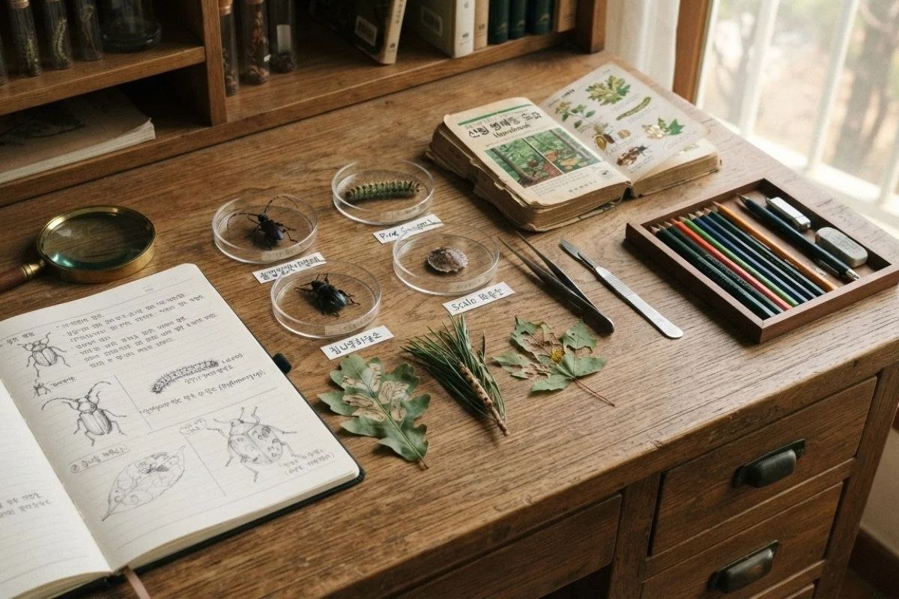
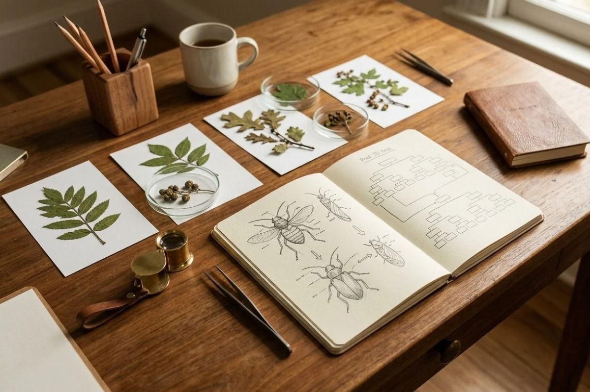

## 목차
1. [[마스터의 화두] "벌레 생김새와 갉아먹은 흔적 앞에서 헷갈리지 않는 법: 형태적 특징(구기·다리·더듬이)과 가해 흔적 동정 합격의 본질"](#master-insight)
2. [[현장 진료 해부] 나비목 유충과 딱정벌레 성충·유충, 깍지벌레·진딧물·응애의 형태 구분과 식흔·배설물 판독에서 오답이 잦던 수험생을, 구기·다리·더듬이 분류 키와 피해 흔적 역추적 루틴으로 실기 동정 고득점에 올려놓은 K 수험코치의 실전 성공 사례](#success-case)
3. [[형태 분류·가해 흔적 역추적 & 답안 완성 3대 전략] 구기·다리·더듬이·변태로 해충과 응애를 가르는 분류 동정 매트릭스(인프라 모델) + 잎말이·천공·충영·배설물(프라스)로 가해자를 추적하는 식흔 캘리브레이션(수익 모델) + 국명·학명·목명·피해 특성을 누락 없이 채우는 시험장 답안 퍼널(유입 경로) 3중 파이프라인 SOP](#pivoting-sop)
4. [[사전 준비 & 실행 프로토콜] 충체·피해 시료 관찰 체크리스트와 동정·서술 답안 템플릿 및 사후 오답·유사 식흔 복기 루틴](#operation-sop)
5. [[마스터의 현장 노트] "수많은 수험생의 해충 동정 답안과 피해 시료를 점검하며 깨달은 분류 기준과 관찰 순서의 힘"](#master-note)
6. [[실전 실행 가이드] 구기·다리·더듬이 형태 분류와 식흔·배설물 역추적, 시험장 답안 완성 SOP를 수험 학습에 적용하여 해충 동정 정확도를 높이는 3대 필수 수칙](#solution)
7. [관련 시리즈 모아보기](#series)
8. [자주 묻는 질문 (FAQ)](#faq)

---

## 1. [마스터의 화두] "벌레 생김새와 갉아먹은 흔적 앞에서 헷갈리지 않는 법: 형태적 특징(구기·다리·더듬이)과 가해 흔적 동정 합격의 본질"

"시험지나 시료대 위에 놓인 유충·성충 표본이나 구멍 뚫린 잎, 말린 잎, 수피 위의 흔적을 보았을 때, **'이것이 나방 유충인지 딱정벌레 유충인지, 깍지벌레인지 응애인지' 짧은 시간 안에 명확한 근거로 가려내지 못해 답안을 망설이신 적이 없으십니까?**"

"수많은 수험생들이 **곤충의 구기(씹는 입·빨아먹는 입 등)와 다리(가슴다리·배다리 수)·더듬이 형태, 변태 양식, 그리고 잎·줄기·수피에 남은 가해 흔적(식흔·천공·충영·배설물)을 단편적으로만 외우다 보니, 실제 시험 문제에서 조금만 표현이 바뀌어도 핵심 분류 키를 놓치고 있다는 사실**을 직시하고 계시지 않습니까?"

수년간 식물보호기사·나무의사 수험 지도와 수목해충학 기출·실기 경향을 분석하며 확신한 절대적인 명제는 **'수목 해충과 응애 동정 문제에서 흔들리지 않는 비결은 구기·다리·더듬이·변태 등 형태적 분류 키를 체계적으로 정리하는 기준, 가해 부위와 식흔·배설물 흔적으로 가해 해충을 역추적하는 감별 원리, 그리고 요구 항목을 빠짐없이 기재하는 시험장 답안 SOP에 있다'**는 사실입니다.

이번 [기획 연재: 나무의사·식물보호기사 실전 감별 & 서술·작업형 합격 마스터 클래스 시즌 3] 제2부에서는 나방 유충·딱정벌레·깍지벌레·응애 형태 특징(구기·다리·더듬이)과 가해 흔적 동정 실전 합격 SOP를 전격 공개합니다.

<figure style="text-align: center; margin: 32px 0;">
  
  <figcaption style="font-size: 0.9rem; color: #6C7A72; margin-top: 12px; font-style: normal;">해충 형태 특징과 가해 흔적 동정 포인트를 정리하는 학습 현장</figcaption>
</figure>

---

## 2. [현장 진료 해부] 나비목 유충과 딱정벌레 성충·유충, 깍지벌레·진딧물·응애의 형태 구분과 식흔·배설물 판독에서 오답이 잦던 수험생을, 구기·다리·더듬이 분류 키와 피해 흔적 역추적 루틴으로 실기 동정 고득점에 올려놓은 K 수험코치의 실전 성공 사례

식물보호기사 실기 작업형 및 나무의사 2차 시험 대비 수험생의 해충·응애 동정 약점 극복 실전 사례입니다. 

해당 수험생은 대표적인 수목 해충 이름을 많이 알고 있었지만, 유충 형태나 식흔 사진·설명만 제시된 문제에서는 나비목 애벌레와 딱정벌레 유충·성충, 흡즙성 해충이나 응애류를 서로 혼동하는 경우가 많았습니다. 

또한 답안을 작성할 때 핵심 용어나 피해 특성을 빼먹어 부분 점수를 잃는 일도 잦았습니다. 

K 수험코치는 즉시 **형태적 특징 & 가해 흔적 동정 실전 SOP**를 가동했습니다. 

먼저 분류군별로 **구기 구조(저작구·흡즙구 등), 가슴다리·배다리 수, 더듬이 형태, 변태 양식(완전변태·불완전변태 등)**을 핵심 키로 묶어 비교 학습했습니다. 

이어 잎말이·굴파리 식흔·천공·충영·배설물 등 피해 흔적을 보고 어떤 식습성과 생활사를 가진 해충인지 역추적하는 연습을 병행하고, 답안 항목 누락을 막는 체크 루틴을 적용했습니다. 

그 결과 충체 형태와 피해 흔적이 결합된 실기 문항에서도 혼란 없이 감별 근거를 적어 안정적인 고득점에 도달할 수 있었습니다.

> #### 🏆 이름·사진 단순 암기 위주 학습 대 마스터 형태 분류 키 및 식흔 역추적 SOP 비교 매트릭스
>
> | 구분 | 이름·사진 단순 암기 위주 학습 (혼동·감점 유발형) | 마스터 형태 분류 키 및 식흔 역추적 SOP (K 코치 모델) |
> | :--- | :--- | :--- |
> | **충체·응애 감별** | 외형 인상만 기억해 유충·성충·응애류 간 차이 혼동 | **구기·다리·더듬이 형태와 변태 양식 등 분류 키로 체계적 구분** |
> | **가해 흔적 판독** | 잎·줄기 피해 사진의 세밀한 흔적을 놓치고 성급히 추측 | **식흔 모양·가해 부위·배설물 흔적을 단서로 가해 해충 역추적** |
> | **답안 완성도** | 단편적 단어만 적다가 문제 요구 항목을 빠뜨려 감점 | **분류·특징·피해 양상 등 핵심 요소를 빠짐없이 정리해 기재** |

---

## 3. [형태 분류·가해 흔적 역추적 & 답안 완성 3대 전략] 구기·다리·더듬이·변태로 해충과 응애를 가르는 분류 동정 매트릭스(인프라 모델) + 잎말이·천공·충영·배설물(프라스)로 가해자를 추적하는 식흔 캘리브레이션(수익 모델) + 국명·학명·목명·피해 특성을 누락 없이 채우는 시험장 답안 퍼널(유입 경로) 3중 파이프라인 SOP

수목 해충과 응애 동정 문제에서 흔들리지 않으려면 분류 동정 매트릭스, 식흔 캘리브레이션, 그리고 시험장 답안 퍼널을 결합한 3중 파이프라인 SOP를 가동해야 합니다.

<figure style="text-align: center; margin: 32px 0;">
  
  <figcaption style="font-size: 0.9rem; color: #6C7A72; margin-top: 12px; font-style: normal;">형태 분류 키와 식흔 역추적 루틴을 정리하는 학습 환경</figcaption>
</figure>

> #### 💡 나무의사·국가자격증 스터디 시즌 3 제2부 핵심 3대 전략 SOP
> 

> 
> 1. **[인프라 모델 전략: 형태적 특징과 변태 양식으로 분류군을 가르는 '해충·응애 분류 동정 매트릭스']**  
>    * 해충과 응애를 구분할 때는 먼저 **구기(씹는 입·흡즙구 등), 다리 수와 형태, 더듬이 구조, 변태 방식**을 핵심 기준으로 삼아야 합니다.  
>    * ① **나방 유충·딱정벌레·깍지벌레 구분:** 나비목(나방·나비) 유충은 씹는 입을 가지며 가슴다리 3쌍 외에 배다리(복각)가 발달하는 경우가 많고, 딱정벌레목 성충은 앞날개가 딱딱한 초시(딱지날개)로 변형되고 씹는 입과 다양한 더듬이 형태를 보입니다. 깍지벌레류는 고착성·흡즙성 특성을 띠며 왁스·각질 등으로 이루어진 껍질(개각)이나 분비물로 덮여 있는 경우가 특징적입니다.  
>    * ② **곤충과 응애의 차이:** 곤충강(Insecta)은 머리·가슴·배 3체절과 성충 기준 다리 3쌍(6개), 더듬이 1쌍을 지니는 반면, 거미강(Arachnida)에 속하는 응애류(진드기·응애)는 더듬이나 날개가 없고 성충 기준 다리가 4쌍(8개)인 점 등 기본 체제 차이를 분명히 알아두어야 합니다.

> 2. **[수익 모델 전략: 남은 피해 흔적으로 가해 해충의 행동과 생태를 읽어내는 '식흔·가해 흔적 캘리브레이션']**  
>    * 현장과 시험에서는 충체가 보이지 않고 피해 흔적만 제시되는 경우가 많으므로, 흔적의 유형을 분류·해석하는 능력이 중요합니다.  
>    * **① 잎·신초·줄기 식흔 유형:** 잎을 말거나 철사줄로 묶은 듯한 잎말이 흔적, 잎 조직 내부를 파고든 갱도(굴파리·굴나방류 식흔 등), 목재나 수피에 뚫린 천공(구멍)과 목질부 갱도, 식물 조직이 비정상적으로 부푼 충영(혹) 등 가해 방식에 따라 단서가 달라집니다.  
>    * **② 배설물·분비물과 수세 반응:** 식흔 주변의 배설물(프라스) 모양·색깔·위치, 수지 유출이나 잎 황화·위축 등 2차 증상을 함께 살피면 가해 시기와 가해 부위를 더 정확히 좁힐 수 있습니다.

> 3. **[유입 경로 전략: 채점 기준이 요구하는 핵심 정보를 빠짐없이 담아내는 '시험장 답안 구성 퍼널']**  
>    * 동정 및 서술형 문제에서는 답을 맞히고도 필수 요소를 적지 않아 감점되는 사례가 흔합니다.  
>    * **① 핵심 명칭·분류 명시:** 문항에서 요구하는 해충·응애명과 분류군(목·과 등) 또는 핵심 형태 특징을 명확히 적습니다.  
>    * **② 형태·식흔 근거 연결:** "가슴다리·배다리 특징과 ~한 식흔/구기 특성이 확인되므로 ~로 동정한다"처럼 **관찰 근거와 결론**을 연결합니다.  
>    * **③ 누락 항목 점검:** 문제 지문에서 묻는 항목(명칭, 분류, 형태, 피해 특징, 방제·생태 포인트 등)을 빠짐없이 충족했는지 확인하는 3단계 시험장 답안 퍼널을 완성하세요.

---

## 4. [사전 준비 & 실행 프로토콜] 충체·피해 시료 관찰 체크리스트와 동정·서술 답안 템플릿 및 사후 오답·유사 식흔 복기 루틴

수험 준비 과정과 시험장에서 해충·응애 동정 문항을 정확하고 빠르게 풀어내기 위한 표준 운영 프로토콜입니다.

> #### ⚙️ 수목 해충·응애 동정 및 가해 흔적 학습·시험장 운영 3대 수칙
> 

> 
> 1. **[관찰 시 핵심 형태와 피해 흔적을 놓치지 않는 '해충·식흔 체크리스트' 매뉴얼]**  
>    * 시료·문제 분석 전 ① 구기 형태, 다리 수·위치, 더듬이 모양, 날개·껍질 등 체제 특징 확인 ➔ ② 가해 부위(잎·신초·줄기·수피·뿌리)와 식흔(잎말이·천공·충영·굴 등) 및 배설물 양상 점검 ➔ ③ 비슷한 외형이나 비슷한 식흔을 남기는 다른 해충·응애와 구별되는 차이점을 짚었는지 확인하는 체크리스트를 준수하세요.

> 2. **[문제 유형에 맞춰 답안 구성을 정형화하는 '해충 동정·서술 답안 템플릿' 캘리브레이션]**  
>    * 답안 작성 시 ① **단답·동정형:** 요구하는 명칭과 핵심 판별 특징을 간결하고 명확하게 기재 ➔ ② **형태·식흔 설명형:** 구기·다리·더듬이·변태 등 형태적 근거와 가해 흔적 특성을 연결해 서술 ➔ ③ **생태·방제 연계형:** 생활사·월동태·가해 습성과 연계된 관리 포인트를 논리적으로 정리하는 템플릿을 적용하세요.

> 3. **[헷갈린 해충과 식흔을 확실한 득점 포인트로 바꾸는 '오답·식흔 비교 복기 사후 모니터링' 루틴]**  
>    * 문제 풀이·모의고사 후 ① 틀렸거나 헷갈렸던 해충·응애 동정 문제를 모아 혼동한 이유 기록 ➔ ② 유사한 형태나 유사한 식흔을 가진 종끼리 구기·다리·피해 부위 차이를 비교 정리 ➔ ③ 다음 복습 회차에 같은 유형을 다시 풀어 판별 속도와 정확도를 점검하는 사후 관리 루틴을 정례화하세요.

---

## 5. [마스터의 현장 노트] "수많은 수험생의 해충 동정 답안과 피해 시료를 점검하며 깨달은 분류 기준과 관찰 순서의 힘"

> #### 📝 [마스터 노트] 수목 해충·응애 분류 동정 및 가해 흔적 학습 현장에서 체득한 실전 지혜
>
> * **첫 번째 지혜: "벌레의 이름부터 떠올리려 애쓰기보다, 입과 다리와 더듬이와 상처 모양을 먼저 읽으면 답이 스스로 모습을 드러낸다"**  
>   ➔ 분류 기준이 서 있으면 처음 보는 표현이나 변형 문제도 차분하게 풀어낼 수 있습니다.

> * **두 번째 지혜: "가해 흔적은 해충이 남긴 지문과 같다. 어디를 어떻게 갉고 파고들었는지만 제대로 읽어도 절반은 맞힌 셈이다"**  
>   ➔ 피해 부위와 식흔·배설물의 특성을 연결해 보는 습관이 실기 감별의 힘을 키웁니다.

> * **세 번째 지혜: "한 번 헷갈렸던 표와 식흔을 그대로 넘기지 않고 나만의 비교 기준으로 정리할 때, 실수의 고리가 실력의 고리로 바뀐다"**  
>   ➔ 잦은 혼동을 기록하고 비교하는 과정이 합격선 위의 안정감을 만듭니다.

---

## 6. [실전 실행 가이드] 구기·다리·더듬이 형태 분류와 식흔·배설물 역추적, 시험장 답안 완성 SOP를 수험 학습에 적용하여 해충 동정 정확도를 높이는 3대 필수 수칙

1. **구기·다리·더듬이 형태와 변태 양식, 곤충과 응애의 체제 차이를 기준으로 분류군을 명확히 구분**  
   나방 유충·딱정벌레·깍지벌레·응애류 등의 핵심 형태 특징을 체계적으로 정리.
2. **잎말이·천공·충영·굴 등 식흔과 가해 부위·배설물 흔적을 단서로 가해 해충을 역추적하는 감별력 강화**  
   충체뿐 아니라 피해 흔적만 제시된 문항에서도 정확한 동정 근거를 도출.
3. **요구 명칭과 형태·식흔 근거를 누락 없이 적고 검토하는 시험장 답안 SOP 체화**  
   작업형과 서술형에서 불필요한 감점을 줄이고 안정적인 합격 점수 확보.

---

## 7. 관련 시리즈 모아보기

* **[기획 연재: 나무의사·식물보호기사 실전 감별 & 서술·작업형 합격 마스터 클래스 시즌 3. ①] [유사 병징 감별 & 병해 동정 마스터 편] \"녹병·흰가루병·탄저병·점무늬병이 한눈에 헷갈릴 때: 육안 병징·표징 판독과 병원균 현미경 검경 실전 합격 SOP\"**  
  ➔ [병징 표징 구분, 녹병 흰가루병 탄저병 점무늬병 감별, 현미경 검경 코흐의 원칙 SOP](https://floraldays.com/study-season3-disease-symptom-sign-microscopy-part1)

* **[기획 연재: 나무의사·식물보호기사 실전 감별 & 서술·작업형 합격 마스터 클래스 시즌 3. ②] [수목 해충·응애 분류 동정 & 생활사 편] \"나방 유충·딱정벌레·깍지벌레·응애를 10초 만에 가르는 핵심 키: 형태적 특징(구기·다리·더듬이)과 가해 흔적 동정 실전 SOP\"**  
  ➔ 나방 유충 딱정벌레 깍지벌레 응애 구분, 구기 다리 더듬이 특징, 가해 흔적 식흔 동정 SOP

---

## 8. 자주 묻는 질문 (FAQ)

**Q1. 실기 문제에서 애벌레(유충)가 제시될 때, 나비목 유충과 딱정벌레 유충을 빠르게 구분하려면 무엇을 먼저 살펴야 하나요?**  

A1. '유충을 구분할 때는 씹는 입(저작구)을 기준으로 하면서, 가슴다리 3쌍 외에 배다리(복각)의 발달 여부와 전체 체형·머리 경화 정도·가해 흔적 특성을 함께 살피는 것이 좋습니다. 

나비목 유충은 가슴다리 외에 배다리가 나타나는 경우가 흔하고 잎을 갉거나 잎말이·식엽 흔적을 남기는 경우가 많으며, 딱정벌레 유충은 목재·수피·토양·뿌리 등 다양한 환경에서 각기 다른 체형과 가해 양상을 보입니다. 

출제 지문에 제시된 형태 설명과 가해 부위를 나란히 연결해 판독하세요'.

> 💡 산림·수목 해충 및 응애 동정·방제 관련 공식 학습·참고 자료는 <a href="https://www.nihhs.go.kr" target="_blank" rel="noopener noreferrer">농촌진흥청 국립원예특작과학원</a>을 참고하시기 바랍니다.

**Q2. 시험 답안을 작성할 때 해충 이름만 적으면 되나요, 아니면 형태나 피해 특징을 함께 적는 것이 좋나요?**  

A2. '문항에서 요구하는 조건에 따라 다르지만, 서술형이나 근거를 묻는 작업형 문제에서는 명칭과 함께 구기·다리·더듬이·변태 등 형태적 특징이나 식흔·가해 부위 등 판별 근거를 함께 명확히 적는 것이 유리합니다. 

문제에서 묻는 핵심 항목을 먼저 확인한 뒤, 명칭과 핵심 근거를 간결하고 정확하게 기재해 감점 요인을 줄이시기 바랍니다'.

> 💡 스마트 홈가드닝 및 도시농업 정보는 <a href="https://www.modunong.or.kr" target="_blank" rel="noopener noreferrer">농림축산식품부 모두가 도시농부 포털</a>을 참고하세요.

---

