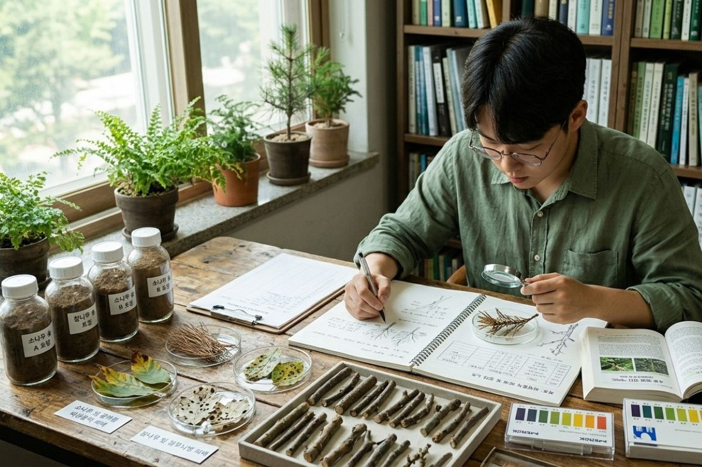

## 목차
1. [[마스터의 화두] "병원균도 해충도 보이지 않는데 수세가 무너지는 이유: 비생물적 피해와 토양 이화학성 판독 합격의 본질"](#master-insight)
2. [[현장 진료 해부] 수관 쇠퇴와 잎 황화·고사 원인을 병해충에서만 찾다 서술형 감점이 잦던 수험생을, 복토·답압·배수·염해·동해 감별 키와 토양 이화학성·2차 피해 연결 루틴으로 실기 고득점에 올려놓은 K 수험코치의 실전 성공 사례](#success-case)
3. [[비생물적 피해 감별·토양 이화학성 해석 & 서술 완성 3대 전략] 복토·답압·배수·가뭄·일소·한해·동해·제설제 염해를 가르는 비생물적 감별 매트릭스(인프라 모델) + 토양 pH·EC·유효토심·경도와 1차 쇠약→2차 침입을 잇는 진단 캘리브레이션(수익 모델) + 원인 배제부터 개량 처방까지 논리를 세우는 시험장 답안 퍼널(유입 경로) 3중 파이프라인 SOP](#pivoting-sop)
4. [[사전 준비 & 실행 프로토콜] 현장·문제 조건 점검 체크리스트와 비생물적 진단·서술 답안 템플릿 및 사후 오답·복합 요인 복기 루틴](#operation-sop)
5. [[마스터의 현장 노트] "수많은 수목진단 사례와 수험 답안지를 검토하며 깨달은 환경·토양 단서 읽기의 힘"](#master-note)
6. [[실전 실행 가이드] 비생물적 피해 감별 기준과 토양 이화학성 판독, 1차·2차 피해 인과 서술 SOP를 수험 학습에 적용하여 진단 정확도를 높이는 3대 필수 수칙](#solution)
7. [관련 시리즈 모아보기](#series)
8. [자주 묻는 질문 (FAQ)](#faq)

---

## 1. [마스터의 화두] "병원균도 해충도 보이지 않는데 수세가 무너지는 이유: 비생물적 피해와 토양 이화학성 판독 합격의 본질"

"나무의 잎이 누렇게 변하거나 끝부터 마르고 수관 활력이 떨어지는데, 정작 뚜렷한 병원체 표징이나 결정적 해충 흔적이 보이지 않을 때 **'이 문제가 환경·토양·기상 요인에서 비롯된 것인지, 아니면 숨어 있는 다른 요인이 있는지'** 명확히 갈라내지 못해 답안을 망설이신 적이 없으십니까?"

"수많은 수험생들이 **복토·토양 답압·배수 불량·가뭄·일소·한해·동해·제설제 염해 등 비생물적 요인의 특징을 막연히만 기억하고, 토양 산도(pH)·전기전도도(EC)·유효토심·경도 같은 토양 이화학성 지표와 '1차 비생물적 쇠약 → 2차 천공성 해충·부후균 침입'의 인과관계를 논리적으로 엮어내지 못해 서술형에서 점수를 잃고 있다는 사실**을 직시하고 계시지 않습니까?"

수년간 나무의사·식물보호기사 수험 지도와 수목진단 핵심 논점을 분석하며 확신한 절대적인 명제는 **'비생물적 피해와 토양 생리장해 문항에서 흔들리지 않는 비결은 환경·기상·토양 조건과 피해 패턴을 대조하는 감별 기준, 토양 이화학성 지표 및 1차 쇠약과 2차 피해의 인과관계를 연결하는 진단 원리, 그리고 원인 판독부터 개량 방향까지 체계적으로 적는 시험장 답안 SOP에 있다'**는 사실입니다.

이번 [기획 연재: 나무의사·식물보호기사 실전 감별 & 서술·작업형 합격 마스터 클래스 시즌 3] 제4부에서는 복토·답압·제설제(염해)·동해·배수 불량 감별 및 토양 이화학성 판독 실전 합격 SOP를 전격 공개합니다.

<figure style="text-align: center; margin: 32px 0;">
  
  <figcaption style="font-size: 0.9rem; color: #6C7A72; margin-top: 12px; font-style: normal;">비생물적 피해 감별과 토양 이화학성 판독 포인트를 정리하는 학습 현장</figcaption>
</figure>

---

## 2. [현장 진료 해부] 수관 쇠퇴와 잎 황화·고사 원인을 병해충에서만 찾다 서술형 감점이 잦던 수험생을, 복토·답압·배수·염해·동해 감별 키와 토양 이화학성·2차 피해 연결 루틴으로 실기 고득점에 올려놓은 K 수험코치의 실전 성공 사례

나무의사 2차 서술형 및 식물보호기사 실기 대비 수험생의 비생물적 피해·토양 진단 약점 극복 실전 사례입니다. 

해당 수험생은 병원균이나 해충 문제에는 익숙했지만, 토양 조건이 나빠지거나 기상·관리 스트레스가 겹친 사례에서는 원인을 한 가지 단편 요인으로만 찍거나 생물적 요인만 찾으려다 서술형 답안의 논리가 끊기곤 했습니다. 

또한 토양 이화학성 지표나 1차 쇠약 뒤 2차 피해가 이어지는 흐름을 빼먹어 점수가 깎이는 경우가 많았습니다. 

K 수험코치는 즉시 **비생물적 피해 감별 & 토양 이화학성 판독 실전 SOP**를 가동했습니다. 

먼저 복토·토양 답압·배수 불량·가뭄·일소·한해·동해·제설제 염해의 발생 환경과 관찰 포인트를 비교 정리하고, 주변 지형·포장·도로·계절·관리 이력과 대조하는 감별 루틴을 만들었습니다. 

이어 토양 pH, 전기전도도(EC), 유효토심, 토양 경도 등 이화학성 해석 기준과 '1차 비생물적 스트레스 → 2차 천공성 해충·부후균 유입'의 연결 고리를 답안 구조에 고정했습니다.

그 결과 복합 스트레스나 환경 장해가 출제되어도 원인 규명과 환경 개선·방제 연계까지 일관된 답안을 작성하며 실기 진단 문항에서 안정적인 고득점을 확보할 수 있었습니다.

> #### 🏆 병해충 위주 단편 추측 대 마스터 비생물적 감별·토양 이화학성·2차 피해 연계 SOP 비교 매트릭스
>
> | 구분 | 병해충 위주 단편 추측 (오답·감점 유발형) | 마스터 비생물적 감별·토양 이화학성·2차 피해 연계 SOP (K 코치 모델) |
> | :--- | :--- | :--- |
> | **원인 탐색 방향** | 병원체·해충 단서가 약한데도 생물적 원인만 찾거나 한 요인만 단정 | **복토·답압·배수·염해·동해·일소 등 환경·기상·토양 조건을 대조해 감별** |
> | **토양·인과 서술** | 토양 조건이나 2차 피해 연결을 생략해 단편적 서술에 그침 | **토양 pH·EC·유효토심·경도와 1차 쇠약→2차 침입 인과관계를 논리화** |
> | **처방 연결성** | 원인 진단과 사후 관리·환경 개선 방향이 따로 놀아 감점 | **진단된 요인에 맞춘 토양·생육 환경 개선 및 2차 피해 관리로 연결** |

---

## 3. [비생물적 피해 감별·토양 이화학성 해석 & 서술 완성 3대 전략] 복토·답압·배수·가뭄·일소·한해·동해·제설제 염해를 가르는 비생물적 감별 매트릭스(인프라 모델) + 토양 pH·EC·유효토심·경도와 1차 쇠약→2차 침입을 잇는 진단 캘리브레이션(수익 모델) + 원인 배제부터 개량 처방까지 논리를 세우는 시험장 답안 퍼널(유입 경로) 3중 파이프라인 SOP

비생물적 피해와 토양 생리장해 문항에서 흔들리지 않으려면 비생물적 감별 매트릭스, 진단 캘리브레이션, 그리고 시험장 답안 퍼널을 결합한 3중 파이프라인 SOP를 가동해야 합니다.

<figure style="text-align: center; margin: 32px 0;">
  
  <figcaption style="font-size: 0.9rem; color: #6C7A72; margin-top: 12px; font-style: normal;">토양 이화학성 해석과 비생물적 진단 루틴을 정리하는 학습 환경</figcaption>
</figure>

> #### 💡 나무의사·국가자격증 스터디 시즌 3 제4부 핵심 3대 전략 SOP
> 

> 
> 1. **[인프라 모델 전략: 환경·기상·토양 단서로 비전염성 피해를 갈라내는 '비생물적 피해 감별 매트릭스']**  
>    * 비생물적 피해는 전염성 병원체가 아니라 **물리적·화학적·기상적 환경 요인**에 의해 발생하므로, 현장 조건과 증상 분포를 함께 읽어야 합니다.  
>    * ① **복토·토양 답압·배수 불량:** 복토는 뿌리권에 흙이 새로 쌓여 통기·수분 환경이 바뀐 흔적을 살피고, 토양 답압은 통행·장비 등으로 흙이 굳어 공극과 투수·통기성이 떨어진 상태를 확인합니다. 배수 불량은 물 빠짐이 좋지 않아 과습·침수가 반복되거나 물 고임 흔적이 나타나는 조건과 연결해 판독합니다.  
>    * ② **가뭄·일소·한해·동해·제설제 염해:** 가뭄·일소는 고온·건조나 강한 직사광선·열 스트레스와 연관된 건조·열 피해를 살피고, 한해·동해는 저온·한파·동결 및 수분 스트레스 조건과 부위별 손상 양상을 대조합니다. 제설제 염해는 겨울철 제설제 살포 인접 구역이나 토양·수분 조건과 연결해 염분 스트레스 가능성을 검토합니다.

> 2. **[수익 모델 전략: 토양 지표와 복합 스트레스 흐름을 읽어내는 '토양 이화학성 및 2차 피해 캘리브레이션']**  
>    * 수목진단에서는 토양 상태와 시간 경과에 따른 2차 변화를 함께 해석해야 진단 깊이가 살아납니다.  
>    * **① 토양 이화학성 판독:** 토양 산도(pH), 전기전도도(EC, 염류·이온 농도 관련 지표), 유효토심(뿌리가 뻗을 수 있는 유효 흙 깊이), 토양 경도(물리적 굳기) 등 수치가 수목의 양분 이용성과 뿌리 생장에 어떤 제약을 주는지 살피고, 그에 맞는 토양 개량·환경 개선 방향을 연결합니다.  
>    * **② 1차 쇠약 → 2차 침입 인과관계:** 복토·답압·배수 불량·염해·한해 등으로 수세가 약해진 나무(1차 비생물적 쇠약)는 방어력이 떨어져 천공성 해충이나 부후균 등 2차 요인의 표적이 되기 쉽습니다. 현장에서 2차 흔적이 보이더라도 근본 뿌리·토양·환경 스트레스를 함께 짚어야 완전한 진단이 됩니다.

> 3. **[유입 경로 전략: 원인 규명부터 개량 처방까지 논리를 완성하는 '시험장 진단 답안 퍼널']**  
>    * 서술형과 처방전 문항에서는 감별 근거와 개선 방향이 자연스럽게 이어져야 높은 점수를 받습니다.  
>    * **① 핵심 요인 및 감별 근거:** 문제 조건(토양·기상·위치·증상)에 부합하는 비생물적 요인을 제시하고 판별 근거를 적습니다.  
>    * **② 토양·2차 요인 연계:** 관련 토양 이화학성 조건이나 1차 쇠약·2차 피해 연결 고리를 명확히 서술합니다.  
>    * **③ 개량·관리 처방 연결:** 토양 통기·배수·수분·염류 관리 및 2차 피해 대응 등 실질적 관리 방향을 정리하는 3단계 시험장 진단 답안 퍼널을 완성하세요.

---

## 4. [사전 준비 & 실행 프로토콜] 현장·문제 조건 점검 체크리스트와 비생물적 진단·서술 답안 템플릿 및 사후 오답·복합 요인 복기 루틴

수험 준비 과정과 시험장에서 비생물적 피해 및 토양 생리장해 문항을 정확하게 풀어내기 위한 표준 운영 프로토콜입니다.

> #### ⚙️ 비생물적 피해 감별 및 토양 이화학성 학습·시험장 운영 3대 수칙
> 

> 
> 1. **[진단·풀이 전 놓치기 쉬운 환경·토양 단서를 살피는 '비생물적·토양 점검 체크리스트' 매뉴얼]**  
>    * 문제·사례 분석 전 ① 복토·답압·배수 불량·제설제 염해·가뭄·일소·한해·동해 등 발생 조건과 위치·계절 단서 확인 ➔ ② 토양 pH, 전기전도도(EC), 유효토심, 토양 경도 등 토양 이화학성 조건과 뿌리 생육 환경 점검 ➔ ③ 1차 비생물적 쇠약 뒤에 2차 해충·부후균이 결합했는지 여부 확인하는 체크리스트를 준수하세요.

> 2. **[문제 유형에 맞춰 진단·처방 논리를 정형화하는 '비생물적 진단·서술 답안 템플릿' 캘리브레이션]**  
>    * 답안 작성 시 ① **단답·감별형:** 핵심 비생물적 요인과 주요 판별 근거를 간결하고 정확하게 기재 ➔ ② **토양·환경 해석형:** 토양 pH·EC·유효토심·경도 등 지표의 의미와 뿌리·수세 영향 및 개량 방향 서술 ➔ ③ **복합 진단·처방형:** 1차 스트레스 요인과 2차 피해 연계 및 종합 관리 대책을 순서대로 정리하는 템플릿을 적용하세요.

> 3. **[헷갈린 환경 장해와 복합 사례를 실력으로 굳히는 '오답·복합 요인 복기 사후 모니터링' 루틴]**  
>    * 문제 풀이·모의고사 후 ① 틀렸거나 감점된 비생물적 진단 문항을 모아 감별 근거 누락인지 인과관계 서술 부족인지 분류 ➔ ② 자주 헷갈리는 요인(예: 복토 vs 답압 vs 배수 불량, 일소 vs 한해·동해 vs 제설제 염해)과 토양 지표 포인트를 비교 정리 ➔ ③ 다음 복습 주기에 같은 유형을 다시 풀어 원인 규명부터 처방 연결까지 막힘없이 서술하는지 점검하는 사후 관리 루틴을 정례화하세요.

---

## 5. [마스터의 현장 노트] "수많은 수목진단 사례와 수험 답안지를 검토하며 깨달은 환경·토양 단서 읽기의 힘"

> #### 📝 [마스터 노트] 비생물적 피해 감별 및 토양 이화학성 학습 현장에서 체득한 실전 지혜
>
> * **첫 번째 지혜: "나무의 증상만 뚫어지게 보아서는 답이 안 보일 때가 많다. 발밑의 흙과 주변 지형, 계절과 관리 이력을 함께 읽어야 진짜 원인이 보인다"**  
>   ➔ 환경과 토양 조건을 넓게 살피는 시야가 수목진단의 정확도를 높입니다.

> * **두 번째 지혜: "토양의 물리·화학적 조건이 무너지면 뿌리가 흔들리고, 뿌리가 흔들리면 수관의 활력과 방어력도 함께 약해진다"**  
>   ➔ 지상부 증상과 지하부·토양 환경의 연결 고리를 이해하는 것이 핵심입니다.

> * **세 번째 지혜: "원인 하나만 찍고 끝내는 답안보다, 왜 그런 상태가 되었는지와 어떻게 환경을 되살릴지를 연결한 답안이 실전에서 빛난다"**  
>   ➔ 진단과 개선 방향을 하나로 엮는 연습이 합격의 깊이를 만듭니다.

---

## 6. [실전 실행 가이드] 비생물적 피해 감별 기준과 토양 이화학성 판독, 1차·2차 피해 인과 서술 SOP를 수험 학습에 적용하여 진단 정확도를 높이는 3대 필수 수칙

1. **복토·토양 답압·배수 불량·가뭄·일소·한해·동해·제설제 염해 등 주요 비생물적 피해의 특징과 감별 기준 확립**  
   주변 환경·계절·증상 양상을 대조해 비전염성 요인을 정확히 판독.
2. **토양 pH·전기전도도(EC)·유효토심·경도 등 토양 이화학성 해석과 '1차 비생물적 쇠약 → 2차 침입' 인과관계 정리**  
   토양 지표의 의미와 복합 스트레스 흐름을 이해해 서술형과 처방전 작성 역량 강화.
3. **원인 판독 → 토양·환경 요인 연결 → 개량·관리 처방으로 이어지는 시험장 진단 SOP 체화**  
   감별 근거와 관리 방향을 누락 없이 서술해 안정적인 합격 점수 확보.

---

## 7. 관련 시리즈 모아보기

* **[기획 연재: 나무의사·식물보호기사 실전 감별 & 서술·작업형 합격 마스터 클래스 시즌 3. ①] [유사 병징 감별 & 병해 동정 마스터 편] \"녹병·흰가루병·탄저병·점무늬병이 한눈에 헷갈릴 때: 육안 병징·표징 판독과 병원균 현미경 검경 실전 합격 SOP\"**  
  ➔ [병징 표징 구분, 녹병 흰가루병 탄저병 점무늬병 감별, 현미경 검경 코흐의 원칙 SOP](https://floraldays.com/study-season3-disease-symptom-sign-microscopy-part1)

* **[기획 연재: 나무의사·식물보호기사 실전 감별 & 서술·작업형 합격 마스터 클래스 시즌 3. ②] [수목 해충·응애 분류 동정 & 생활사 편] \"나방 유충·딱정벌레·깍지벌레·응애를 10초 만에 가르는 핵심 키: 형태적 특징(구기·다리·더듬이)과 가해 흔적 동정 실전 SOP\"**  
  ➔ [나방 유충 딱정벌레 깍지벌레 응애 구분, 구기 다리 더듬이 특징, 가해 흔적 식흔 동정 SOP](https://floraldays.com/study-season3-pest-mite-identification-feeding-sign-part2)

* **[기획 연재: 나무의사·식물보호기사 실전 감별 & 서술·작업형 합격 마스터 클래스 시즌 3. ③] [농약 희석배수·살포량 계산 & 약해 예방 편] \"단위 변환 실수 한 번이면 통째로 날아가는 계산 문제: 유효성분량·희석배수·혼용 가부 및 약해 진단 실전 계산 SOP\"**  
  ➔ [유효성분량 희석배수 살포량 계산, 혼용 가부 작용기작, 약해 진단 SOP](https://floraldays.com/study-season3-pesticide-dilution-compatibility-phytotoxicity-part3)

* **[기획 연재: 나무의사·식물보호기사 실전 감별 & 서술·작업형 합격 마스터 클래스 시즌 3. ④] [비생물적 피해·토양 생리장해 감별 진단 편] \"병원균도 해충도 없는데 나무가 말라 죽어갈 때: 복토·답압·제설제(염해)·동해·배수 불량 감별 및 토양 이화학성 판독 SOP\"**  
  ➔ [복토 답압 배수 불량 제설제 염해 동해 감별, 토양 pH EC 유효토심 경도 판독 SOP](https://floraldays.com/study-season3-abiotic-disorder-soil-diagnosis-part4)

---

## 8. 자주 묻는 질문 (FAQ)

**Q1. 수목진단 문제에서 병해충 흔적이 약하거나 없을 때, 복토·토양 답압·배수 불량·제설제 염해·동해 중 어떤 요인인지 어떻게 좁혀가야 하나요?**  

A1. '먼저 주변 환경과 공간·계절·관리 이력을 대조해 후보를 좁히는 것이 좋습니다. 

예를 들어 흙을 쌓은 흔적이 보이면 복토, 보행·장비 통행으로 흙이 단단해졌으면 토양 답압, 물 빠짐이 나쁘거나 과습 흔적이 있으면 배수 불량, 도로·보행로 인근 겨울철 제설제 영향이 의심되면 제설제 염해, 고온·건조나 저온·한파·동결 등 기상 조건과 맞물리면 가뭄·일소·한해·동해 가능성을 함께 검토합니다. 

여기에 토양 pH·EC·유효토심·경도 등 토양 조건을 연결하면 진단의 근거가 훨씬 탄탄해집니다'.

> 💡 수목진단 및 토양·환경 장해 관련 공식 참고 자료는 <a href="https://www.nihhs.go.kr" target="_blank" rel="noopener noreferrer">농촌진흥청 국립원예특작과학원</a>을 참고하시기 바랍니다.

**Q2. 서술형 답안에서 '1차 비생물적 쇠약과 2차 피해'의 관계를 적을 때 어떤 흐름으로 서술하는 것이 좋나요?**  

A2. '먼저 복토·답압·배수 불량·염해·한해·동해 등 비생물적 요인이 뿌리나 지상부 조직에 스트레스를 주어 나무의 활력과 방어력이 떨어지는 '1차 쇠약' 과정을 설명한 뒤, 약해진 수목에 천공성 해충이나 부후균 등 '2차 요인'이 침입해 피해가 커질 수 있다는 인과 흐름을 보여주세요. 

이어서 2차 흔적만 일시적으로 없애는 데 그치지 않고, 근본이 된 토양·생육 환경을 개선해야 장기적으로 회복할 수 있다는 점까지 연결하면 완성도 높은 답안이 됩니다'.

> 💡 스마트 홈가드닝 및 도시농업 정보는 <a href="https://www.modunong.or.kr" target="_blank" rel="noopener noreferrer">농림축산식품부 모두가 도시농부 포털</a>을 참고하세요.

---

