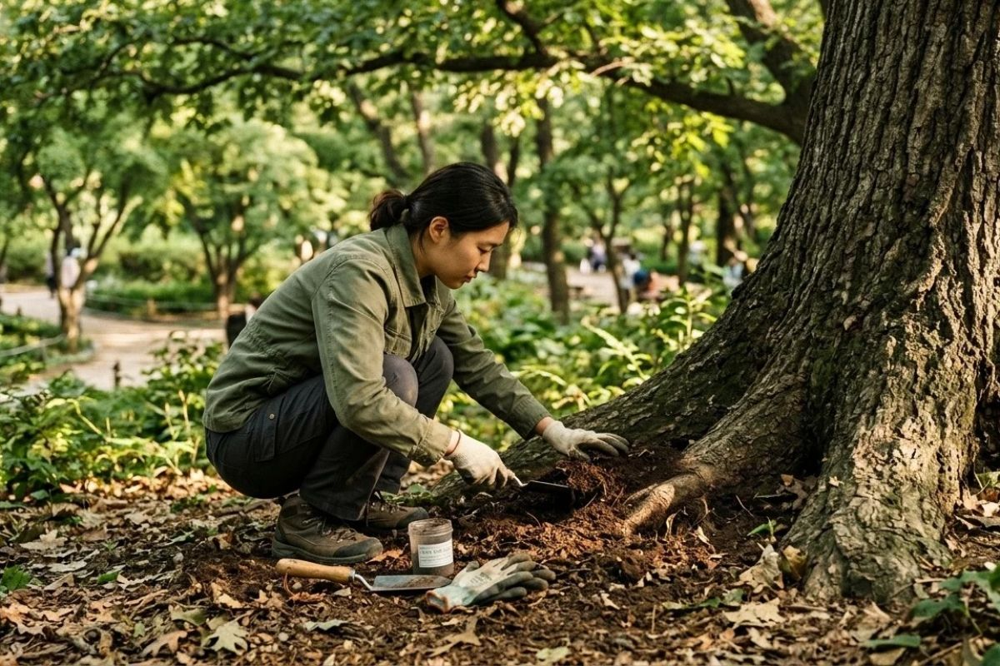
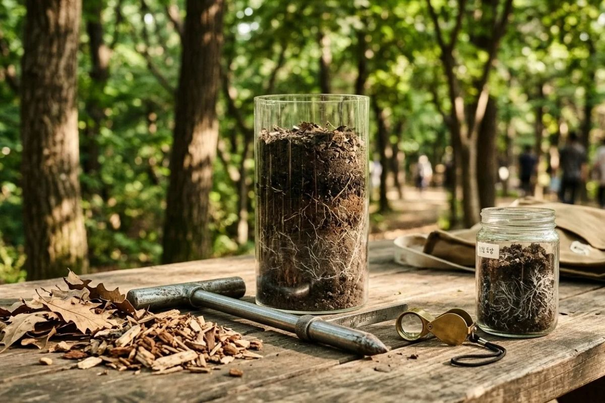

## 목차

1. [[마스터의 화두] "지상에서 홀로 서 있는 것처럼 보이는 도심 가로수도 땅속에서는 서로 손잡고 대화한다: 균근균 공생 네트워크와 도심 토양 인문학의 본질"](#master-insight)
2. [[현장 진료 해부] 보행자 발길로 콘크리트처럼 굳어진 토양 답압과 조경 공사 중 쌓인 과도한 복토로 잎이 작아지고 수세가 급격히 쇠약해지던 도심 공원 참나무·소나무 군락을, 근두부 복토 제거와 에어스페이드 토양 통기 개선, 균근균·낙엽 멀칭 순환 루틴으로 되살린 L 생태기획자의 실전 성공 사례](#success-case)
3. [[균근균 공생·토양 스트레스 진단 & 근권 회복 3대 전략] 외생균근·내생균근과 토양 생물다양성이 양분과 신호를 교환하는 지하 생태계 매트릭스(인프라 모델) + 도심 녹지를 질식시키는 토양 답압(용적밀도 상승)과 복토 매립 스트레스를 판독하는 근권 진단 캘리브레이션(수익 모델) + 낙엽 순환 멀칭, 통기 공극 확보, 보행 동선 분리로 살아 숨 쉬는 흙을 되찾는 도시 토양 회복 퍼널(유입 경로) 3중 파이프라인 SOP](#pivoting-sop)
4. [[사전 준비 & 실행 프로토콜] 근두부(뿌리목) 노출 상태 및 토양 경도·배수 체크리스트와 공간 유형별 토양 생태 복원 템플릿 및 사후 낙엽 부숙·세근 활착 모니터링 루틴](#operation-sop)
5. [[마스터의 현장 노트] "수많은 도심 숲의 뿌리 아래를 들여다보며 깨달은 보이지 않는 연대와 흙의 윤리"](#master-note)
6. [[실전 실행 가이드] 균근균 공생 이해와 복토·답압 스트레스 해소, 낙엽·토양 생물다양성 순환 SOP를 도시숲 관리에 적용하여 건강한 지하 생태계를 복원하는 3대 필수 수칙](#solution)
7. [관련 시리즈 모아보기](#series)
8. [자주 묻는 질문 (FAQ)](#faq)

- - -

## 1. \[마스터의 화두] "지상에서 홀로 서 있는 것처럼 보이는 도심 가로수도 땅속에서는 서로 손잡고 대화한다: 균근균 공생 네트워크와 도심 토양 인문학의 본질"

"우리가 공원이나 가로수길을 걸을 때 눈으로 보는 줄기와 수관은 나무 전체 생명의 절반에 불과하며, 그 아래 캄캄한 땅속에서는 수천 킬로미터에 달하는 하얀 곰팡이 실(균사)과 수억 마리의 토양 미생물이 나무 뿌리와 얽혀 물과 양분, 심지어 해충 침입의 경고 신호까지 주고받는 거대한 **지하 통신망(우드 와이드 웹, Wood Wide Web)**이 작동하고 있다는 사실을 떠올려 보신 적이 있습니까?"  

"수많은 도심 녹지 현장에서 이 경이로운 지하 생태계를 이해하지 못한 채, **사람들의 편의를 위해 수목 뿌리 위를 밟아 단단히 굳히는 '토양 답압'과 성토·잔디 식재를 위해 나무의 숨통인 뿌리목(근두부)까지 흙으로 덮어버리는 '과도한 복토'로 나무를 서서히 질식시키고 있다는 사실**을 직시하고 계시지 않습니까?"

수년간 도시숲 토양 생태계와 수목 근권 환경을 연구하며 확신한 절대적인 명제는 **'도심의 나무가 건강하게 살아 숨 쉬기 위해서는 지상부의 가지치기보다 먼저, 나무 뿌리와 균근균이 공생하는 지하 토양 생물다양성을 보전하고, 토양 답압과 복토 스트레스를 걷어내며, 떨어진 낙엽이 다시 흙으로 돌아가는 자연 순환의 고리를 이어주는 토양 생태·인문 SOP에 있다'**는 사실입니다.

이번 \[기획 연재: 도시 생태계 & 나무 인문학 마스터 클래스 시즌 2] 제2부에서는 도시 토양 생물다양성, 균근균 공생과 복토·답압 스트레스 회복 인문 실무 SOP를 전격 공개합니다.

- - -

## 2. \[현장 진료 해부] 보행자 발길로 콘크리트처럼 굳어진 토양 답압과 조경 공사 중 쌓인 과도한 복토로 잎이 작아지고 수세가 급격히 쇠약해지던 도심 공원 참나무·소나무 군락을, 근두부 복토 제거와 에어스페이드 토양 통기 개선, 균근균·낙엽 멀칭 순환 루틴으로 되살린 L 생태기획자의 실전 성공 사례

도심 내 이용객이 많은 근린공원 산책로 인접 숲의 토양 생태 복원 실전 사례입니다. 

해당 숲은 오랜 기간 방문객들이 지정된 산책로를 벗어나 나무 아래를 밟고 다니면서 표토가 딱딱하게 굳어 빗물이 스며들지 않고 겉으로 흘러내리는 **심각한 토양 답압** 상태였으며, 과거 보수 공사 과정에서 수목 줄기 하단(근두부) 위로 20-30cm 이상의 흙이 덮이는 **복토 피해**까지 겹쳐 있었습니다. 

그 결과 봄철 잎 크기가 예년의 절반 수준으로 위축되고 잔가지가 고사하는 쇠퇴 현상이 뚜렷했습니다. 

L 생태기획자는 즉시 **도시 토양 생태계 & 근권 회복 SOP**를 가동했습니다. 

먼저 수목 줄기 밑동을 덮고 있던 과도한 복토층을 조심스럽게 걷어내 **뿌리목(근두부 플레어)이 자연스럽게 지면 위로 드러나도록 복원**하고, 압축 공기(에어스페이드)를 활용해 뿌리 손상 없이 굳어진 토양에 산소와 수분이 스며들 수 있는 공극을 확보했습니다. 

이어 화학 비료 대신 지역 토양에서 유래한 균근균·유익 미생물 접종과 함께 공원 내 낙엽·우드칩을 활용한 유기물 멀칭을 조성하고, 나무 밑동을 보호하는 낮은 목재 경계 울타리로 보행 동선을 분리했습니다. 이듬해 봄, 땅속 미생물 활동과 잔뿌리 호흡이 되살아나면서 수관의 잎 크기와 엽색이 선명하게 회복되었습니다.

<figure style="text-align: center; margin: 1.5rem 0;">
  
  <figcaption style="font-size: 0.9em; color: #666; margin-top: 0.5rem;">근두부 복토 제거와 토양 통기 개선, 낙엽 멀칭 순환으로 도심 토양 생태계를 복원하는 현장</figcaption>
</figure>

*근두부 복토 제거와 토양 통기 개선, 낙엽 멀칭 순환으로 도심 토양 생태계를 복원하는 현장*

> #### 🏆 인위적 답압·낙엽 수거 관리 대 마스터 균근균 공생·토양 순환 SOP 비교 매트릭스
>
> | 구분              | 인위적 답압·낙엽 전량 수거 (토양 황폐화형)                  | 마스터 균근균 공생·토양 순환 SOP (L 기획자 모델)                  |
> | --------------- | ------------------------------------------ | ------------------------------------------------ |
> | **근두부 및 표토 상태** | 보행 압력으로 토양이 압축되고 복토로 뿌리목이 매몰되어 산소 공급 차단    | **근두부 플레어 노출 유지 및 보행 동선 분리로 토양 공극(통기성) 확보**      |
> | **미생물·균근균 생태**  | 화학 비료·농약 남용과 건조한 나대지 노출로 공생 균근균 및 토양 생물 감소 | **유기물 피복과 적정 수분·공기 유지로 외생·내생균근 및 토양 미생물 군집 활성화** |
> | **물질 순환 철학**    | 가을 낙엽을 '쓰레기'로 간주해 싹 쓸어내어 토양 유기물 고갈 초래      | **낙엽을 숲의 양분이자 보온 이불로 존중하여 수관 하부 멀칭·부숙 순환 유도**    |

- - -

## 3. \[균근균 공생·토양 스트레스 진단 & 근권 회복 3대 전략] 외생균근·내생균근과 토양 생물다양성이 양분과 신호를 교환하는 지하 생태계 매트릭스(인프라 모델) + 도심 녹지를 질식시키는 토양 답압(용적밀도 상승)과 복토 매립 스트레스를 판독하는 근권 진단 캘리브레이션(수익 모델) + 낙엽 순환 멀칭, 통기 공극 확보, 보행 동선 분리로 살아 숨 쉬는 흙을 되찾는 도시 토양 회복 퍼널(유입 경로) 3중 파이프라인 SOP

도심의 나무들이 지닌 본연의 생명력을 되살리려면 지하 생태계 매트릭스, 근권 스트레스 진단 캘리브레이션, 그리고 도시 토양 회복 퍼널을 결합한 3중 파이프라인 SOP를 가동해야 합니다.

<figure style="text-align: center; margin: 1.5rem 0;">
  
  <figcaption style="font-size: 0.9em; color: #666; margin-top: 0.5rem;">균근균 공생 매트릭스, 복토·답압 스트레스 진단 캘리브레이션, 도시 토양 회복 퍼널을 결합한 3중 파이프라인 SOP</figcaption>
</figure>

*균근균 공생 매트릭스, 복토·답압 스트레스 진단 캘리브레이션, 도시 토양 회복 퍼널을 결합한 3중 파이프라인 SOP*

> #### 💡 도시숲, 생태 및 나무 인문학 시즌 2 제2부 핵심 3대 전략 SOP
>
> 1. **\[인프라 모델 전략: 나무 혼자서는 닿을 수 없는 곳까지 뻗어가는 '균근균 공생 및 토양 생물다양성 매트릭스']**  
>
>    * 자연 상태의 숲에서 대부분의 나무는 독자적으로 양분을 흡수하지 않고, 뿌리와 곰팡이(균류)가 결합한 **균근(Mycorrhiza)**을 통해 거대한 협력 생태계를 이룹니다.  
>    * ① **외생균근(Ectomycorrhiza)과 내생균근(Endomycorrhiza):** 소나무·참나무류는 뿌리 겉을 균사 막으로 감싸는 외생균근과, 단풍나무·은행나무·초본류는 뿌리 세포 내부로 들어가는 내생균근(수지상균근)과 주로 공생합니다. 나무는 광합성으로 만든 당분(탄소)을 균근균에 건네주고, 균근균은 머리카락보다 훨씬 가는 균사 네트워크를 넓게 뻗어 나무 뿌리가 닿지 못하는 미세 공극 속의 **인(P)·질소·수분**을 끌어다 줍니다.  
>    * ② **우드 와이드 웹의 인문학적 의미:** 균근균 망은 어미 나무에서 그늘 속 어린 묘목으로 양분을 건네거나, 병해충 공격을 받은 나무가 화학적 방어 물질을 미리 준비하도록 신호를 전달하는 연결 통로입니다. 이는 숲이 경쟁만을 일삼는 공간이 아니라 **서로를 지탱하는 상호의존의 공동체**임을 일깨워 줍니다.
>
> <!---->
>
> 2. **\[수익 모델 전략: 말 못 하는 나무의 숨통이 막히는 징후를 포착하는 '토양 답압 및 복토 스트레스 진단 캘리브레이션']**  
>
>    * 도심 공원과 가로수에서 발생하는 수목 쇠퇴의 상당수는 지상부 병해충 이전에 지하 토양의 물리적 훼손에서 비롯됩니다.  
>    * **① 토양 답압(Soil Compaction):** 사람들의 발걸음이나 관리 차량의 무게가 반복되면 흙 알갱이 사이의 공기 구멍(공극)이 짓눌려 사라집니다. 토양이 단단해지면 산소 확산이 막혀 잔뿌리가 호흡하지 못하고, 빗물이 땅속으로 스며들지 못해 가뭄과 침수 스트레스가 동시에 심화됩니다.  
>    * **② 복토(Fill Soil) 매립 스트레스:** 잔디를 깔거나 지반 높이를 맞추기 위해 나무 줄기 밑동(근두부) 위로 흙을 높이 쌓으면, 원래 지면 근처에서 숨 쉬던 흡수근이 깊은 땅속에 갇혀 질식하고 줄기 껍질이 습기에 노출되어 썩어 들어갑니다. 나무 줄기 하단이 전봇대처럼 일자로 땅속에 꽂혀 있다면 과도한 복토를 의심해야 합니다.
>
> <!---->
>
> 3. **\[유입 경로 전략: 도심의 척박한 흙을 살아있는 숲의 부엽토로 되돌리는 '낙엽 순환·통기 회복 및 동선 분리 퍼널']**  
>
>    * 도시 토양을 살리는 길은 거창한 화학 처방이 아니라, 숲이 원래 작동하던 순환 구조를 회복시켜 주는 데 있습니다.  
>    * **① 근두부(Root Flare) 노출 복원:** 줄기 밑동이 뿌리로 갈라지며 넓어지는 곡선 부위(근두부 플레어)가 지면에서 자연스럽게 보이도록 덮인 흙을 걷어내 뿌리의 호흡구를 열어줍니다.  
>    * **② 보행 동선 분리 및 통기성 개선:** 수관 투영 면적(나무 가지가 뻗은 아래 땅 영역) 내에는 사람들이 밟고 들어가지 않도록 낮은 경계 울타리나 지피식물 구역을 설정하고, 이미 굳어진 토양은 뿌리를 다치지 않는 방식으로 통기 작업을 실시합니다.  
>    * **③ 낙엽·우드칩 멀칭 순환:** 가을철 떨어진 낙엽을 무조건 폐기물로 치우지 말고, 수목 하부 식수대나 화단에 5-8cm 두께로 얹어(단, 줄기 밑동에 직접 닿지 않게 도넛 모양으로 배치) 토양 수분 증발을 막고 지렁이·톡토기·미생물이 분해해 천연 부엽토를 만들도록 돕는 3단계 토양 회복 퍼널을 완성하세요.

- - -

## 4. \[사전 준비 & 실행 프로토콜] 근두부(뿌리목) 노출 상태 및 토양 경도·배수 체크리스트와 공간 유형별 토양 생태 복원 템플릿 및 사후 낙엽 부숙·세근 활착 모니터링 루틴

도심 공원·가로수·정원 녹지에서 토양 생태계를 진단하고 복원하기 위한 표준 운영 프로토콜입니다.

> #### ⚙️ 도시 토양 생태 보전 및 근권 회복 운영 3대 수칙
>
> 1. **\[현장 점검 시 뿌리 호흡 저해 요인을 놓치지 않는 '근두부·토양 답압·유기물 체크리스트' 매뉴얼]**  
>
>    * 현장 진단 시 ① 나무 줄기 밑동이 넓어지는 근두부 플레어가 흙이나 멀칭재에 파묻혀 있지 않은지 확인 ➔ ② 비가 온 뒤 수관 하부에 물이 고여 빠지지 않거나, 반대로 표면만 젖고 속흙이 바짝 말라 있는지(답압 징후) 점검 ➔ ③ 표토에 낙엽이나 부식질 없이 딱딱한 맨흙만 노출되어 있는지 확인하는 체크리스트를 준수하세요.
>
> <!---->
>
> 2. **\[가로수·공원·정원 여건에 맞춰 적용하는 '공간 유형별 토양 생태 복원 템플릿' 캘리브레이션]**  
>
>    * 공간 적용 시 ① **도심 가로수 식수대:** 보호판 규격을 수목 성장에 맞게 확장하고, 답압 방지 및 우드칩·낙엽 멀칭 적용 ➔ ② **근린공원 이용객 밀집 숲:** 샛길 폐쇄 및 목재 데크·경계 로프 설치로 수관 하부 보행 차단 + 통기 개선 및 부엽토 환원 ➔ ③ **신규 식재 및 이식 수목:** 과도한 복토 금지, 배수층 확보, 필요시 지역 토양 생태와 조화로운 균근균·유기물 토양 개량 템플릿을 적용하세요.
>
> <!---->
>
> 3. **\[토양 생물다양성과 수목 활력 회복을 추적하는 '낙엽 부숙·토양 수분·신엽 크기 사후 모니터링' 루틴]**  
>
>    * 복원 조치 후 ① 수관 하부에 덮어둔 낙엽과 우드칩이 계절을 지나며 자연스럽게 분해되어 어둡고 포슬포슬한 부식토로 변하는지 관찰 ➔ ② 지렁이나 토양 절지동물 등 건강한 토양 생물의 흔적이 늘어나는지 확인 ➔ ③ 이듬해 봄 새순의 길이와 잎 크기, 엽색이 이전보다 건강하게 회복되는지 비교 기록하는 사후 관리 루틴을 정례화하세요.

- - -

## 5. \[마스터의 현장 노트] "수많은 도심 숲의 뿌리 아래를 들여다보며 깨달은 보이지 않는 연대와 흙의 윤리"

> #### 📝 \[마스터 노트] 도시 토양 생태계 및 균근균 공생 현장에서 체득한 실전 지혜
>
> * **첫 번째 지혜: "도시 사람들이 낙엽을 '지저분한 쓰레기'로 여기며 한 잎도 남김없이 쓸어 담는 순간, 나무는 자신이 일 년 동안 모아둔 가장 귀한 밥상과 겨울 이불을 빼앗긴다"**\
>   ➔ 도로 위의 낙엽은 안전을 위해 정리하더라도, 공원 화단과 나무 아래의 낙엽만큼은 흙으로 돌아갈 권리를 돌려주어야 합니다.
>
> <!---->
>
> * **두 번째 지혜: "전봇대처럼 일자로 땅속에 박힌 나무는 병든 것이 아니라, 흙 이불을 목까지 뒤집어쓰고 숨을 헐떡이고 있는 것이다"**\
>   ➔ 나무의 발목(근두부)이 자유롭게 숨 쉴 수 있도록 덮인 흙을 걷어내는 작은 배려만으로도 수십 년 된 큰나무의 수명을 되살릴 수 있습니다.
>
> <!---->
>
> * **세 번째 지혜: "균근균과 나무의 공생은 인간 사회에도 깊은 질문을 던진다. 경쟁이 치열해 보일수록 땅속에서 서로를 연결하고 양분을 나누는 공동체가 결국 가장 오래 살아남는다"**\
>   ➔ 흙을 살리는 일은 곧 보이지 않는 연결과 공존의 가치를 회복하는 인문학적 실천입니다.

- - -

## 6. \[실전 실행 가이드] 균근균 공생 이해와 복토·답압 스트레스 해소, 낙엽·토양 생물다양성 순환 SOP를 도시숲 관리에 적용하여 건강한 지하 생태계를 복원하는 3대 몰입 수칙

1. **나무 뿌리와 균근균·토양 미생물이 이루는 지하 공생 네트워크(우드 와이드 웹)의 생태적 가치 존중**\
   화학 비료·농약 위주의 관리를 줄이고 토양 생물다양성이 살아 숨 쉴 수 있는 근권 환경 조성.
2. **근두부 플레어 노출 복원과 보행 동선 분리를 통한 복토·토양 답압 스트레스 선제적 해소**\
   뿌리 호흡에 필수적인 토양 공극과 배수·통기성을 확보하여 도심 수목의 만성 쇠퇴 예방.
3. **수관 하부 낙엽·우드칩 도넛 멀칭과 자연 부숙 순환을 통한 지속 가능한 도시 토양 생태계 구축**\
   낙엽을 숲의 양분으로 환원하여 토양 유기물과 보수력을 높이고 나무와 사람이 공존하는 도시숲 실현.

- - -

## 7. 관련 시리즈 모아보기

* **\[기획 연재: 도시 생태계 & 나무 인문학 마스터 클래스 시즌 2. ①] \[도시 열섬 저감 & 미기후 완충 생태 편] "아스팔트 열기를 식히는 거대한 녹색 에어컨: 도시숲의 증발냉각·차광 메커니즘과 도심 미기후 설계 인문 SOP"**\
  ➔ [도시 열섬 현상 완화, 나무 증발냉각 차광 원리, 도심 미기후 설계 인문 SOP](https://floraldays.com/ecostory-season2-heat-island-microclimate-part1)
* **\[기획 연재: 도시 생태계 & 나무 인문학 마스터 클래스 시즌 2. ②] \[토양 생태계 & 지하 네트워크(우드 와이드 웹) 편] "땅속에서 조용히 연결된 숲의 통신망: 도시 토양 생물다양성, 균근균 공생과 복토·답압 스트레스 회복 인문 SOP"**\
  ➔ 균근균 나무 뿌리 공생, 토양 답압 복토 피해, 도시 토양 생태계 회복 SOP

- - -

## 8. 자주 묻는 질문 (FAQ)

**Q1. 공원이나 정원의 나무 아래에 낙엽이나 우드칩을 멀칭할 때, 나무 줄기 밑동까지 듬뿍 쌓아두면 보온 효과가 더 좋지 않나요?**  

A1. '낙엽이나 우드칩 멀칭을 나무 줄기 밑동(수피)에 바짝 붙여 높이 쌓아 올리는 '화산 모양 멀칭(Volcano Mulching)'은 오히려 나무에 해롭습니다. 

수피에 젖은 유기물이 계속 닿아 있으면 껍질이 물러 썩거나 곰팡이 병균·해충이 침입하기 쉬워지고, 뿌리목의 호흡을 방해합니다. 

따라서 멀칭재는 나무 줄기에서 5-10cm 정도 띄운 뒤 수관 아래로 넓고 평평하게 '도넛 모양'으로 5-8cm 두께로 펴 발라주는 것이 가장 안전하고 효과적입니다'.

> 💡 산림 토양 생태 및 수목 근권 관리 기준은 <a href="https://www.nihhs.go.kr" target="_blank" rel="noopener noreferrer">농촌진흥청 국립원예특작과학원</a>을 참고하시기 바랍니다.

**Q2. 시중에 판매하는 균근균(Mycorrhizae) 제제를 도심 가로수나 정원수에 뿌려주면 무조건 효과가 나타나나요?**  

A2. '균근균 제제는 수목의 뿌리 활착과 양분 흡수를 돕는 유익한 보조 수단이 될 수 있지만, 토양이 콘크리트처럼 딱딱하게 굳어 산소가 부족하거나(토양 답압), 고농도 화학 비료·살균제를 과다하게 사용하고 있는 환경에서는 균근균 역시 정착하여 살아남기 어렵습니다. 

따라서 균근균 접종 효과를 제대로 보려면 먼저 토양의 통기성과 배수성을 개선하고 유기물 피복 환경을 조성해 균근균이 서식할 수 있는 건강한 토양 집을 만들어 주는 것이 우선입니다'.

> 💡 스마트 홈가드닝 및 도시농업 정보는 <a href="https://www.modunong.or.kr" target="_blank" rel="noopener noreferrer">농림축산식품부 모두가 도시농부 포털</a>을 참고하세요.

- - -

