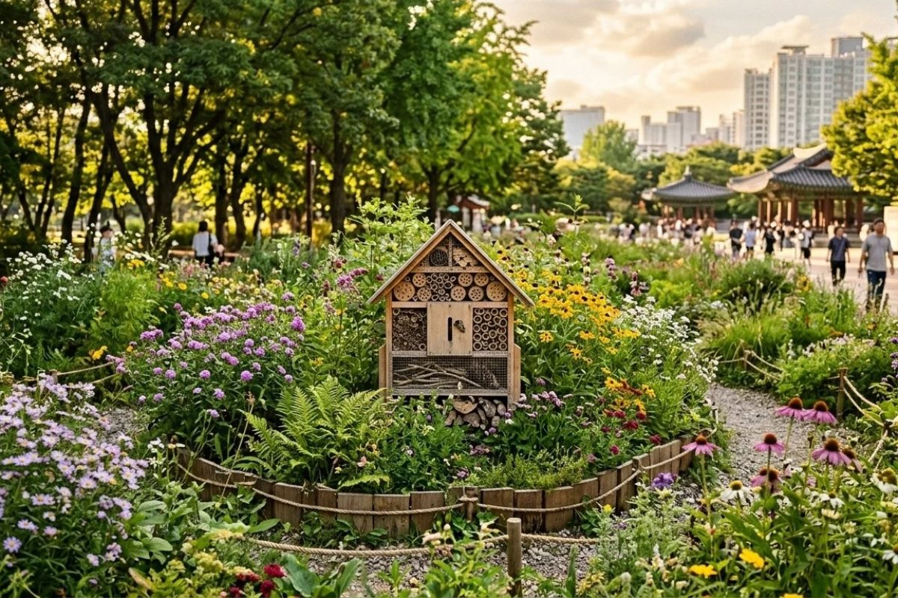
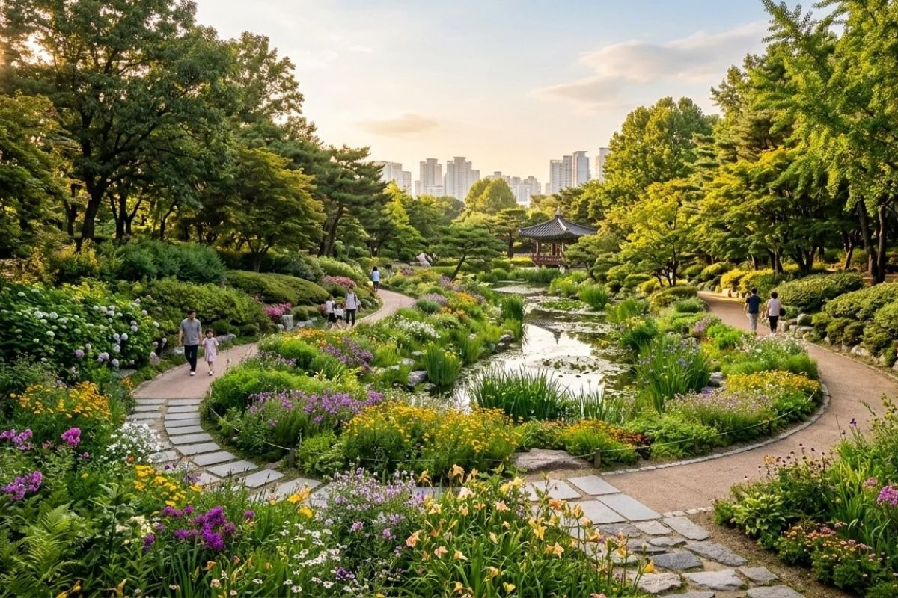

## 목차
1. [[마스터의 화두] "잘 다듬어진 잔디밭과 외래 관상수만 남은 공원에 왜 새소리와 나비의 날갯짓이 사라졌을까?: 서식처 단편화를 넘어선 생물다양성 공존과 정원 인문학의 본질"](#master-insight)
2. [[현장 진료 해부] 사계절 내내 잔디 깎기와 일괄 방제로 곤충과 텃새가 자취를 감췄던 도심 근린공원과 아파트 단지 녹지를, 자생 수종·밀원 초본 층위 조성과 낙엽·은신처 보전, 무농약 생태 관리 루틴으로 되살린 L 생태기획자의 실전 성공 사례](#success-case)
3. [[서식처 연결성·먹이그물 & 생태적 정원 3대 전략] 도시 단편화(파편화)와 디딤돌(Stepping Stone) 서식처로 새·수분매개곤충·식물을 잇는 먹이그물 매트릭스(인프라 모델) + 개화 시기 연속성과 자생 식물·은신처 층위를 조율하는 생물다양성 캘리브레이션(수익 모델) + 화학 약제 의존도를 낮추고 야생의 흔적을 품는 생태적 정원 가꾸기 퍼널(유입 경로) 3중 파이프라인 SOP](#pivoting-sop)
4. [[사전 준비 & 실행 프로토콜] 밀원·열매·은신처 자원 및 서식처 연결 동선 체크리스트와 소형 정원·단지 녹지 생물다양성 설계 템플릿 및 사후 조류·화분매개자 관찰 모니터링 루틴](#operation-sop)
5. [[마스터의 현장 노트] "수많은 도심 생태 정원을 걸으며 깨달은 완벽한 통제 대신 불완전한 공존이 주는 생명력"](#master-note)
6. [[실전 실행 가이드] 서식처 연결성과 먹이그물 이해, 생태적 정원 가꾸기 SOP를 생활권 정원·녹지에 적용하여 도심 생물다양성을 높이는 3대 필수 수칙](#solution)
7. [관련 시리즈 모아보기](#series)
8. [자주 묻는 질문 (FAQ)](#faq)

---

## 1. [마스터의 화두] "잘 다듬어진 잔디밭과 외래 관상수만 남은 공원에 왜 새소리와 나비의 날갯짓이 사라졌을까?: 서식처 단편화를 넘어선 생물다양성 공존과 정원 인문학의 본질"

"아침 산책길에 마주친 도심 공원이 자로 잰 듯 매끈한 잔디와 똑같은 모양의 관목으로 정돈되어 있는데도, 왠지 모르게 고요하고 생명력이 텅 빈 것처럼 느껴져 발걸음이 머뭇거려진 적이 없으십니까?"  

"수많은 도시 공간에서 **아스팔트 도로와 건물로 잘게 쪼개진 '서식처 단편화(Habitat Fragmentation)'와 지나친 획일화·청결 강박 때문에, 꽃가루를 옮기는 벌과 나비, 그리고 그 곤충과 열매를 먹이로 살아가는 작은 새들이 머물 자리와 먹이그물(Food Web)이 끊어지고 있다는 사실**을 직시하고 계시지 않습니까?"

수년간 도시숲의 생물다양성과 생태 정원 인문학을 탐구하며 확신한 절대적인 명제는 **'도심 공원과 정원이 진정한 생명의 그릇이 되려면, 단절된 녹지 조각들을 잇는 디딤돌(Stepping Stone) 서식처를 만들고, 사계절 먹이그물과 은신처를 품는 자생 식물·층위 구조를 설계하며, 인간 중심의 과도한 정돈을 내려놓는 생태적 정원 가꾸기 인문 SOP에 있다'**는 사실입니다.

이번 [기획 연재: 도시 생태계 & 나무 인문학 마스터 클래스 시즌 2] 제3부에서는 조류·수분매개곤충 서식처 연결성과 생태적 정원 가꾸기 인문 실무 SOP를 전격 공개합니다.

*밀원 식물과 층위 식재가 어우러진 도심 생태 공간 모습*

---

## 2. [현장 진료 해부] 사계절 내내 잔디 깎기와 일괄 방제로 곤충과 텃새가 자취를 감췄던 도심 근린공원과 아파트 단지 녹지를, 자생 수종·밀원 초본 층위 조성과 낙엽·은신처 보전, 무농약 생태 관리 루틴으로 되살린 L 생태기획자의 실전 성공 사례

도심 내 아파트 단지 경계 녹지와 근린공원 일부 구간의 생물다양성 복원 실전 사례입니다. 

해당 구역은 이른 봄부터 늦가을까지 짧은 주기의 기계 예초와 일괄적인 살충·제초 관리가 반복되면서 꽃이 피어날 여유가 없었고, 낙엽과 마른 가지조차 남김없이 치워져 벌·나비 등 수분매개곤충과 텃새가 먹이와 둥지·은신처를 찾기 어려웠습니다. 

L 생태기획자는 즉시 **도시 생물다양성 & 먹이그물 공존 SOP**를 가동했습니다. 먼저 녹지 가장자리의 일부 구간을 생태 구역으로 설정해 과도한 예초를 줄이고, 봄·여름·가을로 이어지는 개화 시기를 고려한 **자생 수종과 밀원 초본·관목 층위**를 도입했습니다. 

또한 새들이 쉴 수 있는 수관·관목 은신처와 자연 낙엽층을 일부 보전하고, 불필요한 일괄 약제 살포 대신 생태 균형을 해치지 않는 선별적 관리로 전환했습니다. 

그 결과 꽃을 찾는 벌·나비와 수관 사이를 오가는 소형 조류의 방문이 늘어나며 도심 속 생명의 먹이그물이 서서히 되살아났습니다.

> #### 🏆 획일적 관상·청결 위주 관리 대 마스터 서식처 연결·생태 정원 SOP 비교 매트릭스
>
> | 구분 | 획일적 관상·청결 위주 관리 (생물다양성 축소형) | 마스터 서식처 연결·생태 정원 SOP (L 기획자 모델) |
> | :--- | :--- | :--- |
> | **식생 다양성 및 층위** | 소수 관상 수종과 단일 잔디 위주로 꽃·열매·은신처 자원 부족 | **교목·아목·관목·초본 층위와 자생 수종·밀원 식물 조합으로 먹이그물 지지** |
> | **공간 연결성** | 고립된 작은 화단이나 단절된 녹지 조각으로 야생 이동 통로 부족 | **인접 공원·가로수·정원을 잇는 디딤돌(Stepping Stone) 서식처 역할 강화** |
> | **정원 관리 태도** | 낙엽·고사목·자생 풀을 모두 '지저분함'으로 보아 일괄 제거·방제 | **서식처와 순환의 관점에서 일부 생태 구역을 보전하며 인간과 야생이 공존** |

---

## 3. [서식처 연결성·먹이그물 & 생태적 정원 3대 전략] 도시 단편화(파편화)와 디딤돌(Stepping Stone) 서식처로 새·수분매개곤충·식물을 잇는 먹이그물 매트릭스(인프라 모델) + 개화 시기 연속성과 자생 식물·은신처 층위를 조율하는 생물다양성 캘리브레이션(수익 모델) + 화학 약제 의존도를 낮추고 야생의 흔적을 품는 생태적 정원 가꾸기 퍼널(유입 경로) 3중 파이프라인 SOP

도심 속 작은 녹지 공간이 새와 곤충, 식물이 함께 숨 쉬는 생태 거점으로 거듭나려면 먹이그물 매트릭스, 생물다양성 캘리브레이션, 그리고 생태적 정원 퍼널을 결합한 3중 파이프라인 SOP를 가동해야 합니다.

*다층 식재와 자연스러운 동선이 결합된 생태 공원·정원 전경*

> #### 💡 도시숲, 생태 및 나무 인문학 시즌 2 제3부 핵심 3대 전략 SOP
> 

> 
> 1. **[인프라 모델 전략: 꽃과 열매, 곤충과 새가 서로를 떠받치는 '도시 먹이그물 및 디딤돌 서식처 매트릭스']**  
>    * 도시에서는 큰 숲 하나만으로는 모든 생물이 이동하고 번식하기 어렵기 때문에, 작은 공원·학교숲·가로수·개인 정원이 이어지는 **디딤돌 서식처(Stepping Stone Habitat)**의 역할이 큽니다.  
>    * ① **식물–수분매개곤충–조류의 연결:** 꽃의 꿀과 꽃가루는 벌·나비·등에 등 수분매개곤충의 에너지원이 되고, 수목의 잎과 열매, 그리고 곤충 애벌레는 소형 조류의 중요한 먹이가 됩니다. 새들은 다시 씨앗을 퍼뜨리며 숲의 재생을 돕습니다.  
>    * ② **자생 수종의 생태적 친화성:** 해당 지역 기후와 토양에 오랫동안 적응한 자생 수목과 초본은 지역 야생 곤충·조류와 공진화(Coevolution)한 먹이·서식 관계를 형성하므로 생물다양성 기반을 탄탄히 다지는 데 유리합니다.

> 2. **[수익 모델 전략: 계절 공백 없이 먹이와 은신처를 이어주는 '개화 연속성·층위 구조 캘리브레이션']**  
>    * 특정 계절에만 꽃이 피거나 한 가지 높이의 식물만 있으면 수분매개곤충과 조류가 머물 수 있는 기간이 짧아집니다.  
>    * **① 사계절 먹이 자원 연계:** 이른 봄꽃부터 여름·가을 밀원식물, 그리고 가을·겨울에 남는 열매·종자 자원까지 계절별로 이어지도록 식물을 조합하면 도시 야생생물의 생존 기반이 안정됩니다.  
>    * **② 수직 층위(교목·관목·지피)와 은신처:** 키 큰 나무는 둥지와 전망·차광을 제공하고, 중간 관목과 덤불은 포식자를 피할 은신처를 마련하며, 지피식물과 낙엽층은 지표 곤충과 토양 생물의 터전이 됩니다.

> 3. **[유입 경로 전략: 정원을 통제의 대상이 아닌 공존의 무대로 바꾸는 '생태적 정원 가꾸기 및 인문 공존 퍼널']**  
>    * 생태적 정원 인문학은 "인간이 모든 것을 깔끔하게 통제해야 한다"는 관점에서 벗어나, 자연의 순환과 생명의 흔적을 환대하는 태도에서 출발합니다.  
>    * **① 약제 사용 절제와 생태 균형:** 해충이 보일 때마다 광범위한 살충제를 뿌리면 해충을 먹는 익충과 수분매개곤충까지 함께 줄어들 수 있으므로, 발생 원인과 생태 균형을 살피며 개입을 최소화합니다.  
>    * **② 정돈된 구역과 야생 구역의 조화:** 사람이 걷고 쉬는 동선 주변은 안전하고 쾌적하게 정돈하되, 녹지 가장자리나 화단 일부에는 낙엽과 자생 식물이 숨 쉴 생태 구역을 두어 공존의 균형을 맞춥니다.  
>    * **③ 관찰과 이야기가 있는 정원:** 새소리와 꽃가루를 옮기는 곤충의 움직임을 기록하고 이웃과 나누며 도심 속 생태 감수성을 키우는 3단계 생태 정원 퍼널을 완성하세요.

---

## 4. [사전 준비 & 실행 프로토콜] 밀원·열매·은신처 자원 및 서식처 연결 동선 체크리스트와 소형 정원·단지 녹지 생물다양성 설계 템플릿 및 사후 조류·화분매개자 관찰 모니터링 루틴

개인 정원, 베란다·마당, 아파트 녹지, 소규모 공원에서 생물다양성을 높이기 위한 표준 운영 프로토콜입니다.

> #### ⚙️ 도시 생물다양성 및 생태적 정원 운영 3대 수칙
> 

> 
> 1. **[조성 전 먹이·은신처·안전 요소를 점검하는 '서식처 자원 및 안전 체크리스트' 매뉴얼]**  
>    * 계획·조성 전 ① 봄·여름·가을에 걸쳐 꽃과 열매·서식 자원이 단절되는 시기가 없는지 확인 ➔ ② 새와 곤충이 천적을 피할 수 있는 덤불·수관·지피식물 은신처가 확보되어 있는지 점검 ➔ ③ 보행로 시야 확보와 안전 기준을 해치지 않으면서 생태 구역을 배치할 수 있는지 확인하는 체크리스트를 준수하세요.

> 2. **[공간 규모와 여건에 맞춰 적용하는 '생태적 정원·단지 녹지 설계 템플릿' 캘리브레이션]**  
>    * 공간 적용 시 ① **소형 정원·마당:** 자생 관목·밀원 초본 식재 + 낙엽 멀칭 구역 조성 + 과도한 예초·약제 자제 ➔ ② **아파트 단지·근린공원:** 산책로와 분리된 생태 완충대 설정 + 교목·아목·관목 다층 식재 + 인접 녹지와의 연결성 고려 ➔ ③ **옥상·테라스 소규모 녹지:** 바람·일조 조건에 맞는 내건성·밀원 식물 선정 및 수분·토양 관리로 작은 디딤돌 역할 수행 템플릿을 적용하세요.

> 3. **[생물다양성 회복 흐름을 살피는 '방문 곤충·조류 및 식생 변화 사후 모니터링' 루틴]**  
>    * 조성·관리 후 ① 계절별로 꽃을 찾는 벌·나비 등 수분매개곤충과 나무·관목을 찾는 새들의 출현 양상 관찰 ➔ ② 일부러 남긴 생태 구역과 낙엽층이 과도한 잡초 번성이나 위생·안전 문제를 일으키지 않는지 점검 ➔ ③ 해마다 생태 구역의 식생 조화와 생물 방문 기록을 축적해 장기적인 정원 생태 지도로 활용하는 사후 관리 루틴을 정례화하세요.

---

## 5. [마스터의 현장 노트] "수많은 도심 생태 정원을 걸으며 깨달은 완벽한 통제 대신 불완전한 공존이 주는 생명력"

> #### 📝 [마스터 노트] 도시 생물다양성 및 생태적 정원 가꾸기 현장에서 체득한 실전 지혜
>
> * **첫 번째 지혜: "잎에 작은 벌레가 갉아먹은 흔적이 조금 있다고 해서 곧바로 생태가 무너진 것은 아니다. 그 흔적은 새가 찾아오고 먹이그물이 살아 있다는 신호일 수도 있다"**  
>   ➔ 모든 잎이 상처 하나 없이 완벽해야만 건강한 정원은 아닙니다. 약간의 흔적을 견딜 수 있는 회복탄력성이 생태 정원의 진짜 힘입니다.

> * **두 번째 지혜: "도심의 작은 화단 하나라도 주변 녹지와 이어질 때, 외로운 섬이 아니라 생명이 건너가는 다리가 된다"**  
>   ➔ 내 정원의 꽃 한 포기, 나무 한 그루가 도시 전체의 생태 지도를 조금씩 넓혀 갑니다.

> * **세 번째 지혜: "인간이 자연을 완전히 길들이려 할 때 정원은 박제가 되지만, 자연이 숨 쉴 틈을 내어줄 때 정원은 살아있는 이야기가 된다"**  
>   ➔ 조율과 절제 속에서 피어나는 생태적 정원은 도시를 살아가는 우리에게 가장 깊은 울림을 줍니다.

---

## 6. [실전 실행 가이드] 서식처 연결성과 먹이그물 이해, 생태적 정원 가꾸기 SOP를 생활권 정원·녹지에 적용하여 도심 생물다양성을 높이는 3대 몰입 수칙

1. **서식처 단편화를 줄이는 디딤돌 연결성과 식물–곤충–조류 먹이그물 구조 이해 및 적용**  
   고립된 녹지 조각을 연결하고 다층 식재와 자생 수종·밀원 자원을 조화롭게 배치.
2. **계절별 먹이 자원과 수직 층위·은신처를 조율하는 생물다양성 캘리브레이션 실천**  
   개화 시기와 쉼터·은신처 구조를 함께 설계해 도심 야생생물이 머물 수 있는 생태 기반 강화.
3. **약제 절제와 생태 구역 보전을 통한 균형 잡힌 생태적 정원 가꾸기 루틴 확립**  
   생활 공간의 쾌적함과 생물다양성 보전이 공존하는 지속 가능한 도심 정원 문화 조성.

---

## 7. 관련 시리즈 모아보기

* **[기획 연재: 도시 생태계 & 나무 인문학 마스터 클래스 시즌 2. ①] [도시 열섬 저감 & 미기후 완충 생태 편] \"아스팔트 열기를 식히는 거대한 녹색 에어컨: 도시숲의 증발냉각·차광 메커니즘과 도심 미기후 설계 인문 SOP\"**  
  ➔ [도시 열섬 현상 완화, 나무 증발냉각 차광 원리, 도심 미기후 설계 인문 SOP](https://floraldays.com/ecostory-season2-heat-island-microclimate-part1)

* **[기획 연재: 도시 생태계 & 나무 인문학 마스터 클래스 시즌 2. ②] [토양 생태계 & 지하 네트워크(우드 와이드 웹) 편] \"땅속에서 조용히 연결된 숲의 통신망: 도시 토양 생물다양성, 균근균 공생과 복토·답압 스트레스 회복 인문 SOP\"**  
  ➔ [균근균 나무 뿌리 공생, 토양 답압 복토 피해, 도시 토양 생태계 회복 SOP](https://floraldays.com/ecostory-season2-soil-mycorrhizae-network-part2)

* **[기획 연재: 도시 생태계 & 나무 인문학 마스터 클래스 시즌 2. ③] [도시 생물다양성 & 먹이그물(새·곤충·식물) 공존 편] \"도심 공원 한 그루가 품은 작은 우주: 조류·수분매개곤충 서식처 연결성과 생태적 정원 가꾸기 인문 SOP\"**  
  ➔ 도시 생물다양성 서식처 연결성, 수분매개곤충 조류 먹이그물, 생태적 정원 가꾸기 SOP

---

## 8. 자주 묻는 질문 (FAQ)

**Q1. 도심 정원이나 공원에서 벌·나비 등 수분매개곤충과 새를 부르려면 외래 화려한 화훼류보다 자생 식물을 심는 것이 왜 중요한가요?**  

A1. '자생 식물은 오랜 시간 해당 지역의 기후·토양 조건과 함께 자리 잡아 왔기 때문에, 지역에 서식하는 벌·나비·곤충 유충과 새들이 먹이와 서식처로 이용하기에 구조적·생태적 궁합이 잘 맞는 경우가 많습니다. 

물론 공간 특성에 맞춰 관상·원예 식물을 조화롭게 활용할 수 있지만, 자생 수목과 밀원 초본을 기반으로 삼으면 화학적 관리 의존도를 줄이면서 지역 고유의 먹이그물과 생물다양성을 안정적으로 지탱하는 데 큰 도움이 됩니다'.

> 💡 도시 생물다양성 증진 및 생태 정원 조성 기준은 <a href="https://www.nihhs.go.kr" target="_blank" rel="noopener noreferrer">농촌진흥청 국립원예특작과학원</a>을 참고하시기 바랍니다.

**Q2. 정원이나 녹지에 낙엽이나 일부 야생 구역을 남겨두면 해충이 늘어나거나 주변 이웃에게 불편을 주지 않을까요?**  

A2. '적절한 관리 없이 방치만 하면 잡초 번성이나 배수 막힘, 통행 불편 같은 문제가 생길 수 있으므로, 무분별한 방치가 아니라 '계획된 생태 구역(Ecological Zone)'으로 운영하는 것이 중요합니다. 

보행로·출입구·건물 인접부 등 생활 불편이 생기기 쉬운 곳은 깔끔하게 관리하고, 화단 안쪽이나 수관 하부 일부에 낙엽 멀칭과 다층 식재를 적용하되 통풍과 배수 상태를 주기적으로 살피면 생태적 이점과 생활 쾌적성을 함께 지킬 수 있습니다'.

> 💡 스마트 홈가드닝 및 도시농업 정보는 <a href="https://www.modunong.or.kr" target="_blank" rel="noopener noreferrer">농림축산식품부 모두가 도시농부 포털</a>을 참고하세요.

---

