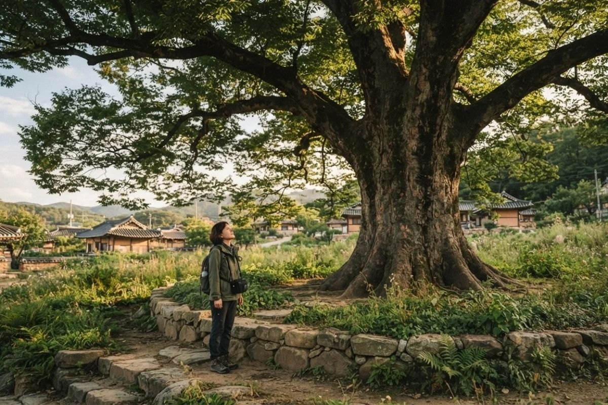
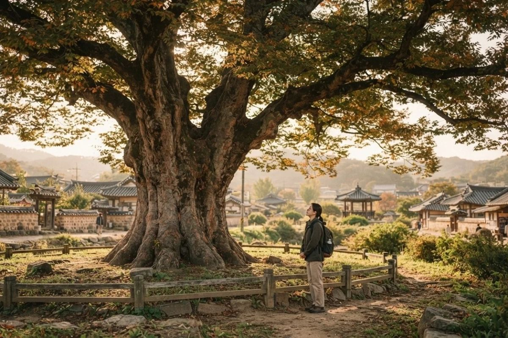

## 목차
1. [[마스터의 화두] "백 년 넘게 같은 자리를 지키며 마을의 기쁨과 슬픔을 품어온 노거수: 세월의 노화 생리와 기억의 장소 인문학의 본질"](#master-insight)
2. [[현장 진료 해부] 주변 도로 포장 확대와 방문객 답압, 가지 말라죽음(수관 쇠퇴)으로 활력이 떨어지던 마을 보호수·노거수를, 뿌리권 보호 경계 설정과 생육 환경 개선, 구술·역사 기록 결합 보전 루틴으로 지켜낸 L 생태기획자의 실전 성공 사례](#success-case)
3. [[노화 생리·쇠퇴 진단 & 인문 보전 3대 전략] 노거수·보호수의 목질부 방어(CODIT)·수관 노화·공동체 기억 가치를 읽는 생애주기 매트릭스(인프라 모델) + 뿌리권 침범·답압·상처 부패 위험을 조기에 포착하는 노거수 진단 캘리브레이션(수익 모델) + 생명력 보전과 마을 스토리텔링·세대 전승을 엮는 노거수 인문 보전 퍼널(유입 경로) 3중 파이프라인 SOP](#pivoting-sop)
4. [[사전 준비 & 실행 프로토콜] 뿌리 보호 반경·수관 고사지·토양 상태 체크리스트와 보호수·마을목 관리 템플릿 및 사후 생육·기록 모니터링 루틴](#operation-sop)
5. [[마스터의 현장 노트] "수많은 노거수와 보호수 앞에 서며 깨달은 시간의 무게와 인간이 지켜야 할 약속"](#master-note)
6. [[실전 실행 가이드] 노화 생리 이해와 뿌리권 보호, 공동체 기억 기록 SOP를 노거수·보호수 관리에 적용하여 오래된 나무와 함께 살아가는 3대 몰입 수칙](#solution)
7. [관련 시리즈 모아보기](#series)
8. [자주 묻는 질문 (FAQ)](#faq)

---

## 1. [마스터의 화두] "백 년 넘게 같은 자리를 지키며 마을의 기쁨과 슬픔을 품어온 노거수: 세월의 노화 생리와 기억의 장소 인문학의 본질"

"오랜 세월 한자리를 지키며 굵은 줄기와 깊은 주름, 듬직한 그늘을 드리운 노거수나 보호수 앞에 섰을 때, 그저 커다란 식물 한 그루를 넘어 **사람들의 삶과 시간, 마을의 역사가 켜켜이 쌓인 '살아있는 기억의 장소'**를 마주한 듯한 경외감을 느껴보신 적이 없으십니까?"  

"수많은 도시 개발과 생활 공간 변화 속에서 **나이가 들수록 수분 이동 거리와 방어 에너지 부담이 커지는 노거수의 생리적 특성을 간과한 채, 뿌리 가까이 포장하거나 밟고 지나가며 노화 속도를 앞당기고, 나무가 품은 지역의 이야기마저 잊혀 가게 만들고 있다는 사실**을 직시하고 계시지 않습니까?"

수년간 노거수·보호수의 생육 환경과 수목생리, 그리고 마을 공동체와 나무가 맺어온 인문학적 서사를 탐구하며 확신한 절대적인 명제는 **'백 년을 버틴 노거수와 보호수를 다음 세대로 이어주는 핵심은 나이에 따른 생리적 한계와 방어 원리를 존중하는 정밀 보호 관리, 뿌리권·토양·수관을 지키는 선제적 환경 보전, 그리고 나무에 얽힌 지역의 기억과 이야기를 기록·전승하는 인문 보전 SOP에 있다'**는 사실입니다.

이번 [기획 연재: 도시 생태계 & 나무 인문학 마스터 클래스 시즌 2] 제4부에서는 노거수·보호수의 노화 생리와 마을 공동체·기억의 장소 인문 실무 SOP를 전격 공개합니다.

<figure style="text-align: center; margin: 32px 0;">
  
  <figcaption style="font-size: 0.9rem; color: #6C7A72; margin-top: 12px; font-style: normal;">세월의 흔적과 풍성한 수관을 품은 오래된 큰 나무</figcaption>
</figure>

---

## 2. [현장 진료 해부] 주변 도로 포장 확대와 방문객 답압, 가지 말라죽음(수관 쇠퇴)으로 활력이 떨어지던 마을 보호수·노거수를, 뿌리권 보호 경계 설정과 생육 환경 개선, 구술·역사 기록 결합 보전 루틴으로 지켜낸 L 생태기획자의 실전 성공 사례

마을의 정자목이자 지역 주민들의 오랜 쉼터였던 노거수·보호수 생육 회복 및 인문 기록 실전 사례입니다. 

해당 노거수는 세월이 흐르면서 주변에 보행로와 주차·진입 공간이 조성되고 방문객 발길이 늘어나며 뿌리 주변 토양이 다져졌고, 수관 상단과 외측 가지 끝부분에서 잎이 작아지거나 고사지가 늘어나는 쇠퇴 징후가 나타났습니다. 

동시에 나무와 관련된 옛이야기나 마을 행사의 기억 역시 세대 교체가 이어지며 점차 희미해지고 있었습니다. 

L 생태기획자는 즉시 **노거수·보호수 생애주기 & 인문 보전 SOP**를 가동했습니다. 

먼저 수관 투영 면적을 기준으로 뿌리권 보호 공간을 설정해 무분별한 답압과 토양 훼손을 줄이고, 통기성과 수분 순환을 돕는 토양 환경 개선 및 위험·고사지 정리를 병행했습니다. 

아울러 지역 어르신과 주민들의 기억 속에 남은 나무의 유래와 계절 풍경, 공동체 모임 이야기를 채록해 안내판과 기록물로 남겼습니다. 

그 결과 뿌리권 스트레스가 완화되며 생육 활력이 안정되었고, 마을 주민들에게도 나무를 단순한 '오래된 조형물'이 아닌 함께 지켜야 할 '공동체의 유산'으로 인식하는 변화가 자리 잡았습니다.

> #### 🏆 단편적 미관·방치 위주 관리 대 마스터 생육 보호·기억 전승 인문 SOP 비교 매트릭스
>
> | 구분 | 단편적 미관·방치 위주 관리 (쇠퇴·망각 가속형) | 마스터 생육 보호·기억 전승 인문 SOP (L 기획자 모델) |
> | :--- | :--- | :--- |
> | **생육 및 뿌리 관리** | 뿌리 주변 포장·답압과 방치를 거듭해 노화 수목의 수분·양분 이동 부담 가중 | **뿌리권 보호 공간 확보, 토양 공극·수분 순환 유지, 무리한 훼손 방지로 수세 안정화** |
> | **손상 및 노화 대응** | 고사지 방치 또는 과도한 강전정으로 나무의 방어 체계와 균형 손상 | **노화 생리와 목질부 방어 원리를 고려한 신중한 관리 및 전문가 진단 연계** |
> | **인문·공동체 가치** | 나무의 연혁·이야기 기록 없이 방치되어 세대 간 기억 단절 | **구술·역사·계절 기록을 남기고 주민 참여로 '기억의 장소' 가치 계승** |

---

## 3. [노화 생리·쇠퇴 진단 & 인문 보전 3대 전략] 노거수·보호수의 목질부 방어(CODIT)·수관 노화·공동체 기억 가치를 읽는 생애주기 매트릭스(인프라 모델) + 뿌리권 침범·답압·상처 부패 위험을 조기에 포착하는 노거수 진단 캘리브레이션(수익 모델) + 생명력 보전과 마을 스토리텔링·세대 전승을 엮는 노거수 인문 보전 퍼널(유입 경로) 3중 파이프라인 SOP

노거수와 보호수가 오랜 시간 건강하게 살아가고 마을의 기억과 함께 숨 쉬려면 생애주기 매트릭스, 노거수 진단 캘리브레이션, 그리고 노거수 인문 보전 퍼널을 결합한 3중 파이프라인 SOP를 가동해야 합니다.

<figure style="text-align: center; margin: 32px 0;">
  
  <figcaption style="font-size: 0.9rem; color: #6C7A72; margin-top: 12px; font-style: normal;">세월을 견디며 굵은 줄기와 수관을 이룬 오래된 큰 나무</figcaption>
</figure>

> #### 💡 도시숲, 생태 및 나무 인문학 시즌 2 제4부 핵심 3대 전략 SOP
> 

> 
> 1. **[인프라 모델 전략: 노화의 생리와 세월이 쌓은 기억을 함께 읽는 '노거수·보호수 생애주기 매트릭스']**  
>    * 노거수는 어린 묘목과 달리 수고가 높고 뿌리에서 잎 끝까지 물과 양분을 끌어올리는 경로가 길며, 그동안 겪은 상처와 환경 변화의 이력을 몸속에 간직하고 있습니다.  
>    * ① **노화 생리와 목질부 방어(CODIT):** 나이가 들면서 신초 생장 속도가 점차 느려지고 수관 외곽의 활력이 떨어질 수 있습니다. 나무는 상처나 부패가 생겼을 때 이를 내부로 넓게 퍼뜨리지 않으려 벽을 쌓아 방어(CODIT, 목질부 부패 구획화 원리)하지만, 방어력이 약해지거나 큰 상처가 생기면 내부 공동이나 부패가 진행될 수 있으므로 과도한 상처 유발을 피해야 합니다.  
>    * ② **기억의 장소와 공동체 인문학:** 마을 입구, 당산·정자, 골목이나 학교 곁에 선 노거수는 혼례·명절·휴식·이별의 풍경을 지켜본 목격자입니다. 나무를 돌보는 일은 곧 지역의 정체성과 사람의 온기를 지키는 일입니다.

> 2. **[수익 모델 전략: 노거수 쇠퇴의 신호를 놓치지 않는 '뿌리권·수관·상처 위험 진단 캘리브레이션']**  
>    * 노거수는 회복 여력이 어린 나무보다 제한적이므로 작은 스트레스 신호를 일찍 알아차리는 것이 중요합니다.  
>    * **① 뿌리권 환경 점검:** 수관 주변 토양이 굳어 있거나 복토·포장·굴착 공사가 이루어졌는지, 배수 불량이나 과습·건조가 반복되는지 살핍니다.  
>    * **② 수관 활력과 손상 부위 확인:** 잎 크기 축소, 잎 변색, 가지 끝 고사(Dieback), 큰 가지 갈라짐이나 수피 박리·부패 징후가 있는지 관찰하고, 위험이나 병해충 징후가 보일 때는 임의 처치보다 전문 수목 진단·관리를 연계합니다.

> 3. **[유입 경로 전략: 나무의 생명과 마을의 이야기를 다음 세대로 잇는 '노거수 인문 보전 및 기록 퍼널']**  
>    * 노거수 보전은 물리적 보호 울타리만으로는 완성되지 않으며, 사람들이 나무를 이해하고 아끼는 문화가 함께 자랄 때 지속됩니다.  
>    * **① 생활 공간과 뿌리권의 조화:** 방문객이 안전하게 나무를 바라보고 쉴 수 있으면서도 뿌리 주변 흙이 짓눌리지 않도록 완충 동선을 설계합니다.  
>    * **② 역사·구술·계절 기록 축적:** 나무의 수령·수종·유래뿐 아니라 마을 어르신의 기억, 사계절 변화 사진과 관찰 기록을 남겨 '살아있는 기록물'로 가꿉니다.  
>    * **③ 공동체 돌봄과 세대 전승:** 지역 주민과 청소년이 계절마다 나무를 살피고 이야기를 나누며 다음 세대에 그 돌봄의 태도를 물려주는 3단계 노거수 인문 보전 퍼널을 완성하세요.

---

## 4. [사전 준비 & 실행 프로토콜] 뿌리 보호 반경·수관 고사지·토양 상태 체크리스트와 보호수·마을목 관리 템플릿 및 사후 생육·기록 모니터링 루틴

노거수나 보호수, 마을의 오래된 큰 나무를 살피고 보전하기 위한 표준 운영 프로토콜입니다.

> #### ⚙️ 노거수·보호수 생태 보전 및 인문 기록 운영 3대 수칙
> 

> 
> 1. **[현장 점검 시 생육 위협과 안전 요소를 함께 살피는 '노거수 환경·수관 체크리스트' 매뉴얼]**  
>    * 현장 확인 시 ① 수관 아래 토양의 답압·포장·배수 상태와 주변 공사·굴착 흔적 여부 점검 ➔ ② 수관 내 말라 죽은 가지(고사지), 갈라진 가지, 수피 손상·병해충 흔적 유무 확인 ➔ ③ 보행로·시설물 인근에서 낙지(떨어지는 가지) 등 안전 위험 요소가 있는지 함께 살피는 체크리스트를 준수하세요.

> 2. **[나무의 상태와 지역 맥락에 맞춰 적용하는 '노거수 보전·인문 기록 템플릿' 캘리브레이션]**  
>    * 관리·기록 시 ① **생육 안정기:** 뿌리권 보호, 토양 유기물·수분 균형 유지, 불필요한 상처 유발 금지 ➔ ② **쇠퇴·손상 징후 발견 시:** 무리한 자가 처치 대신 전문 수목진단 및 적정 보전 조치 연계 ➔ ③ **인문·스토리텔링 기록:** 나무의 위치·특징과 함께 지역 역사, 주민 기억, 계절별 관찰 노트를 체계적으로 정리하는 템플릿을 적용하세요.

> 3. **[장기적인 수세 변화와 기억 자산을 이어가는 '계절별 생육·기록 사후 모니터링' 루틴]**  
>    * 보전 활동 후 ① 봄철 새순 전개와 여름철 잎 활력, 가을철 낙엽·결실 양상, 겨울철 수관 상태를 연중 비교 관찰 ➔ ② 촬영 사진과 현장 메모를 날짜별로 누적해 수세 변화 추이를 파악 ➔ ③ 지역 주민·이해관계자와 정기적으로 상태를 공유하며 보호 기준과 기록을 갱신하는 사후 관리 루틴을 정례화하세요.

---

## 5. [마스터의 현장 노트] "수많은 노거수와 보호수 앞에 서며 깨달은 시간의 무게와 인간이 지켜야 할 약속"

> #### 📝 [마스터 노트] 노거수·보호수 생애주기와 인문학 현장에서 체득한 실전 지혜
>
> * **첫 번째 지혜: "오래된 나무를 지키는 일은 과거를 박제하는 것이 아니라, 그 나무가 앞으로 살아갈 시간을 지켜주는 일이다"**  
>   ➔ 노거수의 진정한 가치는 낡은 흔적 그 자체보다 지금도 새 잎을 피워내며 숨 쉬고 있는 현재의 생명력에 있습니다.

> * **두 번째 지혜: "나무는 말없이 서 있지만, 잎의 크기와 가지의 끝, 뿌리 주변의 흙을 자세히 보면 백 년의 세월이 건네는 신호가 보인다"**  
>   ➔ 성급한 판단보다 세심한 관찰이 노거수를 지키는 가장 든든한 첫걸음입니다.

> * **세 번째 지혜: "한 그루의 노거수가 남긴 그늘 아래서 세대가 이어질 때, 도시는 비로소 시간을 견디는 깊이를 갖게 된다"**  
>   ➔ 나무를 아끼는 마음은 결국 우리가 살아가는 땅과 공동체를 아끼는 마음과 맞닿아 있습니다.

---

## 6. [실전 실행 가이드] 노화 생리 이해와 뿌리권 보호, 공동체 기억 기록 SOP를 노거수·보호수 관리에 적용하여 오래된 나무와 함께 살아가는 3대 필수 수칙

1. **노거수·보호수의 노화 생리와 방어 특성, 그리고 '기억의 장소'로서의 인문 가치 이해**  
   단순한 큰 나무를 넘어 생태적·문화적 자산을 품은 존재로 바라보는 관점 정립.
2. **뿌리권 보호 공간 확보와 토양·수관 상태 점검을 통한 노화 수목 스트레스 경감**  
   답압·포장·무분별한 훼손을 줄이고 생육 환경과 전문 진단을 조화롭게 연계.
3. **지역의 이야기와 계절 관찰 기록을 남기고 세대와 공유하는 인문 보전 루틴 확립**  
   나무의 생명력과 마을 공동체의 기억을 함께 다음 세대로 전승하는 지속 가능한 보전 문화 조성.

---

## 7. 관련 시리즈 모아보기

* **[기획 연재: 도시 생태계 & 나무 인문학 마스터 클래스 시즌 2. ①] [도시 열섬 저감 & 미기후 완충 생태 편] \"아스팔트 열기를 식히는 거대한 녹색 에어컨: 도시숲의 증발냉각·차광 메커니즘과 도심 미기후 설계 인문 SOP\"**  
  ➔ [도시 열섬 현상 완화, 나무 증발냉각 차광 원리, 도심 미기후 설계 인문 SOP](https://floraldays.com/ecostory-season2-heat-island-microclimate-part1)

* **[기획 연재: 도시 생태계 & 나무 인문학 마스터 클래스 시즌 2. ②] [토양 생태계 & 지하 네트워크(우드 와이드 웹) 편] \"땅속에서 조용히 연결된 숲의 통신망: 도시 토양 생물다양성, 균근균 공생과 복토·답압 스트레스 회복 인문 SOP\"**  
  ➔ [균근균 나무 뿌리 공생, 토양 답압 복토 피해, 도시 토양 생태계 회복 SOP](https://floraldays.com/ecostory-season2-soil-mycorrhizae-network-part2)

* **[기획 연재: 도시 생태계 & 나무 인문학 마스터 클래스 시즌 2. ③] [도시 생물다양성 & 먹이그물(새·곤충·식물) 공존 편] \"도심 공원 한 그루가 품은 작은 우주: 조류·수분매개곤충 서식처 연결성과 생태적 정원 가꾸기 인문 SOP\"**  
  ➔ [도시 생물다양성 서식처 연결성, 수분매개곤충 조류 먹이그물, 생태적 정원 가꾸기 SOP](https://floraldays.com/ecostory-season2-biodiversity-foodweb-part3)

* **[기획 연재: 도시 생태계 & 나무 인문학 마스터 클래스 시즌 2. ④] [노거수·보호수의 생애주기와 인문학 편] \"백 년을 버틴 나무의 시간과 기억: 노거수·보호수의 노화 생리와 마을 공동체·기억의 장소 인문 SOP\"**  
  ➔ 노거수 보호수 관리, 노화 생리 목질부 방어, 마을 공동체 기억의 장소 인문 SOP

---

## 8. 자주 묻는 질문 (FAQ)

**Q1. 수령이 오래된 노거수나 보호수 주변에 흙을 다져 산책로를 만들거나 화단을 가꾸는 것이 나무에 도움이 될까요?**  

A1. '오래된 나무일수록 뿌리 주변 토양의 통기성과 수분 순환이 생육 유지에 매우 중요하므로, 수관 아래 토양을 다지거나 흙을 높이 쌓아 올리는 행위는 뿌리 호흡과 수분 흡수를 방해해 쇠퇴를 부를 수 있습니다. 

산책로나 휴식 공간은 뿌리권과 적절한 거리를 두거나 뿌리를 압박하지 않는 방식으로 배치하고, 토양의 자연스러운 숨구멍과 수분 균형을 지키는 방향으로 관리하는 것이 안전합니다'.

> 💡 노거수·보호수 생육 관리 및 수목진단 관련 기준은 <a href="https://www.nihhs.go.kr" target="_blank" rel="noopener noreferrer">농촌진흥청 국립원예특작과학원</a>을 참고하시기 바랍니다.

**Q2. 노거수에 말라 죽은 가지나 상처 난 부분이 보일 때, 일반 주민이나 초보자가 직접 톱이나 칼로 잘라내거나 발라주어도 되나요?**  

A2. '노거수나 보호수는 세월이 쌓인 만큼 생리적 회복 속도가 느리고, 잘못된 부위 절단이나 상처 유발은 부패균 침입이나 수세 악화로 이어질 수 있습니다. 

떨어질 위험이 있어 긴급히 살펴야 하는 경우라도 무리하게 깊게 자르거나 임의 처치를 하기보다는, 지자체·관리 주체나 수목진단 전문가의 진단을 거쳐 안전하고 적절한 방식으로 조치하는 것이 바람직합니다'.

> 💡 스마트 홈가드닝 및 도시농업 정보는 <a href="https://www.modunong.or.kr" target="_blank" rel="noopener noreferrer">농림축산식품부 모두가 도시농부 포털</a>을 참고하세요.

---

### 🎨 도시숲, 생태 및 나무 인문학 시즌 2 제4부 메인 이미지 영문 프롬프트 (텍스트 미포함)
> **A warm, cinematic editorial photograph capturing a majestic century-old veteran tree standing peacefully in a Korean village and park setting, with thick textured bark, wide spreading canopy, and dappled golden sunlight filtering onto natural ground cover and a gentle protective border. A Korean ecological heritage researcher quietly observes the ancient tree's canopy and root zone with respect, evoking deep historical memory, community warmth, and living heritage, shot on 85mm f/2.0 lens, rich natural greens and warm earthy tones, cinematic depth of field, no westerners, no foreign text, no letters, no words, no logos, 16:9**

---

