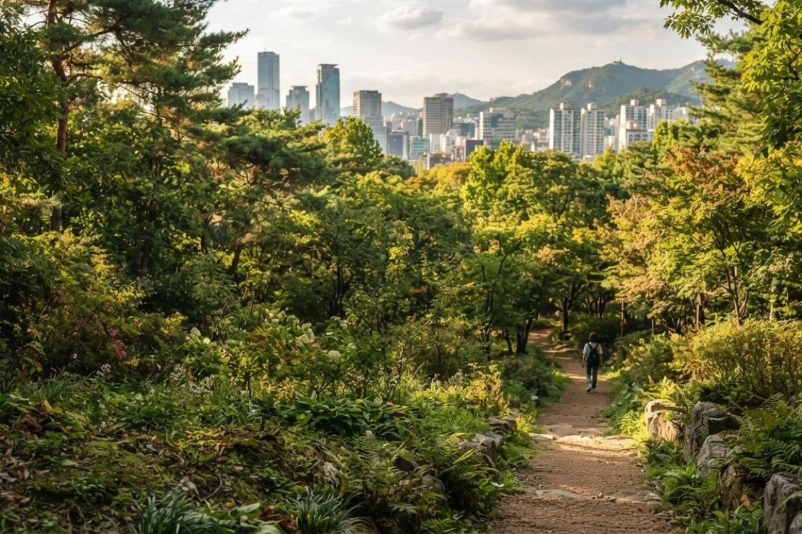
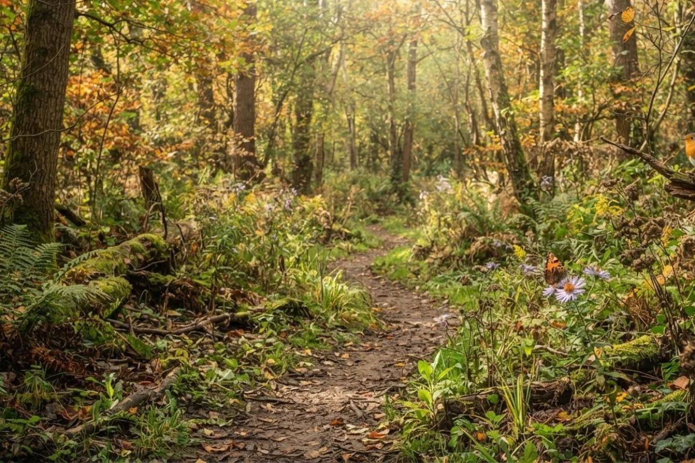

## 목차
1. [[마스터의 화두] "극한 호우와 가뭄, 이상고온이 일상이 된 불확실성의 시대: 도시숲의 탄소·적응 한계를 넘어 회복탄력성과 생태 윤리를 묻는 본질"](#master-insight)
2. [[현장 진료 해부] 특정 단일 수종 편중과 극단 기상(폭염·국지성 호우·병해충) 스트레스로 생육 불안정이 커지던 도심 공원·가로수 구역을, 기후 취약성 점검과 수종 다변화(10-20-30 규칙), 시민 참여형 모니터링 루틴으로 전환한 L 생태기획자의 실전 성공 사례](#success-case)
3. [[기후 적응·회복탄력성 & 생태 시민 3대 전략] 기후위기 속 도시숲의 탄소흡수·적응 기능과 한계, 수종 다양성(10-20-30 규칙)을 읽는 기후 적응 매트릭스(인프라 모델) + 취약 수종·극단 기상 리스크를 조기에 선별하는 회복탄력성 캘리브레이션(수익 모델) + 기술 통제를 넘어선 생태 윤리와 시민 참여형 모니터링을 엮는 생태 시민 퍼널(유입 경로) 3중 파이프라인 SOP](#pivoting-sop)
4. [[사전 준비 & 실행 프로토콜] 수종 편중·배수·취약성 체크리스트와 기후 적응 식재·관리 템플릿 및 사후 시민 참여형 생육·극단 기상 모니터링 루틴](#operation-sop)
5. [[마스터의 현장 노트] "수많은 기후위기 현장과 도시숲 복원 과정을 지켜보며 깨달은 한계의 수용과 공존의 지혜"](#master-note)
6. [[실전 실행 가이드] 기후 적응 기능과 한계의 이해, 수종 다양성·회복탄력성 캘리브레이션, 시민 참여형 생태 윤리 SOP를 도시숲 관리에 적용하여 지속가능한 공존을 이루는 3대 필수 수칙](#solution)
7. [관련 시리즈 모아보기](#series)
8. [자주 묻는 질문 (FAQ)](#faq)

---

## 1. [마스터의 화두] "극한 호우와 가뭄, 이상고온이 일상이 된 불확실성의 시대: 도시숲의 탄소·적응 한계를 넘어 회복탄력성과 생태 윤리를 묻는 본질"

"예측을 뛰어넘는 집중호우가 쏟아진 뒤 곧바로 긴 가뭄과 이상고온이 찾아오고, 과거엔 드물었던 병해충과 기상 이변이 반복되는 요즘, 도심의 나무와 숲을 바라보며 **'우리가 심은 나무들이 이 거친 변화 속에서 얼마나 오래 버틸 수 있을까?'**라는 질문을 던져보신 적이 없으십니까?"

"수많은 도시 녹지 현장에서 **나무를 만능 해결사처럼 여기며 탄소를 흡수하고 열기를 식혀줄 것이라 막연히 기대하거나, 반대로 기후위기를 오직 인공 기술과 통제 수단으로만 다스리려다 자연 고유의 한계와 회복탄력성(Resilience), 그리고 시민과 함께 지켜나갈 생태 윤리를 놓치고 있다는 사실**을 직시하고 계시지 않습니까?"

수년간 도시숲 생태계와 기후 적응 전략, 그리고 자연과 인간의 관계를 인문학적으로 탐구하며 확신한 절대적인 명제는 **'불확실성의 시대에 도시숲을 지키는 힘은 숲의 기능과 한계를 정직하게 인정하는 현실 감각, 특정 수종 쏠림을 줄이는 다양성과 회복탄력성 설계, 그리고 자연을 통제하기보다 함께 배우고 돌보는 생태 시민의 참여와 윤리 SOP에 있다'**는 사실입니다.

이번 [기획 연재: 도시 생태계 & 나무 인문학 마스터 클래스 시즌 2] 제5부 완결편에서는 기후변화 취약 수종 진단, 탄소흡수·회복탄력성과 생태 시민 인문 실무 SOP를 전격 공개합니다.

<figure style="text-align: center; margin: 32px 0;">
  
  <figcaption style="font-size: 0.9rem; color: #6C7A72; margin-top: 12px; font-style: normal;">다양한 수종과 생태적 층위가 어우러진 도시숲 풍경</figcaption>
</figure>

---

## 2. [현장 진료 해부] 특정 단일 수종 편중과 극단 기상(폭염·국지성 호우·병해충) 스트레스로 생육 불안정이 커지던 도심 공원·가로수 구역을, 기후 취약성 점검과 수종 다변화(10-20-30 규칙), 시민 참여형 모니터링 루틴으로 전환한 L 생태기획자의 실전 성공 사례

기후변화에 따른 고온 건조와 단시간 폭우, 병해충 변동성이 커지던 도심 공원 및 가로수 관리 개선 실전 사례입니다. 

해당 구역은 과거 조성 과정에서 특정 수종 비중이 지나치게 높았고, 극단 기상이 이어질 때마다 수분 스트레스나 배수·토양 교란, 병해충 발생 등 복합적인 부담을 겪고 있었습니다. 

또한 행정 중심의 일회성 점검만으로는 현장 변화를 세밀하게 포착하기 어려웠습니다. 

L 생태기획자는 즉시 **기후위기 적응 도시숲 & 생태 시민 SOP**를 가동했습니다. 

먼저 구역별 기후 취약성(고온·건조 노출, 침수·배수 취약, 수종 편중도)을 점검하고, 보완·갱신 식재 시 **10-20-30 규칙(단일 종 10% 이하, 단일 속 20% 이하, 단일 과 30% 이하)**의 취지를 살려 수종 다양성을 넓히고 입지 적합성을 높였습니다. 

아울러 지역 주민과 생태 시민이 계절별 잎 상태, 가뭄·호우 후 토양 및 수목 변화, 병해충·생물 흔적을 함께 기록·공유하는 시민 참여형 모니터링 체계를 도입했습니다. 

그 결과 특정 수종에 집중되던 위험이 분산되었고, 현장의 이상 징후를 더 일찍 발견해 대응하는 지속 가능한 공존 기반이 마련되었습니다.

> #### 🏆 단일 수종 편중·일방 관리 대 마스터 수종 다변화·회복탄력성·시민 참여 SOP 비교 매트릭스
>
> | 구분 | 단일 수종 편중·일방 관리 (취약·소모형) | 마스터 수종 다변화·회복탄력성·시민 참여 SOP (L 기획자 모델) |
> | :--- | :--- | :--- |
> | **수종 구성 및 적응성** | 소수 수종 위주 식재로 이상기후·병해충 발생 시 동시 피해 위험 확대 | **입지 적합 수종과 10-20-30 규칙 등 다양성 원칙으로 리스크 분산** |
> | **기후 대응 관점** | 탄소 수치나 단기 미관만 강조하고 숲의 생육 한계·회복 시간 간과 | **탄소 저장·적응 기능과 한계를 함께 고려해 회복탄력성(Resilience) 강화** |
> | **참여 및 윤리 구조** | 전문가·관리자 중심 일방향 관리로 생활권 변화 포착 지연 | **생태 시민 모니터링과 공존 윤리로 지역과 함께 숲을 돌보는 체계 구축** |

---

## 3. [기후 적응·회복탄력성 & 생태 시민 3대 전략] 기후위기 속 도시숲의 탄소흡수·적응 기능과 한계, 수종 다양성(10-20-30 규칙)을 읽는 기후 적응 매트릭스(인프라 모델) + 취약 수종·극단 기상 리스크를 조기에 선별하는 회복탄력성 캘리브레이션(수익 모델) + 기술 통제를 넘어선 생태 윤리와 시민 참여형 모니터링을 엮는 생태 시민 퍼널(유입 경로) 3중 파이프라인 SOP

기후위기 시대에 도시숲이 본연의 역할을 다하고 오래도록 살아남으려면 기후 적응 매트릭스, 회복탄력성 캘리브레이션, 그리고 생태 시민 퍼널을 결합한 3중 파이프라인 SOP를 가동해야 합니다.

<figure style="text-align: center; margin: 32px 0;">
  
  <figcaption style="font-size: 0.9rem; color: #6C7A72; margin-top: 12px; font-style: normal;">자연의 순환과 회복탄력성을 품은 생태 녹지 풍경</figcaption>
</figure>

> #### 💡 도시숲, 생태 및 나무 인문학 시즌 2 제5부 완결편 핵심 3대 전략 SOP
> 

> 
> 1. **[인프라 모델 전략: 도시숲이 감당할 수 있는 역할과 한계, 그리고 다양성의 힘을 읽는 '기후 적응 및 10-20-30 매트릭스']**  
>    * 도시숲은 광합성을 통한 탄소 고정·저장, 폭염 완화, 우수 유출 저감, 생물다양성 보전 등 다층적 기후 적응(Adaptation) 기능을 수행하지만, 도심 면적과 토양·기상 조건의 한계 속에서 모든 온실가스 배출을 대신 감당할 수는 없습니다.  
>    * ① **탄소흡수·적응 기능과 한계:** 나무가 건강하게 자랄수록 탄소 저장과 미기후 완충에 기여하지만, 극심한 가뭄·침수·고온이나 토양 훼손이 겹치면 생장이 둔화되거나 고사하여 오히려 기능이 떨어질 수 있습니다. 따라서 '나무를 많이 심는 것'만큼 '살아남고 자랄 수 있는 생육 조건을 만드는 것'이 중요합니다.  
>    * ② **수종 다양성(10-20-30 규칙):** 도시숲의 병해충이나 기후 스트레스로 인한 대규모 피해를 줄이기 위한 대표적인 다양성 원칙으로, **단일 수종(Species) 10% 이하, 단일 속(Genus) 20% 이하, 단일 과(Family) 30% 이하**로 구성하는 접근이 널리 참조됩니다. 특정 종이 흔들려도 다른 수종이 생태 기능과 경관을 떠받칠 수 있게 돕습니다.

> 2. **[수익 모델 전략: 흔들리더라도 다시 일어서는 힘을 키우는 '취약성 진단 및 회복탄력성 캘리브레이션']**  
>    * 회복탄력성(Resilience)은 외부 충격이 전혀 없는 상태를 뜻하기보다, 극단 기상이나 스트레스를 겪은 뒤에도 본래의 구조와 기능을 회복하고 적응해 나가는 능력을 말합니다.  
>    * **① 기후 취약성 진단:** 고온·건조가 심한 남향·포장 인접지, 집중호우 시 물이 고이기 쉬운 저지대·불투수 포장 주변, 병해충이나 고온·저온에 민감한 수종 등 취약 요소를 미리 파악합니다.  
>    * **② 수종 다변화와 생육 기반 조율:** 지역 기후와 토양에 맞는 수종을 폭넓게 조합하고, 뿌리 공간·배수·유기물 순환을 탄탄히 다져 극단 기상 후 회복 여력을 높입니다.

> 3. **[유입 경로 전략: 기술을 넘어선 생태 윤리와 생활 속 실천을 잇는 '생태 시민 및 참여형 모니터링 퍼널']**  
>    * 기후위기를 오직 첨단 기술과 통제 장치로만 해결하려는 시선은 자연의 한계 앞에서 쉽게 한계에 부딪힙니다. 생태 윤리는 자연을 지배하거나 완벽히 통제하려는 태도 대신, 자연의 리듬과 한계를 존중하며 함께 살아가는 책임을 묻습니다.  
>    * **① 통제에서 공존·생태 윤리로:** 나무와 숲을 '도구'로만 소모하지 않고, 생명의 한계와 회복 시간을 이해하며 과도한 개입을 절제하는 태도를 기릅니다.  
>    * **② 시민 참여형 모니터링:** 주민·자원봉사자·학습자가 일상 속에서 계절별 잎 상태, 폭우·가뭄 후 변화, 낙엽·생물 흔적 등을 관찰하고 기록하며 현장의 눈과 귀가 됩니다.  
>    * **③ 배움과 연대의 순환:** 기록된 관찰을 바탕으로 관리 방안을 함께 돌아보고 세대 간 생태 감수성을 나누는 3단계 생태 시민 퍼널을 완성하세요.

---

## 4. [사전 준비 & 실행 프로토콜] 수종 편중·배수·취약성 체크리스트와 기후 적응 식재·관리 템플릿 및 사후 시민 참여형 생육·극단 기상 모니터링 루틴

기후위기 시대에 맞춰 도시숲과 생활권 녹지의 취약성을 점검하고, 수종 다변화와 시민 참여형 모니터링을 운영하기 위한 표준 운영 프로토콜입니다.

> #### ⚙️ 지속가능한 도시숲 공존 및 생태 시민 운영 3대 수칙
> 

> 
> 1. **[현장의 약점과 편중 구조를 미리 파악하는 '기후 취약성·수종 다양성 체크리스트' 매뉴얼]**  
>    * 점검·계획 시 ① 특정 수종·속·과에 과도하게 편중되어 병해충이나 기상 스트레스에 취약한 구간이 없는지 확인 ➔ ② 폭염·가뭄 시 건조가 심한 곳과 집중호우 시 배수·침수가 우려되는 지형·토양 조건 점검 ➔ ③ 탄소·냉각 기대치와 실제 토양·수분·공간 여건이 균형을 이루고 있는지 확인하는 체크리스트를 준수하세요.

> 2. **[기후 변동성과 공간 여건에 맞춰 적용하는 '수종 다변화·적응 관리 템플릿' 캘리브레이션]**  
>    * 조성·보완 시 ① **신규·보완 식재:** 현지 기후·토양 적합성과 다양성 원칙(10-20-30 등)을 고려한 수종 다변화 및 건강한 근권 조성 ➔ ② **극단 기상 대응:** 폭염·가뭄기 토양 수분·차광·멀칭 관리와 호우·강풍 후 배수·지주·손상 상태 점검 ➔ ③ **휴면·회복기 관리:** 무리한 자극을 줄이고 자연스러운 회복과 순환을 지원하는 템플릿을 적용하세요.

> 3. **[현장 변화를 놓치지 않고 공동체 기록으로 남기는 '시민 참여형 모니터링 사후 관리' 루틴]**  
>    * 운영·참여 시 ① 계절 전환기 및 폭염·호우·한파 이후 수목의 잎 상태, 가지 손상, 토양 습윤·배수 상태를 사진과 메모로 기록 ➔ ② 시민 관찰 기록을 정리·공유해 관리 주체와 지역사회가 함께 취약 구간과 회복 과정을 파악 ➔ ③ 단기 행사에 그치지 않고 사계절 누적 기록을 다음 해 식재·관리 개선에 반영하는 사후 관리 루틴을 정례화하세요.

---

## 5. [마스터의 현장 노트] "수많은 기후위기 현장과 도시숲 복원 과정을 지켜보며 깨달은 한계의 수용과 공존의 지혜"

> #### 📝 [마스터 노트] 기후위기 적응 도시숲 및 생태 시민 현장에서 체득한 실전 지혜
>
> * **첫 번째 지혜: "나무는 도시의 모든 상처와 탄소를 대신 떠안아 주는 만능 방패가 아니라, 우리와 함께 살아가며 서로를 지탱하는 생명이다"**  
>   ➔ 나무에게 모든 문제를 떠넘기기보다, 나무가 살아갈 수 있는 흙과 물, 공간과 절제의 삶을 함께 만들어가야 합니다.

> * **두 번째 지혜: "한 가지 정답이나 한 가지 수종에만 기댈 때 숲은 흔들리지만, 서로 다른 생명이 어우러질 때 숲은 비바람 속에서도 다시 일어선다"**  
>   ➔ 다양성과 연결성은 자연이 오랜 시간 증명해 온 가장 단단한 회복탄력성의 비밀입니다.

> * **세 번째 지혜: "기후위기 시대의 진정한 생태 시민은 거창한 구호를 외치는 사람이 아니라, 오늘 내 곁의 나무 한 그루가 건네는 작은 신호를 살피고 기록하는 사람이다"**  
>   ➔ 일상 속 세심한 관찰과 돌봄의 손길이 모일 때, 불확실한 계절 속에서도 희망의 숲이 자라납니다.

---

## 6. [실전 실행 가이드] 기후 적응 기능과 한계의 이해, 수종 다양성·회복탄력성 캘리브레이션, 시민 참여형 생태 윤리 SOP를 도시숲 관리에 적용하여 지속가능한 공존을 이루는 3대 필수 수칙

1. **기후위기 시대 도시숲의 탄소 저장·기후 적응 기능과 한계, 그리고 수종 다양성(10-20-30 규칙 등)의 가치 이해**  
   단순 식재 수량이나 과도한 기대를 넘어 생육 기반과 다양성을 바탕으로 한 현실적 기후 적응 전략 수립.
2. **취약 수종·극단 기상 리스크 점검과 토양·수분·배수 관리를 통한 회복탄력성(Resilience) 강화**  
   고온·가뭄·호우 등 변화하는 환경 속에서 수목과 녹지가 스스로 회복하고 적응할 수 있는 여력 확보.
3. **기술 통제를 넘어선 생태 윤리와 시민 참여형 모니터링 루틴을 통한 지속가능한 공존 문화 조성**  
   자연의 한계를 존중하고 지역 시민의 관찰과 돌봄을 결합해 오래도록 이어지는 도시숲 생태계 구현.

---

## 7. 관련 시리즈 모아보기

* **[기획 연재: 도시 생태계 & 나무 인문학 마스터 클래스 시즌 2. ①] [도시 열섬 저감 & 미기후 완충 생태 편] \"아스팔트 열기를 식히는 거대한 녹색 에어컨: 도시숲의 증발냉각·차광 메커니즘과 도심 미기후 설계 인문 SOP\"**  
  ➔ [도시 열섬 현상 완화, 나무 증발냉각 차광 원리, 도심 미기후 설계 인문 SOP](https://floraldays.com/ecostory-season2-heat-island-microclimate-part1)

* **[기획 연재: 도시 생태계 & 나무 인문학 마스터 클래스 시즌 2. ②] [토양 생태계 & 지하 네트워크(우드 와이드 웹) 편] \"땅속에서 조용히 연결된 숲의 통신망: 도시 토양 생물다양성, 균근균 공생과 복토·답압 스트레스 회복 인문 SOP\"**  
  ➔ [균근균 나무 뿌리 공생, 토양 답압 복토 피해, 도시 토양 생태계 회복 SOP](https://floraldays.com/ecostory-season2-soil-mycorrhizae-network-part2)

* **[기획 연재: 도시 생태계 & 나무 인문학 마스터 클래스 시즌 2. ③] [도시 생물다양성 & 먹이그물(새·곤충·식물) 공존 편] \"도심 공원 한 그루가 품은 작은 우주: 조류·수분매개곤충 서식처 연결성과 생태적 정원 가꾸기 인문 SOP\"**  
  ➔ [도시 생물다양성 서식처 연결성, 수분매개곤충 조류 먹이그물, 생태적 정원 가꾸기 SOP](https://floraldays.com/ecostory-season2-biodiversity-foodweb-part3)

* **[기획 연재: 도시 생태계 & 나무 인문학 마스터 클래스 시즌 2. ④] [노거수·보호수의 생애주기와 인문학 편] \"백 년을 버틴 나무의 시간과 기억: 노거수·보호수의 노화 생리와 마을 공동체·기억의 장소 인문 SOP\"**  
  ➔ [노거수 보호수 관리, 노화 생리 목질부 방어, 마을 공동체 기억의 장소 인문 SOP](https://floraldays.com/ecostory-season2-veteran-trees-humanities-part4)

* **[기획 연재: 도시 생태계 & 나무 인문학 마스터 클래스 시즌 2. ⑤] [기후위기 적응 도시숲과 지속가능한 공존 편] \"불확실성의 시대에 숲이 건네는 지혜: 기후변화 취약 수종 진단, 탄소흡수·회복탄력성과 생태 시민 인문 SOP\"**  
  ➔ 기후변화 취약 수종 진단, 도시숲 탄소흡수 회복탄력성, 생태 시민 인문 SOP

---

## 8. 자주 묻는 질문 (FAQ)

**Q1. 도시숲을 조성하거나 가꿀 때 '10-20-30 규칙' 같은 수종 다양성 기준을 적용하면, 경관이 산만해지거나 관리가 더 어려워지지 않나요?**  

A1. '특정 수종 하나만 심으면 당장은 관리가 단순해 보일 수 있지만, 기후변화나 특정 병해충·병이 발생했을 때 한꺼번에 큰 피해를 입거나 경관이 통째로 무너지는 위험이 커집니다. 

수종 다양성 기준은 공간의 성격과 동선에 맞게 수종을 조화롭게 배치해 생태적 안정성과 회복탄력성을 높이기 위한 원칙이므로, 구역별 역할과 관리 기준을 잘 설계하면 오히려 장기적으로 더 안정적이고 풍성한 도시숲을 유지하는 데 도움이 됩니다'.

> 💡 기후변화 대응 도시숲·산림 적응 및 수목 관리 관련 자료는 <a href="https://www.nihhs.go.kr" target="_blank" rel="noopener noreferrer">농촌진흥청 국립원예특작과학원</a>을 참고하시기 바랍니다.

**Q2. 전문 지식이 없는 일반 시민도 도시숲 기후 적응과 모니터링에 어떻게 참여할 수 있나요?**  

A2. '거창한 전문 장비나 복잡한 조사가 아니더라도, 일상적으로 걷는 공원이나 가로수길, 단지 녹지에서 계절에 따른 잎의 색·활력 변화, 폭염이나 폭우 뒤 물 고임이나 가지 손상 여부, 새·곤충의 방문 모습 등을 사진과 날짜로 기록해 공유하는 것만으로도 소중한 현장 데이터가 됩니다. 

시민의 세심한 관찰이 쌓일수록 지역의 작은 변화를 빠르게 포착하고, 자연과 공존하는 생태 시민 문화를 함께 키워갈 수 있습니다'.

> 💡 스마트 홈가드닝 및 도시농업 정보는 <a href="https://www.modunong.or.kr" target="_blank" rel="noopener noreferrer">농림축산식품부 모두가 도시농부 포털</a>을 참고하세요.

---

