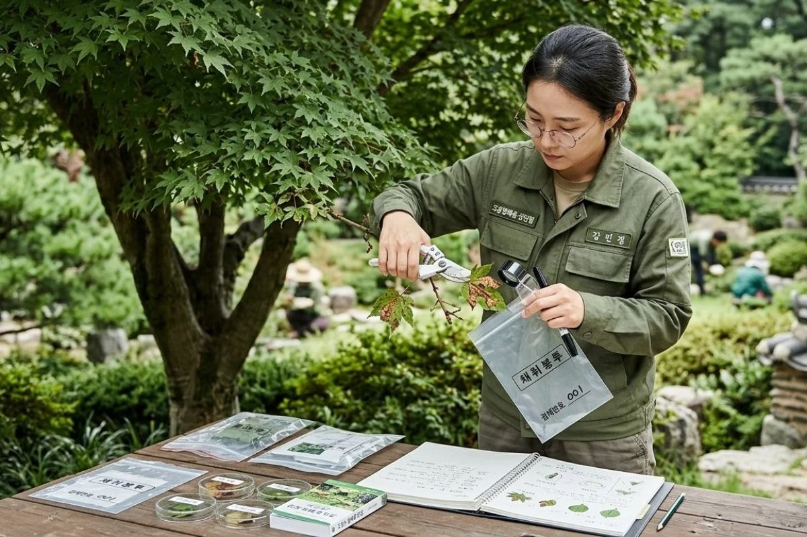
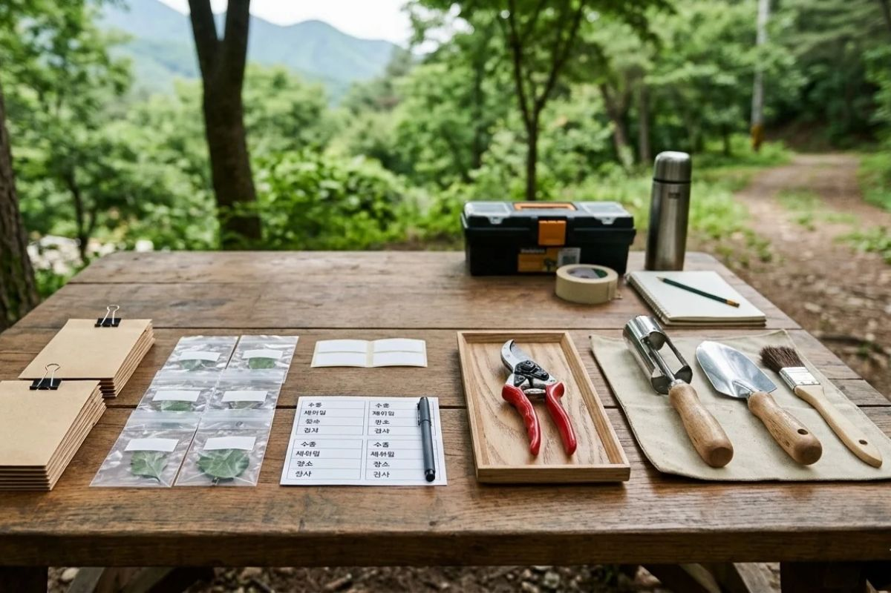

## 목차
1. [[마스터의 화두] "시료를 잘못 담으면 실험실과 현미경이 아무리 정밀해도 오진으로 흐른다: 현장 정밀 진단과 시료 채취 합격의 본질"](#master-insight)
2. [[현장 진료 해부] 잎과 토양 시료를 비닐봉지에 한꺼번에 밀봉해 보내 곰팡이 2차 증식과 수분 변질로 판독 불가 판정을 받던 현장 담당자를, 부위별 분리 포장·건습 조절·현장 기록 표준 SOP로 정밀 진단 성공률 100%에 올려놓은 K 수목진료 코치의 실전 성공 사례](#success-case)
3. [[현장 진단·시료 채취 & 이송 기록 3대 전략] 수관부터 근주부까지 놓치지 않는 현장 정밀 점검 매트릭스(인프라 모델) + 잎·가지·수피·토양의 변질과 교차 오염을 막는 부위별 채취·포장 캘리브레이션(수익 모델) + 진단 정확도를 완성하는 현장 기록·라벨링·신속 이송 퍼널(유입 경로) 3중 파이프라인 SOP](#pivoting-sop)
4. [[사전 준비 & 실행 프로토콜] 현장 진단 키트·채취 도구 준비 체크리스트와 부위별 시료 채취·포장 템플릿 및 사후 의뢰·결과 피드백 루틴](#operation-sop)
5. [[마스터의 현장 노트] "수많은 현장 의뢰 시료와 진단 기록지를 검토하며 깨달은 채취 위치와 포장 상태의 결정적 차이"](#master-note)
6. [[실전 실행 가이드] 현장 정밀 점검 순서와 부위별 시료 채취·포장 기준, 기록·라벨링 SOP를 현장 업무에 적용하여 진단 정확도를 높이는 3대 필수 수칙](#solution)
7. [관련 시리즈 모아보기](#series)
8. [자주 묻는 질문 (FAQ)](#faq)

---

## 1. [마스터의 화두] "시료를 잘못 담으면 실험실과 현미경이 아무리 정밀해도 오진으로 흐른다: 현장 정밀 진단과 시료 채취 합격의 본질"

"조경수나 정원수의 잎이 변색되고 가지가 말라 들어가는 현장에서, 정밀 검경이나 토양 분석을 의뢰하려고 잎과 흙을 급히 뜯어 비닐봉지에 한데 담아 보냈다가 **'시료 부패 및 2차 잡균 번식으로 정확한 판독이 어렵다'**는 회신을 받아 당황하신 적이 없으십니까?"

"수많은 현장 실무자와 초보 관리자들이 **진단의 성패가 이미 '현장에서 시료를 어떻게 관찰하고, 어느 경계 부위에서 채취해, 어떤 용기에 담아 보존하는가'에서 절반 이상 결정된다는 사실**을 간과하고 있다는 점을 직시하고 계시지 않습니까?"

수년간 수목진료 현장 사례와 병해충·토양 의뢰 시료의 판독 과정을 분석하며 확신한 절대적인 명제는 **'현장 정밀 진단과 시료 채취에서 흔들리지 않는 비결은 수관부터 근주부·토양까지 순서대로 살피는 현장 점검 기준, 잎·가지·수피·토양의 수분과 온도를 제어해 변질을 막는 부위별 채취·포장 원리, 그리고 위치·증상·이력을 누락 없이 남기는 기록·이송 SOP에 있다'**는 사실입니다.

이번 [기획 연재: 수목진료 및 병해충 실무 마스터 클래스 시즌 1] 제1부에서는 현장 정밀 진단과 시료 채취의 첫걸음—흙·잎·가지 시료를 망가뜨리지 않고 담는 실전 표준 작업 절차(SOP)를 전격 공개합니다.

<figure style="text-align: center; margin: 32px 0;">
  
  <figcaption style="font-size: 0.9rem; color: #6C7A72; margin-top: 12px; font-style: normal;">수목 진료 현장에서 잎·가지 시료 채취 전 병반 경계를 점검하는 모습</figcaption>
</figure>

---

## 2. [현장 진료 해부] 잎과 토양 시료를 비닐봉지에 한꺼번에 밀봉해 보내 곰팡이 2차 증식과 수분 변질로 판독 불가 판정을 받던 현장 담당자를, 부위별 분리 포장·건습 조절·현장 기록 표준 SOP로 정밀 진단 성공률 100%에 올려놓은 K 수목진료 코치의 실전 성공 사례

아파트 단지 및 공원 수목 관리 담당자의 현장 진단·시료 채취 프로토콜 개선 실전 사례입니다. 

해당 담당자는 여름철 소나무와 활엽수에서 잎 황화와 가지 마름 증상이 나타나자, 이미 완전히 말라 죽은 낙엽과 젖은 토양을 한 봉지에 함께 넣어 직사광선이 닿는 차량 트렁크에 보관한 뒤 의뢰했습니다. 

그 결과 이송 도중 시료가 짓무르고 2차 부생균이 뒤덮여 원래 병원균과 해충 흔적을 판독할 수 없는 상황이 발생했습니다. 

K 수목진료 코치는 즉시 **현장 정밀 진단 & 시료 채취 표준 SOP**를 도입했습니다. 

먼저 완전히 고사한 조직이 아닌 **건전부와 병반부가 만나는 진행 경계 부위**에서 시료를 채취하도록 기준을 바로잡았습니다. 

이어 잎·가지 시료는 마른 키친타월·신문지 등으로 적정 습도를 조절해 통기성이 확보된 종이봉투나 분리 용기에 담고, 토양 시료는 흙 묻음이 식물체에 닿지 않도록 별도 지퍼백에 분리 밀봉하며, 냉장·차광 보냉백으로 신속 이송하는 절차를 정착시켰습니다. 

그 결과 의뢰 시료의 원형 보존율이 획기적으로 높아져 1회 검경·분석만으로 정확한 원인을 규명하고 적기 처방을 내릴 수 있었습니다.

> #### 🏆 무분별 혼합 밀봉 채취 대 마스터 부위별 분리·경계 채취·보냉 이송 SOP 비교 매트릭스
>
> | 구분 | 무분별 혼합 밀봉 채취 (변질·오진 유발형) | 마스터 부위별 분리·경계 채취·보냉 이송 SOP (K 코치 모델) |
> | :--- | :--- | :--- |
> | **채취 위치 기준** | 이미 완전히 고사해 부패한 잎·가지나 표토 먼지만 대충 채취 | **건전부와 병반부가 맞닿은 진행 경계 부위 및 유효 근권부에서 채취** |
> | **포장 및 습도 관리** | 잎·가지·흙을 한 비닐봉지에 밀봉해 짓무름 및 2차 부생균 번식 | **식물체(건습 조절·분리 포장)와 토양(별도 밀봉)을 철저히 분리 보관** |
> | **기록 및 이송 방식** | 수종·위치·이력 기록 없이 고온 차량에 방치 후 지연 발송 | **현장 사진·라벨·관리 이력을 동봉하고 차광·보냉 상태로 신속 이송** |

---

## 3. [현장 진단·시료 채취 & 이송 기록 3대 전략] 수관부터 근주부까지 놓치지 않는 현장 정밀 점검 매트릭스(인프라 모델) + 잎·가지·수피·토양의 변질과 교차 오염을 막는 부위별 채취·포장 캘리브레이션(수익 모델) + 진단 정확도를 완성하는 현장 기록·라벨링·신속 이송 퍼널(유입 경로) 3중 파이프라인 SOP

현장 정밀 진단과 시료 채취에서 실패하지 않으려면 현장 정밀 점검 매트릭스, 부위별 채취·포장 캘리브레이션, 그리고 현장 기록·신속 이송 퍼널을 결합한 3중 파이프라인 SOP를 가동해야 합니다.

<figure style="text-align: center; margin: 32px 0;">
  
  <figcaption style="font-size: 0.9rem; color: #6C7A72; margin-top: 12px; font-style: normal;">교차 오염과 부패를 막기 위해 부위별로 분리 포장하는 현장 SOP 세팅</figcaption>
</figure>

> #### 💡 수목진료 및 병해충 실무 SOP 시즌 1 제1부 핵심 3대 전략 SOP
> 

> 
> 1. **[인프라 모델 전략: 나무 전체에서 국소 부위로 좁혀 들어가는 '현장 정밀 점검 매트릭스']**  
>    * 시료를 뜯기 전에 먼저 나무와 주변 환경을 거시적 시야에서 미시적 시야로 순서대로 스캔해야 진짜 원인을 놓치지 않습니다.  
>    * ① **주변 환경 및 수관 전체 관찰:** 식재 위치(도로변·보행로·배수 불량지·복토 구역), 인접 수목의 동시 피해 여부, 수관 상단·외곽·내부 중 어디부터 잎 황화·위조·고사지가 시작되었는지 살핍니다.  
>    * ② **줄기·수피·근주부 및 토양 점검:** 수피 균열·수지 유출·천공 구멍·버섯 자실체 여부를 확인하고, 근주부 매몰(복토) 여부와 토양 굳기(답압)·과습 상태를 점검한 뒤 시료 채취 대상을 확정합니다.

> 2. **[수익 모델 전략: 병원균·해충·토양의 원형을 그대로 보존하는 '부위별 채취·포장 캘리브레이션']**  
>    * 시료 종류에 따라 변질 원인이 다르므로 부위별 맞춤 채취·포장 기준을 엄격히 적용해야 합니다.  
>    * **① 잎·신초 시료:** 완전히 죽어 부패한 조직은 2차 잡균이 많아 판독을 방해하므로, **건전 조직과 병반 조직이 만나는 진행 경계 부위**의 잎을 여러 장 채취합니다. 물기를 닦아내고 마른 키친타월·신문지 사이에 끼워 평평하게 펴서 종이봉투나 통기성 봉투에 담습니다.  
>    * **② 가지·수피·해충 시료:** 가지마름·궤양·천공 부위는 병반 경계 아래 건전부까지 여유를 두고 절단하며, 절단면의 수분 증발과 곰팡이 증식을 막기 위해 신문지 등으로 감싸 분리 포장합니다. 해충·응애가 붙어 있을 때는 잎·가지째 채취해 통기 구멍이 있는 투명 용기에 담아 도주와 압사를 방지합니다.  
>    * **③ 토양·뿌리 시료:** 표면 낙엽·이물질을 걷어낸 뒤 수관 투영선 안쪽 유효 근권부(여러 지점 혼합 대표 시료)에서 채취하며, 흙이 잎·가지 시료를 오염시키지 않도록 **반드시 별도의 밀봉 지퍼백**에 담습니다.

> 3. **[유입 경로 전략: 현장의 맥락을 실험실과 처방전으로 전달하는 '현장 기록·라벨링·신속 이송 퍼널']**  
>    * 아무리 깨끗하게 채취한 시료라도 현장 정보가 빠지면 반쪽짜리 자료가 됩니다.  
>    * **① 현장 사진 촬영:** 채취 직전 전체 수형 사진 → 피해 부위 근접 사진 → 근주부·토양·주변 환경 사진을 순서대로 남깁니다.  
>    * **② 라벨링 및 이력 기록:** 시료 봉투 겉면에 유성펜으로 채취 일시, 수종, 위치, 채취 부위를 적고, 최근 약제 살포·시비·굴착·복토·제설제 살포 이력을 함께 기록합니다.  
>    * **③ 차광·보냉 신속 이송:** 직사광선과 고온 차량 내부 방치를 피하고, 아이스박스·보냉백(얼음팩이 시료에 직접 닿아 동해 입지 않도록 수건 등으로 분리)을 활용해 가급적 24-48시간 이내에 검경·분석을 진행합니다.

---

## 4. [사전 준비 & 실행 프로토콜] 현장 진단 키트·채취 도구 준비 체크리스트와 부위별 시료 채취·포장 템플릿 및 사후 의뢰·결과 피드백 루틴

수목진료 현장에서 시료 채취 실수와 재방문 번거로움을 없애기 위한 표준 운영 프로토콜입니다.

> #### ⚙️ 현장 정밀 진단 및 시료 채취·이송 실무 3대 수칙
> 

> 
> 1. **[출동 전 가방 속 장비를 점검하는 '현장 진단·채취 키트 체크리스트' 매뉴얼]**  
>    * 현장 출발 전 ① 소독용 알코올(70% 에탄올 등)·전정가위·접이식 톱·모종삽(토양 채취용)·루페(확대경) 준비 확인 ➔ ② 종이봉투·키친타월·신문지·투명 채집통·밀봉 지퍼백·유성펜·라벨지 구비 점검 ➔ ③ 현장 사진 촬영 장비와 보냉백·아이스팩 상태를 확인하는 체크리스트를 준수하세요. *(※ 다른 나무로 시료를 옮겨 채취할 때는 전정가위 날을 알코올로 소독해 병원균 전파를 차단합니다.)*

> 2. **[부위별 시료 형태에 맞춰 즉시 적용하는 '시료 채취·포장 표준 템플릿' 캘리브레이션]**  
>    * 현장 채취 시 ① **잎·초본성 신초:** 병반 경계부 채취 → 물기 제거 → 마른 키친타월·신문지 사이 평면 고정 → 종이봉투 보관 ➔ ② **목본 가지·수피·해충:** 경계부 여유 절단 → 신문지 완충 포장(해충은 통기 채집통 분리) → 별도 봉투 라벨링 ➔ ③ **토양·세근:** 표토 이물질 제거 후 다지점 근권 혼합 채취 → 식물 시료와 완전 분리된 지퍼백 밀봉 템플릿을 적용하세요.

> 3. **[분석 결과를 현장 처방과 다음 점검으로 연결하는 '의뢰·검경 결과 피드백 사후 모니터링' 루틴]**  
>    * 시료 이송 및 결과 회신 후 ① 현장 사진·관리 이력과 검경·토양 분석 결과를 대조해 1차 원인(비생물적·토양 요인)과 2차 원인(병해충)을 확정 ➔ ② 시료 채취 상태에 대한 피드백(과습·건조·채취 부위 적절성 등)을 작업 일지에 기록 ➔ ③ 처방 실행 후 동일 구역 수목의 회복 경과를 정기 모니터링하는 사후 관리 루틴을 정례화하세요.

---

## 5. [마스터의 현장 노트] "수많은 현장 의뢰 시료와 진단 기록지를 검토하며 깨달은 채취 위치와 포장 상태의 결정적 차이"

> #### 📝 [마스터 노트] 수목진료 현장 진단 및 시료 채취 실무에서 체득한 현장 지혜
>
> * **첫 번째 지혜: "이미 완전히 바싹 말라 죽은 잎은 범죄가 끝난 뒤의 빈집과 같다. 진짜 범인은 살아 있는 조직과 병든 조직이 맞닿는 경계선에 있다"**  
>   ➔ 진행 경계 부위를 채취해야 병원균과 해충의 생생한 흔적을 포착할 수 있습니다.

> * **두 번째 지혜: "젖은 흙과 잎을 한 비닐봉지에 넣는 순간, 그 봉지는 시료 보관함이 아니라 잡균 배양기가 된다"**  
>   ➔ 부위별 분리 포장과 습도 조절만 지켜도 오진 가능성을 획기적으로 줄일 수 있습니다.

> * **세 번째 지혜: "전정가위 날을 닦는 5초의 알코올 소독이 아픈 나무의 병을 건강한 나무로 옮기는 실수를 막는다"**  
>   ➔ 시료 채취 도구 위생은 수목진료 실무자가 지켜야 할 가장 기본적인 현장 윤리이자 안전 수칙입니다.

---

## 6. [실전 실행 가이드] 현장 정밀 점검 순서와 부위별 시료 채취·포장 기준, 기록·라벨링 SOP를 현장 업무에 적용하여 진단 정확도를 높이는 3대 필수 수칙

1. **주변 환경 → 수관 → 줄기·수피 → 근주부·토양 순으로 살피는 현장 정밀 점검 순서 확립**  
   지상부 증상만 보지 않고 토양·배수·복토·관리 이력까지 폭넓게 확인해 진단 단서 확보.
2. **진행 경계 부위 채취, 부위별 분리 포장, 건습 조절 및 전정가위 소독 원칙 준수**  
   잎·가지·해충·토양 시료의 변질과 교차 오염, 작업자 매개 전염을 철저히 차단.
3. **현장 사진·라벨링·관리 이력 기록과 차광·보냉 신속 이송 SOP 체화**  
   실험실 검경 및 토양 분석의 신뢰도를 높여 정확한 처방전 수립으로 연결.

---

## 7. 관련 시리즈 모아보기

* **[기획 연재: 수목진료 및 병해충 실무 마스터 클래스 시즌 1. ①] [현장 정밀 진단 & 시료 채취 실무 편] \"현장 정밀 진단과 시료 채취의 첫걸음: 흙·잎·가지 시료를 망가뜨리지 않고 담는 법\"**  
  ➔ [수목진료 현장 진단 순서, 잎 가지 토양 시료 채취 포장 이송 SOP](https://floraldays.com/sop-season1-field-diagnosis-sample-collection-part1)

---

## 8. 자주 묻는 질문 (FAQ)

**Q1. 현장에서 병든 잎이나 가지를 채취할 때, 비닐 지퍼백에 젖은 휴지를 함께 넣어 밀봉하면 더 싱싱하게 보존되지 않나요?**  

A1. '잎이나 가지 시료에 과도한 수분을 함께 넣어 밀봉하면 이송 중 온도가 오르면서 조직이 짓무르고, 원래 원인균이 아닌 2차 부생 곰팡이와 세균이 폭발적으로 증식해 정확한 판독이 어려워집니다. 

잎 시료는 표면 물기를 가볍게 제거한 뒤 마른 키친타월이나 신문지 사이에 끼워 종이봉투나 통기성 있는 봉투에 담아 서늘하게 이송하는 것이 가장 안전합니다'.

> 💡 수목진단 및 산림병해충 의뢰·관리 관련 공식 참고 자료는 <a href="https://www.nihhs.go.kr" target="_blank" rel="noopener noreferrer">농촌진흥청 국립원예특작과학원</a>을 참고하시기 바랍니다.

**Q2. 토양 분석을 위해 흙 시료를 채취할 때는 나무 밑 한 곳만 깊게 파서 담으면 되나요?**  

A2. '한 지점만 채취하면 국소적인 비료 뭉침이나 배수 편차 때문에 전체 근권 상태를 잘못 해석할 수 있습니다. 

표면의 낙엽과 잡초·자갈을 걷어낸 뒤, 수관 투영선 안쪽의 여러 지점(보통 3-5곳 이상)에서 유효 근권 깊이의 토양을 고르게 채취해 깨끗한 용기에서 잘 섞은 대표 시료를 별도 지퍼백에 담아 의뢰하는 것이 바람직합니다'.

> 💡 스마트 홈가드닝 및 도시농업 정보는 <a href="https://www.modunong.or.kr" target="_blank" rel="noopener noreferrer">농림축산식품부 모두가 도시농부 포털</a>을 참고하세요.

---

