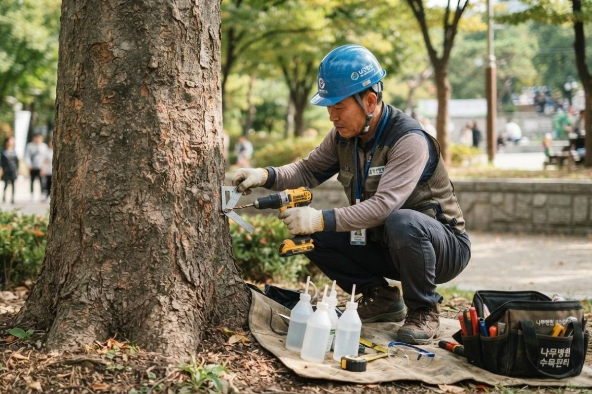
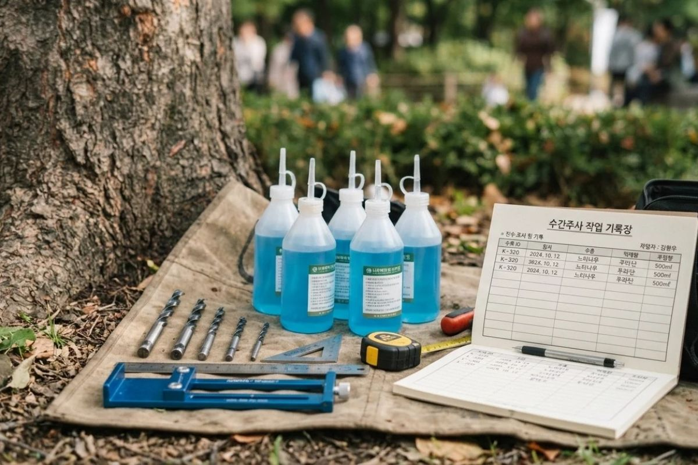

## 목차
1. [[마스터의 화두] "수간주사는 껍질에 구멍만 뚫어 약을 흘려보내는 단순 작업이 아니다: 수종·시기별 천공 각도와 깊이, 주입 원리가 방제 성패를 가르는 본질"](#master-insight)
2. [[현장 진료 해부] 무분별한 수직 천공과 과도한 주입압·시기 착오로 약액 역류와 수피 손상, 방제 편차를 겪던 현장 시공팀을, 수종·시기별 천공 기준과 단계별 주입·마감 SOP로 안정 시공에 올려놓은 K 수목진료 코치의 실전 성공 사례](#success-case)
3. [[수간주사 현장 시공 & 안전 3대 전략] 수종 특성과 수액 흐름을 반영하는 천공 각도·깊이·간격 매트릭스(인프라 모델) + 약액 주입·누출 제어와 상처 회복을 조율하는 현장 시공 캘리브레이션(수익 모델) + 생활권 안전과 사후 점검을 완성하는 현장 운영 퍼널(유입 경로) 3중 파이프라인 SOP](#pivoting-sop)
4. [[사전 준비 & 실행 프로토콜] 천공 공구·약제·보호구 점검 체크리스트와 수간주사 단계별 시공 템플릿 및 사후 주입구·수세 모니터링 루틴](#operation-sop)
5. [[마스터의 현장 노트] "수많은 수간주사 시공 현장과 천공 단면을 살피며 깨달은 각도·깊이·시기의 결정적 무게"](#master-note)
6. [[실전 실행 가이드] 수종·시기별 천공 기준과 약액 주입·누출 제어, 현장 안전·사후 점검 SOP를 현장 시공에 적용하여 방제 완성도를 높이는 3대 필수 수칙](#solution)
7. [관련 시리즈 모아보기](#series)
8. [자주 묻는 질문 (FAQ)](#faq)

---

## 1. [마스터의 화두] "수간주사는 껍질에 구멍만 뚫어 약을 흘려보내는 단순 작업이 아니다: 수종·시기별 천공 각도와 깊이, 주입 원리가 방제 성패를 가르는 본질"

"현장에서 수간주사를 시공할 때, 드릴 각도나 천공 깊이를 대충 어림잡아 뚫었다가 **약액이 바깥으로 줄줄 새어 나오거나, 목질부 상처가 깊어져 수액 이동이 매끄럽지 못했던 경험**이 없으십니까?"

"수많은 현장 실무자와 입문자들이 **수종마다 목질부·변재 특성과 수액 흐름이 다르고, 계절·생육 시기와 수세 상태에 따라 천공과 주입 조건을 달리해야 하는데도 '한 가지 방식 일괄 적용'으로 약액 손실과 불필요한 상처를 남기고 있다는 사실**을 직시하고 계시지 않습니까?"

수년간 수목진료 현장 시공 사례와 수간주사 운영 기준을 분석하며 확신한 절대적인 명제는 **'수간주사 현장 시공에서 흔들리지 않는 비결은 수종 특성과 생육 시기에 맞춘 천공 각도·깊이·간격 기준, 약액 누출과 과도한 조직 손상을 줄이는 주입·마감 원리, 그리고 생활권 안전과 사후 확인을 묶은 현장 SOP에 있다'**는 사실입니다.

이번 [기획 연재: 수목진료 및 병해충 실무 마스터 클래스 시즌 1] 제2부에서는 구멍을 뚫을 때도 각도와 깊이가 있다—수종·시기별 수간주사 현장 시공 SOP를 전격 공개합니다.

<figure style="text-align: center; margin: 32px 0;">
  
  <figcaption style="font-size: 0.9rem; color: #6C7A72; margin-top: 12px; font-style: normal;">수간주사 시공 전 천공 각도와 수피·근주부 상태를 확인하는 현장</figcaption>
</figure>

---

## 2. [현장 진료 해부] 무분별한 수직 천공과 과도한 주입압·시기 착오로 약액 역류와 수피 손상, 방제 편차를 겪던 현장 시공팀을, 수종·시기별 천공 기준과 단계별 주입·마감 SOP로 안정 시공에 올려놓은 K 수목진료 코치의 실전 성공 사례

공원 및 가로수·아파트 단지 병해충 방제 현장의 수간주사 시공 품질 개선 실전 사례입니다. 

해당 시공팀은 현장마다 수종과 수령, 생육 시기가 달랐음에도 동일한 각도와 깊이로 빠르게 구멍을 뚫고 약액을 밀어 넣는 방식을 고수했습니다. 

그 결과 일부 수목에서는 주입구 밖으로 약액이 흘러내려 수피 변색이나 주변 노출 우려가 생겼고, 시기가 어긋나거나 상처가 커진 개체에서는 약효 발현 편차와 구멍 주변 건조·변색 흔적이 남곤 했습니다. 

K 수목진료 코치는 즉시 **수종·시기별 수간주사 현장 시공 SOP**를 가동했습니다. 

먼저 시공 전 대상 수종의 방제 대상·시기를 확인하고, 수피 손상·부후·상처가 있는 부위를 피해 건전한 수간 하부에서 수종 특성에 맞는 천공 각도·깊이·간격을 적용하도록 기준을 세웠습니다. 

이어 천공 시 칩 배출과 날 과열을 관리하고, 약액 주입 속도와 누출 여부를 실시간으로 살피며 시공 후 주입구 관리 및 기록까지 한 흐름으로 묶었습니다. 

그 결과 약액 누출과 불필요한 조직 손상이 크게 줄어들고, 현장별 시공 일관성과 방제 신뢰도를 함께 높일 수 있었습니다.

> #### 🏆 일괄 천공·과속 주입 위주 시공 대 마스터 수종·시기별 천공·누출 제어 SOP 비교 매트릭스
>
> | 구분 | 일괄 천공·과속 주입 위주 시공 (누출·손상 유발형) | 마스터 수종·시기별 천공·누출 제어 SOP (K 코치 모델) |
> | :--- | :--- | :--- |
> | **천공 위치·각도·깊이** | 수종·부위 상태 무시한 임의 천공으로 약액 역류·과도한 상처 발생 | **수종·시기·상처 회피를 반영한 적정 각도·깊이·간격 기준 적용** |
> | **약액 주입 및 마감** | 누출·압력 상태를 살피지 않고 급하게 밀어 넣어 약액 손실 | **주입 상태·누출 여부 점검 후 규정량 주입 및 깔끔한 마감 처리** |
> | **안전 및 기록 관리** | 보행자·주변 노출 고려나 시공 이력 남김이 미흡 | **생활권 통제·보호구 착용·수종/일자/약량 기록으로 추적성 확보** |

---

## 3. [수간주사 현장 시공 & 안전 3대 전략] 수종 특성과 수액 흐름을 반영하는 천공 각도·깊이·간격 매트릭스(인프라 모델) + 약액 주입·누출 제어와 상처 회복을 조율하는 현장 시공 캘리브레이션(수익 모델) + 생활권 안전과 사후 점검을 완성하는 현장 운영 퍼널(유입 경로) 3중 파이프라인 SOP

수간주사 현장 시공에서 약효와 안전을 동시에 잡으려면 천공 각도·깊이·간격 매트릭스, 현장 시공 캘리브레이션, 그리고 현장 운영 퍼널을 결합한 3중 파이프라인 SOP를 가동해야 합니다.

<figure style="text-align: center; margin: 32px 0;">
  
  <figcaption style="font-size: 0.9rem; color: #6C7A72; margin-top: 12px; font-style: normal;">정확한 약량 계량과 공구 점검을 거친 수간주사 시공 세팅</figcaption>
</figure>

> #### 💡 수목진료 및 병해충 실무 SOP 시즌 1 제2부 핵심 3대 전략 SOP
> 

> 
> 1. **[인프라 모델 전략: 수액 이동과 목질부 특성을 살리는 '천공 각도·깊이·간격 매트릭스']**  
>    * 천공은 나무에 상처를 내는 행위이기도 하므로, 수액이 잘 흐르고 불필요한 손상을 줄이는 설계가 먼저입니다.  
>    * ① **수종·부위별 천공 설계:** 수종과 목질부(변재·수액 이동층) 특성, 수간 굵기·상태를 고려해 천공 각도와 깊이를 설정합니다. 지면과 수평에 가까운 각도나 완만한 하향·상향 경사 등 적용 기준에 맞춰 뚫되, 수피가 갈라진 틈이나 기존 상처·부후·융기부·지제부 과습 부위는 피하고 건전한 부위를 택합니다.  
>    * ② **시기·간격 기준 반영:** 방제 대상 병해충의 발생 시기와 수목의 수액 이동 활성 시기에 맞춰 시공 시기를 잡아야 약액이 수관으로 원활히 이동합니다. 수간 둘레에 따라 천공 간격을 균형 있게 배분해 한쪽에 구멍이 몰려 수액 이동 통로가 과도하게 끊기지 않도록 조절합니다.

> 2. **[수익 모델 전략: 약액 손실과 조직 스트레스를 줄이는 '주입·누출 제어 및 상처 관리 캘리브레이션']**  
>    * 구멍을 뚫은 뒤 약액을 넣고 마무리하는 과정에서도 세밀한 조절이 필요합니다.  
>    * **① 천공 및 칩 배출 관리:** 날카로운 드릴 비트를 사용하고, 뚫는 도중 목질부 칩(톱밥)이 구멍 안에 쌓여 약액 흡수를 막지 않도록 칩을 빼내며 정돈합니다. 마찰열이 과도하게 쌓이지 않도록 속도도 조절합니다.  
>    * **② 약액 주입 및 누출 제어:** 처방된 약량과 희석·제품 기준을 확인한 뒤 주입기를 장착하고, 주입 초기에 주입구 틈새로 약액이 새어 나오는지 살핍니다. 누출이 생기면 밀착 상태를 점검하거나 주입 속도·압력을 조정해 약액 낭비와 수피 오염을 막고, 주입 완료 후에는 지침과 현장 조건에 맞게 주입구를 마감합니다.

> 3. **[유입 경로 전략: 도심 현장 안전과 사후 확인을 잇는 '현장 운영 및 사후 점검 퍼널']**  
>    * 생활권 수목 시공은 주변 사람·반려동물·시설물 안전과 기록 관리까지 함께 챙겨야 완성됩니다.  
>    * **① 현장 안전 통제:** 작업 구역 안내·동선 분리와 개인보호구 착용을 기본으로 하고, 약액이 바닥이나 주변 식물에 떨어지지 않도록 주의합니다.  
>    * **② 시공 기록 남기기:** 수종, 위치, 시공 일자, 천공 수·위치, 사용 약제 및 주입량, 특이사항을 기록해 향후 진단과 방제 이력으로 활용합니다.  
>    * **③ 사후 경과 확인:** 시공 후 일정 시일이 지난 뒤 약액 흡수 완료 여부, 주입구 주변 상태, 병해충 감소 및 수세 반응을 점검하는 3단계 현장 운영 퍼널을 완성하세요.

---

## 4. [사전 준비 & 실행 프로토콜] 천공 공구·약제·보호구 점검 체크리스트와 수간주사 단계별 시공 템플릿 및 사후 주입구·수세 모니터링 루틴

수간주사 현장에서 실수와 약액 누출을 줄이기 위한 표준 운영 프로토콜입니다.

> #### ⚙️ 수간주사 현장 시공 및 안전 관리 3대 수칙
> 

> 
> 1. **[시공 전 장비·약제·현장 조건을 확인하는 '수간주사 사전 점검 체크리스트' 매뉴얼]**  
>    * 작업 착수 전 ① 수종·방제 대상·적정 시기·약제 라벨(용법·용량·주의사항) 확인 ➔ ② 드릴·비트 상태·깊이 가이드·주입 용기/장비·보호구 구비 점검 ➔ ③ 수간 외상·부후 여부, 근주부 상태, 보행자·주변 환경 안전 조건을 확인하는 체크리스트를 준수하세요.

> 2. **[현장 작업 순서를 표준화하는 '수간주사 단계별 시공 템플릿' 캘리브레이션]**  
>    * 시공 진행 시 ① **대상 위치 선정:** 건전 수간 부위 확인 및 천공 지점·간격 표시 ➔ ② **천공 및 칩 제거:** 적정 각도·깊이로 천공 후 목질부 칩 정리 ➔ ③ **약액 주입 및 마감:** 누출 점검하며 규정량 주입 후 지침에 따른 마감 및 시공 기록 템플릿을 적용하세요.

> 3. **[시공 이후 효과와 나무 반응을 추적하는 '주입구·수세 사후 모니터링' 루틴]**  
>    * 시공 완료 후 ① 당일~초기 단계에서 약액 흘러내림·누출 흔적 및 주변 잔여물 정리 여부 확인 ➔ ② 일정 기간 뒤 병해충 피해 진행 억제 여부와 수관 활력 변화 관찰 ➔ ③ 다음 방제·진단 계획에 시공 이력과 현장 반응 데이터를 반영하는 사후 관리 루틴을 정례화하세요.

---

## 5. [마스터의 현장 노트] "수많은 수간주사 시공 현장과 천공 단면을 살피며 깨달은 각도·깊이·시기의 결정적 무게"

> #### 📝 [마스터 노트] 수간주사 현장 시공 실무에서 체득한 현장 지혜
>
> * **첫 번째 지혜: "나무의 물길은 보이지 않지만 분명히 흐르고 있다. 각도와 깊이를 맞추는 일은 물길을 살리면서 약을 전하는 일이다"**  
>   ➔ 대충 뚫은 구멍은 약효보다 상처를 남기기 쉽습니다.

> * **두 번째 지혜: "약액이 밖으로 새어 나오는 현상은 나무가 보내는 첫 번째 신호다. 서두르지 말고 밀착과 속도를 바로잡아야 한다"**  
>   ➔ 누출을 방치하면 약제 손실은 물론 주변 환경과 수피에도 불필요한 부담을 줍니다.

> * **세 번째 지혜: "시공이 끝난 날보다 몇 주 뒤 나무가 어떻게 반응하는지가 진짜 성적표다"**  
>   ➔ 기록과 사후 관찰이 쌓일수록 현장 시공의 깊이가 달라집니다.

---

## 6. [실전 실행 가이드] 수종·시기별 천공 기준과 약액 주입·누출 제어, 현장 안전·사후 점검 SOP를 현장 시공에 적용하여 방제 완성도를 높이는 3대 필수 수칙

1. **수종 특성·병해충 발생 시기·수액 이동을 고려한 천공 각도·깊이·간격 기준 확립**  
   손상·부후 부위를 피하고 적정 위치와 간격으로 천공해 수액 이동과 약제 전달 효율 확보.
2. **칩 배출, 누출 점검, 규정량 주입 및 마감 처리로 이어지는 시공 품질 관리**  
   약액 역류·낭비와 불필요한 수피·목질부 손상을 최소화.
3. **현장 안전 통제, 시공 이력 기록, 사후 경과 모니터링 SOP 체화**  
   생활권 안전과 방제 신뢰도를 함께 높이는 지속 가능한 현장 진료 루틴 구축.

---

## 7. 관련 시리즈 모아보기

* **[기획 연재: 수목진료 및 병해충 실무 마스터 클래스 시즌 1. ①] [현장 정밀 진단 & 시료 채취 실무 편] \"현장 정밀 진단과 시료 채취의 첫걸음: 흙·잎·가지 시료를 망가뜨리지 않고 담는 법\"**  
  ➔ [수목진료 현장 진단 순서, 잎 가지 토양 시료 채취 포장 이송 SOP](https://floraldays.com/sop-season1-field-diagnosis-sample-collection-part1)

* **[기획 연재: 수목진료 및 병해충 실무 마스터 클래스 시즌 1. ②] [수간주사 현장 시공 실무 편] \"구멍을 뚫을 때도 각도와 깊이가 있다: 수종·시기별 수간주사 현장 시공 SOP\"**  
  ➔ [수간주사 천공 각도 깊이 간격, 약액 누출 제어, 현장 시공 안전 SOP](https://floraldays.com/sop-season1-trunk-injection-field-sop-part2)

---

## 8. 자주 묻는 질문 (FAQ)

**Q1. 수간주사를 시공할 때 구멍을 너무 깊게 뚫으면 어떤 문제가 생길 수 있나요?**  

A1. '수종과 생육 조건에 맞지 않게 지나치게 깊게 뚫으면 수액 이동이 활발한 변재·활성층 범위를 벗어나거나 불필요한 목질부 상처를 넓혀 수목의 상처 구획화(CODIT) 부담이 커질 수 있습니다. 

반대로 너무 얕으면 주입부가 제대로 자리 잡지 않아 약액이 밖으로 새어 나올 수 있으므로, 대상 수종과 약제·장비 지침에 맞는 적정 깊이를 지키는 것이 중요합니다'.

> 💡 수목 병해충 방제 및 수간주사 관련 공식 참고 자료는 <a href="https://www.nihhs.go.kr" target="_blank" rel="noopener noreferrer">농촌진흥청 국립원예특작과학원</a>을 참고하시기 바랍니다.

**Q2. 수간주사 약액을 주입할 때 구멍 밖으로 약액이 흘러나오면 어떻게 대처해야 하나요?**  

A2. '약액이 흘러나온다는 것은 주입구 밀착이 충분하지 않거나 주입 속도·압력이 높은 경우, 또는 수피·조직 상태가 고르지 못한 경우 등이 원인일 수 있습니다. 

즉시 주입 상태를 확인해 누출 원인을 점검하고, 주변에 흘린 약액은 닦아내거나 안전하게 처리한 뒤 적정 조건을 맞춰 재점검하는 것이 바람직합니다'.

> 💡 스마트 홈가드닝 및 도시농업 정보는 <a href="https://www.modunong.or.kr" target="_blank" rel="noopener noreferrer">농림축산식품부 모두가 도시농부 포털</a>을 참고하세요.

---

