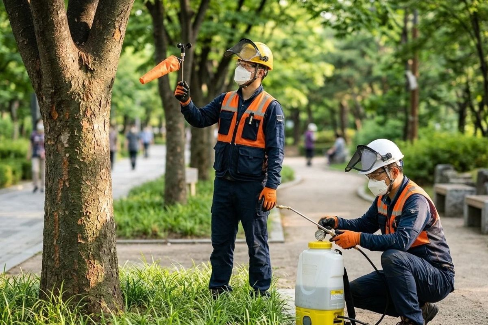
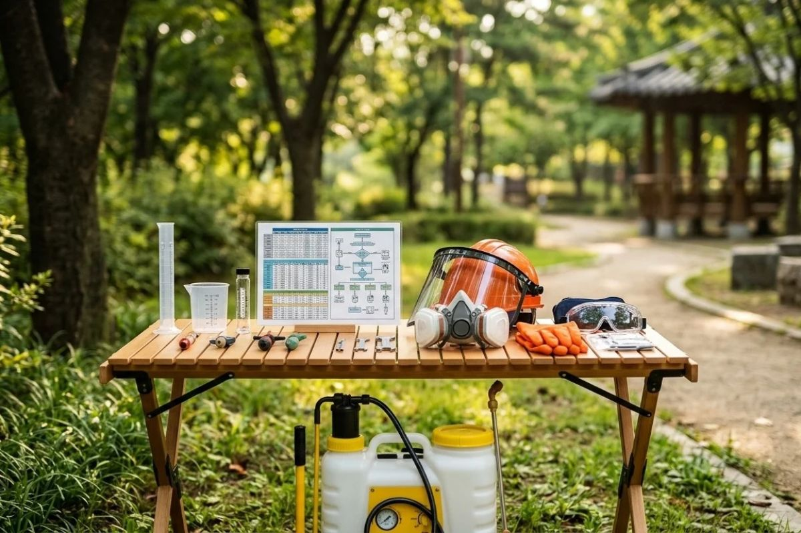

## 목차
1. [[마스터의 화두] "도심 한가운데서 뿌리는 약제는 나무만 향하지 않는다: 바람·보행자·비산(Drift)을 통제하는 현장 안전이 방제 품질을 완성하는 본질"](#master-insight)
2. [[현장 진료 해부] 바람이 부는 낮 시간대와 보행 동선이 겹치는 아파트 단지에서 무분별한 고압 살포로 민원과 약해 우려를 겪던 현장팀을, 풍속·동선 통제와 비산 저감·적정 희석 SOP로 안전 방제에 올려놓은 K 수목진료 코치의 실전 성공 사례](#success-case)
3. [[도심 약제 살포 & 비산 차단 3대 전략] 기상·노즐·거리를 조율하는 비산(Drift) 저감 매트릭스(인프라 모델) + 민감 수종·고온·혼용 리스크를 줄이는 약해·환경 보호 캘리브레이션(수익 모델) + 생활권 통제와 사후 확인을 잇는 현장 안전 운영 퍼널(유입 경로) 3중 파이프라인 SOP](#pivoting-sop)
4. [[사전 준비 & 실행 프로토콜] 살포 전 기상·장비·보호구 점검 체크리스트와 도심 약제 살포 단계별 시공 템플릿 및 사후 민원·약해·방제 모니터링 루틴](#operation-sop)
5. [[마스터의 현장 노트] "수많은 도심 방제 현장과 민원·약해 사례를 살피며 깨달은 바람과 동선, 한 걸음 물러서는 판단의 힘"](#master-note)
6. [[실전 실행 가이드] 바람·비산(Drift) 저감 기준과 생활권·약해 예방 수칙, 사후 점검 SOP를 현장 방제에 적용하여 안전과 방제 효과를 함께 높이는 3대 필수 수칙](#solution)
7. [관련 시리즈 모아보기](#series)
8. [자주 묻는 질문 (FAQ)](#faq)

---

## 1. [마스터의 화두] "도심 한가운데서 뿌리는 약제는 나무만 향하지 않는다: 바람·보행자·비산(Drift)을 통제하는 현장 안전이 방제 품질을 완성하는 본질"

"아파트 단지나 공원, 가로수 현장에서 약제를 살포할 때, 옆으로 밀려나가는 안개 같은 분무가 **산책하는 주민·반려동물 동선이나 열린 창문, 주변 민감 식물로 날아갈까 봐 가슴을 쓸어내린 적**이 없으십니까?"

"수많은 현장 실무자와 초보 관리자들이 **'병해충만 잡으면 된다'는 생각으로 바람 세기나 분사 압력, 살포 각도·시간대를 가볍게 넘기다가 약액 비산(Drift)으로 인한 생활권 불편과 잎 가장자리·신초 약해, 방제 효율 저하라는 이중 부담을 떠안고 있다는 사실**을 직시하고 계시지 않습니까?"

수년간 도심 수목진료 현장과 병해충 방제 운영 사례를 분석하며 확신한 절대적인 명제는 **'도심·아파트 단지 약제 살포에서 흔들리지 않는 비결은 바람·기상 조건과 분무 특성을 제어하는 비산 저감 기준, 고온·강광·혼용·민감 수종을 고려한 약해 예방 원리, 그리고 보행자 통제와 사후 확인을 묶은 현장 안전 SOP에 있다'**는 사실입니다.

이번 [기획 연재: 수목진료 및 병해충 실무 마스터 클래스 시즌 1] 제3부에서는 도심·아파트 단지 약제 살포 안전 수칙—바람·보행자·비산(Drift)을 막는 현장 프로토콜을 전격 공개합니다.

<figure style="text-align: center; margin: 32px 0;">
  
  <figcaption style="font-size: 0.9rem; color: #6C7A72; margin-top: 12px; font-style: normal;">살포 전 풍향과 보행자·주변 환경 안전을 확인하는 도심 방제 현장</figcaption>
</figure>

---

## 2. [현장 진료 해부] 바람이 부는 낮 시간대와 보행 동선이 겹치는 아파트 단지에서 무분별한 고압 살포로 민원과 약해 우려를 겪던 현장팀을, 풍속·동선 통제와 비산 저감·적정 희석 SOP로 안전 방제에 올려놓은 K 수목진료 코치의 실전 성공 사례

공동주택 단지 및 도심 녹지 병해충 방제 현장의 약제 살포 안전 개선 실전 사례입니다. 

해당 현장팀은 바람이 불고 햇빛이 강한 시간대에도 높은 압력으로 수관 상부까지 한꺼번에 분사하는 방식을 사용했습니다. 

그 결과 약액이 옆 동선이나 인접 수목·시설물 쪽으로 비산되어 주민 민원이 발생했고, 뜨거운 햇볕 아래 약액이 맺힌 잎 부위에서 약해 우려와 방제 편차가 함께 나타났습니다. 

K 수목진료 코치는 즉시 **도심·아파트 단지 약제 살포 안전 SOP**를 가동했습니다. 

먼저 살포 전 풍속·풍향과 기상 조건을 점검하고, 보행자·어린이·반려동물 동선과 개방 창문·주차 차량·놀이터 등 민감 구역을 사전에 안내·통제하도록 기준을 세웠습니다. 

이어 과도한 분사 압력과 미세 안개화를 줄이고, 대상 수관에 맞춘 거리·각도와 희석배수·단위 기준을 지켜 정밀 살포하며, 살포 후 현장 정리와 경과 확인까지 한 흐름으로 묶었습니다. 

그 결과 비산으로 인한 생활권 불편과 약해 리스크가 크게 줄어들고, 정해진 대상 부위에 약제가 안정적으로 안착해 방제 신뢰도도 함께 높아졌습니다.

> #### 🏆 고압·무풍미점검 살포 대 마스터 비산(Drift) 저감·동선 통제·약해 예방 SOP 비교 매트릭스
>
> | 구분 | 고압·무풍미점검 살포 (비산·민원·약해 유발형) | 마스터 비산 저감·동선 통제·약해 예방 SOP (K 코치 모델) |
> | :--- | :--- | :--- |
> | **기상·분무 제어** | 바람·일사 조건을 살피지 않고 과도한 압력으로 멀리 분사 | **풍속·풍향·기상 확인 후 비산을 줄이는 압력·노즐·거리 기준 적용** |
> | **생활권·약해 관리** | 보행자·주변 동선 안내나 고온·민감 수종·혼용 고려 미흡 | **사전 안내·동선 분리 및 고온·강광·혼용·약해 요인 사전 차단** |
> | **기록 및 사후 확인** | 살포 후 잔여물·주변 반응 점검 없이 작업 종료 | **약제·희석·살포량 기록 및 약해·방제 반응 사후 모니터링** |

---

## 3. [도심 약제 살포 & 비산 차단 3대 전략] 기상·노즐·거리를 조율하는 비산(Drift) 저감 매트릭스(인프라 모델) + 민감 수종·고온·혼용 리스크를 줄이는 약해·환경 보호 캘리브레이션(수익 모델) + 생활권 통제와 사후 확인을 잇는 현장 안전 운영 퍼널(유입 경로) 3중 파이프라인 SOP

도심·아파트 단지 약제 살포에서 안전과 방제 효과를 함께 지키려면 비산 저감 매트릭스, 약해·환경 보호 캘리브레이션, 그리고 현장 안전 운영 퍼널을 결합한 3중 파이프라인 SOP를 가동해야 합니다.

<figure style="text-align: center; margin: 32px 0;">
  
  <figcaption style="font-size: 0.9rem; color: #6C7A72; margin-top: 12px; font-style: normal;">정확한 희석과 노즐·보호구 점검을 거친 도심 약제 살포 세팅</figcaption>
</figure>

> #### 💡 수목진료 및 병해충 실무 SOP 시즌 1 제3부 핵심 3대 전략 SOP
> 

> 
> 1. **[인프라 모델 전략: 바람과 분무 입자를 다스리는 '비산(Drift) 저감 매트릭스']**  
>    * 약제가 목표 수관을 벗어나 바람에 실려 날아가는 비산(Drift)은 주변 노출과 약제 낭비의 주된 원인입니다.  
>    * ① **기상·시간대 조건 확인:** 바람이 강하게 불거나 풍향이 주변 생활권·민감 구역으로 향할 때는 살포를 피하거나 일정을 조정합니다. 기온이 지나치게 높거나 직사광선이 강한 한낮 시간대 역시 증발과 비산, 약해 위험을 높일 수 있으므로 기상 조건을 꼼꼼히 살핍니다.  
>    * ② **분무 압력·노즐·거리 조절:** 지나치게 미세한 안개 입자가 과도한 압력으로 분사되면 바람에 쉽게 날립니다. 대상 수관 높이와 잎 밀도에 맞는 적정 노즐·압력과 분사 거리를 유지하고, 바람이 부는 방향의 역풍·횡풍 특성을 고려해 불필요한 상향 과분사를 줄입니다.

> 2. **[수익 모델 전략: 잎 손상과 주변 생태 영향을 줄이는 '약해·환경 보호 캘리브레이션']**  
>    * 약제 살포는 대상 병해충을 억제하되 나무와 주변 환경에 불필요한 스트레스를 주지 않아야 합니다.  
>    * **① 농도·단위·혼용 안전 확인:** 제품 라벨의 적용 대상과 희석배수·살포량을 정확히 계산해 적용하고, 임의 고농도 살포나 검증되지 않은 혼용, 동일 작용기작 약제의 무분별한 연용을 피합니다.  
>    * **② 민감 부위·주변 환경 보호:** 연약한 신초기나 개화기, 수세가 약해진 개체, 약해 민감 수종은 별도로 살피고, 인접 화단·작물·수공간·차량·놀이터 등 비표적 구역에 약액이 닿지 않도록 차폐·거리 확보를 병행합니다.

> 3. **[유입 경로 전략: 주민 안전과 사후 점검을 잇는 '현장 안전 운영 퍼널']**  
>    * 도심 현장은 작업 과정의 투명성과 사후 확인이 현장 신뢰를 결정합니다.  
>    * **① 사전 안내 및 구역 통제:** 살포 일시와 대상 구역, 주의사항을 사전에 알리고, 작업 중에는 안내 표지·동선 유도·보호구 착용으로 보행자 접근을 통제합니다.  
>    * **② 현장 기록 남기기:** 살포 일시, 위치·수종, 기상 조건, 사용 약제 및 희석배수·살포량, 특이사항을 기록합니다.  
>    * **③ 사후 경과 확인:** 작업 후 주변 잔여물·안전 상태를 점검하고, 일정 시일이 지난 뒤 약해 발생 여부와 병해충 억제·수세 변화를 확인하는 3단계 현장 안전 운영 퍼널을 완성하세요.

---

## 4. [사전 준비 & 실행 프로토콜] 살포 전 기상·장비·보호구 점검 체크리스트와 도심 약제 살포 단계별 시공 템플릿 및 사후 민원·약해·방제 모니터링 루틴

도심 및 공동주택 현장에서 비산과 약해, 안전사고를 예방하기 위한 표준 운영 프로토콜입니다.

> #### ⚙️ 도심·아파트 단지 약제 살포 안전 관리 3대 수칙
> 

> 
> 1. **[출동 및 분사 전 현장을 점검하는 '약제 살포 사전 점검 체크리스트' 매뉴얼]**  
>    * 작업 착수 전 ① 풍속·풍향·기온·일사 등 기상 조건과 보행자·반려동물·주변 시설물 근접 여부 확인 ➔ ② 약제 라벨(용법·용량·주의사항·혼용/약해 주의) 및 계량·희석 도구·분무기 노즐·호스 누수 상태 점검 ➔ ③ 보호의·장갑·마스크·고글 등 개인보호구 착용과 사전 안내·통제 준비 상태를 확인하는 체크리스트를 준수하세요.

> 2. **[현장 살포 순서를 표준화하는 '도심 약제 살포 단계별 시공 템플릿' 캘리브레이션]**  
>    * 살포 진행 시 ① **사전 통제 및 희석:** 동선 안내·차폐 확인 후 규정 희석배수·단위 기준에 맞춰 약액 조제 ➔ ② **비산 저감 살포:** 풍향·거리·압력·노즐을 맞춰 대상 잎·가지 중심으로 고르게 분사(과도한 흘러내림·비산 억제) ➔ ③ **장비 세척 및 기록:** 작업 종료 후 장비·보호구 세척·보관 및 살포 이력 기록 템플릿을 적용하세요.

> 3. **[살포 이후 안전과 효과를 함께 추적하는 '민원·약해·방제 사후 모니터링' 루틴]**  
>    * 살포 완료 후 ① 당일~초기 단계에서 작업 구역 안전 상태, 잔여물 여부 및 현장 특이사항·민원 대응 여부 확인 ➔ ② 며칠~일정 기간 뒤 잎 가장자리·신초 변색 등 약해 징후와 대상 병해충 감소 여부 관찰 ➔ ③ 기록된 기상·살포 조건과 현장 반응을 다음 방제 계획에 반영하는 사후 관리 루틴을 정례화하세요.

---

## 5. [마스터의 현장 노트] "수많은 도심 방제 현장과 민원·약해 사례를 살피며 깨달은 바람과 동선, 한 걸음 물러서는 판단의 힘"

> #### 📝 [마스터 노트] 도심 약제 살포 안전 실무에서 체득한 현장 지혜
>
> * **첫 번째 지혜: "바람이 거센 날의 무리한 살포는 방제보다 비산을 먼저 만든다. 멈추거나 미룰 줄 아는 판단이 프로의 실력이다"**  
>   ➔ 기상과 주변 조건을 존중할 때 약제가 진짜 필요한 곳에 닿습니다.

> * **두 번째 지혜: "사람이 오가는 공간에서의 방제는 기술 이전에 배려다. 안내와 동선 분리, 낮은 압력이 현장의 긴장을 낮춘다"**  
>   ➔ 생활권 안전을 지키는 절차가 곧 수목진료의 신뢰를 만듭니다.

> * **세 번째 지혜: "높은 압력으로 멀리 쏘는 것보다, 알맞은 거리와 조건으로 정확히 닿게 하는 편이 잎도 살리고 약도 아낀다"**  
>   ➔ 세심한 조절이 약해와 낭비를 줄이는 가장 확실한 방법입니다.

---

## 6. [실전 실행 가이드] 바람·비산(Drift) 저감 기준과 생활권·약해 예방 수칙, 사후 점검 SOP를 현장 방제에 적용하여 안전과 방제 효과를 함께 높이는 3대 필수 수칙

1. **풍속·풍향·기상 조건 확인과 적정 노즐·압력·거리 조절로 비산(Drift) 최소화**  
   주변 생활권과 비표적 식물로 약액이 날아가는 것을 막고 대상 수관 안착률 확보.
2. **규정 희석배수·단위 준수, 고온·강광·민감 시기·혼용 주의 및 동선 통제로 약해·안전사고 예방**  
   보행자·반려동물·주변 시설물 안전과 수목 조직 보호를 동시에 충족.
3. **살포 이력 기록과 약해·병해충 반응 사후 모니터링 SOP 체화**  
   현장 데이터를 축적해 다음 방제 시기와 방법의 정확도를 지속적으로 개선.

---

## 7. 관련 시리즈 모아보기

* **[기획 연재: 수목진료 및 병해충 실무 마스터 클래스 시즌 1. ①] [현장 정밀 진단 & 시료 채취 실무 편] \"현장 정밀 진단과 시료 채취의 첫걸음: 흙·잎·가지 시료를 망가뜨리지 않고 담는 법\"**  
  ➔ [수목진료 현장 진단 순서, 잎 가지 토양 시료 채취 포장 이송 SOP](https://floraldays.com/sop-season1-field-diagnosis-sample-collection-part1)

* **[기획 연재: 수목진료 및 병해충 실무 마스터 클래스 시즌 1. ②] [수간주사 현장 시공 실무 편] \"구멍을 뚫을 때도 각도와 깊이가 있다: 수종·시기별 수간주사 현장 시공 SOP\"**  
  ➔ [수간주사 천공 각도 깊이 간격, 약액 누출 제어, 현장 시공 안전 SOP](https://floraldays.com/sop-season1-trunk-injection-field-sop-part2)

* **[기획 연재: 수목진료 및 병해충 실무 마스터 클래스 시즌 1. ③] [약제 살포 & 비산 방지 실무 편] \"도심·아파트 단지 약제 살포 안전 수칙: 바람·보행자·비산(Drift)을 막는 현장 프로토콜\"**  
  ➔ [도심 약제 살포 안전, 비산 Drift 저감, 약해 예방 현장 SOP](https://floraldays.com/sop-season1-pesticide-spray-safety-drift-sop-part3)

---

## 8. 자주 묻는 질문 (FAQ)

**Q1. 아파트 단지나 도심 녹지에서 약제를 살포할 때 비산(Drift)을 줄이려면 현장에서 어떤 점을 먼저 챙겨야 하나요?**  

A1. '가장 먼저 풍속과 풍향을 확인해 바람이 강하거나 주변 주거·보행 공간 쪽으로 불 때는 살포를 피하거나 조정해야 합니다. 

또한 과도하게 높은 분사 압력과 지나치게 미세한 안개 입자는 바람에 쉽게 날릴 수 있으므로, 대상 수관 거리에 맞는 적정 노즐·압력과 분사 각도를 유지하고 인접 민감 구역과의 거리·차폐를 함께 살피는 것이 좋습니다'.

> 💡 수목 병해충 방제 및 약제 안전 사용 관련 공식 참고 자료는 <a href="https://www.nihhs.go.kr" target="_blank" rel="noopener noreferrer">농촌진흥청 국립원예특작과학원</a>을 참고하시기 바랍니다.

**Q2. 약제를 살포한 뒤 잎 가장자리나 신초가 마르거나 변색되는 약해가 생기지 않도록 하려면 무엇을 주의해야 하나요?**  

A2. '약제 라벨에 안내된 희석배수와 살포량을 정확히 지키고, 임의 고농도 살포나 불확실한 혼용을 피하는 것이 기본입니다. 

아울러 기온이 높고 직사광선이 강한 시간대나 연약한 신초·민감 수종을 다룰 때는 살포 시기와 조건을 세심하게 살피고, 살포 후 며칠~일정 기간 동안 잎과 신초의 반응을 관찰하는 습관을 들이는 것이 안전합니다'.

> 💡 스마트 홈가드닝 및 도시농업 정보는 <a href="https://www.modunong.or.kr" target="_blank" rel="noopener noreferrer">농림축산식품부 모두가 도시농부 포털</a>을 참고하세요.

---

