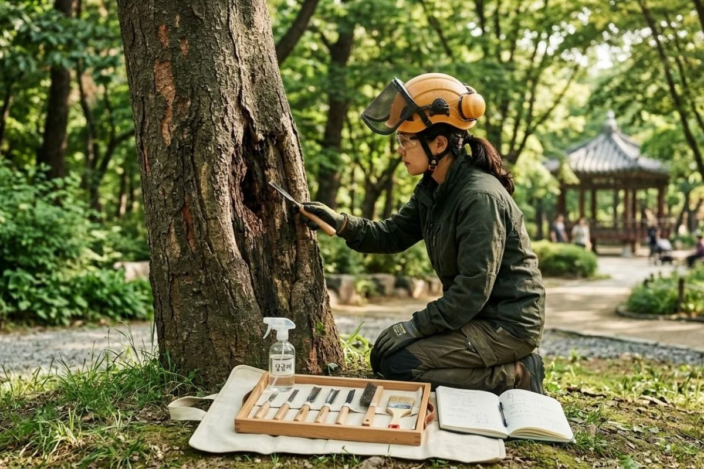
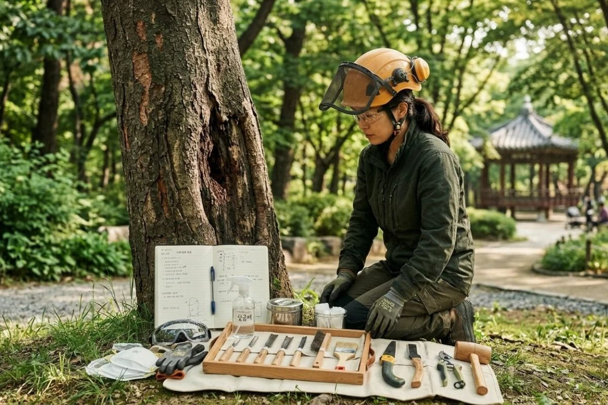

## 목차
1. [[마스터의 화두] "썩은 조직을 깊숙이 파내고 단단히 막기만 하면 나무가 저절로 나을까: 수목의 방어 원리를 지키는 외과수술과 공동·부후 처치의 본질"](#master-insight)
2. [[현장 진료 해부] 수간 부후부와 공동 부위를 과도하게 파내거나 물이 고이는 구조로 마감해 수세 약화와 내부 재부후를 겪던 현장을, 구획화 보호·배수 확보·구조 안전 병행 SOP로 안정화한 K 수목진료 코치의 실전 성공 사례](#success-case)
3. [[외과수술 & 공동·부후 처치 3대 전략] 건전 조직과 방어벽을 보호하는 부후부 제거·정리 매트릭스(인프라 모델) + 수분 고임·2차 침입을 막는 표면·공동 마감 캘리브레이션(수익 모델) + 구조 결함 위험과 경과를 관리하는 안전·모니터링 퍼널(유입 경로) 3중 파이프라인 SOP](#pivoting-sop)
4. [[사전 준비 & 실행 프로토콜] 외과수술 공구·소독·안전 점검 체크리스트와 공동·부후 처치 단계별 시공 템플릿 및 사후 부후·구조 상태 모니터링 루틴](#operation-sop)
5. [[마스터의 현장 노트] "수많은 외과수술 처치 현장과 절단면을 살피며 깨달은 '더 파내기보다 덜 해치는' 절제와 균형의 지혜"](#master-note)
6. [[실전 실행 가이드] 건전 조직 보호·부후부 정리 기준과 수분 배출·안전 평가, 사후 모니터링 SOP를 현장에 적용하여 처치 완성도를 높이는 3대 필수 수칙](#solution)
7. [관련 시리즈 모아보기](#series)
8. [자주 묻는 질문 (FAQ)](#faq)

---

## 1. [마스터의 화두] "썩은 조직을 깊숙이 파내고 단단히 막기만 하면 나무가 저절로 나을까: 수목의 방어 원리를 지키는 외과수술과 공동·부후 처치의 본질"

"수간이나 굵은 가지의 상처 부위가 썩어 들어가거나 공동(空洞)이 생겼을 때, **썩은 부분을 무조건 넓고 깊게 깎아내거나 내부를 빈틈없이 틀어막아야만 안심이 되었던 경험**이 없으십니까?"

"수많은 현장 실무자와 입문자들이 **나무는 동물처럼 상처를 아물게 하는 것이 아니라 방어벽을 세워 구획화(CODIT)한다는 점과, 부후부 제거 과정에서 건전 목질부·형성층·수피 경계까지 과도하게 훼손하거나 물이 고이는 구조를 만들면 오히려 부후가 안쪽으로 더 깊어질 수 있다는 사실**을 놓치고 있다는 점을 직시하고 계시지 않습니까?"

수년간 수목 외과수술 현장과 부후·공동 처치 사례를 분석하며 확신한 절대적인 명제는 **'수목 외과수술과 공동·부후 처치에서 흔들리지 않는 비결은 나무의 구획화 방어선을 해치지 않는 범위의 부후부 정리 기준, 수분 정체와 2차 부후를 막는 처치·배수 원리, 그리고 구조적 안전성과 사후 점검을 묶은 현장 SOP에 있다'**는 사실입니다.

이번 [기획 연재: 수목진료 및 병해충 실무 마스터 클래스 시즌 1] 제4부에서는 썩은 부분을 파내기만 하면 될까—수목 외과수술과 공동·부후 처치 실전 SOP를 전격 공개합니다.

<figure style="text-align: center; margin: 32px 0;">
  
  <figcaption style="font-size: 0.9rem; color: #6C7A72; margin-top: 12px; font-style: normal;">수목 외과수술 전 손상·부후 범위와 수피·목질부 상태를 확인하는 현장</figcaption>
</figure>

---

## 2. [현장 진료 해부] 수간 부후부와 공동 부위를 과도하게 파내거나 물이 고이는 구조로 마감해 수세 약화와 내부 재부후를 겪던 현장을, 구획화 보호·배수 확보·구조 안전 병행 SOP로 안정화한 K 수목진료 코치의 실전 성공 사례

공원 및 가로수·단지 수목의 상처·부후 부위 처치 품질 개선 실전 사례입니다. 

해당 현장에서는 수간이나 분지부의 부후 흔적이 보일 때마다 연약해진 목질부를 과도하게 도려내 상처 면적을 넓히거나, 물이 빠져나갈 틈 없이 마감해 내부에 습기가 차면서 부후가 재진행되는 사례가 반복되었습니다. 

또한 잔존 목질부 두께나 구조 결함을 함께 살피지 않아 바람이 불 때 위험성 판단에 어려움을 겪기도 했습니다. 

K 수목진료 코치는 즉시 **수목 외과수술 & 공동·부후 처치 실전 SOP**를 가동했습니다. 

먼저 부후 조직과 건전 조직의 경계를 구분하되, 나무 스스로 형성한 방어 장벽과 건전 목질부를 불필요하게 훼손하지 않도록 제거 범위를 설정하도록 기준을 세웠습니다. 

이어 이완된 부후 잔재 정리, 물이 고이지 않도록 하는 배수 고려 및 처치 기준 적용, 공구 소독과 함께 구조적 안전성 평가 및 사후 경과 관찰까지 한 흐름으로 묶었습니다. 

그 결과 불필요한 조직 손상과 수분 정체로 인한 재부후 리스크가 줄어들고, 수세와 현장 안전성을 함께 관리하는 체계적인 외과수술 루틴이 자리 잡았습니다.

> #### 🏆 무분별 과도 굴착·수분 정체 마감 대 마스터 구획화 보호·배수 고려·안전 병행 SOP 비교 매트릭스
>
> | 구분 | 무분별 과도 굴착·수분 정체 마감 (손상·재부후 유발형) | 마스터 구획화 보호·배수 고려·안전 병행 SOP (K 코치 모델) |
> | :--- | :--- | :--- |
> | **부후부·상처 정리** | 건전 조직·방어선까지 과도하게 깎아내어 상처 확대 | **부후 잔재 정리 시 건전 조직과 방어 경계 보호 원칙 준수** |
> | **수분·내부 관리** | 물이 고이거나 습기가 갇혀 내부 부후·균류 증식 심화 | **물 고임 방지 및 통기·배수 조건과 처치 지침을 함께 고려** |
> | **안전 및 사후 점검** | 구조적 결함·위험도 확인이나 사후 관찰 없이 마무리 | **잔존 목질·위험 요인 검토 및 정기 경과 모니터링 실시** |

---

## 3. [외과수술 & 공동·부후 처치 3대 전략] 건전 조직과 방어벽을 보호하는 부후부 제거·정리 매트릭스(인프라 모델) + 수분 고임·2차 침입을 막는 표면·공동 마감 캘리브레이션(수익 모델) + 구조 결함 위험과 경과를 관리하는 안전·모니터링 퍼널(유입 경로) 3중 파이프라인 SOP

수목 외과수술과 공동·부후 처치에서 나무의 방어력과 현장 안전을 함께 지키려면 부후부 제거·정리 매트릭스, 표면·공동 마감 캘리브레이션, 그리고 안전·모니터링 퍼널을 결합한 3중 파이프라인 SOP를 가동해야 합니다.

<figure style="text-align: center; margin: 32px 0;">
  
  <figcaption style="font-size: 0.9rem; color: #6C7A72; margin-top: 12px; font-style: normal;">공구 소독과 안전 장구를 갖춘 수목 외과수술 시공 세팅</figcaption>
</figure>

> #### 💡 수목진료 및 병해충 실무 SOP 시즌 1 제4부 핵심 3대 전략 SOP
> 

> 
> 1. **[인프라 모델 전략: 나무의 방어선을 지키는 '부후부 제거·정리 매트릭스']**  
>    * 외과수술의 목적은 부후를 억지로 없애는 것이 아니라 수목이 스스로 방어하고 회복할 수 있도록 돕는 것입니다.  
>    * ① **건전 조직·방어벽 보호:** 이미 썩어 물러지고 떨어져 나갈 부후 잔재는 조심스럽게 정리하되, 수목이 부후 확산을 막기 위해 형성한 방어벽과 건전한 변재·형성층·수피 경계를 훼손하지 않도록 범위를 제한합니다.  
>    * ② **작업 공구 위생 관리:** 작업 전후와 개체 이동 시 절삭·정리 공구를 알코올 등으로 소독해 부후균이나 병원체가 다른 부위·개체로 옮겨가지 않도록 관리합니다.

> 2. **[수익 모델 전략: 습기와 부후 확산을 줄이는 '표면·공동 처치 및 배수 캘리브레이션']**  
>    * 정리된 부위와 공동(空洞)을 어떻게 다루느냐에 따라 이후 부후 진행 여부가 달라집니다.  
>    * **① 물 고임 및 과습 방지:** 공동 하부에 빗물이나 수액이 고여 있으면 목재부후균 번식과 내부 부패가 가속화될 수 있습니다. 물이 고이지 않도록 배수 조건을 확보하고, 처치 방식과 마감 여부는 현장 조건과 적용 기준에 맞춰 신중히 선택합니다.  
>    * **② 표면 정돈 및 처치 기준 준수:** 거칠게 찢어진 섬유나 들뜬 부위를 정돈할 때는 과도한 상처를 내지 않도록 주의하고, 필요한 경우 적용 기준에 맞는 보호 처치나 전문 진단을 연계합니다.

> 3. **[유입 경로 전략: 구조 안전과 회복 경과를 잇는 '안전·모니터링 퍼널']**  
>    * 부후나 공동이 생긴 수목은 바람·하중 조건에서 구조적 취약성이 생길 수 있으므로 안전 확인이 필수입니다.  
>    * **① 구조 및 주변 안전 점검:** 수간·분지부·근주부의 부후 범위와 건전 목질 잔존 상태, 주변 보행로·시설물과의 근접성을 함께 살핍니다.  
>    * **② 처치 이력 기록:** 위치, 수종, 부후·공동 상태, 처치 내용, 작업 일자, 사진 기록을 남깁니다.  
>    * **③ 정기 경과 모니터링:** 처치 후 계절 변화와 강풍·강우 이후 부위 상태, 수관 활력 및 구조 이상 징후를 추적하는 3단계 안전·모니터링 퍼널을 완성하세요.

---

## 4. [사전 준비 & 실행 프로토콜] 외과수술 공구·소독·안전 점검 체크리스트와 공동·부후 처치 단계별 시공 템플릿 및 사후 부후·구조 상태 모니터링 루틴

외과수술 및 공동·부후 처치 현장에서 과도한 손상과 안전사고를 막기 위한 표준 운영 프로토콜입니다.

> #### ⚙️ 수목 외과수술 및 공동·부후 처치 3대 수칙
> 

> 
> 1. **[작업 전 수목 상태·공구·안전 조건을 확인하는 '외과수술 사전 점검 체크리스트' 매뉴얼]**  
>    * 작업 착수 전 ① 부후·공동 발생 위치와 범위, 수관 활력 및 주변 보행자·시설물 안전 조건 확인 ➔ ② 절삭·정리 공구 날 상태, 소독제, 보호구(장갑·고글·안전모 등) 구비 점검 ➔ ③ 단순 처치로 가능한지, 구조 안전 진단이나 추가 조치가 필요한지 확인하는 체크리스트를 준수하세요.

> 2. **[처치 순서를 표준화하는 '공동·부후 처치 단계별 시공 템플릿' 캘리브레이션]**  
>    * 처치 진행 시 ① **현장 확인 및 소독:** 부위 점검·사진 촬영 및 공구 소독 ➔ ② **부후 잔재 정리 및 수분 관리:** 이완 부후물 정돈, 물 고임 방지 및 적용 기준에 따른 처치 ➔ ③ **정리 및 기록:** 작업 부위·주변 정리, 시공 내역 및 사진 기록 템플릿을 적용하세요.

> 3. **[처치 이후 부후 진행과 안전성을 추적하는 '공동·부후 사후 모니터링' 루틴]**  
>    * 처치 완료 후 ① 초기 단계에서 물 고임 여부, 처치 부위 상태 및 주변 잔여물 정리 확인 ➔ ② 생육기와 강풍·폭우 이후 부후 확산 여부, 수관 잎 상태 및 구조적 변화 관찰 ➔ ③ 기록된 경과 데이터를 바탕으로 후속 관리 또는 정밀 안전 진단을 연계하는 사후 관리 루틴을 정례화하세요.

---

## 5. [마스터의 현장 노트] "수많은 외과수술 처치 현장과 절단면을 살피며 깨달은 '더 파내기보다 덜 해치는' 절제와 균형의 지혜"

> #### 📝 [마스터 노트] 수목 외과수술 및 공동·부후 처치 실무에서 체득한 현장 지혜
>
> * **첫 번째 지혜: "나무는 상처를 지우는 존재가 아니라 경계를 세워 버티는 존재다. 그 방어선을 지키는 것이 진짜 처치다"**  
>   ➔ 무리한 제거보다 건전 조직 보호가 우선입니다.

> * **두 번째 지혜: "물이 고이고 숨 쉴 틈이 사라진 자리에서는 부후가 멈추기 어렵다. 물길과 통기, 안전을 함께 보아야 한다"**  
>   ➔ 표면 처치보다 물이 머무르지 않는 환경과 구조적 안정성이 중요합니다.

> * **세 번째 지혜: "처치가 끝난 날보다 바람이 불고 계절이 바뀐 뒤의 모습이 나무의 진짜 상태를 말해 준다"**  
>   ➔ 꾸준한 관찰과 기록이 수목진료의 완성도를 높입니다.

---

## 6. [실전 실행 가이드] 건전 조직 보호·부후부 정리 기준과 수분 배출·안전 평가, 사후 모니터링 SOP를 현장에 적용하여 처치 완성도를 높이는 3대 필수 수칙

1. **건전 조직과 방어 경계를 존중하는 부후부 정리 및 공구 소독 기준 확립**  
   불필요한 조직 손상과 병원체·부후균 확산을 예방.
2. **물 고임 방지와 구조·생활권 안전 평가를 병행하는 처치 원칙 준수**  
   내부 수분 정체로 인한 재부후를 줄이고 주변 안전 확보.
3. **현장 기록과 계절·기상 변화에 따른 사후 모니터링 SOP 체화**  
   수세 회복과 구조적 안정성을 지속적으로 점검.

---

## 7. 관련 시리즈 모아보기

* **[기획 연재: 수목진료 및 병해충 실무 마스터 클래스 시즌 1. ①] [현장 정밀 진단 & 시료 채취 실무 편] \"현장 정밀 진단과 시료 채취의 첫걸음: 흙·잎·가지 시료를 망가뜨리지 않고 담는 법\"**  
  ➔ [수목진료 현장 진단 순서, 잎 가지 토양 시료 채취 포장 이송 SOP](https://floraldays.com/sop-season1-field-diagnosis-sample-collection-part1)

* **[기획 연재: 수목진료 및 병해충 실무 마스터 클래스 시즌 1. ②] [수간주사 현장 시공 실무 편] \"구멍을 뚫을 때도 각도와 깊이가 있다: 수종·시기별 수간주사 현장 시공 SOP\"**  
  ➔ [수간주사 천공 각도 깊이 간격, 약액 누출 제어, 현장 시공 안전 SOP](https://floraldays.com/sop-season1-trunk-injection-field-sop-part2)

* **[기획 연재: 수목진료 및 병해충 실무 마스터 클래스 시즌 1. ③] [약제 살포 & 비산 방지 실무 편] \"도심·아파트 단지 약제 살포 안전 수칙: 바람·보행자·비산(Drift)을 막는 현장 프로토콜\"**  
  ➔ [도심 약제 살포 안전, 비산 Drift 저감, 약해 예방 현장 SOP](https://floraldays.com/sop-season1-pesticide-spray-safety-drift-sop-part3)

* **[기획 연재: 수목진료 및 병해충 실무 마스터 클래스 시즌 1. ④] [수목 외과수술 & 공동·부후 처치 실무 편] \"썩은 부분을 파내기만 하면 될까? 수목 외과수술과 공동·부후 처치 실전 SOP\"**  
  ➔ [수목 외과수술, 공동 부후 처치, 수분 고임 방지 및 안전 SOP](https://floraldays.com/sop-season1-tree-surgery-decay-cavity-sop-part4)

---

## 8. 자주 묻는 질문 (FAQ)

**Q1. 나무에 썩은 부분이나 구멍(공동)이 보일 때, 속이 썩지 않도록 깊숙이 파낸 뒤 시멘트나 충전재로 꽉 막아주는 것이 좋을까요?**  

A1. '무조건 깊게 파내거나 내부를 일괄적으로 막는 방식은 나무의 방어벽을 손상시키거나 수분 배출을 막아 오히려 내부 부후와 균류 확산을 부추길 수 있습니다. 

이완된 부후 잔재를 조심스럽게 정리하되 건전 조직과 방어 경계를 보호하고, 물 고임 여부와 구조적 안전성, 적용 기준에 맞춰 신중히 접근하는 것이 바람직합니다'.

> 💡 수목 외과수술 및 수목진료 관련 공식 참고 자료는 <a href="https://www.nihhs.go.kr" target="_blank" rel="noopener noreferrer">농촌진흥청 국립원예특작과학원</a>을 참고하시기 바랍니다.

**Q2. 부후나 공동이 생긴 수목을 관리할 때, 처치 외에 함께 확인해야 할 안전 요소는 무엇인가요?**  

A2. '손상 부위의 위치와 크기, 잔존 목질 상태, 수관의 무게 균형, 그리고 보행로·차도·건물·놀이터 등 주변 생활권과의 거리와 위험도를 함께 살펴야 합니다. 

구조적 결함이나 도복·낙지 위험이 크다고 판단되면 단순 처치만으로 끝내지 않고 전문가 정밀 진단이나 위험 요인 관리 조치를 연계하는 것이 안전합니다'.

> 💡 스마트 홈가드닝 및 도시농업 정보는 <a href="https://www.modunong.or.kr" target="_blank" rel="noopener noreferrer">농림축산식품부 모두가 도시농부 포털</a>을 참고하세요.

---

