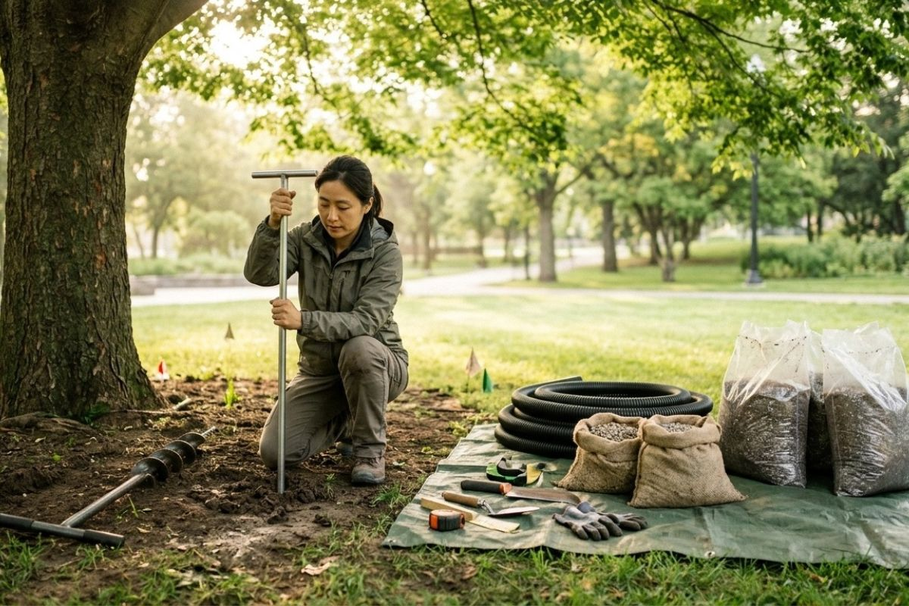
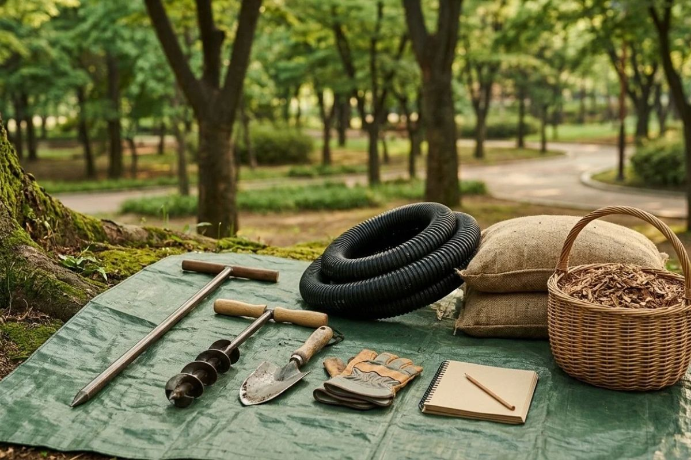

## 목차
1. [[마스터의 화두] "잎이 마르고 가지 끝이 시들 때 하늘만 바라보지 마라: 흙 속 산소 부족과 물 고임을 바로잡는 근권 관리가 수목 회복의 출발점인 본질"](#master-insight)
2. [[현장 진료 해부] 보행·차량 답압과 배수 불량으로 수관 황화와 지제부 약화를 겪던 조경수 현장을, 뿌리 손상 최소화 통기·배수 개선 및 단계별 근권 회복 SOP로 되살린 K 수목진료 코치의 실전 성공 사례](#success-case)
3. [[토양 답압 해소 & 통기·배수 개선 3대 전략] 유효 근권과 뿌리 피해를 줄이는 답압·배수 진단 매트릭스(인프라 모델) + 산소·수분 순환을 회복하는 통기·배수·개량 시공 캘리브레이션(수익 모델) + 근권 안정화와 수세 회복을 잇는 현장 관리 퍼널(유입 경로) 3중 파이프라인 SOP](#pivoting-sop)
4. [[사전 준비 & 실행 프로토콜] 토양·뿌리·공구 사전 점검 체크리스트와 답압 해소·통기·배수 개선 단계별 시공 템플릿 및 사후 근권·수관 모니터링 루틴](#operation-sop)
5. [[마스터의 현장 노트] "수많은 근권 굴착과 토양 상태를 살피며 깨달은 '땅속 숨구멍을 살리는' 신중함과 균형의 지혜"](#master-note)
6. [[실전 실행 가이드] 답압·배수 진단 기준과 뿌리 손상 최소화 시공 수칙, 사후 모니터링 SOP를 현장에 적용하여 근권 회복력을 높이는 3대 필수 수칙](#solution)
7. [관련 시리즈 모아보기](#series)
8. [자주 묻는 질문 (FAQ)](#faq)

---

## 1. [마스터의 화두] "잎이 마르고 가지 끝이 시들 때 하늘만 바라보지 마라: 흙 속 산소 부족과 물 고임을 바로잡는 근권 관리가 수목 회복의 출발점인 본질"

"조경수나 공원·단지 수목의 잎이 이유 없이 누렇게 변하거나 수관 끝이 마르며 활력이 떨어질 때, **위쪽 잎과 가지에만 시선을 두고 약제나 영양제부터 찾다가 정작 뿌리가 갇힌 흙 속 환경은 놓쳤던 경험**이 없으십니까?"

"수많은 현장 실무자와 초보 관리자들이 **나무의 흡수근과 호흡 뿌리는 흙 속 공극의 산소와 수분 균형에 의존하는데, 보행·차량 통행으로 흙이 단단해지거나 물이 고여 산소가 부족해지면 뿌리 기능이 떨어지고 2차 피해로 이어질 수 있다는 사실**을 간과하고 있다는 점을 직시하고 계시지 않습니까?"

수년간 토양·근권 관리 현장과 수목 쇠퇴 사례를 분석하며 확신한 절대적인 명제는 **'토양 답압 해소와 통기·배수 개선에서 흔들리지 않는 비결은 유효 근권의 토양 상태와 배수 조건을 살피는 진단 기준, 뿌리 손상을 줄이며 산소와 물길 순환을 돕는 시공 원리, 그리고 근권 안정화와 수세 회복을 추적하는 현장 SOP에 있다'**는 사실입니다.

이번 [기획 연재: 수목진료 및 병해충 실무 마스터 클래스 시즌 1] 제5부에서는 조경수가 흙 속에서 숨을 못 쉴 때—토양 답압 해소·통기·배수 개선 시공 매뉴얼을 전격 공개합니다.

<figure style="text-align: center; margin: 32px 0;">
  
  <figcaption style="font-size: 0.9rem; color: #6C7A72; margin-top: 12px; font-style: normal;">식재지 토양 굳기와 물 고임 여부를 점검하는 현장 모습</figcaption>
</figure>

---

## 2. [현장 진료 해부] 보행·차량 답압과 배수 불량으로 수관 황화와 지제부 약화를 겪던 조경수 현장을, 뿌리 손상 최소화 통기·배수 개선 및 단계별 근권 회복 SOP로 되살린 K 수목진료 코치의 실전 성공 사례

보행 동선과 인접 포장·경계부가 맞닿은 조경수 식재지의 토양 환경 개선 실전 사례입니다. 

해당 현장에서는 지속적인 보행·압박과 배수 불량으로 흙이 굳고 비가 온 뒤 물이 잘 빠지지 않아, 뿌리 호흡이 원활하지 못하고 수관 잎 황화와 생육 저하가 이어졌습니다. 

작업 과정에서 뿌리 위치를 고려하지 않고 거칠게 파거나 물길을 막는 임시 조치만 반복할 경우 오히려 세근 손상과 국소 과습이 남을 수 있었습니다. 

K 수목진료 코치는 즉시 **토양 답압 해소·통기·배수 개선 시공 SOP**를 가동했습니다. 

먼저 수관 투영선 범위와 뿌리 분포를 감안해 작업 구역을 설정하고, 토양 경도와 배수·고임 양상을 확인한 뒤 뿌리 손상을 줄이는 방식으로 통기 및 배수 개선 공정을 진행하도록 기준을 세웠습니다. 

이어 시공 후 표면 정리와 적정 수분·멀칭 관리, 그리고 계절 변화에 따른 근권·수관 경과 관찰까지 한 흐름으로 묶었습니다. 

그 결과 흙 속 공기·수분 순환 여건이 개선되면서 불필요한 뿌리 손상을 줄이고 수세 회복을 뒷받침하는 안정적인 현장 관리 체계를 갖출 수 있었습니다.

> #### 🏆 무분별 굴착·방치형 관리 대 마스터 뿌리 보호 통기·배수 개선 SOP 비교 매트릭스
>
> | 구분 | 무분별 굴착·방치형 관리 (뿌리 손상·과습 지속형) | 마스터 뿌리 보호 통기·배수 개선 SOP (K 코치 모델) |
> | :--- | :--- | :--- |
> | **현장 진단 및 구역 설정** | 물 고임·답압 원인을 살피지 않고 지상부 증상만 대처 | **토양 굳기·배수 상태·수관 투영선 기준 작업 구역 설정** |
> | **통기·배수 시공** | 굵은 뿌리·세근을 고려하지 않은 거친 굴착이나 배수 방치 | **뿌리 손상을 최소화하며 통기·배수 흐름 개선 및 정리** |
> | **사후 관리 및 관찰** | 시공 후 토양·수관 경과 점검 없이 종료 | **수분·표면 상태 및 수관 활력 회복 경과 정기 모니터링** |

---

## 3. [토양 답압 해소 & 통기·배수 개선 3대 전략] 유효 근권과 뿌리 피해를 줄이는 답압·배수 진단 매트릭스(인프라 모델) + 산소·수분 순환을 회복하는 통기·배수·개량 시공 캘리브레이션(수익 모델) + 근권 안정화와 수세 회복을 잇는 현장 관리 퍼널(유입 경로) 3중 파이프라인 SOP

토양 답압 해소와 통기·배수 개선에서 뿌리 손상을 줄이며 회복 효과를 높이려면 답압·배수 진단 매트릭스, 통기·배수·개량 시공 캘리브레이션, 그리고 현장 관리 퍼널을 결합한 3중 파이프라인 SOP를 가동해야 합니다.

<figure style="text-align: center; margin: 32px 0;">
  
  <figcaption style="font-size: 0.9rem; color: #6C7A72; margin-top: 12px; font-style: normal;">근권 보호와 통기·배수 개선을 위한 현장 장비 및 자재 세팅</figcaption>
</figure>

> #### 💡 수목진료 및 병해충 실무 SOP 시즌 1 제5부 핵심 3대 전략 SOP
> 

> 
> 1. **[인프라 모델 전략: 흙 속 병목과 뿌리 범위를 살피는 '답압·배수 진단 매트릭스']**  
>    * 토양 개선은 무조건 흙을 뒤집는 것이 아니라 무엇이 뿌리의 숨과 물길을 막고 있는지 정확히 파악하는 것에서 시작합니다.  
>    * ① **답압·굳기 및 토성 확인:** 보행·차량·적재 흔적, 표면 경도, 지제부 주변 복토 여부와 토양 배수 속도를 확인해 답압과 과습 중 어떤 요인이 우세한지 구분합니다.  
>    * ② **유효 근권 및 뿌리 분포 고려:** 수관 아래 넓게 퍼진 흡수근·세근 영역을 고려해 작업 위치와 깊이를 설정하고, 지제부 바로 옆이나 굵은 지지근에 과도한 충격을 주지 않도록 동선을 나눕니다.

> 2. **[수익 모델 전략: 공기 통로와 물 빠짐을 확보하는 '통기·배수·개량 시공 캘리브레이션']**  
>    * 뿌리 스트레스를 줄이면서 토양 물리성을 개선하려면 단계별 절제와 균형이 필요합니다.  
>    * **① 통기 및 답압 완화:** 토양 상태와 수목 조건에 맞춰 통기 구멍·갱도 조성이나 표층 완화 작업을 진행하되, 세근 절단을 최소화하고 흙이 과도하게 뭉개지지 않도록 작업 시기(너무 질퍽하거나 극심한 건조기 회피 등)를 살핍니다.  
>    * **② 배수 개선 및 자재 적용:** 물이 고이는 지형·토층 조건에서는 배수 흐름을 확보할 수 있는 배수층·배수로 정비나 토양 개량·멀칭 기준을 적용합니다. 이때 지제부(줄기 밑동)에 흙이나 멀칭재가 과도하게 쌓여 습기가 차는 일이 없도록 여유 공간을 둡니다.

> 3. **[유입 경로 전략: 뿌리 안정화와 수세 회복을 연결하는 '현장 관리 퍼널']**  
>    * 토양 환경이 바뀌면 나무가 반응하는 데 시간이 걸리므로 사후 관리 흐름이 중요합니다.  
>    * **① 재답압·유입 방지:** 작업 구역 내 불필요한 보행·적재·차량 진입을 줄이고 배수 경로가 막히지 않도록 관리합니다.  
>    * **② 시공·토양 이력 기록:** 위치, 수종, 토양·배수 상태, 통기·배수 개선 내용, 사용 자재 및 일자를 기록합니다.  
>    * **③ 근권·수관 경과 확인:** 강우 후 물 빠짐 속도와 표면 상태, 잎·신초의 수세 변화를 점검하는 3단계 현장 관리 퍼널을 완성하세요.

---

## 4. [사전 준비 & 실행 프로토콜] 토양·뿌리·공구 사전 점검 체크리스트와 답압 해소·통기·배수 개선 단계별 시공 템플릿 및 사후 근권·수관 모니터링 루틴

토양 답압 해소 및 통기·배수 개선 현장에서 뿌리 손상과 재발을 줄이기 위한 표준 운영 프로토콜입니다.

> #### ⚙️ 토양 답압 해소 및 통기·배수 개선 3대 수칙
> 

> 
> 1. **[작업 전 토양 조건·뿌리 위치·공구를 확인하는 '근권 개선 사전 점검 체크리스트' 매뉴얼]**  
>    * 작업 착수 전 ① 토양 굳기, 물 고임·배수 불량 여부, 복토·지제부 상태 및 주변 시설물·매설물·보행 동선 확인 ➔ ② 통기·굴착·정리 공구 상태, 소독제, 개량·멀칭 자재 및 보호구 구비 점검 ➔ ③ 뿌리 손상을 줄일 수 있는 작업 범위와 시기 적정성을 확인하는 체크리스트를 준수하세요.

> 2. **[시공 순서를 표준화하는 '답압 해소·통기·배수 개선 단계별 시공 템플릿' 캘리브레이션]**  
>    * 시공 진행 시 ① **현장 확인 및 구역 설정:** 상태 점검·사진 촬영 후 근권 보호 범위 설정 ➔ ② **통기·배수 개선 시공:** 뿌리 손상을 최소화하며 통기 확보 및 배수 개선·자재 적용(지제부 접촉 주의) ➔ ③ **표면 정리 및 기록:** 잔여물 정리, 동선 안내 및 시공 내역·사진 기록 템플릿을 적용하세요.

> 3. **[시공 이후 배수성과 수세 회복을 추적하는 '근권·수관 사후 모니터링' 루틴]**  
>    * 시공 완료 후 ① 강우·관수 후 물 고임 해소 여부와 표면·지제부 상태 점검 ➔ ② 생육기와 계절 변화에 따른 잎 색상·신초 생장·수관 활력 변화 관찰 ➔ ③ 기록된 토양 상태와 나무 반응을 바탕으로 추가 개량이나 관리 계획을 조정하는 사후 관리 루틴을 정례화하세요.

---

## 5. [마스터의 현장 노트] "수많은 근권 굴착과 토양 상태를 살피며 깨달은 '땅속 숨구멍을 살리는' 신중함과 균형의 지혜"

> #### 📝 [마스터 노트] 토양 답압 해소 및 통기·배수 개선 실무에서 체득한 현장 지혜
>
> * **첫 번째 지혜: "나무의 뿌리는 흙 속에서 공기와 물을 함께 마신다. 어느 한쪽이 막히면 수관도 흔들린다"**  
>   ➔ 단단해진 흙과 고인 물의 균형을 맞추는 것이 근권 관리의 핵심입니다.

> * **두 번째 지혜: "흙을 고치려다 뿌리를 크게 다치면 회복이 더뎌진다. 조심스러운 한 걸음이 깊은 차이를 만든다"**  
>   ➔ 작업 범위와 뿌리 손상 최소화를 늘 함께 따져야 합니다.

> * **세 번째 지혜: "지제부 주변을 답답하게 덮지 않고 물길을 열어 두는 세심함이 오래가는 숲을 만든다"**  
>   ➔ 작은 현장 습관이 나무의 수명과 건강을 지탱합니다.

---

## 6. [실전 실행 가이드] 답압·배수 진단 기준과 뿌리 손상 최소화 시공 수칙, 사후 모니터링 SOP를 현장에 적용하여 근권 회복력을 높이는 3대 필수 수칙

1. **토양 굳기·배수 불량·복토 여부와 유효 근권 범위를 살피는 사전 진단 기준 확립**  
   원인에 맞는 통기·배수 개선 방향을 설정하고 무분별한 시공을 방지.
2. **뿌리 손상 최소화, 지제부 과습·매몰 주의 및 적정 자재·배수 흐름 확보 원칙 준수**  
   근권 산소·수분 순환을 돕고 2차 뿌리 스트레스를 억제.
3. **시공 기록과 강우·생육기별 근권·수관 경과 모니터링 SOP 체화**  
   토양 개선 효과와 수세 변화를 지속적으로 확인해 관리 완성도를 높임.

---

## 7. 관련 시리즈 모아보기

* **[기획 연재: 수목진료 및 병해충 실무 마스터 클래스 시즌 1. ①] [현장 정밀 진단 & 시료 채취 실무 편] \"현장 정밀 진단과 시료 채취의 첫걸음: 흙·잎·가지 시료를 망가뜨리지 않고 담는 법\"**  
  ➔ [수목진료 현장 진단 순서, 잎 가지 토양 시료 채취 포장 이송 SOP](https://floraldays.com/sop-season1-field-diagnosis-sample-collection-part1)

* **[기획 연재: 수목진료 및 병해충 실무 마스터 클래스 시즌 1. ②] [수간주사 현장 시공 실무 편] \"구멍을 뚫을 때도 각도와 깊이가 있다: 수종·시기별 수간주사 현장 시공 SOP\"**  
  ➔ [수간주사 천공 각도 깊이 간격, 약액 누출 제어, 현장 시공 안전 SOP](https://floraldays.com/sop-season1-trunk-injection-field-sop-part2)

* **[기획 연재: 수목진료 및 병해충 실무 마스터 클래스 시즌 1. ③] [약제 살포 & 비산 방지 실무 편] \"도심·아파트 단지 약제 살포 안전 수칙: 바람·보행자·비산(Drift)을 막는 현장 프로토콜\"**  
  ➔ [도심 약제 살포 안전, 비산 Drift 저감, 약해 예방 현장 SOP](https://floraldays.com/sop-season1-pesticide-spray-safety-drift-sop-part3)

* **[기획 연재: 수목진료 및 병해충 실무 마스터 클래스 시즌 1. ④] [수목 외과수술 & 공동·부후 처치 실무 편] \"썩은 부분을 파내기만 하면 될까? 수목 외과수술과 공동·부후 처치 실전 SOP\"**  
  ➔ [수목 외과수술, 공동 부후 처치, 수분 고임 방지 및 안전 SOP](https://floraldays.com/sop-season1-tree-surgery-decay-cavity-sop-part4)

* **[기획 연재: 수목진료 및 병해충 실무 마스터 클래스 시즌 1. ⑤] [토양 답압 해소 & 통기·배수 개선 실무 편] \"조경수가 흙 속에서 숨을 못 쉴 때: 토양 답압 해소·통기·배수 개선 시공 매뉴얼\"**  
  ➔ [토양 답압 해소, 통기 배수 개선, 근권 관리 현장 SOP](https://floraldays.com/sop-season1-soil-compaction-aeration-drainage-sop-part5)

---

## 8. 자주 묻는 질문 (FAQ)

**Q1. 조경수 주변 흙이 딱딱하게 굳고 물이 잘 빠지지 않을 때, 통기나 배수 개선 작업을 하면서 가장 주의해야 할 점은 무엇인가요?**  

A1. '수관 아래 유효 근권부에는 흡수근과 세근이 넓게 분포하므로, 뿌리 위치를 고려하지 않고 무리하게 파거나 거칠게 작업하면 오히려 뿌리 손상과 수세 저하를 부를 수 있습니다. 

토양 굳기와 물 고임 상태를 먼저 파악한 뒤 뿌리 손상을 줄이는 방식으로 통기와 배수 흐름을 개선하고, 지제부(줄기 밑동) 주변에 흙이나 자재가 과도하게 쌓이지 않도록 관리하는 것이 중요합니다'.

> 💡 토양 관리 및 수목 생육 환경 관련 공식 참고 자료는 <a href="https://www.nihhs.go.kr" target="_blank" rel="noopener noreferrer">농촌진흥청 국립원예특작과학원</a>을 참고하시기 바랍니다.

**Q2. 토양 통기·배수 개선 작업 후에는 어떤 점을 확인하면서 관리해야 하나요?**  

A2. '비가 오거나 물을 준 뒤 물이 고이지 않고 잘 빠지는지 확인하고, 작업 구역에 보행이나 적재 등 답압 요인이 다시 생기지 않도록 관리해야 합니다.

 또한 일정 기간 동안 잎 색상, 새순·신초 생장, 수관 활력 등 지상부 반응과 토양 상태를 함께 기록하며 경과를 살피는 것이 좋습니다'.

> 💡 스마트 홈가드닝 및 도시농업 정보는 <a href="https://www.modunong.or.kr" target="_blank" rel="noopener noreferrer">농림축산식품부 모두가 도시농부 포털</a>을 참고하세요.

---

