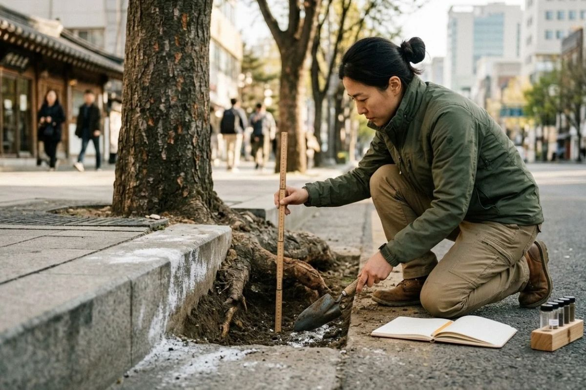
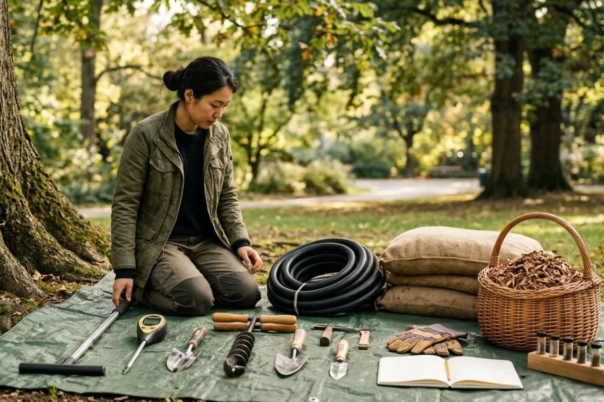

## 목차
1. [[마스터의 화두] "겨울 눈길 위 뿌려진 제설제와 봄철 흙더미가 수목의 봄을 가로막는다: 염류 축적과 복토 스트레스를 풀어내는 근권 정비의 본질"](#master-insight)
2. [[현장 진료 해부] 겨울철 융설제 유입과 봄철 주변 정지·복토로 잎 가장자리 갈변과 신초 고사를 겪던 가로수·단지 수목을, 염류·복토 진단과 단계별 근권 정비·세척·배수 SOP로 회복시킨 K 수목진료 코치의 실전 성공 사례](#success-case)
3. [[염류 저감 & 근권 정비 3대 전략] 제설제 염류 유입과 복토 깊이를 살피는 스트레스 진단 매트릭스(인프라 모델) + 뿌리 손상을 줄이며 염류 배출·복토 정리를 조율하는 근권 회복 캘리브레이션(수익 모델) + 배수 유지와 생육기 경과를 잇는 사후 관리 퍼널(유입 경로) 3중 파이프라인 SOP](#pivoting-sop)
4. [[사전 준비 & 실행 프로토콜] 토양·복토·공구 사전 점검 체크리스트와 염류 저감·복토 정비 단계별 시공 템플릿 및 사후 토양·수세 모니터링 루틴](#operation-sop)
5. [[마스터의 현장 노트] "수많은 제설 피해지와 복토 현장을 살피며 깨달은 '뿌리 호흡선을 되돌리는' 세심함과 원칙의 힘"](#master-note)
6. [[실전 실행 가이드] 제설제·복토 진단 기준과 뿌리 보호 시공 수칙, 사후 모니터링 SOP를 현장에 적용하여 수목 회복력을 높이는 3대 필수 수칙](#solution)
7. [관련 시리즈 모아보기](#series)
8. [자주 묻는 질문 (FAQ)](#faq)

---

## 1. [마스터의 화두] "겨울 눈길 위 뿌려진 제설제와 봄철 흙더미가 수목의 봄을 가로막는다: 염류 축적과 복토 스트레스를 풀어내는 근권 정비의 본질"

"봄이 되었는데도 가로수나 단지·정원 수목의 잎 가장자리가 마르거나 새순이 제대로 뻗지 못하고, **겨울철 제설제 흔적이나 주변 공사·조경 정비 과정에서 쌓인 복토 흔적이 함께 보였던 현장**이 없으십니까?"

"수많은 현장 실무자와 초보 관리자들이 **제설제 성분(염화칼슘·염화나트륨 등)이 녹은 물과 함께 토양으로 스며들어 삼투 스트레스와 이온 불균형을 일으키고, 지제부나 유효 근권 위에 흙이 덧씌워지면 뿌리 산소 공급과 가스 교환이 크게 방해받는다는 사실**을 놓치고 있다는 점을 직시하고 계시지 않습니까?"

수년간 도심 가로수·단지 수목의 제설 피해 및 복토 스트레스 사례를 분석하며 확신한 절대적인 명제는 **'제설제 염류 저감과 복토 스트레스 근권 정비에서 흔들리지 않는 비결은 염류 유입 경로와 복토·지제부 상태를 정확히 살피는 진단 기준, 뿌리 손상과 배수 막힘을 피하며 염류 배출과 토양 환경을 정돈하는 시공 원리, 그리고 강우·생육기 반응을 추적하는 현장 SOP에 있다'**는 사실입니다.

이번 [기획 연재: 수목진료 및 병해충 실무 마스터 클래스 시즌 1] 제6부에서는 겨울 제설제와 봄철 복토 스트레스에서 나무 구하기—염류 저감·근권 정비 실무 SOP를 전격 공개합니다.

<figure style="text-align: center; margin: 32px 0;">
  
  <figcaption style="font-size: 0.9rem; color: #6C7A72; margin-top: 12px; font-style: normal;">제설제 유입 경로와 지제부 복토 상태를 점검하는 현장</figcaption>
</figure>

---

## 2. [현장 진료 해부] 겨울철 융설제 유입과 봄철 주변 정지·복토로 잎 가장자리 갈변과 신초 고사를 겪던 가로수·단지 수목을, 염류·복토 진단과 단계별 근권 정비·세척·배수 SOP로 회복시킨 K 수목진료 코치의 실전 성공 사례

도로변·보도 경계와 인접 화단·조경 구역 수목의 제설제·복토 스트레스 개선 실전 사례입니다. 

해당 현장에서는 겨울철 제설 작업 후 녹은 물이 식재대로 흘러들고, 봄철 주변 흙 정리·조경 정비 과정에서 지제부 주변에 흙이 쌓이면서 수관 잎 끝·가장자리 마름과 생육 부진이 반복되었습니다. 

배수가 원활하지 않은 상태에서 흙만 덮어두거나 무리하게 깊게 파내면 뿌리 손상과 염류·습기 정체가 이어질 수 있었습니다. 

K 수목진료 코치는 즉시 **염류 저감·근권 정비 실무 SOP**를 가동했습니다. 

먼저 제설수 유입 경사·배수로 상태와 지제부 매몰 깊이를 확인하고, 뿌리 손상을 줄이는 범위에서 과도한 복토 정리와 배수·통기 여건 확보, 배수 흐름을 전제로 한 염류 저감 관리 및 사후 경과 점검까지 한 흐름으로 묶었습니다. 

그 결과 염류·복토로 인한 뿌리 호흡·수분 스트레스 요인이 줄어들고, 생육기 수세 회복을 뒷받침하는 체계적인 현장 관리 루틴이 정착되었습니다.

> #### 🏆 제설수·복토 방치형 관리 대 마스터 염류 저감·복토 정리·배수 연동 SOP 비교 매트릭스
>
> | 구분 | 제설수·복토 방치형 관리 (스트레스 누적형) | 마스터 염류 저감·복토 정리·배수 연동 SOP (K 코치 모델) |
> | :--- | :--- | :--- |
> | **원인·현장 진단** | 잎 갈변·생육 부진을 단순 병해충이나 건조로만 간주 | **제설제 유입 경로·배수 상태·복토·지제부 매몰 여부 종합 확인** |
> | **근권·염류 관리** | 배수 확인 없이 물만 붓거나 지제부 흙·이물질 방치 | **뿌리 손상 최소화하며 복토 정리·배수 확보 및 염류 배출 여건 조성** |
> | **사후 경과 점검** | 시공 후 토양·배수·신초 반응 추적 없이 종료 | **강우·관수 후 물 빠짐과 새순·잎·수관 활력 변화 정기 관찰** |

---

## 3. [염류 저감 & 근권 정비 3대 전략] 제설제 염류 유입과 복토 깊이를 살피는 스트레스 진단 매트릭스(인프라 모델) + 뿌리 손상을 줄이며 염류 배출·복토 정리를 조율하는 근권 회복 캘리브레이션(수익 모델) + 배수 유지와 생육기 경과를 잇는 사후 관리 퍼널(유입 경로) 3중 파이프라인 SOP

제설제와 복토 스트레스를 안전하게 풀어내려면 스트레스 진단 매트릭스, 근권 회복 캘리브레이션, 그리고 사후 관리 퍼널을 결합한 3중 파이프라인 SOP를 가동해야 합니다.

<figure style="text-align: center; margin: 32px 0;">
  
  <figcaption style="font-size: 0.9rem; color: #6C7A72; margin-top: 12px; font-style: normal;">근권 보호와 염류·복토 정비를 위한 현장 장비 및 자재 세팅</figcaption>
</figure>

> #### 💡 수목진료 및 병해충 실무 SOP 시즌 1 제6부 핵심 3대 전략 SOP
> 

> 
> 1. **[인프라 모델 전략: 제설제·복토 요인을 구분하는 '스트레스 진단 매트릭스']**  
>    * 겨울철 염류 피해와 봄철 복토 스트레스는 함께 나타나는 경우가 많으므로 현장 조건부터 차분히 따져야 합니다.  
>    * ① **제설제 유입 및 토양 조건 확인:** 도로·보도·계단·주차장 경사와 제설수 유입 방향, 표층 염류 자국·토양 굳기·배수 속도를 점검해 염분이 토양에 머무르는지 확인합니다.  
>    * ② **복토 및 지제부 매몰 확인:** 원래의 지제부(근주부) 위치가 흙이나 자재로 덮였는지, 수관 투영선 안쪽에 추가 흙이 쌓였는지 살피며 흡수근·세근 분포 범위를 파악합니다.

> 2. **[수익 모델 전략: 뿌리 피해를 줄이며 환경을 되돌리는 '근권 회복 캘리브레이션']**  
>    * 뿌리를 다치지 않게 하면서 염류와 복토 부담을 낮추는 세밀한 조율이 필요합니다.  
>    * **① 복토 정리 및 지제부 확보:** 지제부 주변에 쌓인 여분의 흙·이물질을 조심스럽게 걷어내 뿌리목이 과습·부후에 노출되지 않도록 하고, 뿌리 손상을 줄이는 범위에서 과도한 복토층과 토양 굳기를 완화합니다.  
>    * **② 염류 저감 및 배수 흐름 확보:** 물이 고이거나 배수가 막힌 상태에서는 염류가 빠져나가기 어렵습니다. 배수로·배수층 상태를 점검해 물길을 확보하고, 토양·배수 조건과 적용 기준에 맞춘 관수·세척 및 토양 개량·멀칭 기준을 적용합니다.

> 3. **[유입 경로 전략: 재유입 차단과 수세 회복을 잇는 '사후 관리 퍼널']**  
>    * 한 번의 정비로 끝내지 않고 이후 유입과 회복 과정을 이어가야 효과가 유지됩니다.  
>    * **① 재유입·복토 방지:** 겨울철 제설수 유입 완화 대책과 함께 식재지 내 추가 복토·적재·차량 진입을 막습니다.  
>    * **② 정비·토양 이력 기록:** 위치, 수종, 제설제·복토 상태, 정비 내용, 자재 및 일자를 기록합니다.  
>    * **③ 생육기 경과 확인:** 강우·관수 후 배수 상태와 새순·잎·수관 활력 회복 여부를 추적하는 3단계 사후 관리 퍼널을 완성하세요.

---

## 4. [사전 준비 & 실행 프로토콜] 토양·복토·공구 사전 점검 체크리스트와 염류 저감·복토 정비 단계별 시공 템플릿 및 사후 토양·수세 모니터링 루틴

제설제 염류 저감 및 복토 정비 현장에서 뿌리 손상과 재발을 줄이기 위한 표준 운영 프로토콜입니다.

> #### ⚙️ 제설제 염류 저감 및 복토 근권 정비 3대 수칙
> 

> 
> 1. **[작업 전 염류·복토 상태와 장비를 확인하는 '근권 정비 사전 점검 체크리스트' 매뉴얼]**  
>    * 작업 착수 전 ① 제설수 유입 경로·배수 여부, 지제부 매몰·복토 깊이 및 주변 시설물·매설물·보행 동선 확인 ➔ ② 뿌리 손상을 줄일 수 있는 정리·통기 공구, 소독제, 토양 개량·멀칭 자재 및 보호구 구비 점검 ➔ ③ 배수 흐름 확보 가능 여부와 작업 시기 적정성을 확인하는 체크리스트를 준수하세요.

> 2. **[정비 순서를 표준화하는 '염류 저감·복토 정비 단계별 시공 템플릿' 캘리브레이션]**  
>    * 시공 진행 시 ① **현장 확인 및 지제부 정리:** 상태 점검·사진 촬영 후 지제부 주변 복토·이물질 조심 제거 ➔ ② **배수·통기·염류 저감 적용:** 뿌리 손상을 줄이며 배수 흐름을 확보하고 적용 기준에 맞춰 염류 저감·토양 개량·멀칭 진행 ➔ ③ **표면 정리 및 기록:** 잔여물 정리, 재유입 주의 안내 및 시공 내역·사진 기록 템플릿을 적용하세요.

> 3. **[정비 이후 배수성과 수세 회복을 추적하는 '토양·수세 사후 모니터링' 루틴]**  
>    * 시공 완료 후 ① 강우·관수 후 물 고임 해소 여부와 지제부·표면 상태 점검 ➔ ② 봄·여름 생육기 동안 잎 가장자리 갈변 진행 여부, 새순·신초 생장 및 수관 활력 변화 관찰 ➔ ③ 기록된 경과 데이터를 바탕으로 후속 관리나 다음 겨울철 제설·복토 예방 계획에 반영하는 사후 관리 루틴을 정례화하세요.

---

## 5. [마스터의 현장 노트] "수많은 제설 피해지와 복토 현장을 살피며 깨달은 '뿌리 호흡선을 되돌리는' 세심함과 원칙의 힘"

> #### 📝 [마스터 노트] 제설제 염류 저감 및 복토 근권 정비 실무에서 체득한 현장 지혜
>
> * **첫 번째 지혜: "겨울의 염분과 봄의 흙더미는 한꺼번에 뿌리의 숨길을 좁힌다. 물길이 열리고 숨쉴 틈이 생겨야 나무가 살아난다"**  
>   ➔ 원인과 배수 상태를 함께 보는 것이 회복의 첫걸음입니다.

> * **두 번째 지혜: "복토를 걷어내고 흙을 고를 때는 '더 많이 파내기'보다 '뿌리를 덜 다치게 하기'를 먼저 떠올려야 한다"**  
>   ➔ 세심한 손길이 약해진 뿌리의 회복 속도를 지킵니다.

> * **세 번째 지혜: "지제부가 숨을 쉬고 다음 겨울·봄에 같은 실수가 반복되지 않도록 막는 것이 진짜 현장 관리다"**  
>   ➔ 기록과 예방 동선이 나무의 다음 계절을 바꿉니다.

---

## 6. [실전 실행 가이드] 제설제·복토 진단 기준과 뿌리 보호 시공 수칙, 사후 모니터링 SOP를 현장에 적용하여 수목 회복력을 높이는 3대 필수 수칙

1. **제설수 유입·배수 상태·지제부 매몰 및 복토 깊이를 살피는 사전 진단 기준 확립**  
   염류 축적과 복토 스트레스의 원인을 구분해 무분별한 조치를 방지.
2. **뿌리 손상 최소화, 지제부 주변 복토 정리 및 배수 흐름 확보를 전제로 한 염류 저감·개량 원칙 준수**  
   근권 산소·수분 순환 여건을 되살리고 이차적 뿌리 피해를 줄임.
3. **시공 기록과 강우·생육기별 배수·수세 경과 모니터링 SOP 체화**  
   회복 과정을 꾸준히 추적해 다음 계절 관리 계획에 반영.

---

## 7. 관련 시리즈 모아보기

* **[기획 연재: 수목진료 및 병해충 실무 마스터 클래스 시즌 1. ①] [현장 정밀 진단 & 시료 채취 실무 편] \"현장 정밀 진단과 시료 채취의 첫걸음: 흙·잎·가지 시료를 망가뜨리지 않고 담는 법\"**  
  ➔ [수목진료 현장 진단 순서, 잎 가지 토양 시료 채취 포장 이송 SOP](https://floraldays.com/sop-season1-field-diagnosis-sample-collection-part1)

* **[기획 연재: 수목진료 및 병해충 실무 마스터 클래스 시즌 1. ②] [수간주사 현장 시공 실무 편] \"구멍을 뚫을 때도 각도와 깊이가 있다: 수종·시기별 수간주사 현장 시공 SOP\"**  
  ➔ [수간주사 천공 각도 깊이 간격, 약액 누출 제어, 현장 시공 안전 SOP](https://floraldays.com/sop-season1-trunk-injection-field-sop-part2)

* **[기획 연재: 수목진료 및 병해충 실무 마스터 클래스 시즌 1. ③] [약제 살포 & 비산 방지 실무 편] \"도심·아파트 단지 약제 살포 안전 수칙: 바람·보행자·비산(Drift)을 막는 현장 프로토콜\"**  
  ➔ [도심 약제 살포 안전, 비산 Drift 저감, 약해 예방 현장 SOP](https://floraldays.com/sop-season1-pesticide-spray-safety-drift-sop-part3)

* **[기획 연재: 수목진료 및 병해충 실무 마스터 클래스 시즌 1. ④] [수목 외과수술 & 공동·부후 처치 실무 편] \"썩은 부분을 파내기만 하면 될까? 수목 외과수술과 공동·부후 처치 실전 SOP\"**  
  ➔ [수목 외과수술, 공동 부후 처치, 수분 고임 방지 및 안전 SOP](https://floraldays.com/sop-season1-tree-surgery-decay-cavity-sop-part4)

* **[기획 연재: 수목진료 및 병해충 실무 마스터 클래스 시즌 1. ⑤] [토양 답압 해소 & 통기·배수 개선 실무 편] \"조경수가 흙 속에서 숨을 못 쉴 때: 토양 답압 해소·통기·배수 개선 시공 매뉴얼\"**  
  ➔ [토양 답압 해소, 통기 배수 개선, 근권 관리 현장 SOP](https://floraldays.com/sop-season1-soil-compaction-aeration-drainage-sop-part5)

* **[기획 연재: 수목진료 및 병해충 실무 마스터 클래스 시즌 1. ⑥] [염류 저감 & 근권 정비 실무 편] \"겨울 제설제와 봄철 복토 스트레스에서 나무 구하기: 염류 저감·근권 정비 실무 SOP\"**  
  ➔ [제설제 염류 저감, 복토 스트레스 해소, 근권 정비 현장 SOP](https://floraldays.com/sop-season1-deicing-salt-fill-soil-stress-sop-part6)

---

## 8. 자주 묻는 질문 (FAQ)

**Q1. 겨울철 제설제 영향을 받은 수목이나 봄철에 흙이 덧씌워진 수목을 관리할 때 가장 먼저 확인해야 할 점은 무엇인가요?**  

A1. '먼저 제설수가 흘러드는 경사·배수로 상태와 토양 배수 속도를 확인하고, 원래의 지제부(근주부) 위치가 흙이나 자재로 얼마나 덮였는지 살펴야 합니다. 

배수가 막힌 채로 방치하거나 뿌리 위치를 고려하지 않고 거칠게 파면 회복이 더뎌질 수 있으므로, 뿌리 손상을 줄이는 범위에서 복토를 정리하고 배수·통기 여건을 함께 갖추는 것이 중요합니다'.

> 💡 제설 피해 수목 관리 및 토양 환경 관련 공식 참고 자료는 <a href="https://www.nihhs.go.kr" target="_blank" rel="noopener noreferrer">농촌진흥청 국립원예특작과학원</a>을 참고하시기 바랍니다.

**Q2. 염류 저감 및 복토 정비 작업을 마친 뒤에는 어떤 점을 중점적으로 살펴야 하나요?**  

A2. '비나 관수 이후 물이 고이지 않고 잘 빠지는지 확인하고, 작업 구역에 다시 흙이 쌓이거나 보행·차량·제설수 유입이 생기지 않도록 관리해야 합니다. 

또한 생육기 동안 잎 가장자리 갈변이 멈추는지, 새순과 수관 활력이 서서히 회복되는지 기록하며 경과를 추적하는 것이 좋습니다'.

> 💡 스마트 홈가드닝 및 도시농업 정보는 <a href="https://www.modunong.or.kr" target="_blank" rel="noopener noreferrer">농림축산식품부 모두가 도시농부 포털</a>을 참고하세요.

---

