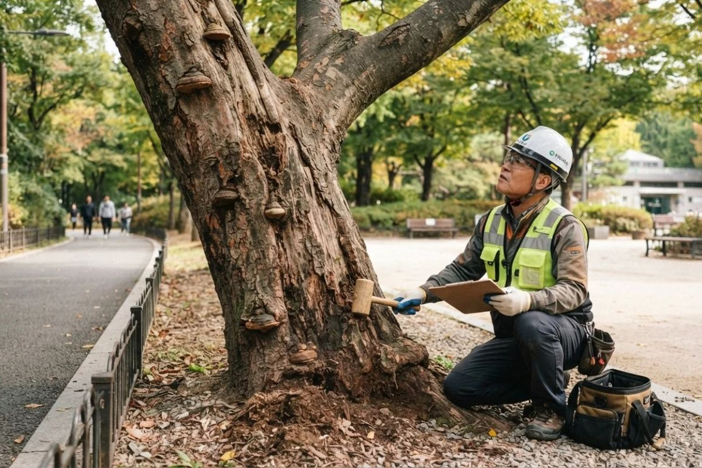

## 목차
1. [[마스터의 화두] "겉으로 푸르게 잎을 피운 나무라고 모두 안전한 것은 아니다: 구조 결함과 표적 위험을 함께 읽는 위험수목 진단·관리의 본질"](#master-insight)
2. [[현장 진료 해부] 수관 상부만 살피고 하부 근주부 부후와 좁은 분지각 결함을 놓쳐 강풍 전후 낙지·도복 우려를 겪던 공원·단지 현장을, 부위별 구조 진단과 단계별 안전 전정·통제 SOP로 안정화한 K 수목진료 코치의 실전 성공 사례](#success-case)
3. [[위험수목 진단 & 안전 전정 3대 전략] 결함 징후와 표적 구역을 교차 평가하는 위험도 진단 매트릭스(인프라 모델) + 수피·지융부 보호와 하중 균형을 조율하는 안전 전정 캘리브레이션(수익 모델) + 현장 통제와 기상 전후 점검을 잇는 안전 관리 퍼널(유입 경로) 3중 파이프라인 SOP](#pivoting-sop)
4. [[사전 준비 & 실행 프로토콜] 위험수목 진단·전정 장비·안전 점검 체크리스트와 단계별 전정·정리 시공 템플릿 및 사후 강풍·경과 모니터링 루틴](#operation-sop)
5. [[마스터의 현장 노트] "수많은 노거수·가로수 안전 점검과 강풍 피해 현장을 살피며 깨달은 '뿌리부터 수관 끝까지 연결해 보는' 관찰의 무게"](#master-note)
6. [[실전 실행 가이드] 부위별 결함·표적 평가 기준과 수피 보호 안전 전정 수칙, 사후 모니터링 SOP를 현장에 적용하여 도심 수목 안전성을 높이는 3대 필수 수칙](#solution)
7. [관련 시리즈 모아보기](#series)
8. [자주 묻는 질문 (FAQ)](#faq)

---

## 1. [마스터의 화두] "겉으로 푸르게 잎을 피운 나무라고 모두 안전한 것은 아니다: 구조 결함과 표적 위험을 함께 읽는 위험수목 진단·관리의 본질"

"공원 산책로나 아파트 단지, 도로변을 지나는 큰 나무를 바라볼 때, **잎이 무성하게 달려 있다는 이유만으로 안전하다고 여겼다가 비바람이 불 때 굵은 가지가 찢어지거나 뿌리째 기울어지는 아찔한 상황**을 마주한 적이 없으십니까?"

"수많은 현장 실무자와 초보 관리자들이 **수목의 생리적 활력(잎의 푸름)과 물리적·구조적 안정성(지지력·결함 유무)은 별개의 축이며, 작은 결함이라도 보행로·차도·놀이터·건물 같은 '표적 구역'과 겹치면 큰 안전 리스크로 이어질 수 있다는 사실**을 놓치고 있다는 점을 직시하고 계시지 않습니까?"

수년간 도심 가로수·공원 수목 안전 점검과 전정 시공 사례를 분석하며 확신한 절대적인 명제는 **'위험수목 진단과 전정·관리에서 흔들리지 않는 비결은 수관·분지부·수간·근주부 결함과 주변 표적 조건을 함께 따지는 진단 기준, 수피와 지융부를 보호하며 수관 하중 균형을 잡는 안전 전정 원리, 그리고 현장 통제와 기상 전후 점검을 묶은 현장 SOP에 있다'**는 사실입니다.

이번 [기획 연재: 수목진료 및 병해충 실무 마스터 클래스 시즌 1] 제7부에서는 쓰러질 위험이 있는 나무는 어떻게 판단할까—위험수목 진단·전정·관리 SOP를 전격 공개합니다.

<figure style="text-align: center; margin: 32px 0;">
  
  <figcaption style="font-size: 0.9rem; color: #6C7A72; margin-top: 12px; font-style: normal;">수간 분지부와 근주부 상태, 주변 표적 구역을 함께 점검하는 현장</figcaption>
</figure>

---

## 2. [현장 진료 해부] 수관 상부만 살피고 하부 근주부 부후와 좁은 분지각 결함을 놓쳐 강풍 전후 낙지·도복 우려를 겪던 공원·단지 현장을, 부위별 구조 진단과 단계별 안전 전정·통제 SOP로 안정화한 K 수목진료 코치의 실전 성공 사례

보행자 이용이 많은 공원 및 공동주택 단지 대형 조경수의 위험수목 안전 관리 개선 실전 사례입니다. 

해당 현장에서는 평소 마른 가지만 눈에 띌 때마다 임의로 잘라내는 수준의 전정만 반복했고, 지제부 흙 들뜸, 수간 세로 균열, 내포수피를 동반한 좁은 Y자 분지부 같은 구조적 약점은 체계적으로 기록되지 않았습니다. 

또한 무리한 강전정(두목 전정)을 시행한 일부 개체에서는 절단부 부후와 약한 맹아지 다발이 생겨 오히려 바람 저항과 가지 부러짐 위험이 커졌습니다. 

K 수목진료 코치는 즉시 **위험수목 진단·전정·관리 실전 SOP**를 가동했습니다. 

먼저 근주부·수간·분지부·수관과 주변 표적 구역을 순서대로 점검해 위험 요인과 우선순위를 분류하도록 기준을 세웠습니다. 

이어 고사지·피해지·교차지 정리와 수관 하중 조절 시 지융부(가지 밑동)를 보존하는 올바른 절단 위치와 작업 구역 통제를 적용하고, 기상 특보 전후 재점검 루틴까지 한 흐름으로 묶었습니다. 

그 결과 불필요한 강전정 후유증을 줄이면서 낙지·도복 리스크를 사전에 관리하는 안정적인 현장 안전 체계를 구축할 수 있었습니다.

> #### 🏆 육안 인상·임의 강전정 관리 대 마스터 부위별 구조 진단·지융부 보존 안전 전정 SOP 비교 매트릭스
>
> | 구분 | 육안 인상·임의 강전정 관리 (결함 누락·약한 맹아 유발형) | 마스터 부위별 구조 진단·지융부 보존 안전 전정 SOP (K 코치 모델) |
> | :--- | :--- | :--- |
> | **위험도·결함 점검** | 잎이 무성하면 안전하다고 보고 근주부·분지부 결함 간과 | **근주부·수간·분지부·수관 결함과 주변 표적 구역을 종합 평가** |
> | **전정 방식·위치** | 두목 전정(토핑)이나 바짝 자르기로 큰 상처·약한 맹아 유발 | **지융부 보존·3단계 절단으로 수피 찢김 방지 및 하중 균형 조절** |
> | **안전 통제 및 추적** | 작업 구역 통제나 기상 특보 전후 재확인 절차 부재 | **낙하 반경 통제·보호구 착용 및 강풍·폭우 전후 모니터링 수행** |

---

## 3. [위험수목 진단 & 안전 전정 3대 전략] 결함 징후와 표적 구역을 교차 평가하는 위험도 진단 매트릭스(인프라 모델) + 수피·지융부 보호와 하중 균형을 조율하는 안전 전정 캘리브레이션(수익 모델) + 현장 통제와 기상 전후 점검을 잇는 안전 관리 퍼널(유입 경로) 3중 파이프라인 SOP

위험수목을 정확히 가려내고 안전하게 관리하려면 위험도 진단 매트릭스, 안전 전정 캘리브레이션, 그리고 안전 관리 퍼널을 결합한 3중 파이프라인 SOP를 가동해야 합니다.

<figure style="text-align: center; margin: 32px 0;">
  
  <figcaption style="font-size: 0.9rem; color: #6C7A72; margin-top: 12px; font-style: normal;">안전 장구와 소독된 전정 공구, 현장 진단표를 갖춘 시공 준비 모습</figcaption>
</figure>

> #### 💡 수목진료 및 병해충 실무 SOP 시즌 1 제7부 핵심 3대 전략 SOP
> 

> 
> 1. **[인프라 모델 전략: 뿌리부터 수관·표적까지 단계별로 살피는 '위험도 진단 매트릭스']**  
>    * 위험수목 평가는 나무 자체의 구조적 결함과 쓰러지거나 부러졌을 때 피해를 입을 대상(표적)을 함께 보아야 합니다.  
>    * ① **부위별 결함 징후 점검:** 지제부·근주부(토양 균열·들뜸, 뿌리 절단, 버섯 자실체, 수간 기울기 변화) → 수간(공동, 세로 균열, 수피 탈락, 부후 흔적) → 분지부(좁은 Y자 분지각과 내포수피, 쪼개짐) → 수관(고사지, 걸린 가지, 편중된 수관 하중) 순서로 빠짐없이 살핍니다.  
>    * ② **표적 구역 및 우선순위 평가:** 보행로, 어린이 놀이터, 주차장, 도로, 건축물, 전선 등 상시·빈번 이용 구역과의 거리 및 예상 낙하 반경을 교차 검토해 관리 우선순위를 정합니다.

> 2. **[수익 모델 전략: 상처 구획화와 구조 균형을 지키는 '안전 전정 캘리브레이션']**  
>    * 위험 요인을 줄이기 위한 전정은 수목의 방어 능력을 해치지 않으면서 하중과 바람 저항을 낮추는 방향으로 진행해야 합니다.  
>    * **① 지융부 보존 및 3단계 절단:** 가지를 자를 때는 줄기 쪽 지융부(Branch Collar)를 파고들지 않고 바깥 경계에서 절단하며, 굵은 가지는 밑면 1차 컷 → 바깥쪽 절단 → 지융부 바깥 최종 정리의 3단계 절단으로 수피 찢어짐을 막습니다.  
>    * **② 두목 전정(토핑) 회피 및 하중 조절:** 원줄기나 굵은 가지를 무분별하게 잘라내는 두목 전정은 큰 부후 상처와 약하게 붙은 다량의 맹아지를 만들어 향후 낙지 위험을 오히려 높입니다. 고사지·손상지·내포수피 결함지 정리와 선택적 솎아내기 중심으로 수관 균형을 맞춥니다.

> 3. **[유입 경로 전략: 작업자·보행자 안전과 사후 추적을 연결하는 '안전 관리 퍼널']**  
>    * 위험수목 관리 현장은 시공 중 사고 예방과 기상 변화 대응이 핵심입니다.  
>    * **① 작업 구역 통제 및 개인보호구:** 낙하 반경을 확보해 안내 표지·통제선으로 보행자 접근을 막고, 안전모·보안경·장갑·안전화 등 보호구를 철저히 착용하며 고소·전선 인접 작업 시 안전 기준을 준수합니다.  
>    * **② 진단·전정 이력 기록:** 수목 위치, 수종, 결함 부위·유형, 표적 구역, 조치 내용, 사진 기록을 남깁니다.  
>    * **③ 기상 전후 및 정기 모니터링:** 태풍·강풍·폭설 예보 전후와 계절 변화 시기에 결함 부위 진행 여부, 수관 균형, 추가 전정 또는 정밀 안전 진단 필요성을 점검하는 3단계 안전 관리 퍼널을 완성하세요.

---

## 4. [사전 준비 & 실행 프로토콜] 위험수목 진단·전정 장비·안전 점검 체크리스트와 단계별 전정·정리 시공 템플릿 및 사후 강풍·경과 모니터링 루틴

위험수목 진단 및 안전 전정 현장에서 인명·시설물 피해와 2차 수목 손상을 막기 위한 표준 운영 프로토콜입니다.

> #### ⚙️ 위험수목 진단 및 안전 전정·관리 3대 수칙
> 

> 
> 1. **[작업 전 결함·표적·안전 장비를 확인하는 '위험수목 사전 점검 체크리스트' 매뉴얼]**  
>    * 작업 착수 전 ① 근주부·수간·분지부·수관 결함 상태와 보행로·차량·시설물·전선 등 표적 구역 확인 ➔ ② 전정 톱·가위 날 상태, 소독제, 로프·사다리/고소 장비 및 개인보호구(안전모·보안경·장갑 등) 구비 점검 ➔ ③ 현장 작업 가능 범위인지, 대형 위험목 제거·전문 정밀 진단·지주/당김줄 보강 연계가 필요한지 확인하는 체크리스트를 준수하세요.

> 2. **[전정·정리 순서를 표준화하는 '안전 전정 단계별 시공 템플릿' 캘리브레이션]**  
>    * 시공 진행 시 ① **구역 통제 및 공구 소독:** 낙하 반경 통제선 설치·사전 촬영 및 절삭 공구 소독 ➔ ② **결함지 정리 및 지융부 보존 절단:** 고사지·위험지 우선 정리, 굵은 가지 3단계 절단 및 수관 균형 조절 ➔ ③ **잔재 반출 및 기록:** 전정 부산물 정리, 통제 해제 및 진단·시공 내역·사진 기록 템플릿을 적용하세요.

> 3. **[시공 이후 구조 안정성과 기상 대응을 추적하는 '위험수목 사후 모니터링' 루틴]**  
>    * 시공 완료 후 ① 초기 단계에서 절단면 상태, 수피 찢김 유무 및 현장 정리 상태 점검 ➔ ② 강풍·폭우·폭설 전후로 근주부 기울기 변화, 균열·부후 확대 여부 및 수관 하중 균형 재확인 ➔ ③ 위험도가 높아진 개체는 접근 통제 강화 및 정밀 안전 진단·추가 조치를 연계하는 사후 관리 루틴을 정례화하세요.

---

## 5. [마스터의 현장 노트] "수많은 노거수·가로수 안전 점검과 강풍 피해 현장을 살피며 깨달은 '뿌리부터 수관 끝까지 연결해 보는' 관찰의 무게"

> #### 📝 [마스터 노트] 위험수목 진단 및 안전 전정 실무에서 체득한 현장 지혜
>
> * **첫 번째 지혜: "나무가 쓰러질 때는 하늘이 아니라 발밑에서 신호가 먼저 온다. 근주부와 분지부를 놓치지 마라"**  
>   ➔ 잎의 무성함 뒤에 숨은 구조 결함을 읽어내는 눈이 사고를 막습니다.

> * **두 번째 지혜: "급하다고 머리부터 잘라내는 두목 전정은 당장 작아 보일 뿐, 몇 년 뒤 더 위험한 가지를 키운다"**  
>   ➔ 지융부를 지키는 절제된 전정이 나무의 방어력과 안전을 함께 살립니다.

> * **세 번째 지혜: "위험수목 관리는 한 번의 전정으로 끝나지 않는다. 바람이 오기 전과 지나간 뒤의 기록이 현장을 지킨다"**  
>   ➔ 꾸준한 추적 관찰이 도심 숲과 사람의 안전을 잇는 가장 든든한 안전망입니다.

---

## 6. [실전 실행 가이드] 부위별 결함·표적 평가 기준과 수피 보호 안전 전정 수칙, 사후 모니터링 SOP를 현장에 적용하여 도심 수목 안전성을 높이는 3대 필수 수칙

1. **근주부·수간·분지부·수관 결함과 주변 표적 구역을 교차 평가하는 진단 기준 확립**  
   생육 활력과 구조 안정성을 구분해 관리 우선순위를 명확히 설정.
2. **지융부 보존·3단계 절단·두목 전정 회피 및 낙하 반경 통제 원칙 준수**  
   수피 손상과 2차 부후를 줄이면서 작업자·보행자 안전을 확보.
3. **진단·시공 이력 기록과 기상 특보 전후 사후 모니터링 SOP 체화**  
   계절·기상 변화에 선제적으로 대응하는 지속 가능한 위험수목 관리 체계 구축.

---

## 7. 관련 시리즈 모아보기

* **[기획 연재: 수목진료 및 병해충 실무 마스터 클래스 시즌 1. ①] [현장 정밀 진단 & 시료 채취 실무 편] \"현장 정밀 진단과 시료 채취의 첫걸음: 흙·잎·가지 시료를 망가뜨리지 않고 담는 법\"**  
  ➔ [수목진료 현장 진단 순서, 잎 가지 토양 시료 채취 포장 이송 SOP](https://floraldays.com/sop-season1-field-diagnosis-sample-collection-part1)

* **[기획 연재: 수목진료 및 병해충 실무 마스터 클래스 시즌 1. ②] [수간주사 현장 시공 실무 편] \"구멍을 뚫을 때도 각도와 깊이가 있다: 수종·시기별 수간주사 현장 시공 SOP\"**  
  ➔ [수간주사 천공 각도 깊이 간격, 약액 누출 제어, 현장 시공 안전 SOP](https://floraldays.com/sop-season1-trunk-injection-field-sop-part2)

* **[기획 연재: 수목진료 및 병해충 실무 마스터 클래스 시즌 1. ③] [약제 살포 & 비산 방지 실무 편] \"도심·아파트 단지 약제 살포 안전 수칙: 바람·보행자·비산(Drift)을 막는 현장 프로토콜\"**  
  ➔ [도심 약제 살포 안전, 비산 Drift 저감, 약해 예방 현장 SOP](https://floraldays.com/sop-season1-pesticide-spray-safety-drift-sop-part3)

* **[기획 연재: 수목진료 및 병해충 실무 마스터 클래스 시즌 1. ④] [수목 외과수술 & 공동·부후 처치 실무 편] \"썩은 부분을 파내기만 하면 될까? 수목 외과수술과 공동·부후 처치 실전 SOP\"**  
  ➔ [수목 외과수술, 공동 부후 처치, 수분 고임 방지 및 안전 SOP](https://floraldays.com/sop-season1-tree-surgery-decay-cavity-sop-part4)

* **[기획 연재: 수목진료 및 병해충 실무 마스터 클래스 시즌 1. ⑤] [토양 답압 해소 & 통기·배수 개선 실무 편] \"조경수가 흙 속에서 숨을 못 쉴 때: 토양 답압 해소·통기·배수 개선 시공 매뉴얼\"**  
  ➔ [토양 답압 해소, 통기 배수 개선, 근권 관리 현장 SOP](https://floraldays.com/sop-season1-soil-compaction-aeration-drainage-sop-part5)

* **[기획 연재: 수목진료 및 병해충 실무 마스터 클래스 시즌 1. ⑥] [염류 저감 & 근권 정비 실무 편] \"겨울 제설제와 봄철 복토 스트레스에서 나무 구하기: 염류 저감·근권 정비 실무 SOP\"**  
  ➔ [제설제 염류 저감, 복토 스트레스 해소, 근권 정비 현장 SOP](https://floraldays.com/sop-season1-deicing-salt-fill-soil-stress-sop-part6)

* **[기획 연재: 수목진료 및 병해충 실무 마스터 클래스 시즌 1. ⑦] [위험수목 진단 & 전정·관리 실무 편] \"쓰러질 위험이 있는 나무는 어떻게 판단할까? 위험수목 진단·전정·관리 SOP\"**  
  ➔ [위험수목 진단, 지융부 보존 안전 전정, 표적 구역 관리 SOP](https://floraldays.com/sop-season1-hazard-tree-assessment-pruning-sop-part7)

---

## 8. 자주 묻는 질문 (FAQ)

**Q1. 잎이 푸르고 무성하게 자라는 나무도 쓰러지거나 큰 가지가 부러질 위험이 있을 수 있나요?**  

A1. '네, 그렇습니다. 잎이 무성하다는 것은 수관의 광합성·생리 활동이 유지되고 있다는 뜻일 뿐, 근주부 뿌리 지지력이나 수간 내부 부후, 내포수피를 동반한 좁은 분지부 결함이 없다는 보장은 아닙니다. 

오히려 잎이 무성한 수관은 강풍이나 폭우 시 바람 저항과 하중을 크게 받을 수 있으므로, 근주부·수간·분지부 구조 결함과 주변 표적 구역을 함께 점검해야 합니다'.

> 💡 도심 수목 관리 및 안전 전정 관련 공식 참고 자료는 <a href="https://www.nihhs.go.kr" target="_blank" rel="noopener noreferrer">농촌진흥청 국립원예특작과학원</a>을 참고하시기 바랍니다.

**Q2. 가지가 부러질까 봐 원줄기나 굵은 가지를 한꺼번에 짧게 잘라내는 전정(두목 전정)을 하면 안전해질까요?**  

A2. '큰 가지를 무분별하게 잘라내는 두목 전정은 넓은 절단면을 통해 목재부후균이 침입하기 쉽게 만들고, 절단 부위 주변에서 약하게 부착된 맹아지가 한꺼번에 자라나 몇 년 뒤 오히려 가지 찢어짐과 낙지 위험을 높일 수 있습니다. 

고사지·손상지·결함지를 중심으로 지융부 바깥 경계를 지켜 선택적으로 정리하는 안전 전정 원칙을 따르는 것이 바람직합니다'.

> 💡 스마트 홈가드닝 및 도시농업 정보는 <a href="https://www.modunong.or.kr" target="_blank" rel="noopener noreferrer">농림축산식품부 모두가 도시농부 포털</a>을 참고하세요.

---

