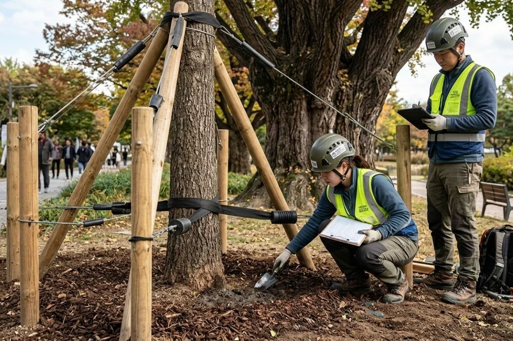
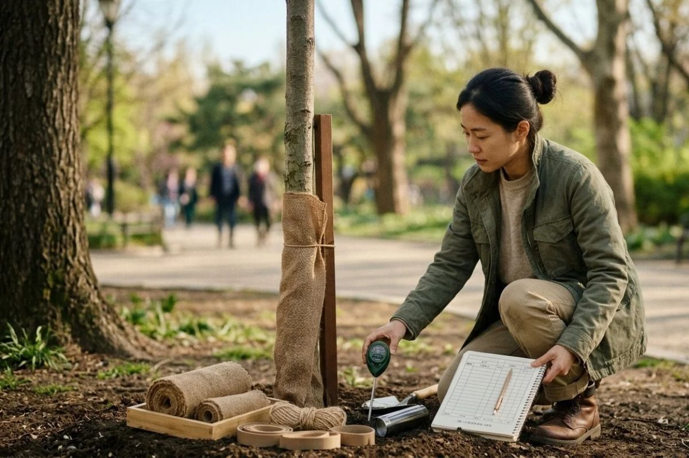

## 목차
1. [[마스터의 화두] "단단히 묶어 세우기만 하면 나무가 뿌리를 잘 내릴까: 줄기 상처를 막고 스스로 서는 힘을 키우는 지주·생육 안정화의 본질"](#master-insight)
2. [[현장 진료 해부] 지주 결속선 파고듦과 과도한 고정·불규칙 관수로 수피 손상과 생육 지연을 겪던 이식목·노거수 현장을, 완충 보호·단계별 관수·적기 해체 SOP로 안정화한 K 수목진료 코치의 실전 성공 사례](#success-case)
3. [[지주·이식목·노거수 안정화 3대 전략] 수피 손상과 흔들림을 조율하는 지주목·당김줄 설치 매트릭스(인프라 모델) + 수분·토양·상처 부담을 맞추는 이식목·노거수 생육 캘리브레이션(수익 모델) + 지주 점검·해체·경과 추적을 잇는 관리 퍼널(유입 경로) 3중 파이프라인 SOP](#pivoting-sop)
4. [[사전 준비 & 실행 프로토콜] 지주 자재·완충재·관수 점검 체크리스트와 지주·이식목·노거수 단계별 시공 템플릿 및 사후 결속·활력 모니터링 루틴](#operation-sop)
5. [[마스터의 현장 노트] "수많은 이식목과 노거수 현장을 살피며 깨달은 '영원히 묶어 두지 않는' 배려와 타이밍의 무게"](#master-note)
6. [[실전 실행 가이드] 지주목·당김줄 설치 기준과 이식목·노거수 보호 수칙, 사후 모니터링 SOP를 현장에 적용하여 생육 안정성을 높이는 3대 필수 수칙](#solution)
7. [관련 시리즈 모아보기](#series)
8. [자주 묻는 질문 (FAQ)](#faq)

---

## 1. [마스터의 화두] "단단히 묶어 세우기만 하면 나무가 뿌리를 잘 내릴까: 줄기 상처를 막고 스스로 서는 힘을 키우는 지주·생육 안정화의 본질"

"새로 식재한 조경수나 중요한 노거수·이식목을 관리할 때, **바람에 흔들리지 않도록 단단히 묶어 두었는데 훗날 결속선이 줄기를 파고들어 수피가 찢어지거나 뿌리 활착이 늦어졌던 경험**이 없으십니까?"

"수많은 현장 실무자와 초보 관리자들이 **지주목과 당김줄은 뿌리가 자리를 잡을 때까지 최소한의 흔들림과 도복을 막는 보조 장치일 뿐인데, 뻣뻣한 결속이나 과도한 고정, 불균형한 수분·근권 관리를 이어가면 오히려 수피 손상과 생육 저하로 이어질 수 있다는 사실**을 간과하고 있다는 점을 직시하고 계시지 않습니까?"

수년간 이식목·조경수 활착 관리와 노거수 보호 현장을 분석하며 확신한 절대적인 명제는 **'지주목·당김줄 설치와 이식목·노거수 생육 안정화에서 흔들리지 않는 비결은 줄기 상처와 과도한 고정을 막는 설치 기준, 토양 수분과 근권·수관 균형을 맞추는 생육 관리 원리, 그리고 결속 점검과 적기 해체를 묶은 현장 SOP에 있다'**는 사실입니다.

이번 [기획 연재: 수목진료 및 병해충 실무 마스터 클래스 시즌 1] 제8부에서는 새로 심은 나무와 노거수를 지키는 힘—지주목·당김줄 설치와 생육 안정화 SOP를 전격 공개합니다.

<figure style="text-align: center; margin: 32px 0;">
  
  <figcaption style="font-size: 0.9rem; color: #6C7A72; margin-top: 12px; font-style: normal;">지주 결속 부위와 이식목·노거수 근권 상태를 점검하는 현장</figcaption>
</figure>

---

## 2. [현장 진료 해부] 지주 결속선 파고듦과 과도한 고정·불규칙 관수로 수피 손상과 생육 지연을 겪던 이식목·노거수 현장을, 완충 보호·단계별 관수·적기 해체 SOP로 안정화한 K 수목진료 코치의 실전 성공 사례

조경 식재지와 공원·사찰·마을 주변 노거수 관리 현장의 지주·생육 안정화 개선 실전 사례입니다. 

해당 현장에서는 식재 후 지주 결속 상태를 방치해 끈이나 철선이 수피를 조이거나 마찰 상처를 내고, 토양 배수·수분 조건을 살피지 않은 채 일률적으로 물을 주거나 노거수 주변 답압·손상을 방치해 생육이 더뎌지는 일이 반복되었습니다. 

K 수목진료 코치는 즉시 **지주목·당김줄 설치 및 이식목·노거수 생육 안정화 SOP**를 가동했습니다. 

먼저 나무 크기와 현장 여건에 맞춘 지주·당김줄 설치 및 수피 완충 기준을 세우고, 이식목·노거수의 토양 수분·배수·지제부 보호와 전정 균형 조절을 병행하도록 했습니다. 

이어 정기 결속 점검과 뿌리 활착 후 적기 해체, 사후 활력 관찰까지 한 흐름으로 묶었습니다. 

그 결과 결속선 파고듦과 수피 손상을 줄이면서 이식목 활착과 노거수 생육 안정성을 함께 높이는 체계적인 현장 관리 루틴을 확립할 수 있었습니다.

> #### 🏆 방치·과고정 관리 대 마스터 완충 보호·생육 조율·적기 해체 SOP 비교 매트릭스
>
> | 구분 | 방치·과고정 관리 (조임·활착 지연 유발형) | 마스터 완충 보호·생육 조율·적기 해체 SOP (K 코치 모델) |
> | :--- | :--- | :--- |
> | **지주·당김줄 관리** | 결속 방치로 수피 파고듦·마찰 손상 발생 | **완충재·유격 확보 및 지주·당김줄 형태·고정 기준 준수** |
> | **이식목·노거수 관리** | 과습·건조 방치나 무리한 전정으로 생육 부담 | **배수·수분 균형, 지제부 보호 및 무리한 상처 최소화** |
> | **점검 및 해체** | 활착 이후에도 지주 방치 또는 사후 확인 누락 | **정기 결속 점검, 활착 확인 후 해체 및 경과 추적** |

---

## 3. [지주·이식목·노거수 안정화 3대 전략] 수피 손상과 흔들림을 조율하는 지주목·당김줄 설치 매트릭스(인프라 모델) + 수분·토양·상처 부담을 맞추는 이식목·노거수 생육 캘리브레이션(수익 모델) + 지주 점검·해체·경과 추적을 잇는 관리 퍼널(유입 경로) 3중 파이프라인 SOP

지주목·당김줄 설치와 이식목·노거수 생육 안정화에서 나무를 안전하게 지키려면 지주목·당김줄 설치 매트릭스, 이식목·노거수 생육 캘리브레이션, 그리고 관리 퍼널을 결합한 3중 파이프라인 SOP를 가동해야 합니다.

<figure style="text-align: center; margin: 32px 0;">
  
  <figcaption style="font-size: 0.9rem; color: #6C7A72; margin-top: 12px; font-style: normal;">수피 보호 자재와 현장 점검 도구를 갖춘 생육 안정화 세팅</figcaption>
</figure>

> #### 💡 수목진료 및 병해충 실무 SOP 시즌 1 제8부 핵심 3대 전략 SOP
> 

> 
> 1. **[인프라 모델 전략: 흔들림은 줄이고 수피는 지키는 '지주목·당김줄 설치 매트릭스']**  
>    * 지주는 나무를 억지로 가두는 틀이 아니라 뿌리가 자리를 잡을 때까지 도복과 과도한 흔들림을 막는 지지대입니다.  
>    * ① **설치 방식·위치 선정:** 수목 규격과 바람·보행 동선 조건에 맞춰 지주목 또는 당김줄 방식을 선택하고, 지주 말뚝이 뿌리에 과도한 손상을 주지 않는 위치에 견고히 설치합니다.  
>    * ② **완충재 및 유격 확보:** 줄기와 맞닿는 부위에는 수피 상처와 마찰을 줄이는 완충재를 대고, 생장에 따른 줄기 굵어짐과 조임을 고려해 여유와 결속 상태를 살핍니다.

> 2. **[수익 모델 전략: 활착과 노쇠 수목 보호를 조율하는 '이식목·노거수 생육 캘리브레이션']**  
>    * 이식목은 뿌리 손실 이후 새 뿌리를 뻗는 과정이 핵심이고, 노거수는 기존 구조와 방어력을 지키는 것이 핵심입니다.  
>    * **① 토양 수분·배수 및 지제부 관리:** 물이 고이지 않도록 배수를 확보하되 뿌리 건조나 과습이 치우치지 않게 토양 상태를 살피고, 지제부 주변 복토·답압을 피하며 적정 멀칭으로 수분 증발과 온도 변동을 완화합니다.  
>    * **② 수관 균형 및 추가 손상 억제:** 이식 직후나 노거수 관리에서는 무리한 강전정을 피하고 고사지·손상지·불균형 하중 위주로 신중히 정리해 광합성과 상처 구획화 부담을 줄입니다.

> 3. **[유입 경로 전략: 점검·해체·경과 추적을 연결하는 '관리 퍼널']**  
>    * 지주와 생육 관리는 설치로 끝나지 않고 시기에 맞춰 조절해야 완성됩니다.  
>    * **① 정기 결속 및 지주 점검:** 바람·강우 뒤나 계절 변화 시기에 지주 기울기, 결속 느슨함·조임 여부, 수피 마찰 흔적을 확인합니다.  
>    * **② 관리 이력 기록:** 위치, 수종, 이식/노거수 구분, 지주·관수·정비 내용, 일자를 기록합니다.  
>    * **③ 활착 확인 후 적기 해체 및 추적:** 뿌리가 자립할 수 있을 만큼 자리 잡았는지 살핀 뒤 지주·당김줄을 해체하고, 해체 이후에도 기립 안정성과 수세 변화를 추적하는 3단계 관리 퍼널을 완성하세요.

---

## 4. [사전 준비 & 실행 프로토콜] 지주 자재·완충재·관수 점검 체크리스트와 지주·이식목·노거수 단계별 시공 템플릿 및 사후 결속·활력 모니터링 루틴

지주목·당김줄 설치 및 이식목·노거수 생육 안정화 현장에서 수피 손상과 생육 저하를 막기 위한 표준 운영 프로토콜입니다.

> #### ⚙️ 지주목·당김줄 설치 및 이식목·노거수 생육 안정화 3대 수칙
> 

> 
> 1. **[작업 전 지주 자재·근권·안전 조건을 확인하는 '생육 안정화 사전 점검 체크리스트' 매뉴얼]**  
>    * 작업 착수 전 ① 수목 규격·수세, 지제부·근권 상태, 바람·보행·차량 동선 및 주변 시설물 안전 조건 확인 ➔ ② 지주목·당김줄·완충재 상태, 관수·정리 공구, 소독제 및 보호구 구비 점검 ➔ ③ 뿌리 위치와 매설물·동선을 고려한 지주 설치 위치 및 적정 관리 범위 확인 체크리스트를 준수하세요.

> 2. **[시공 순서를 표준화하는 '지주·이식목·노거수 단계별 시공 템플릿' 캘리브레이션]**  
>    * 시공 진행 시 ① **현장 확인 및 근권 보호:** 상태 점검·사진 촬영 후 뿌리 손상과 지제부 과습을 피하는 구역·수분 관리 적용 ➔ ② **지주·당김줄 설치 및 수관 정리:** 완충재를 적용해 수피를 보호하며 지주 설치 및 필요한 범위 내 결함지·하중 정리 ➔ ③ **정리 및 기록:** 주변 잔여물 정리, 통행 안내 및 시공 내역·사진 기록 템플릿을 적용하세요.

> 3. **[시공 이후 결속 상태와 수세 회복을 추적하는 '결속·활력 사후 모니터링' 루틴]**  
>    * 시공 완료 후 ① 초기~생육기 단계에서 지주 고정 상태, 결속부 조임·마찰 여부 및 토양 수분·배수 상태 점검 ➔ ② 계절 변화와 강풍·폭우 이후 수관 활력, 새순 생장 및 자립 안정성 관찰 ➔ ③ 활착이 확인되면 결속재·지주를 제때 해체하고 이후 경과를 기록하는 사후 관리 루틴을 정례화하세요.

---

## 5. [마스터의 현장 노트] "수많은 이식목과 노거수 현장을 살피며 깨달은 '영원히 묶어 두지 않는' 배려와 타이밍의 무게"

> #### 📝 [마스터 노트] 지주목·당김줄 설치 및 이식목·노거수 생육 안정화 실무에서 체득한 현장 지혜
>
> * **첫 번째 지혜: "지주는 나무를 대신 서 주는 기둥이 아니라 스스로 설 힘을 기를 때까지 곁을 지키는 버팀목이다"**  
>   ➔ 단단함보다 수피를 상하게 하지 않는 완충과 균형이 중요합니다.

> * **두 번째 지혜: "뿌리가 자리를 잡았는데도 지주를 오래 남겨 두면 오히려 줄기를 옥죄고 자립을 늦출 수 있다"**  
>   ➔ 설치만큼이나 언제 풀어 주느냐의 타이밍을 챙겨야 합니다.

> * **세 번째 지혜: "새로 심은 나무와 오래된 나무 모두 흙 속 숨길과 수분 균형이 잡힐 때 비로소 안심할 수 있다"**  
>   ➔ 세심한 점검과 기록이 나무의 다음 생육기를 지탱합니다.

---

## 6. [실전 실행 가이드] 지주목·당김줄 설치 기준과 이식목·노거수 보호 수칙, 사후 모니터링 SOP를 현장에 적용하여 생육 안정성을 높이는 3대 필수 수칙

1. **수피 완충·유격 확보와 뿌리 손상 방지를 고려한 지주목·당김줄 설치 기준 확립**  
   조임·마찰 상처를 줄이고 바람·보행 환경에 맞는 안정적인 지지 조건 마련.
2. **토양 배수·수분 균형, 지제부 보호 및 무리한 전정 회피를 통한 이식목·노거수 보호 원칙 준수**  
   활착 과정과 노거수의 방어·생리 부담을 줄임.
3. **정기 결속 점검, 활착 후 적기 해체 및 수세 모니터링 SOP 체화**  
   장기적인 구조 안정성과 건강한 수세 유지를 이어감.

---

## 7. 관련 시리즈 모아보기

* **[기획 연재: 수목진료 및 병해충 실무 마스터 클래스 시즌 1. ①] [현장 정밀 진단 & 시료 채취 실무 편] \"현장 정밀 진단과 시료 채취의 첫걸음: 흙·잎·가지 시료를 망가뜨리지 않고 담는 법\"**  
  ➔ [수목진료 현장 진단 순서, 잎 가지 토양 시료 채취 포장 이송 SOP](https://floraldays.com/sop-season1-field-diagnosis-sample-collection-part1)

* **[기획 연재: 수목진료 및 병해충 실무 마스터 클래스 시즌 1. ②] [수간주사 현장 시공 실무 편] \"구멍을 뚫을 때도 각도와 깊이가 있다: 수종·시기별 수간주사 현장 시공 SOP\"**  
  ➔ [수간주사 천공 각도 깊이 간격, 약액 누출 제어, 현장 시공 안전 SOP](https://floraldays.com/sop-season1-trunk-injection-field-sop-part2)

* **[기획 연재: 수목진료 및 병해충 실무 마스터 클래스 시즌 1. ③] [약제 살포 & 비산 방지 실무 편] \"도심·아파트 단지 약제 살포 안전 수칙: 바람·보행자·비산(Drift)을 막는 현장 프로토콜\"**  
  ➔ [도심 약제 살포 안전, 비산 Drift 저감, 약해 예방 현장 SOP](https://floraldays.com/sop-season1-pesticide-spray-safety-drift-sop-part3)

* **[기획 연재: 수목진료 및 병해충 실무 마스터 클래스 시즌 1. ④] [수목 외과수술 & 공동·부후 처치 실무 편] \"썩은 부분을 파내기만 하면 될까? 수목 외과수술과 공동·부후 처치 실전 SOP\"**  
  ➔ [수목 외과수술, 공동 부후 처치, 수분 고임 방지 및 안전 SOP](https://floraldays.com/sop-season1-tree-surgery-decay-cavity-sop-part4)

* **[기획 연재: 수목진료 및 병해충 실무 마스터 클래스 시즌 1. ⑤] [토양 답압 해소 & 통기·배수 개선 실무 편] \"조경수가 흙 속에서 숨을 못 쉴 때: 토양 답압 해소·통기·배수 개선 시공 매뉴얼\"**  
  ➔ [토양 답압 해소, 통기 배수 개선, 근권 관리 현장 SOP](https://floraldays.com/sop-season1-soil-compaction-aeration-drainage-sop-part5)

* **[기획 연재: 수목진료 및 병해충 실무 마스터 클래스 시즌 1. ⑥] [염류 저감 & 근권 정비 실무 편] \"겨울 제설제와 봄철 복토 스트레스에서 나무 구하기: 염류 저감·근권 정비 실무 SOP\"**  
  ➔ [제설제 염류 저감, 복토 스트레스 해소, 근권 정비 현장 SOP](https://floraldays.com/sop-season1-deicing-salt-fill-soil-stress-sop-part6)

* **[기획 연재: 수목진료 및 병해충 실무 마스터 클래스 시즌 1. ⑦] [위험수목 진단 & 전정·관리 실무 편] \"쓰러질 위험이 있는 나무는 어떻게 판단할까? 위험수목 진단·전정·관리 SOP\"**  
  ➔ [위험수목 진단, 지융부 보존 안전 전정, 표적 구역 관리 SOP](https://floraldays.com/sop-season1-hazard-tree-assessment-pruning-sop-part7)

* **[기획 연재: 수목진료 및 병해충 실무 마스터 클래스 시즌 1. ⑧] [지주목·이식목·노거수 생육 안정화 실무 편] \"새로 심은 나무와 노거수를 지키는 힘: 지주목·당김줄 설치와 생육 안정화 SOP\"**  
  ➔ [지주목 당김줄 설치, 이식목 노거수 생육 안정화 현장 SOP](https://floraldays.com/sop-season1-staking-guywire-transplant-oldtree-sop-part8)

---

## 8. 자주 묻는 질문 (FAQ)

**Q1. 지주목이나 당김줄을 설치할 때 줄기가 굵어지면서 결속선이 파고드는 문제를 막으려면 어떻게 해야 하나요?**  

A1. '줄기와 결속재가 직접 닿아 마찰·조임이 생기지 않도록 수피 보호 완충재를 사용하고, 수목의 생육 상태와 결속 유격을 정기적으로 점검해야 합니다. 

또한 뿌리가 충분히 자리를 잡아 스스로 설 수 있게 된 뒤에는 지주와 결속재를 방치하지 않고 적절한 시기에 해체하는 것이 중요합니다'.

> 💡 조경수 식재 및 생육 관리 관련 공식 참고 자료는 <a href="https://www.nihhs.go.kr" target="_blank" rel="noopener noreferrer">농촌진흥청 국립원예특작과학원</a>을 참고하시기 바랍니다.

**Q2. 새로 심은 이식목이나 오래된 노거수를 관리할 때 물 관리와 전정에서 특히 주의할 점은 무엇인가요?**  

A2. '토양 배수 상태를 먼저 확인해 물이 고이지 않도록 하면서 과습과 극심한 건조가 반복되지 않도록 관리하고, 지제부 주변에 흙이 쌓이거나 밟혀 답압이 생기지 않도록 지켜야 합니다. 

전정은 필요한 범위 내에서 수피와 방어 조직 손상을 줄이는 방향으로 신중히 진행하고, 계절 변화에 따른 수세 반응을 꾸준히 기록하며 살피는 것이 바람직합니다'.

> 💡 스마트 홈가드닝 및 도시농업 정보는 <a href="https://www.modunong.or.kr" target="_blank" rel="noopener noreferrer">농림축산식품부 모두가 도시농부 포털</a>을 참고하세요.

---

