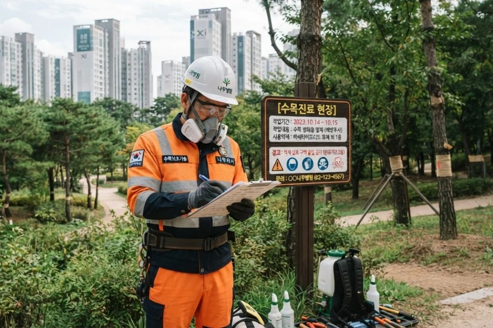
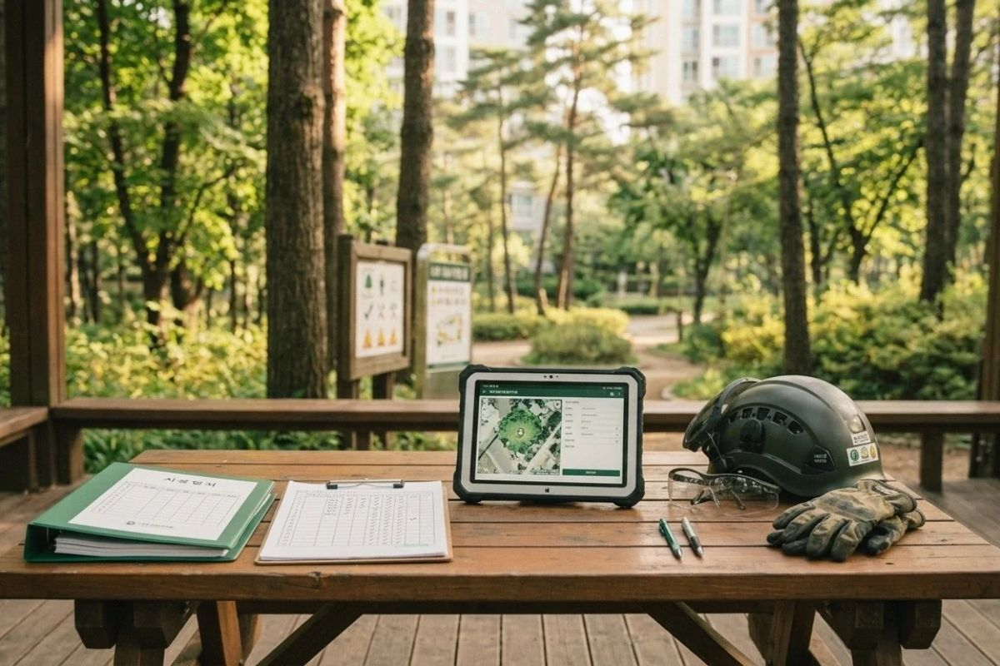

## 목차
1. [[마스터의 화두] "현장 시공이 끝났다고 수목진료가 마무리된 것이 아니다: 투명한 기록과 안전 통제, 객관적 소통이 프로의 신뢰를 완성하는 본질"](#master-insight)
2. [[현장 진료 해부] 시공 일지와 사전 안내가 부실해 약제 살포 후 주민 문의와 약해 의심 클레임에 속수무책으로 휘둘리던 현장팀을, 사진·기상·약제 기록 일지와 단계별 민원 응대 SOP로 안정시킨 K 수목진료 코치의 실전 성공 사례](#success-case)
3. [[방제 기록·현장 안전·클레임 대응 3대 전략] 처방·시공·기상·사진을 하나로 묶는 표준 기록 매트릭스(인프라 모델) + 작업자 보호구·생활권 통제·잔여물 회수를 조율하는 현장 안전 캘리브레이션(수익 모델) + 사전 안내부터 클레임 검증·후속 조치를 잇는 소통 퍼널(유입 경로) 3중 파이프라인 SOP](#pivoting-sop)
4. [[사전 준비 & 실행 프로토콜] 현장 안전·기록 서식 사전 점검 체크리스트와 민원·클레임 접수·검증·조치 단계별 템플릿 및 사후 이력 보관·재발 방지 루틴](#operation-sop)
5. [[마스터의 현장 노트] "수많은 현장 민원과 클레임 조정 과정을 겪으며 깨달은 '감정이 아닌 기록과 사실로 설명하는' 프로페셔널의 태도"](#master-note)
6. [[실전 실행 가이드] 표준 시공 일지 기록과 현장 안전 통제 수칙, 클레임 검증·대응 SOP를 현장에 적용하여 실무 신뢰도를 높이는 3대 필수 수칙](#solution)
7. [관련 시리즈 모아보기](#series)
8. [자주 묻는 질문 (FAQ)](#faq)

---

## 1. [마스터의 화두] "현장 시공이 끝났다고 수목진료가 마무리된 것이 아니다: 투명한 기록과 안전 통제, 객관적 소통이 프로의 신뢰를 완성하는 본질"

"아파트 단지나 공원, 공공 녹지에서 수목진료·병해충 방제 작업을 마친 뒤, **관리사무소나 주민으로부터 '어떤 약을 얼마나 썼는지', '잎이 변색된 것이 약해 때문인지' 묻는 연락을 받았을 때 근거 자료가 부족해 난감했던 경험**이 없으십니까?"

"수많은 현장 실무자와 초보 관리자들이 **현장 시공 기술만큼이나 중요한 것이 작업 전·중·후의 객관적 기록, 작업자와 주민을 지키는 안전 통제, 그리고 민원·클레임 발생 시 감정이 아닌 사실과 데이터로 확인·대응하는 표준 절차라는 사실**을 간과하고 있다는 점을 직시하고 계시지 않습니까?"

수년간 수목진료 현장 운영과 단지·공공 발주처 클레임 조정 사례를 분석하며 확신한 절대적인 명제는 **'방제 기록 관리·현장 안전·민원 대응에서 흔들리지 않는 비결은 처방·기상·약제·사진을 연결하는 기록 기준, 작업자·생활권 안전과 약제·폐기물 관리를 지키는 현장 안전 원리, 그리고 사전 안내부터 클레임 사실 확인·후속 조치를 묶은 소통 SOP에 있다'**는 사실입니다.

이번 [기획 연재: 수목진료 및 병해충 실무 마스터 클래스 시즌 1] 제9부에서는 시공보다 중요한 마무리와 소통—수목 병해충 방제 기록 관리·현장 안전·민원 대응 SOP를 전격 공개합니다.

<figure style="text-align: center; margin: 32px 0;">
  
  <figcaption style="font-size: 0.9rem; color: #6C7A72; margin-top: 12px; font-style: normal;">방제 일지와 현장 안전 안내, 시공 전후 상태를 점검하는 현장 모습</figcaption>
</figure>

---

## 2. [현장 진료 해부] 시공 일지와 사전 안내가 부실해 약제 살포 후 주민 문의와 약해 의심 클레임에 속수무책으로 휘둘리던 현장팀을, 사진·기상·약제 기록 일지와 단계별 민원 응대 SOP로 안정시킨 K 수목진료 코치의 실전 성공 사례

공동주택 단지 및 도심 녹지 방제 용역 현장의 기록·안전·민원 관리 개선 실전 사례입니다. 

해당 현장팀은 작업 자체는 성실히 수행했지만, 작업 전 안내문 게시 범위가 좁았고 기상 조건·희석배수·시공 전 수목 상태 사진이 남아 있지 않아 사소한 잎 갈변이나 냄새 문의에도 객관적인 설명을 내놓지 못해 불필요한 오해와 재작업 부담을 겪곤 했습니다. 

K 수목진료 코치는 즉시 **방제 기록·현장 안전·민원 대응 실무 SOP**를 가동했습니다. 

먼저 작업 전 안내·동선 통제와 함께 시공 전·중·후 사진, 기상(기온·풍속), 약제명·작용기작·희석배수·사용량을 한 장의 표준 시공 일지에 남기도록 기준을 세웠습니다. 

이어 민원이나 클레임이 접수되면 방어적인 해명 대신 현장 재방문·상태 대조·원인 구분(기존 병해충·생리 장애·기상·약해 여부)과 후속 관리 안내로 이어지는 3단계 응대 절차를 적용했습니다. 

그 결과 민원 발생 빈도 자체가 줄었을 뿐 아니라, 문의가 들어와도 객관적 기록을 바탕으로 신속하고 신뢰 있게 설명할 수 있는 현장 운영 체계가 자리 잡았습니다.

> #### 🏆 구두 보고·사후 해명 위주 운영 대 마스터 표준 기록·안전 통제·사실 기반 클레임 대응 SOP 비교 매트릭스
>
> | 구분 | 구두 보고·사후 해명 위주 운영 (오해·분쟁 확대형) | 마스터 표준 기록·안전 통제·사실 기반 대응 SOP (K 코치 모델) |
> | :--- | :--- | :--- |
> | **시공·약제 기록** | 작업 일자·약제명 정도만 간략히 적어 세부 근거 부재 | **기상·수종·처방·희석·살포량·시공 전후 사진을 표준 일지로 기록** |
> | **현장 안전·안내** | 구두 주의 위주로 동선 통제나 빈 용기·잔여물 관리 미흡 | **사전 안내·통제선·보호구 착용 및 세척수·빈 용기 안전 회수** |
> | **민원·클레임 응대** | 즉시 반박하거나 근거 없이 수용해 혼선·손실 발생 | **접수 기록 → 현장 대조·원인 감별 → 문서·후속 조치 안내** |

---

## 3. [방제 기록·현장 안전·클레임 대응 3대 전략] 처방·시공·기상·사진을 하나로 묶는 표준 기록 매트릭스(인프라 모델) + 작업자 보호구·생활권 통제·잔여물 회수를 조율하는 현장 안전 캘리브레이션(수익 모델) + 사전 안내부터 클레임 검증·후속 조치를 잇는 소통 퍼널(유입 경로) 3중 파이프라인 SOP

방제 기록 관리와 현장 안전, 민원 대응을 체계화하려면 표준 기록 매트릭스, 현장 안전 캘리브레이션, 그리고 소통 퍼널을 결합한 3중 파이프라인 SOP를 가동해야 합니다.

<figure style="text-align: center; margin: 32px 0;">
  
  <figcaption style="font-size: 0.9rem; color: #6C7A72; margin-top: 12px; font-style: normal;">표준 시공 일지와 안전 체크리스트를 갖춘 현장 기록·안전 관리 세팅</figcaption>
</figure>

> #### 💡 수목진료 및 병해충 실무 SOP 시즌 1 제9부 핵심 3대 전략 SOP
> 

> 
> 1. **[인프라 모델 전략: 모든 현장을 데이터로 남기는 '표준 방제·시공 기록 매트릭스']**  
>    * 기록은 단순 행정 서류가 아니라 방제 효과 평가, 약제 저항성 관리, 클레임 입증의 핵심 자산입니다.  
>    * ① **필수 기록 항목 표준화:** 작업 일시, 현장명·구역(수종·수량), 작업 당시 기상(기온·풍속·강수 여부), 진단 병해충 및 처방 근거, 사용 약제(품목명·작용기작·희석배수·총 사용량), 시공 방법과 작업자 정보를 빠짐없이 기재합니다.  
>    * ② **시공 전·중·후 사진 증빙:** 특히 작업 전 이미 존재하던 잎 변색·병해충 피해·수피 손상·토양 불량 상태를 사진으로 남겨 두면 사후 원인 구분에 큰 힘이 됩니다.

> 2. **[수익 모델 전략: 사람·환경·자재 사고를 차단하는 '현장 안전 및 폐기물 관리 캘리브레이션']**  
>    * 안전한 현장이 뒷받침되지 않으면 어떤 방제 성과도 의미가 퇴색됩니다.  
>    * **① 작업자 및 생활권 안전 통제:** 약제 취급·희석·살포·전정 등 작업 유형에 맞는 개인보호구(보호의·장갑·마스크·고글·안전모 등)를 착용하고, 작업 구역 안내 표지와 통제선으로 보행자·어린이·반려동물 접근을 분리합니다.  
>    * **② 약제 보관·잔여물·빈 용기 관리:** 약제는 지정된 장소에 잠금·분리 보관하고, 작업 후 남은 희석액이나 세척수가 우수관·하천·화단에 무분별하게 흘러들지 않도록 처리하며 빈 용기는 지침에 맞게 회수·반출합니다.

> 3. **[유입 경로 전략: 오해를 줄이고 신뢰를 높이는 '사전 안내 및 클레임 대응 퍼널']**  
>    * 민원 대응은 문제가 터진 뒤가 아니라 작업 전 안내에서 이미 시작됩니다.  
>    * **① 사전 안내 및 소통 창구 명시:** 작업 일정, 대상 구역, 주의사항, 담당 연락처를 관리주체와 주민에게 미리 공유합니다.  
>    * **② 클레임 접수 및 현장 사실 확인:** 약해·비산·수목 이상 문의가 접수되면 일시·위치·증상을 기록한 뒤 현장을 방문해 시공 전 사진·기상·약제 기록과 현재 증상을 대조합니다(기존 병해충·건조·고온·동해·답압과 약해 감별).  
>    * **③ 객관적 설명 및 후속 조치 이행:** 확인된 사실과 원인, 필요한 회복 관리 또는 보완 조치를 차분히 설명하고 처리 결과를 기록으로 남기는 3단계 소통 퍼널을 완성하세요.

---

## 4. [사전 준비 & 실행 프로토콜] 현장 안전·기록 서식 사전 점검 체크리스트와 민원·클레임 접수·검증·조치 단계별 템플릿 및 사후 이력 보관·재발 방지 루틴

방제 기록 관리와 현장 안전, 클레임 대응 현장에서 누락과 혼선을 막기 위한 표준 운영 프로토콜입니다.

> #### ⚙️ 방제 기록 관리·현장 안전·민원 대응 3대 수칙
> 

> 
> 1. **[작업 착수 전 안내·보호구·기록 양식을 점검하는 '안전·기록 사전 점검 체크리스트' 매뉴얼]**  
>    * 작업 시작 전 ① 관리주체 협의 및 주민 사전 안내 게시 여부, 작업 구역 통제 표지 준비 확인 ➔ ② 개인보호구 구비·착용 상태, 응급 세척수·구급함, 약제 보관 및 빈 용기 회수 용기 점검 ➔ ③ 표준 시공 일지 서식과 시공 전 상태 촬영 장비 준비 여부를 확인하는 체크리스트를 준수하세요.

> 2. **[클레임 발생 시 감정이 아닌 절차로 움직이는 '민원·클레임 대응 단계별 템플릿' 캘리브레이션]**  
>    * 클레임 접수 시 ① **접수 및 경청:** 민원인·관리주체 의견과 발생 위치·시점·증상 기록(성급한 단정·반박 금지) ➔ ② **현장 대조 및 원인 감별:** 시공 일지(기상·약제·희석배수)·시공 전 사진과 현장 수목·주변 식물 상태를 대조해 약해·비산·기존 스트레스 여부 확인 ➔ ③ **결과 공유 및 후속 조치:** 원인 설명서·현장 사진 공유 및 필요 시 회복 관리·보완 조치 이행 템플릿을 적용하세요.

> 3. **[완료 후 데이터를 자산으로 축적하는 '시공·클레임 이력 보관 및 재발 방지' 루틴]**  
>    * 모든 현장 종료 후 ① 시공 일지·처방 기록·사진·약제 사용 내역을 현장별·일자별로 정리해 보관 ➔ ② 민원이나 특이사항이 있었던 현장은 일정 기간 뒤 재점검해 수목 상태와 관리주체 만족도 확인 ➔ ③ 반복되는 문의 유형과 현장 실수 요인을 다음 작업 사전 안내와 안전 체크리스트에 반영하는 사후 관리 루틴을 정례화하세요.

---

## 5. [마스터의 현장 노트] "수많은 현장 민원과 클레임 조정 과정을 겪으며 깨달은 '감정이 아닌 기록과 사실로 설명하는' 프로페셔널의 태도"

> #### 📝 [마스터 노트] 방제 기록 관리·현장 안전·클레임 대응 실무에서 체득한 현장 지혜
>
> * **첫 번째 지혜: "시공 전 찍어 둔 사진 한 장과 정확히 적은 일지 한 줄이 백 마디 해명보다 강하다"**  
>   ➔ 기록은 의심을 줄이고 전문가의 기준을 보여 주는 가장 정직한 언어입니다.

> * **두 번째 지혜: "안전 수칙과 사전 안내는 번거로운 절차가 아니라 현장을 지키는 가장 경제적인 보험이다"**  
>   ➔ 보호구 착용, 동선 분리, 빈 용기 회수는 어떤 현장에서도 타협할 수 없는 기본입니다.

> * **세 번째 지혜: "클레임은 공격이 아니라 현장의 빈틈을 점검할 기회다. 차분히 듣고 사실로 확인하면 신뢰는 오히려 단단해진다"**  
>   ➔ 성급한 변명 대신 정확한 현장 확인과 책임 있는 후속 조치가 장기 거래와 평판을 만듭니다.

---

## 6. [실전 실행 가이드] 표준 시공 일지 기록과 현장 안전 통제 수칙, 클레임 검증·대응 SOP를 현장에 적용하여 실무 신뢰도를 높이는 3대 필수 수칙

1. **기상·처방·약제·희석배수·시공 전후 사진을 포함한 표준 방제·시공 일지 기록 확립**  
   방제 이력 추적과 약제 저항성 관리, 객관적 사실 입증의 기반을 구축.
2. **사전 안내, 작업 구역 통제, 개인보호구 착용 및 잔여물·빈 용기 안전 회수 원칙 준수**  
   작업자와 주민, 생활권 환경을 보호하는 무사고 현장 운영.
3. **접수 → 현장 대조·원인 감별 → 사실 기반 설명·후속 조치로 이어지는 클레임 대응 SOP 체화**  
   현장 분쟁을 예방하고 발주처·주민과의 장기적 신뢰를 확보.

---

## 7. 관련 시리즈 모아보기

* **[기획 연재: 수목진료 및 병해충 실무 마스터 클래스 시즌 1. ①] [현장 정밀 진단 & 시료 채취 실무 편] \"현장 정밀 진단과 시료 채취의 첫걸음: 흙·잎·가지 시료를 망가뜨리지 않고 담는 법\"**  
  ➔ [수목진료 현장 진단 순서, 잎 가지 토양 시료 채취 포장 이송 SOP](https://floraldays.com/sop-season1-field-diagnosis-sample-collection-part1)

* **[기획 연재: 수목진료 및 병해충 실무 마스터 클래스 시즌 1. ②] [수간주사 현장 시공 실무 편] \"구멍을 뚫을 때도 각도와 깊이가 있다: 수종·시기별 수간주사 현장 시공 SOP\"**  
  ➔ [수간주사 천공 각도 깊이 간격, 약액 누출 제어, 현장 시공 안전 SOP](https://floraldays.com/sop-season1-trunk-injection-field-sop-part2)

* **[기획 연재: 수목진료 및 병해충 실무 마스터 클래스 시즌 1. ③] [약제 살포 & 비산 방지 실무 편] \"도심·아파트 단지 약제 살포 안전 수칙: 바람·보행자·비산(Drift)을 막는 현장 프로토콜\"**  
  ➔ [도심 약제 살포 안전, 비산 Drift 저감, 약해 예방 현장 SOP](https://floraldays.com/sop-season1-pesticide-spray-safety-drift-sop-part3)

* **[기획 연재: 수목진료 및 병해충 실무 마스터 클래스 시즌 1. ④] [수목 외과수술 & 공동·부후 처치 실무 편] \"썩은 부분을 파내기만 하면 될까? 수목 외과수술과 공동·부후 처치 실전 SOP\"**  
  ➔ [수목 외과수술, 공동 부후 처치, 수분 고임 방지 및 안전 SOP](https://floraldays.com/sop-season1-tree-surgery-decay-cavity-sop-part4)

* **[기획 연재: 수목진료 및 병해충 실무 마스터 클래스 시즌 1. ⑤] [토양 답압 해소 & 통기·배수 개선 실무 편] \"조경수가 흙 속에서 숨을 못 쉴 때: 토양 답압 해소·통기·배수 개선 시공 매뉴얼\"**  
  ➔ [토양 답압 해소, 통기 배수 개선, 근권 관리 현장 SOP](https://floraldays.com/sop-season1-soil-compaction-aeration-drainage-sop-part5)

* **[기획 연재: 수목진료 및 병해충 실무 마스터 클래스 시즌 1. ⑥] [염류 저감 & 근권 정비 실무 편] \"겨울 제설제와 봄철 복토 스트레스에서 나무 구하기: 염류 저감·근권 정비 실무 SOP\"**  
  ➔ [제설제 염류 저감, 복토 스트레스 해소, 근권 정비 현장 SOP](https://floraldays.com/sop-season1-deicing-salt-fill-soil-stress-sop-part6)

* **[기획 연재: 수목진료 및 병해충 실무 마스터 클래스 시즌 1. ⑦] [위험수목 진단 & 전정·관리 실무 편] \"쓰러질 위험이 있는 나무는 어떻게 판단할까? 위험수목 진단·전정·관리 SOP\"**  
  ➔ [위험수목 진단, 지융부 보존 안전 전정, 표적 구역 관리 SOP](https://floraldays.com/sop-season1-hazard-tree-assessment-pruning-sop-part7)

* **[기획 연재: 수목진료 및 병해충 실무 마스터 클래스 시즌 1. ⑧] [지주목·이식목·노거수 생육 안정화 실무 편] \"새로 심은 나무와 노거수를 지키는 힘: 지주목·당김줄 설치와 생육 안정화 SOP\"**  
  ➔ [지주목 당김줄 설치, 이식목 노거수 생육 안정화 현장 SOP](https://floraldays.com/sop-season1-staking-guywire-transplant-oldtree-sop-part8)

* **[기획 연재: 수목진료 및 병해충 실무 마스터 클래스 시즌 1. ⑨] [방제 기록·현장 안전·클레임 대응 실무 편] \"시공보다 중요한 마무리와 소통: 수목 병해충 방제 기록 관리·현장 안전·민원 대응 SOP\"**  
  ➔ [방제 시공 일지 기록, 현장 안전 수칙, 민원 클레임 대응 SOP](https://floraldays.com/sop-season1-treatment-records-safety-claim-response-sop-part9)

## 8. 자주 묻는 질문 (FAQ)

**Q1. 수목 병해충 방제 시공 일지에는 어떤 항목들을 꼭 기록해 두어야 나중에 도움이 되나요?**  

A1. '작업 일시, 현장 위치와 대상 수종, 작업 당시 기온·풍속·강수 등 기상 조건, 진단된 병해충과 처방 근거, 사용한 약제명·작용기작·희석배수·총 살포량(또는 주입량), 그리고 시공 전·중·후 사진 기록을 함께 남겨 두는 것이 좋습니다. 

이 자료들은 이후 방제 효과 판정과 약제 저항성 관리, 민원 발생 시 객관적 사실 확인에 핵심 근거가 됩니다'.

> 💡 농약 안전 사용 및 수목 병해충 방제 관리 기준은 <a href="https://www.nihhs.go.kr" target="_blank" rel="noopener noreferrer">농촌진흥청 국립원예특작과학원</a>을 참고하시기 바랍니다.

**Q2. 약제 살포 후 아파트 단지나 공원에서 '잎이 타거나 변색되었다'는 클레임이 들어오면 현장에서 어떤 순서로 대응해야 하나요?**  

A2. '먼저 민원 내용과 발생 위치·시점을 정확히 기록한 뒤 현장을 방문해 시공 전 촬영해 둔 사진, 당시 기상 및 희석배수 기록과 현재 증상을 대조해야 합니다. 

실제 약해나 비산 영향인지, 아니면 기존 병해충 피해·고온 건조·염류·토양 배수 불량 등 다른 요인인지 차분히 감별한 후 사실에 기반해 설명하고 필요한 후속 관리 방안을 안내하는 것이 바람직합니다'.

> 💡 스마트 홈가드닝 및 도시농업 정보는 <a href="https://www.modunong.or.kr" target="_blank" rel="noopener noreferrer">농림축산식품부 모두가 도시농부 포털</a>을 참고하세요.

---

