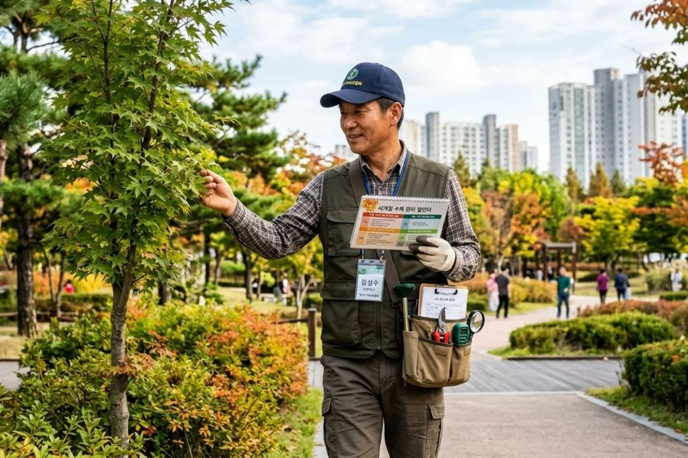
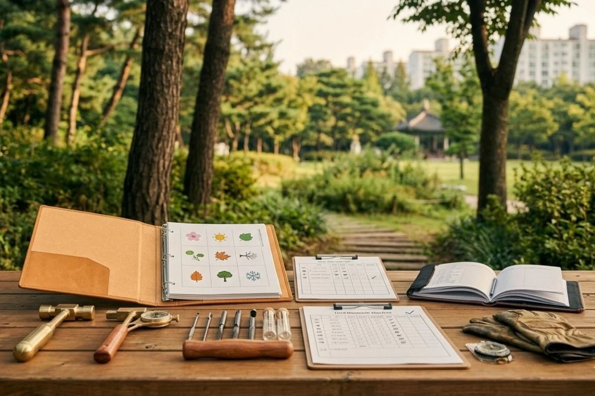

## 목차
1. [[마스터의 화두] "병해충이 번지고 잎이 떨어진 뒤에야 달려가는 방제는 늘 한 발 늦는다: 사계절 생육 리듬을 읽고 현장을 연결하는 통합 수목진료 운영의 본질"](#master-insight)
2. [[현장 진료 해부] 계절별 작업이 분절되어 매번 긴급 방제와 민원 대응에 쫓기던 공원·단지 관리 현장을, 사계절 연간 점검 캘린더와 9대 실무 SOP 통합 운영 체계로 전환해 안정화한 K 수목진료 코치의 실전 성공 사례](#success-case)
3. [[연간 점검 캘린더 & 통합 실전 운영 3대 전략] 봄·여름·가을·겨울 핵심 과업을 배열하는 사계절 수목진료 캘린더 매트릭스(인프라 모델) + 진단·시공·토양·안전을 상황별로 연결하는 통합 현장 의사결정 캘리브레이션(수익 모델) + 연간 기록 축적과 다음 해 계획 보완을 잇는 순환 관리 퍼널(유입 경로) 3중 파이프라인 SOP](#pivoting-sop)
4. [[사전 준비 & 실행 프로토콜] 분기·계절별 현장 점검 체크리스트와 수목진료 통합 출동·시공·보고 표준 템플릿 및 연말 데이터 결산·차년도 계획 수립 루틴](#operation-sop)
5. [[마스터의 현장 노트] "수목진료 및 병해충 실무 마스터 클래스 시즌 1 10부작을 완결하며 전하는, 나무의 시간을 존중하는 현장 프로페셔널의 태도"](#master-note)
6. [[실전 실행 가이드] 사계절 연간 점검 캘린더와 시즌 1 9대 핵심 SOP 통합 적용, 연간 기록·피드백 순환 체계를 현장에 정착시키는 3대 필수 수칙](#solution)
7. [관련 시리즈 모아보기](#series)
8. [자주 묻는 질문 (FAQ)](#faq)

---

## 1. [마스터의 화두] "병해충이 번지고 잎이 떨어진 뒤에야 달려가는 방제는 늘 한 발 늦는다: 사계절 생육 리듬을 읽고 현장을 연결하는 통합 수목진료 운영의 본질"

"봄의 새순이 트는 시기부터 한여름의 장마·폭염, 가을의 양분 축적과 겨울의 제설·적설기에 이르기까지, **문제마다 따로 대응하다가 어느새 방제·전정·토양·안전 일정이 엉키고 현장이 늘 뒤처지는 느낌**을 받으신 적이 없으십니까?"

"수많은 현장 실무자와 관리자들이 **현장 진단과 시료 채취, 수간주사, 약제 살포, 외과수술, 토양 통기·배수, 염류·복토 정비, 위험수목 전정, 지주·이식목 관리, 기록·클레임 대응은 각각 떨어진 기술이 아니라 사계절 수목 생육 주기와 맞물려 돌아가는 하나의 통합 운영 시스템이라는 사실**을 놓치고 있다는 점을 직시하고 계시지 않습니까?"

수년간 도심 녹지·공동주택·공원 수목진료 운영 체계를 설계하며 확신한 절대적인 명제는 **'연간 수목진료 및 병해충 실무에서 흔들리지 않는 비결은 봄·여름·가을·겨울 계절 리듬에 맞춘 선제적 점검 캘린더, 증상과 원인에 따라 9대 현장 SOP를 정확히 연결하는 통합 의사결정 기준, 그리고 연간 기록과 피드백을 다음 해 계획으로 잇는 순환 운영 체계에 있다'**는 사실입니다.

이번 [기획 연재: 수목진료 및 병해충 실무 마스터 클래스 시즌 1] 최종 완결편 제10부에서는 봄·여름·가을·겨울 한눈에 보는 수목진료—연간 병해충·생육 점검 캘린더 및 통합 실전 운영 매뉴얼을 전격 공개합니다.

<figure style="text-align: center; margin: 32px 0;">
  
  <figcaption style="font-size: 0.9rem; color: #6C7A72; margin-top: 12px; font-style: normal;">사계절 생육 주기에 맞춰 현장 진단·토양·방제·안전 계획을 통합 점검하는 모습</figcaption>
</figure>

---

## 2. [현장 진료 해부] 계절별 작업이 분절되어 매번 긴급 방제와 민원 대응에 쫓기던 공원·단지 관리 현장을, 사계절 연간 점검 캘린더와 9대 실무 SOP 통합 운영 체계로 전환해 안정화한 K 수목진료 코치의 실전 성공 사례

공동주택 단지 및 도심 공원 녹지의 연간 수목진료 운영 체계 전환 실전 사례입니다. 

해당 현장에서는 과거에 민원이 들어오거나 잎이 심하게 변색된 뒤에야 단발성 약제 살포나 급한 전정을 진행했고, 겨울철 제설 피해·봄철 복토·토양 답압·지주 결속 조임 같은 근본 원인은 다음 해까지 방치되는 악순환이 이어졌습니다. 

K 수목진료 코치는 즉시 **연간 병해충·생육 점검 캘린더 및 통합 실전 운영 SOP**를 가동했습니다. 

먼저 사계절별로 반드시 점검할 우선순위(봄철 월동 후 복토·염류·발아 점검 → 여름철 병해충 예찰·비산 안전 방제·장마 배수 및 강풍 전정 → 가을철 수세·공동·토양 통기 및 월동 준비 → 겨울철 위험수목·지주·제설 유입 차단)를 연간 캘린더로 구조화했습니다.

이어 현장 발견 징후에 따라 시즌 1 제1부-제9부의 세부 SOP(정밀 진단, 수간주사, 안전 살포, 외과수술, 토양·염류 정비, 위험수목·지주 관리, 기록·민원 대응)를 즉시 호출하는 통합 출동 매뉴얼과 연말 데이터 결산 루틴을 묶었습니다. 

그 결과 긴급 출동과 주민 민원 빈도가 눈에 띄게 줄어들고, 예산·인력·자재 투입을 계절 흐름에 맞춰 안정적으로 배분하는 선제적 수목진료 운영 체계를 완성할 수 있었습니다.

> #### 🏆 사후 단발성 긴급 대응 운영 대 마스터 사계절 연간 캘린더·9대 SOP 통합 운영 매트릭스
>
> | 구분 | 사후 단발성 긴급 대응 운영 (민원 추격·중복 투입형) | 마스터 사계절 연간 캘린더·통합 SOP 운영 (K 코치 모델) |
> | :--- | :--- | :--- |
> | **일정 및 예찰** | 피해가 커진 뒤에야 출동해 약제·전정을 급히 투입 | **봄·여름·가을·겨울 계절 리듬별 선제 점검 및 조기 대응** |
> | **진단 및 시공 연계** | 지상부 증상만 보고 획일적 방제나 무리한 전정 반복 | **원인(병해충·토양·염류·구조 결함)에 맞춰 9대 세부 SOP 연결** |
> | **기록 및 차년도 개선** | 작업 완료 후 이력이 흩어져 매년 같은 시행착오 반복 | **시공·기상·민원·생육 데이터를 결산해 다음 해 캘린더 보완** |

---

## 3. [연간 점검 캘린더 & 통합 실전 운영 3대 전략] 봄·여름·가을·겨울 핵심 과업을 배열하는 사계절 수목진료 캘린더 매트릭스(인프라 모델) + 진단·시공·토양·안전을 상황별로 연결하는 통합 현장 의사결정 캘리브레이션(수익 모델) + 연간 기록 축적과 다음 해 계획 보완을 잇는 순환 관리 퍼널(유입 경로) 3중 파이프라인 SOP

사계절 수목진료를 흔들림 없이 운영하려면 사계절 수목진료 캘린더 매트릭스, 통합 현장 의사결정 캘리브레이션, 그리고 순환 관리 퍼널을 결합한 3중 파이프라인 SOP를 가동해야 합니다.

<figure style="text-align: center; margin: 32px 0;">
  
  <figcaption style="font-size: 0.9rem; color: #6C7A72; margin-top: 12px; font-style: normal;">연간 점검 캘린더와 시즌 1 9대 실무 SOP 체크리스트를 통합한 현장 운영 세팅</figcaption>
</figure>

> #### 💡 수목진료 및 병해충 실무 SOP 시즌 1 최종 완결편 제10부 핵심 3대 전략 SOP
> 

> 
> 1. **[인프라 모델 전략: 계절별 우선순위를 고정하는 '사계절 수목진료 캘린더 매트릭스']**  
>    * 나무의 생리 주기와 도심 환경 변화를 기준으로 연간 핵심 점검 과업을 4계절로 배치합니다.  
>    * ① **봄(3~5월 — 해빙·발아·활착기):** 겨울철 제설제 염류 유입·복토·지제부 매몰 정비(제6부), 이식목·지주 결속 및 수분·근권 점검(제8부), 월동 병해충 초기 예찰·정밀 진단(제1부) 및 수액 이동 시기를 고려한 수간주사 계획(제2부)을 실행합니다.  
>    * ② **여름(6~8월 — 생육 왕성·장마·태풍기):** 풍속·보행자·비산(Drift) 통제를 준수하는 정밀 약제 살포(제3부), 장마철 물 고임·배수 불량·토양 답압 점검(제5부), 태풍·강풍 대비 위험수목 진단·지융부 보존 안전 전정(제7부)에 집중합니다.  
>    * ③ **가을(9~11월 — 양분 축적·근권·상처 정비기):** 생육기 수세 평가, 답압 해소·통기·배수 개선 시공(제5부), 수목 외과수술·공동·부후 부위 정리 및 배수 확보(제4부), 지주·당김줄 유격 점검 및 월동 준비를 진행합니다.  
>    * ④ **겨울(12~2월 — 휴면·구조 점검·예방기):** 낙엽 후 수간·분지부 구조 결함 정밀 관찰(제7부), 제설제 유입 차단·방풍·지주 보강(제6·8부), 연간 방제·시공 일지 결산 및 차년도 약제·자재·일정 계획 수립(제9·10부)을 마무리합니다.

> 2. **[수익 모델 전략: 현장 징후에 따라 최적의 프로토콜을 호출하는 '통합 현장 의사결정 캘리브레이션']**  
>    * 현장에서 이상 징후를 발견했을 때는 감에 의존하지 않고 표준 분기 흐름에 따라 세부 SOP를 연결합니다.  
>    * **① 1단계 원인 감별(제1부):** 전경 → 수관 → 수간 → 지제부 → 토양 순으로 관찰하고, 필요 시 오염 없는 잎·가지·토양 시료를 채취해 병해충·비생물적 스트레스·복합 요인을 구분합니다.  
>    * **② 2단계 맞춤 시공 선택(제2~8부):** 병해충 방제가 필요하면 수목 크기·주변 환경에 따라 수간주사(제2부) 또는 비산 저감 안전 살포(제3부)를 선택하고, 상처·부후는 구획화 보호·배수 기준(제4부), 토양·염류·복토 문제는 근권·배수·염류 정비(제5·6부), 도복·낙지·신식재 문제는 위험수목 전정·지주 관리(제7·8부)로 연결합니다.  
>    * **③ 3단계 안전·기록·소통 완결(제9부):** 모든 작업 전 사전 안내·동선 통제·보호구 착용을 적용하고, 기상·약제·시공 전후 사진을 표준 일지에 남겨 사후 경과 모니터링과 민원 대응 근거로 삼습니다.

> 3. **[유입 경로 전략: 한 해의 경험을 다음 해의 정밀도로 바꾸는 '연간 순환 관리 퍼널']**  
>    * 수목진료의 실력은 매년 쌓이는 현장 데이터에서 나옵니다.  
>    * **① 표준 데이터 축적:** 구역별·수종별 진단 이력, 약제 작용기작 순환 내역, 토양·배수 개선 구간, 위험수목 추적 목록을 통합 관리합니다.  
>    * **② 계절별 중간 점검:** 분기마다 계획 대비 실행률, 방제 후 회복 반응, 민원 발생 원인을 점검해 현장 체크리스트를 미세 조정합니다.  
>    * **③ 연말 결산 및 차년도 예방 반영:** 반복 발생 구역(상습 제설 피해지, 답압 구간, 병해충 다발 수종)을 우선 관리 대상으로 지정해 다음 해 봄 캘린더에 선반영하는 3단계 순환 관리 퍼널을 완성하세요.

---

## 4. [사전 준비 & 실행 프로토콜] 분기·계절별 현장 점검 체크리스트와 수목진료 통합 출동·시공·보고 표준 템플릿 및 연말 데이터 결산·차년도 계획 수립 루틴

연간 수목진료 현장에서 계절별 누락을 없애고 9대 세부 SOP를 일관되게 실행하기 위한 통합 운영 프로토콜입니다.

> #### ⚙️ 연간 수목진료 통합 운영 3대 수칙
> 

> 
> 1. **[매월·분기 초 현장의 우선순위를 확정하는 '사계절 현장 점검 체크리스트' 매뉴얼]**  
>    * 분기 시작 전 ① 해당 계절의 핵심 위험 요인(봄 염류·복토·발아 / 여름 병해충·장마·강풍 / 가을 근권·부후 / 겨울 구조 결함·제설) 대상 구역 목록화 ➔ ② 필요한 진단 도구·시료 용기·약제·전정/토양 공구·개인보호구·안내 표지 재고 및 소독 상태 점검 ➔ ③ 날씨 예보와 생활권 이용 동선을 반영한 주간·월간 작업 일정표 확정 체크리스트를 준수하세요.

> 2. **[출동부터 시공·보고까지 한 흐름으로 묶는 '수목진료 통합 출동·시공·보고 템플릿' 캘리브레이션]**  
>    * 현장 출동 시 ① **진단·안전 세팅:** 현장 전경·증상 촬영, 원인 감별(제1부) 및 사전 안내·통제선·보호구 적용(제9부) ➔ ② **타깃 SOP 시공:** 병해충(제2·3부)·외과(제4부)·토양/염류(제5·6부)·위험수목/지주(제7·8부) 기준에 따른 정밀 작업 수행 ➔ ③ **완료 보고 및 모니터링 예약:** 시공 전후 사진·기상·약제/자재 내역 기록 및 1주·1개월·계절별 추적 일정 등록 템플릿을 적용하세요.

> 3. **[한 해의 현장 기록을 다음 해 자산으로 전환하는 '연말 데이터 결산 및 차년도 계획 수립' 루틴]**  
>    * 연말 결산 시 ① 구역별 시공 일지·약제 사용 이력·민원/클레임 사례·위험수목 변동 내역을 통합 정리 ➔ ② 약제 작용기작 연용 여부, 재발한 토양·배수·병해충 구간, 회복이 더딘 개체 원인 분석 ➔ ③ 개선 과제를 반영해 차년도 사계절 캘린더와 자재·안전 예산을 확정하는 순환 관리 루틴을 정례화하세요.

---

## 5. [마스터의 현장 노트] "수목진료 및 병해충 실무 마스터 클래스 시즌 1 10부작을 완결하며 전하는, 나무의 시간을 존중하는 현장 프로페셔널의 태도"

> #### 📝 [마스터 노트] 수목진료 및 병해충 실무 마스터 클래스 시즌 1 완결에 부치는 현장 지혜
>
> * **첫 번째 지혜: "나무를 치료하는 기술은 손끝에서 시작되지만, 나무를 살리는 실력은 계절을 앞서 읽는 눈에서 완성된다"**  
>   ➔ 사계절 캘린더가 자리 잡으면 현장은 늘 한 걸음 여유를 갖게 됩니다.

> * **두 번째 지혜: "잎만 보지 않고 흙과 뿌리, 바람과 사람의 동선까지 함께 살필 때 비로소 현장의 정답이 보인다"**  
>   ➔ 1부부터 9부까지의 모든 SOP는 결국 '나무와 사람 모두를 해치지 않는 균형'이라는 한 점으로 모입니다.

> * **세 번째 지혜: "오늘 남긴 정확한 기록 한 줄과 사진 한 장이 내일의 나무를 지키고, 현장 전문가의 이름을 증명한다"**  
>   ➔ 원칙을 지키는 꾸준한 루틴이 어떤 현장에서도 흔들리지 않는 가장 강한 무기입니다.

---

## 6. [실전 실행 가이드] 사계절 연간 점검 캘린더와 시즌 1 9대 핵심 SOP 통합 적용, 연간 기록·피드백 순환 체계를 현장에 정착시키는 3대 필수 수칙

1. **봄·여름·가을·겨울 계절별 핵심 과업을 고정한 연간 수목진료 점검 캘린더 운영**  
   사후 긴급 방제 중심에서 벗어나 계절 리듬에 맞춘 선제적 예찰·정비 체계를 확립.
2. **정밀 진단(제1부)을 출발점으로 방제·외과·토양·염류·안전 전정·지주·기록 SOP(제2~9부)를 유기적으로 연결**  
   단편적 처치를 줄이고 원인에 맞는 정확한 현장 프로토콜을 일관되게 실행.
3. **시공 일지·사진 증빙·약제 이력과 연말 결산을 잇는 연간 순환 피드백 루틴 체화**  
   매년 현장 데이터를 축적해 방제 효율, 수목 활력, 안전 관리 수준을 지속적으로 고도화.

---

## 7. 관련 시리즈 모아보기 (시즌 1 전 10부 완결 아카이브)

* **[기획 연재: 수목진료 및 병해충 실무 마스터 클래스 시즌 1. ①] [현장 정밀 진단 & 시료 채취 실무 편] \"현장 정밀 진단과 시료 채취의 첫걸음: 흙·잎·가지 시료를 망가뜨리지 않고 담는 법\"**  
  ➔ [수목진료 현장 진단 순서, 잎 가지 토양 시료 채취 포장 이송 SOP](https://floraldays.com/sop-season1-field-diagnosis-sample-collection-part1)

* **[기획 연재: 수목진료 및 병해충 실무 마스터 클래스 시즌 1. ②] [수간주사 현장 시공 실무 편] \"구멍을 뚫을 때도 각도와 깊이가 있다: 수종·시기별 수간주사 현장 시공 SOP\"**  
  ➔ [수간주사 천공 각도 깊이 간격, 약액 누출 제어, 현장 시공 안전 SOP](https://floraldays.com/sop-season1-trunk-injection-field-sop-part2)

* **[기획 연재: 수목진료 및 병해충 실무 마스터 클래스 시즌 1. ③] [약제 살포 & 비산 방지 실무 편] \"도심·아파트 단지 약제 살포 안전 수칙: 바람·보행자·비산(Drift)을 막는 현장 프로토콜\"**  
  ➔ [도심 약제 살포 안전, 비산 Drift 저감, 약해 예방 현장 SOP](https://floraldays.com/sop-season1-pesticide-spray-safety-drift-sop-part3)

* **[기획 연재: 수목진료 및 병해충 실무 마스터 클래스 시즌 1. ④] [수목 외과수술 & 공동·부후 처치 실무 편] \"썩은 부분을 파내기만 하면 될까? 수목 외과수술과 공동·부후 처치 실전 SOP\"**  
  ➔ [수목 외과수술, 공동 부후 처치, 수분 고임 방지 및 안전 SOP](https://floraldays.com/sop-season1-tree-surgery-decay-cavity-sop-part4)

* **[기획 연재: 수목진료 및 병해충 실무 마스터 클래스 시즌 1. ⑤] [토양 답압 해소 & 통기·배수 개선 실무 편] \"조경수가 흙 속에서 숨을 못 쉴 때: 토양 답압 해소·통기·배수 개선 시공 매뉴얼\"**  
  ➔ [토양 답압 해소, 통기 배수 개선, 근권 관리 현장 SOP](https://floraldays.com/sop-season1-soil-compaction-aeration-drainage-sop-part5)

* **[기획 연재: 수목진료 및 병해충 실무 마스터 클래스 시즌 1. ⑥] [염류 저감 & 근권 정비 실무 편] \"겨울 제설제와 봄철 복토 스트레스에서 나무 구하기: 염류 저감·근권 정비 실무 SOP\"**  
  ➔ [제설제 염류 저감, 복토 스트레스 해소, 근권 정비 현장 SOP](https://floraldays.com/sop-season1-deicing-salt-fill-soil-stress-sop-part6)

* **[기획 연재: 수목진료 및 병해충 실무 마스터 클래스 시즌 1. ⑦] [위험수목 진단 & 전정·관리 실무 편] \"쓰러질 위험이 있는 나무는 어떻게 판단할까? 위험수목 진단·전정·관리 SOP\"**  
  ➔ [위험수목 진단, 지융부 보존 안전 전정, 표적 구역 관리 SOP](https://floraldays.com/sop-season1-hazard-tree-assessment-pruning-sop-part7)

* **[기획 연재: 수목진료 및 병해충 실무 마스터 클래스 시즌 1. ⑧] [지주목·이식목·노거수 생육 안정화 실무 편] \"새로 심은 나무와 노거수를 지키는 힘: 지주목·당김줄 설치와 생육 안정화 SOP\"**  
  ➔ [지주목 당김줄 설치, 이식목 노거수 생육 안정화 현장 SOP](https://floraldays.com/sop-season1-staking-guywire-transplant-oldtree-sop-part8)

* **[기획 연재: 수목진료 및 병해충 실무 마스터 클래스 시즌 1. ⑨] [방제 기록·현장 안전·클레임 대응 실무 편] \"시공보다 중요한 마무리와 소통: 수목 병해충 방제 기록 관리·현장 안전·민원 대응 SOP\"**  
  ➔ [방제 시공 일지 기록, 현장 안전 수칙, 민원 클레임 대응 SOP](https://floraldays.com/sop-season1-treatment-records-safety-claim-response-sop-part9)

* **[기획 연재: 수목진료 및 병해충 실무 마스터 클래스 시즌 1. ⑩] [연간 점검 캘린더 & 통합 실전 운영 매뉴얼] \"봄·여름·가을·겨울 한눈에 보는 수목진료: 연간 병해충·생육 점검 캘린더 및 통합 실전 운영 매뉴얼\"**  
  ➔ [연간 수목진료 점검 캘린더, 사계절 병해충·토양·안전 통합 운영 SOP](https://floraldays.com/sop-season1-annual-tree-care-calendar-integrated-manual-part10)

---

## 8. 자주 묻는 질문 (FAQ)

**Q1. 연간 수목진료 점검 캘린더를 처음 도입할 때 사계절 중 어느 시기와 항목부터 기준을 잡는 것이 가장 효과적인가요?**  

A1. '해빙 후 봄철(3~5월)의 겨울철 제설제 염류·복토·지제부 점검과 월동 병해충 초기 예찰, 그리고 장마·태풍 전후 여름철(6~8월)의 배수·비산 안전 방제·위험수목 전정을 우선 축으로 삼는 것이 좋습니다. 

여기에 가을철 토양 통기·부후 정비와 겨울철 구조 결함 관찰·연간 기록 결산을 연결하면 사계절 순환 체계를 무리 없이 정착시킬 수 있습니다'.

> 💡 수목진료 및 병해충 관리 관련 공식 참고 자료는 <a href="https://www.nihhs.go.kr" target="_blank" rel="noopener noreferrer">농촌진흥청 국립원예특작과학원</a>을 참고하시기 바랍니다.

**Q2. 한 현장에서 병해충 피해와 토양 배수 불량, 가지 결함이 동시에 보일 때는 어떤 순서로 우선순위를 정해야 하나요?**  

A2. '가장 먼저 보행자·시설물 안전과 직결되는 위험수목·낙지 요인(제7부)을 통제·정리하고, 이어 정밀 진단(제1부)을 통해 1차 원인(토양 배수·답압·염류·복토 등 근권 스트레스)과 2차 병해충 피해를 구분해야 합니다. 

급성 병해충 확산 억제가 필요할 때는 적정 방제(제2·3부)를 안전하게 시행하면서 동시에 토양·근권 환경 개선(제5·6부)을 병행해야 재발을 줄일 수 있습니다'.

> 💡 스마트 홈가드닝 및 도시농업 정보는 <a href="https://www.modunong.or.kr" target="_blank" rel="noopener noreferrer">농림축산식품부 모두가 도시농부 포털</a>을 참고하세요.

---

