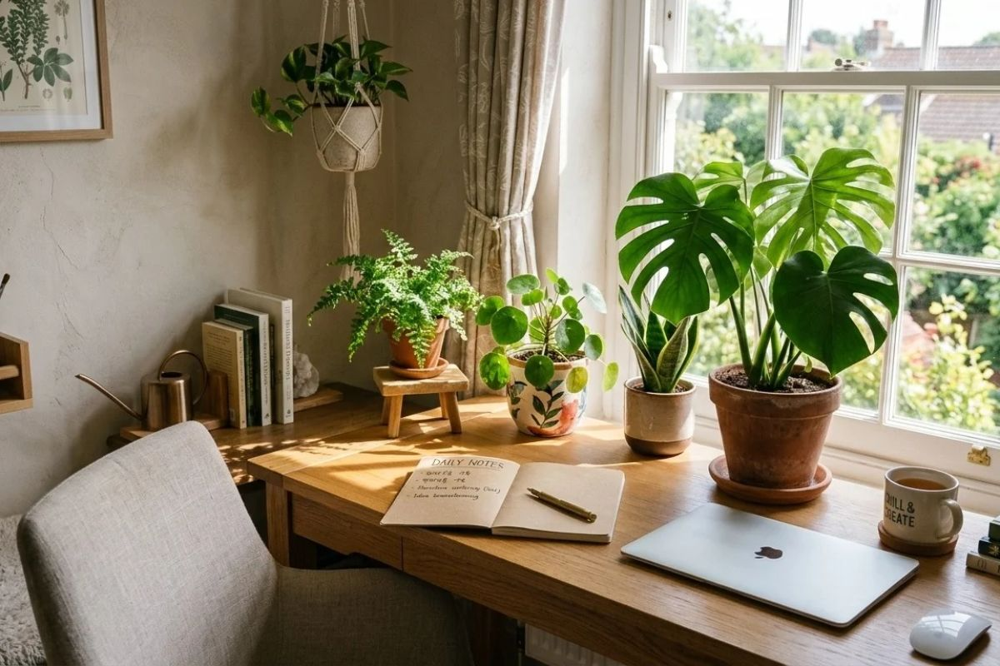
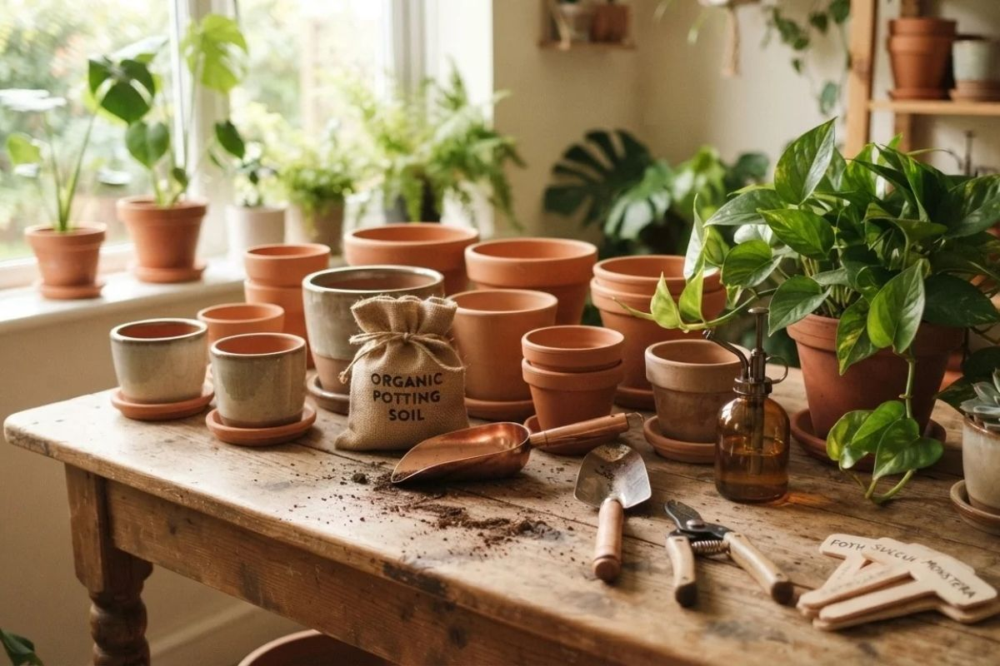

## 목차
1. [[입문의 화두] "베란다 화분 두세 개로 시작하는 조용한 변화: 초록 취미가 현실의 아이디어가 되는 순간"](#master-insight)
2. [[일상 속 계기 해부] 지인의 질문과 동네 매장 관찰에서 "나도 한 번 해볼까?"라는 호기심이 자라나는 현실 장면](#daily-triggers)
3. [[시선의 전환 3대 포인트] 예쁜 식물을 고르던 눈이 '일과 공간'의 언어로 바뀌는 순간](#perspective-shift)
4. [[현실 체크 프로토콜] 큰 결정 전에 가볍게 짚어보는 예산·시간·일상 리듬 점검 루틴](#reality-check)
5. [[현장 메모] "화분 몇 개를 돌보며 깨달은 '좋아하는 마음'과 '감당 가능한 리듬'의 균형"](#master-note)
6. [[실전 시작 가이드] 작은 관심과 경험을 부담 없이 첫걸음으로 이어가는 3대 필수 수칙](#solution)
7. [다음 연재 예고 & 시리즈 안내](#series)
8. [자주 묻는 질문 (FAQ)](#faq)

---

## 1. [입문의 화두] "베란다 화분 두세 개로 시작하는 조용한 변화: 초록 취미가 현실의 아이디어가 되는 순간"

"처음부터 거창한 사업 계획이나 가게 오픈을 염두에 두고 식물을 들이는 사람은 드문데, **어느 날 문득 집 안 화분 몇 개가 부업이나 창업, 매장 리뉴얼 아이디어로 이어졌던 경험**이 없으십니까?"

"수많은 입문자와 식물 애호가들이 **집에서 내 취향대로 식물을 키우는 즐거움과 누군가의 공간·일상에서 식물이 사랑받고 거래되는 현실 사이에는 분명한 차이가 있다는 점**을 놓친 채 막연한 기대나 반대로 과도한 두려움에 머무르곤 한다는 사실을 체감하고 계시지 않습니까?"

소규모 식물 활동과 공간 연출, 매장 리뉴얼 흐름을 살피며 확인한 현실적인 출발점은 **'식물 몇 화분에서 시작된 작은 관심이 부업이나 창업, 리뉴얼 아이디어로 자라나는 힘은 거창한 자본이나 전문가 행세가 아니라, 일상 속 작은 계기를 포착하고 감당 가능한 범위부터 차분히 시험해 보는 태도에 있다'**는 사실입니다.

이번 [기획 연재: 식물 창업·전업 & 매장 리뉴얼 마스터 클래스 시즌 1] 제1부에서는 식물 몇 화분에서 시작해 부업·창업까지 떠올리게 된 계기를 차분히 풀어봅니다.

<figure style="text-align: center; margin: 32px 0;">
  
  <figcaption style="font-size: 0.9rem; color: #6C7A72; margin-top: 12px; font-style: normal;">작은 화분 몇 개와 기록 노트에서 시작되는 조용한 아이디어</figcaption>
</figure>

---

## 2. [일상 속 계기 해부] 지인의 질문과 동네 매장 관찰에서 "나도 한 번 해볼까?"라는 호기심이 자라나는 현실 장면

작은 취미가 현실적인 아이디어로 번지는 순간은 대개 거창한 계획표가 아니라, 아주 평범한 일상 장면에서 찾아옵니다.

처음에는 집들이 선물이나 이사 기념, 혹은 바쁜 일상에 작은 숨통을 틔우려고 들인 화분 두세 개로 시작합니다. 그러다 아침에 일어나 흙의 마름 정도를 살피고, 잎 끝에 맺힌 물방울이나 새순이 올라오는 각도를 유심히 보게 됩니다. 주말이면 괜히 동네 꽃집이나 식물 코너에 들러 다른 집 식물들은 어떤 흙과 화분에 심겨 있는지 구경하게 되죠.

이 단계에서는 아직 '창업'이나 '전업'이라는 말이 선명하지 않습니다. 대신 **내 손으로 돌본 식물이 살아나고 자라나는 과정 자체가 주는 잔잔한 성취감**이 커지며, 주변의 풍경이 조금씩 다르게 보이기 시작합니다.

> #### 🌱 일상 속 계기와 아이디어 확장 비교 매트릭스
>
> | 일상 속 계기 | 처음 드는 생각 | 다음으로 이어지는 호기심 |
> | :--- | :--- | :--- |
> | **지인의 관리 질문 증가** | "내 경험이 남에게도 도움이 되네?" | 간단한 케어 팁 공유·원데이 클래스 구상 |
> | **동네 매장·공간 관찰** | "이 공간은 이렇게 꾸미면 좋겠다" | 소규모 매장 리뉴얼·플랜테리어 아이디어 |
> | **번식·나눔 경험 축적** | "여분의 식물이나 손질이 필요한 사람이 있겠는데?" | 무점포 소규모 판매·분갈이 대행 탐색 |
> | **주말 루틴의 확장** | "조금만 더 깊게 해보면 어떨까?" | 부업·사이드 프로젝트·전업 가능성 검토 |

---

## 3. [시선의 전환 3대 포인트] 예쁜 식물을 고르던 눈이 '일과 공간'의 언어로 바뀌는 순간

식물 몇 화분을 돌보던 사람이 부업이나 창업, 매장 리뉴얼을 떠올리게 될 때는 식물을 바라보는 기준이 하나둘 늘어납니다.

<figure style="text-align: center; margin: 32px 0;">
  
  <figcaption style="font-size: 0.9rem; color: #6C7A72; margin-top: 12px; font-style: normal;">식물의 매력과 공간·관리 조건을 함께 살피는 작업대</figcaption>
</figure>

> #### 💡 식물 창업·전업 & 매장 리뉴얼 시즌 1 제1부 핵심 3대 시선 변화
> 

> 
> 1. **[내 취향 중심에서 '상대와 공간' 중심으로의 이동]**  
>    * 예전에는 "내가 좋아하는 식물인가?"만 봤다면, 이제는 "초보자가 집에 데려가도 무난할까?", "이 가게 입구나 테이블에 두면 분위기가 어떻게 달라질까?"를 함께 떠올리게 됩니다.

> 2. **[예쁜 모습 너머의 '이동·진열·관리 동선' 포착]**  
>    * 길을 걷거나 매장을 둘러볼 때 단순히 꽃이나 잎만 보는 것이 아니라, "이동할 때 잎이 덜 상할까?", "손님이 멈춰 서서 구경하기 편한 자리일까?" 같은 현실적인 디테일이 눈에 들어옵니다.

> 3. **[단발성 호기심에서 '작은 시도'로의 연결]**  
>    * 막연한 동경에 머물기보다 지인에게 식물을 건네며 반응이 좋았던 경험, 동네 공간의 아쉬운 구석을 보며 떠올린 작은 아이디어가 "가볍게 한 번 해볼까?"라는 질문으로 이어집니다.

---

## 4. [현실 체크 프로토콜] 큰 결정 전에 가볍게 짚어보는 예산·시간·일상 리듬 점검 루틴

설레는 아이디어가 떠올랐을 때일수록 처음부터 큰 결정을 내리기보다 가벼운 질문 몇 개로 숨을 고르는 것이 좋습니다.

> #### ⚙️ 작은 시작 전 현실 감각 점검 3대 루틴
> 

> 
> 1. **[무리하지 않는 범위 확인: '지금 당장 크게 벌이지 않아도 되는가' 점검]**  
>    * 가게 계약이나 큰 물량·장비 구매 전에, 집에서 소규모로 해보거나 지인·동네 단위로 가볍게 시험해 볼 수 있는 여지가 있는지 먼저 살펴보세요.

> 2. **[즐거운 일과 번거로운 일 구분: '꾸미는 재미와 운영 수고' 캘리브레이션]**  
>    * 식물을 고르고 배치하는 과정은 즐겁더라도, 포장·응대·일정 조율·재고나 공간 정리 같은 과정이 생겼을 때 내가 감당할 수 있을지 미리 떠올려 보세요.

> 3. **[일상 리듬 조율: '본업·가족·휴식 시간과의 균형' 확인]**  
>    * 평일 퇴근 후나 주말 자투리 시간, 기존 본업이나 생활 리듬과 지나치게 부딪치지 않는 선에서 시작할 수 있는지 돌아보세요.

---

## 5. [현장 메모] "화분 몇 개를 돌보며 깨달은 '좋아하는 마음'과 '감당 가능한 리듬'의 균형"

> #### 📝 [현장 노트] 작은 식물 취미에서 현실의 아이디어를 떠올릴 때 챙겨야 할 세 가지 마음가짐
>
> * **첫 번째 메모: "거창한 계획보다 화분 몇 개에서 시작된 애정과 호기심이 더 오래 간다"**  
>   ➔ 처음부터 완벽한 그림을 그리려 애쓰기보다 내 일상에 스며든 작은 계기를 소중히 여겨 보세요.

> * **두 번째 메모: "내 방에서 잘 자라는 식물과, 다른 사람의 공간에서 사랑받는 식물은 조금 다를 수 있다"**  
>   ➔ 식물을 보는 눈을 한 걸음 넓혀 상대의 환경과 동선을 함께 떠올려 보면 아이디어가 선명해집니다.

> * **세 번째 메모: "설렘이 클수록 작은 단위로 먼저 움직여 보며 내 리듬에 맞는지 확인하는 것이 안전하다"**  
>   ➔ 무리하지 않는 첫걸음이 다음 이야기를 이어 가게 만듭니다.

---

## 6. [실전 시작 가이드] 작은 관심과 경험을 부담 없이 첫걸음으로 이어가는 3대 필수 수칙

* **[기획 연재: 식물 창업·전업 & 매장 리뉴얼 마스터 클래스 시즌 1. ①] (현재글) [작은 시작 편] \"식물 몇 화분에서 시작해 부업·창업까지 떠올리게 된 계기: 초록 취미가 현실의 아이디어가 되는 순간\"**  
  ➔ [소소한 화분 취미가 부업·창업·매장 리뉴얼 아이디어로 이어지는 일상 속 출발점과 현실 체크포인트](https://floraldays.com/biz-season1-from-few-pots-to-plant-side-hustle-and-startup-part1)

* **[다음 예고 — 시즌 1. ②] [생각의 차이 편] \"'식물 잘 키우는 사람'과 '식물로 돈 버는 사람'의 생각 차이\"**  
  ➔ [취미로 식물을 돌볼 때와 누군가에게 가치와 경험을 전하며 일로 이어갈 때 달라지는 관점 정리](https://floraldays.com/biz-season1-plant-lover-vs-plant-business-mindset-part2)

---

## 7. 다음 연재 예고 & 시리즈 안내

* **[기획 연재: 식물 창업·전업 & 매장 리뉴얼 마스터 클래스 시즌 1. ①] [작은 시작 편] \"식물 몇 화분에서 시작해 부업·창업까지 떠올리게 된 계기: 초록 취미가 현실의 아이디어가 되는 순간\"**  
  ➔ [소소한 화분 취미가 부업·창업·매장 리뉴얼 아이디어로 이어지는 일상 속 출발점과 현실 체크포인트](https://floraldays.com/biz-season1-from-few-pots-to-plant-side-hustle-and-startup-part1)

* **[다음 예고 — 시즌 1. ②] [생각의 차이 편] \"'식물 잘 키우는 사람'과 '식물로 돈 버는 사람'의 생각 차이\"**  
  ➔ [취미로 식물을 돌볼 때와 누군가에게 가치와 경험을 전하며 일로 이어갈 때 달라지는 관점 정리](https://floraldays.com/biz-season1-plant-lover-vs-plant-business-mindset-part2)

---

## 8. 자주 묻는 질문 (FAQ)

**Q1. 식물을 전문적으로 잘 알지 못해도 부업이나 매장 리뉴얼 같은 아이디어를 떠올려 볼 수 있을까요?**  

A1. '네, 처음부터 거창한 전문가 수준이 아니더라도 식물을 좋아하며 돌본 경험과 공간을 살피는 눈이 있다면 작은 아이디어부터 가볍게 떠올려 볼 수 있습니다. 

중요한 것은 무리하게 큰 규모로 시작하기보다 내가 감당할 수 있는 작은 범위에서 차근차근 경험을 쌓아 가는 것입니다'.

> 💡 도시농업 및 생활 속 원예 활동 관련 공공 정보는 <a href="https://www.modunong.or.kr" target="_blank" rel="noopener noreferrer">농림축산식품부 모두가 도시농부 포털</a>을 참고하시기 바랍니다.

**Q2. 베란다 화분 몇 개로 시작했을 때 가장 먼저 해볼 만한 작은 시도는 무엇인가요?**  

A2. '지인들이 자주 묻는 관리 포인트를 정리해 보거나, 여분의 식물을 나누며 반응과 취향을 살펴보고, 주변 카페나 작은 매장의 식물 배치를 눈여겨보며 아이디어를 메모해 보는 것이 좋습니다. 

작은 시도를 통해 내가 어떤 방식에 흥미를 느끼는지 먼저 확인해 보세요'.

> 💡 원예 및 생활 가드닝 관련 참고 자료는 <a href="https://www.nihhs.go.kr" target="_blank" rel="noopener noreferrer">농촌진흥청 국립원예특작과학원</a>을 참고하시기 바랍니다.

---

