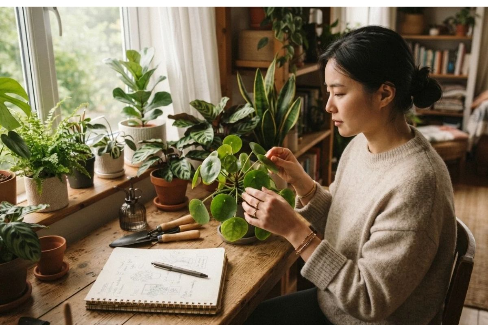
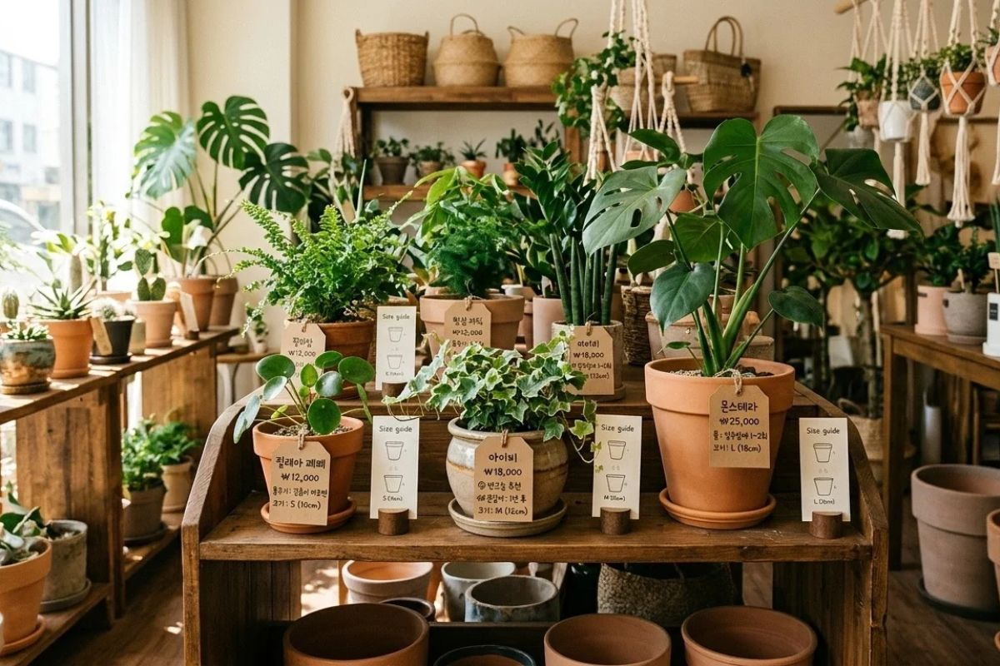

## 목차
1. [[관점의 화두] "내 방에서 싱싱하게 자라는 화분과, 누군가의 공간에서 사랑받으며 팔리는 식물은 왜 다를까"](#master-insight)
2. [[현장 경험 해부] '내가 아끼는 한 그루'를 돌보던 손길에서 '상대의 공간과 거래의 흐름'을 읽는 관점으로 옮겨간 현실 장면들](#mindset-cases)
3. [[생각의 차이 3대 축] 식물 선택 기준·돌봄의 타이밍·공간과 거래를 보는 눈의 차이 비교](#mindset-differences)
4. [[관점 전환 프로토콜] 취미의 애정을 해치지 않으면서 일의 현실 감각을 익히는 3단계 연습 루틴](#practice-protocol)
5. [[현장 메모] "식물을 향한 마음은 그대로 두고, 바라보는 질문만 한 줄 더 늘려 본 기록"](#master-note)
6. [[실전 적용 가이드] 잘 키우는 감각을 실용적인 아이디어로 연결하는 3대 필수 수칙](#solution)
7. [연재 시리즈 안내 & 다음 예고](#series)
8. [자주 묻는 질문 (FAQ)](#faq)

---

## 1. [관점의 화두] "내 방에서 싱싱하게 자라는 화분과, 누군가의 공간에서 사랑받으며 팔리는 식물은 왜 다를까"

"집에서는 잎 하나 허투루 상하지 않게 잘 키우던 식물이 막상 지인에게 나누거나 소규모 판매·공간 배치를 해보면 **생각과 다른 반응이나 예상 밖의 번거로움을 마주했던 경험**이 없으십니까?"

"수많은 식물 애호가들이 **내 환경에 맞춰 정성을 쏟는 '돌봄의 감각'과 다른 사람의 조건·동선·기대를 함께 읽는 '일의 관점'은 출발점부터 다르다는 점**을 놓친 채, '식물만 잘 키우면 자연스럽게 일로도 잘 풀릴 것'이라 막연히 기대하거나 반대로 '나는 장사꾼이 아니라서 안 될 것'이라며 일찌감치 선을 긋곤 한다는 사실을 느끼고 계시지 않습니까?"

소규모 식물 판매, 원데이 클래스, 매장 식물 리뉴얼 현장을 가까이서 지켜보며 확인한 현실적인 차이는 **'식물을 잘 키우는 사람은 식물의 상태와 내 리듬에 깊이 집중하지만, 식물로 일을 만들어 가는 사람은 여기에 상대의 환경, 이동·진열의 흐름, 그리고 감당 가능한 수고의 균형을 함께 얹는다'**는 사실입니다.

이번 [기획 연재: 식물 창업·전업 & 매장 리뉴얼 마스터 클래스 시즌 1] 제2부에서는 '식물 잘 키우는 사람'과 '식물로 돈 버는 사람'의 생각 차이를 차분히 살펴봅니다.

<figure style="text-align: center; margin: 32px 0;">
  
  <figcaption style="font-size: 0.9rem; color: #6C7A72; margin-top: 12px; font-style: normal;">식물 상태와 공간·운영 흐름을 함께 바라보는 시선</figcaption>
</figure>

---

## 2. [현장 경험 해부] '내가 아끼는 한 그루'를 돌보던 손길에서 '상대의 공간과 거래의 흐름'을 읽는 관점으로 옮겨간 현실 장면들

취미로 식물을 돌볼 때와 부업·창업·매장 리뉴얼을 떠올릴 때 가장 먼저 부딪히는 지점은 **'내 기준'과 '상대·현장의 기준'이 만나는 순간**입니다.

예를 들어 집에서는 햇빛이 잘 드는 베란다와 내가 편한 시간에 물을 줄 수 있는 환경이 갖춰져 있어 까다롭거나 개성 강한 식물도 즐겁게 키울 수 있습니다. 하지만 누군가의 사무실 책상이나 햇빛이 약한 카페 구석, 혹은 식물 초보자의 거실로 가게 되면 이야기가 달라집니다. "이 식물이 며칠 동안 물 없이도 버틸까?", "옮겨 실을 때 가지가 쉽게 부러지지는 않을까?", "받는 사람이 관리법을 듣고 부담스러워하지 않을까?" 같은 질문이 따라붙기 때문입니다.

동네 매장 리뉴얼이나 소규모 나눔·판매를 해본 사람들이 한결같이 이야기하는 변화도 비슷합니다. 처음에는 내가 예뻐 보이는 화분 위주로 고르다가, 점차 **상대의 공간 분위기와 손님이 접하는 순간, 그리고 내가 꾸준히 챙길 수 있는 작업량**을 함께 따지게 되면서 생각이 한층 현실적으로 다듬어집니다.

> #### 🌿 '잘 키우는 사람'과 '돈 버는 사람'의 생각 차이 비교 매트릭스
>
> | 구분 | 식물을 잘 키우는 사람의 시선 | 식물로 일·수익을 만들어 가는 사람의 시선 |
> | :--- | :--- | :--- |
> | **식물을 고르는 기준** | 내가 끌리고 잘 돌볼 수 있는 식물 중심 | 상대 환경·공간 어울림·이동/관리 부담까지 함께 고려 |
> | **시간과 정성의 방향** | 한 그루에 시간을 들이며 자라는 과정 자체를 즐김 | 정해진 시간·예산 안에서 재현성과 효율의 균형을 살핌 |
> | **상대와의 접점** | 내 취향과 경험을 나누는 데 초점 | 상대가 편하게 선택·관리·재방문할 수 있는 경험 설계 |
> | **변수를 대하는 태도** | 잎 한 장의 변화도 애정을 갖고 세심히 살핌 | 상처·배송·재고·일정 변수에 대비한 현실적 기준 마련 |

---

## 3. [생각의 차이 3대 축] 식물 선택 기준·돌봄의 타이밍·공간과 거래를 보는 눈의 차이 비교

식물을 향한 애정은 같더라도, 관점이 일의 영역으로 넓어질 때 달라지는 차이는 크게 세 가지 축에서 뚜렷하게 드러납니다.

<figure style="text-align: center; margin: 32px 0;">
  
  <figcaption style="font-size: 0.9rem; color: #6C7A72; margin-top: 12px; font-style: normal;">공간 조건과 손님의 선택 흐름을 함께 고려한 배치</figcaption>
</figure>

> #### 💡 식물 창업·전업 & 매장 리뉴얼 시즌 1 제2부 핵심 3대 관점 차이
> 

> 
> 1. **[제1축: '내가 좋아하는 식물'에서 '상대 공간에서 살아남고 사랑받는 식물'로의 기준 확장]**  
>    * 집에서는 조금 손이 가도 멋진 식물이 주인공이 될 수 있지만, 판매나 리뉴얼에서는 받는 사람의 빛·통풍·생활 습관과 어우러지는지가 중요해집니다. "예쁜가?"에 더해 **"누가, 어디에 두고, 어떻게 돌볼까?"**를 함께 묻게 됩니다.

> 2. **[제2축: '끝없는 정성'에서 '감당 가능한 시간·비용·작업량'으로의 현실 조율]**  
>    * 취미에서는 주말 내내 분갈이를 하거나 잎을 닦아도 즐거움으로 남지만, 일이 되면 정해진 시간과 예산 안에서 무리하지 않는 선이 필요해집니다. 내가 감당할 수 있는 물량과 수고를 미리 가늠해야 지치지 않습니다.

> 3. **[제3축: '돌봄 자체의 만족'에서 '상대의 선택과 만족이 이어지는 흐름'으로의 시선 이동]**  
>    * 식물을 잘 키우는 것이 '결과와 과정의 기쁨'이라면, 식물로 돈을 버는 일은 '상대가 기분 좋게 고르고, 집이나 매장에 들인 뒤에도 만족하며 다시 찾게 만드는 경험'을 함께 만드는 과정에 가깝습니다.

---

## 4. [관점 전환 프로토콜] 취미의 애정을 해치지 않으면서 일의 현실 감각을 익히는 3단계 연습 루틴

관점의 차이를 이해했다고 해서 억지로 계산기부터 두드릴 필요는 없습니다. 식물을 좋아하는 마음을 지키면서 일의 시선을 자연스럽게 익혀 볼 수 있는 가벼운 연습 루틴을 소개합니다.

> #### ⚙️ 생각의 간극을 좁히는 3단계 연습 루틴
> 

> 
> 1. **[1단계: 지인·공간 맞춤 추천 연습]**  
>    * 지인의 집이나 동네 카페·사무실을 떠올리며 "이 공간에는 어떤 크기의 화분과 분위기가 어울릴까?"를 머릿속으로 그려 보세요. 내 취향보다 그 공간의 햇빛과 동선을 먼저 떠올려 보는 연습입니다.

> 2. **[2단계: 수고와 비용을 함께 적어 보는 메모 습관]**  
>    * 작은 화분 하나를 꾸미거나 나눌 때도 식물 값 외에 화분·흙·포장재·이동 시간 같은 요소가 얼마나 들었는지 가볍게 적어 보세요. 숫자를 엄격히 따지기보다 **'생각보다 손이 많이 가는 부분'**을 눈으로 확인하는 것만으로도 큰 도움이 됩니다.

> 3. **[3단계: 취미 구역과 일 구상의 경계 나누기]**  
>    * 오롯이 내 마음을 쉬게 하는 화분 몇 개는 취미 영역으로 남겨 두고, 부업이나 매장 리뉴얼로 생각해 볼 아이디어는 별도로 떼어내어 살펴보세요. 둘을 섞지 않을 때 식물을 사랑하는 마음도 오래 지켜집니다.

---

## 5. [현장 메모] "식물을 향한 마음은 그대로 두고, 바라보는 질문만 한 줄 더 늘려 본 기록"

> #### 📝 [현장 노트] 잘 키우는 감각을 일의 관점으로 넓힐 때 기억해 두면 좋은 세 가지 문장
>
> * **첫 번째 메모: "식물을 잘 키우는 능력은 훌륭한 밑거름이지만, 일에서는 '상대의 환경과 편의'라는 질문이 더해진다"**  
>   ➔ 내 손에 익은 방식만 고집하지 않고 상대의 눈높이를 함께 살필 때 아이디어가 단단해집니다.

> * **두 번째 메모: "좋아하는 일이라고 해서 모든 과정이 저절로 쉬워지는 것은 아니며, 번거로움을 미리 아는 것이 현실 감각이다"**  
>   ➔ 포장, 응대, 일정, 관리 같은 수고를 미리 상상해 보면 낭만적인 기대와 실제 사이의 거리를 줄일 수 있습니다.

> * **세 번째 메모: "돈 버는 시선을 익힌다고 해서 식물을 아끼는 마음이 사라지는 것은 아니다"**  
>   ➔ 오히려 식물이 상하지 않고 오래 사랑받기를 바라는 마음은 돌봄과 일 모두를 지탱하는 힘입니다.

---

## 6. [실전 적용 가이드] 잘 키우는 감각을 실용적인 아이디어로 연결하는 3대 필수 수칙

1. **식물 자체뿐 아니라 '놓일 공간과 돌볼 사람'을 함께 떠올리기**  
   빛, 공간 여유, 초보자의 관리 난이도, 이동·배치 편의성까지 한 세트로 살펴보기.
2. **내 시간·체력·예산이 감당할 수 있는 현실적인 크기부터 시작하기**  
   처음부터 거창한 규모를 그리기보다 소규모·동네·비정기적인 시도부터 가볍게 경험하기.
3. **취미의 즐거움과 일의 현실을 구분해 지치지 않는 리듬 만들기**  
   식물을 만지며 쉬는 시간과 부업·리뉴얼 아이디어를 구상하는 시간을 분리해 오래 이어가기.

---

## 7. 연재 시리즈 안내 & 다음 예고

* **[기획 연재: 식물 창업·전업 & 매장 리뉴얼 마스터 클래스 시즌 1. ①] [작은 시작 편] \"식물 몇 화분에서 시작해 부업·창업까지 떠올리게 된 계기: 초록 취미가 현실의 아이디어가 되는 순간\"**  
  ➔ [소소한 화분 취미가 부업·창업·매장 리뉴얼 아이디어로 이어지는 일상 속 출발점과 현실 체크포인트](https://floraldays.com/biz-season1-from-few-pots-to-plant-side-hustle-and-startup-part1)

* **[기획 연재: 식물 창업·전업 & 매장 리뉴얼 마스터 클래스 시즌 1. ②] [생각의 차이 편] \"'식물 잘 키우는 사람'과 '식물로 돈 버는 사람'의 생각 차이: 초록 애정의 감각을 일의 관점으로 넓히는 법\"**  
  ➔ [취미로 식물을 돌볼 때와 누군가에게 가치와 경험을 전하며 일로 이어갈 때 달라지는 관점 정리](https://floraldays.com/biz-season1-plant-lover-vs-plant-business-mindset-part2)

* **[다음 예고 — 시즌 1. ③] [적성·흥미 테스트 편] \"큰돈 들이지 않고 내 적성과 흥미부터 가볍게 테스트해 보는 법\"**  
  ➔ 지출과 부담을 줄이면서 나에게 맞는 식물 부업·클래스·리뉴얼 방향을 미리 가늠해 보는 현실적인 방법

---

## 8. 자주 묻는 질문 (FAQ)

**Q1. 식물을 잘 키운다고 해서 꼭 부업이나 창업을 해야 하는 건가요?**  

A1. '전혀 그렇지 않습니다. 

식물을 잘 키우는 것만으로도 일상의 큰 즐거움과 휴식이 되며, 부업이나 매장 리뉴얼은 마음이 끌리고 생활 리듬에 맞을 때 가볍게 탐색해 보는 선택지 중 하나일 뿐입니다. 

취미로 머물러도 좋고, 작은 시도로 이어가도 모두 자연스러운 선택입니다'.

> 💡 생활 속 반려식물 관리 및 원예 활동 안내는 <a href="https://www.modunong.or.kr" target="_blank" rel="noopener noreferrer">농림축산식품부 모두가 도시농부 포털</a>을 참고하시기 바랍니다.

**Q2. 식물로 일해보고 싶을 때 '내 기준'을 내려놓는다는 것이 구체적으로 무슨 뜻인가요?**  

A2. '내 방 기준에서만 식물을 고르거나, 내가 편한 방식만 고집하지 않고 상대의 공간 조건·관리 습관·이동과 진열 편의성을 함께 고려한다는 뜻입니다. 

내 취향을 완전히 버리기보다 상대와 만나는 지점까지 시야를 넓힌다고 이해하시면 쉽습니다'.

> 💡 실내 원예 및 식물 활용 관련 공공 참고 자료는 <a href="https://www.nihhs.go.kr" target="_blank" rel="noopener noreferrer">농촌진흥청 국립원예특작과학원</a>을 참고하시기 바랍니다.

---

