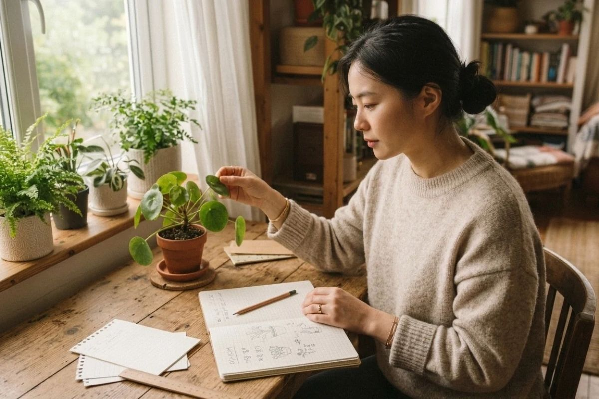
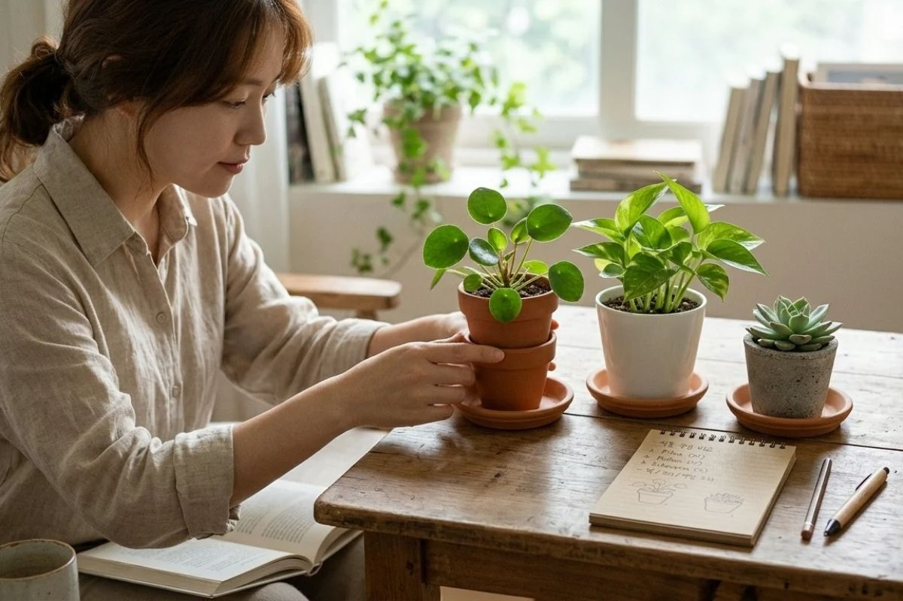

## 목차
1. [[테스트의 화두] "화분이나 공간을 사기 전에, 내 마음과 생활 리듬부터 가볍게 시험해 보아야 하는 이유"](#master-insight)
2. [[실전 테스트 사례] 큰 지출 없이 작은 시도로 적성을 확인해 본 현실적인 경험들](#test-cases)
3. [[저비용 테스트 3대 축] 돌봄·연출·소통 중 어디에 마음이 끌리는지 확인하는 3가지 가벼운 실험](#low-cost-tests)
4. [[체크 프로토콜] 테스트 뒤 '계속해 볼 만한지' 판단하는 현실 기준 루틴](#check-protocol)
5. [[현장 메모] "작게 해 본 하루의 감정이 큰 계획표보다 더 솔직하게 말해 준 것들"](#master-note)
6. [[실전 실행 가이드] 지출과 부담을 줄이며 나에게 맞는 식물 방향을 찾는 3대 필수 수칙](#solution)
7. [연재 시리즈 안내 & 다음 예고](#series)
8. [자주 묻는 질문 (FAQ)](#faq)

---

## 1. [테스트의 화두] "화분이나 공간을 사기 전에, 내 마음과 생활 리듬부터 가볍게 시험해 보아야 하는 이유"

"식물 부업이나 소규모 공방, 매장 리뉴얼을 떠올리면서 **막상 지갑을 열기 전에 내가 정말 이 과정을 재미있어할지, 아니면 번거로움에 금방 지칠지 가늠해 보고 싶었던 순간**이 없으십니까?"

"수많은 입문자들이 **식물을 좋아하는 마음만 믿고 화분이나 자재, 공간을 먼저 마련했다가, 막상 사람을 응대하거나 정해진 일정에 맞춰 움직이고 공간을 정리하는 과정에서 예상과 다른 피로감을 겪곤 한다는 사실**을 체감하고 계시지 않습니까?"

소규모 식물 활동과 현장 흐름을 살피며 확인한 현실적인 순서는 **'큰돈을 들여 판을 벌이기 전에, 돈이 거의 들지 않거나 아주 적은 비용으로 해볼 수 있는 작은 테스트를 먼저 거쳐 내 적성·흥미·생활 리듬과의 궁합을 확인하는 것'**입니다.

이번 [기획 연재: 식물 창업·전업 & 매장 리뉴얼 마스터 클래스 시즌 1] 제3부에서는 큰돈 들이지 않고 내 적성과 흥미부터 가볍게 테스트해 보는 법을 차분히 정리합니다.

<figure style="text-align: center; margin: 32px 0;">
  
  <figcaption style="font-size: 0.9rem; color: #6C7A72; margin-top: 12px; font-style: normal;">큰 지출 없이 메모와 작은 시도로 적성을 가늠해 보는 시간</figcaption>
</figure>

---

## 2. [실전 테스트 사례] 큰 지출 없이 작은 시도로 적성을 확인해 본 현실적인 경험들

적성과 흥미를 확인하는 방법은 거창한 시장조사보다 훨씬 단순합니다. 지금 가진 물건과 주변의 작은 기회 안에서 한두 가지만 살짝 건드려 보면 됩니다.

예를 들어 집에서 키우던 식물의 여분 모종이나 분갈이 후 남은 튼튼한 포기를 지인이나 동네 모임에서 가볍게 나눠 주며 반응을 살펴볼 수 있습니다. 이때 받는 사람이 어떤 점에 고마워하는지, 내가 관리법을 설명할 때 즐거운지 아니면 진땀이 나는지가 선명하게 드러납니다.

또 다른 사례로는 동네 단골 카페나 작은 가게, 친구의 작업실 한구석에 화분 몇 개를 놓아 보며 분위기를 바꿔 보는 시도가 있습니다. 공사를 하거나 새 물건을 잔뜩 사지 않고도 **배치 하나만으로 공간의 인상이 달라지는 과정**을 경험해 보면, 내가 식물 돌봄보다 공간 연출 쪽에 더 끌리는지 금방 알 수 있습니다.

> #### 🧪 저비용 테스트 방식별 확인 포인트 비교 매트릭스
>
> | 가벼운 테스트 방식 | 드는 비용·부담 | 주로 확인하게 되는 적성·흥미 |
> | :--- | :--- | :--- |
> | **여분 식물 나눔·소규모 교환** | 매우 낮음(기존 식물·기본 자재 활용) | 남에게 식물을 건네고 관리법을 알려줄 때의 재미와 소통 감각 |
> | **집·지인 공간 미니 배치 연습** | 매우 낮음(있는 화분·소품 재배치) | 빛·동선·분위기를 맞추며 공간을 다듬는 연출 적성 |
> | **소규모 체험·나눔 모임 1회 진행** | 낮음(간단한 재료비·소모품 수준) | 여러 사람의 진도를 맞추고 분위기를 이끄는 진행 감각 |
> | **동네 매장·공간 관찰 및 제안 메모** | 거의 없음(시간·관찰 중심) | 공간의 아쉬운 점과 개선 아이디어를 읽어 내는 시선 |

---

## 3. [저비용 테스트 3대 축] 돌봄·연출·소통 중 어디에 마음이 끌리는지 확인하는 3가지 가벼운 실험

식물과 관련된 일이라고 해서 모두가 똑같은 지점에서 즐거움을 느끼지는 않습니다. 아래 세 가지 실험을 가볍게 해보면 내 마음이 어디서 더 살아나는지 구분하기 쉬워집니다.

<figure style="text-align: center; margin: 32px 0;">
  
  <figcaption style="font-size: 0.9rem; color: #6C7A72; margin-top: 12px; font-style: normal;">돌봄, 공간 연출, 사람과의 소통 중 내게 맞는 지점 찾기</figcaption>
</figure>

> #### 💡 식물 창업·전업 & 매장 리뉴얼 시즌 1 제3부 핵심 3대 테스트
> 

> 
> 1. **[제1실험: '꾸준히 돌보고 손질하는 것'이 즐거운지 확인하기]**  
>    * 며칠 간격으로 흙 상태를 보고, 상한 잎을 정리하고, 분갈이나 번식을 이어가는 과정을 내 일정 속에서 억지스럽지 않게 해낼 수 있는지 살펴봅니다. "귀찮다"보다 "손이 간다"는 느낌이 앞서는지 체크해 보세요.

> 2. **[제2실험: '공간과 화분의 어울림을 맞추는 것'이 즐거운지 확인하기]**  
>    * 집 안 테이블이나 창가, 베란다 구석에 화분 위치와 받침, 주변 소품을 바꿔 놓으며 분위기가 달라지는 모습을 보는 것이 설레는지 확인합니다. 작은 변화로 공간 전체가 정돈될 때 기분이 좋아진다면 연출·리뉴얼 쪽에 흥미가 있을 가능성이 큽니다.

> 3. **[제3실험: '다른 사람에게 알려 주고 함께 해보는 것'이 즐거운지 확인하기]**  
>    * 지인이나 소모임 사람들에게 물 주는 요령이나 배치 아이디어를 이야기할 때 말이 자연스럽게 나오는지, 상대의 질문에 답하며 보람을 느끼는지 살펴봅니다. 사람들과 호흡하는 과정이 맞는지 가늠하는 좋은 기준이 됩니다.

---

## 4. [체크 프로토콜] 테스트 뒤 '계속해 볼 만한지' 판단하는 현실 기준 루틴

작은 실험을 한두 번 해본 뒤에는 거창한 성공 여부보다 **내 일상이 얼마나 편안했는지**를 기준으로 다음 걸음을 가늠해 보는 것이 좋습니다.

> #### ⚙️ 테스트 후 현실 판단 3대 루틴
> 

> 
> 1. **[피로도 확인: '재미와 수고의 온도 차' 살펴보기]**  
>    * 해본 뒤 피곤하더라도 "또 해보고 싶다"는 여운이 남는지, 아니면 준비와 뒷정리 때문에 다시 생각하기조차 버거운지 솔직하게 적어 보세요.

> 2. **[시간·공간 여유 확인: '지금 생활 리듬에 들어맞는지' 점검하기]**  
>    * 평일 저녁이나 주말 일부 시간을 썼을 때 본업·가족·휴식 시간과 크게 충돌하지 않았는지, 집이나 작업 공간에 작은 짐을 두어도 불편하지 않았는지 확인합니다.

> 3. **[다음 한 걸음 선택: '멈춤·유지·소폭 확장' 중 고르기]**  
>    * 마음이 맞지 않으면 가볍게 멈춰도 손해가 거의 없습니다. 반대로 흥미가 남았다면 한 번에 키우기보다 다음 작은 시도를 하나만 더 이어 가 보세요.

---

## 5. [현장 메모] "작게 해 본 하루의 감정이 큰 계획표보다 더 솔직하게 말해 준 것들"

> #### 📝 [현장 노트] 큰돈 쓰기 전 작은 테스트를 거치며 남게 되는 세 가지 깨달음
>
> * **첫 번째 메모: "아직 해 보지 않은 일은 머릿속으로만 굴릴수록 부풀거나 막연해지기 쉽다"**  
>   ➔ 작은 실험 한 번이 열 번의 고민보다 내 감각을 더 선명하게 깨워 줍니다.

> * **두 번째 메모: "적성 테스트의 목적은 완벽한 답을 찾는 것이 아니라, 덜 맞는 길을 미리 걸러 내는 데 있다"**  
>   ➔ 내게 안 맞는 부분을 일찍 알아차리는 것도 충분히 값진 수확입니다.

> * **세 번째 메모: "돈을 적게 쓰고 시작할수록 마음이 조급해지지 않아 내 적성을 차분히 볼 수 있다"**  
>   ➔ 지출 부담이 낮아야 실패해도 웃으며 다음 선택을 할 수 있습니다.

---

## 6. [실전 실행 가이드] 지출과 부담을 줄이며 나에게 맞는 식물 방향을 찾는 3대 필수 수칙

1. **가게·장비·큰 물량보다 '작은 시도 1~2번'을 먼저 해보기**  
   지출을 최소화한 상태로 나눔, 배치 변경, 소규모 체험·모임 등 가벼운 경험부터 쌓기.
2. **돌봄·연출·소통 중 내가 가장 지치지 않고 즐기는 지점 찾기**  
   모든 걸 잘하려 하기보다 내 성향과 생활 리듬에 맞는 부분부터 눈여겨보기.
3. **테스트 직후의 감정과 번거로움을 짧게 기록해 두기**  
   기분이 좋았던 순간과 손이 많이 갔던 부분을 남겨 두어 다음 선택의 기준으로 삼기.

---

## 7. 연재 시리즈 안내 & 다음 예고

* **[기획 연재: 식물 창업·전업 & 매장 리뉴얼 마스터 클래스 시즌 1. ①] [작은 시작 편] \"식물 몇 화분에서 시작해 부업·창업까지 떠올리게 된 계기: 초록 취미가 현실의 아이디어가 되는 순간\"**  
  ➔ [소소한 화분 취미가 부업·창업·매장 리뉴얼 아이디어로 이어지는 일상 속 출발점과 현실 체크포인트](https://floraldays.com/biz-season1-from-few-pots-to-plant-side-hustle-and-startup-part1)

* **[기획 연재: 식물 창업·전업 & 매장 리뉴얼 마스터 클래스 시즌 1. ②] [생각의 차이 편] \"'식물 잘 키우는 사람'과 '식물로 돈 버는 사람'의 생각 차이: 초록 애정의 감각을 일의 관점으로 넓히는 법\"**  
  ➔ [취미로 식물을 돌볼 때와 누군가에게 가치와 경험을 전하며 일로 이어갈 때 달라지는 관점 정리](https://floraldays.com/biz-season1-plant-lover-vs-plant-business-mindset-part2)

* **[기획 연재: 식물 창업·전업 & 매장 리뉴얼 마스터 클래스 시즌 1. ③] [적성·흥미 테스트 편] \"큰돈 들이지 않고 내 적성과 흥미부터 가볍게 테스트해 보는 법: 지출과 부담을 줄이며 나에게 맞는 식물 일 찾기\"**  
  ➔ [지출과 부담을 줄이면서 나에게 맞는 식물 부업·클래스·리뉴얼 방향을 미리 가늠해 보는 현실적인 방법](https://floraldays.com/biz-season1-low-cost-aptitude-interest-test-part3)

* **[다음 예고 — 시즌 1. ④] [동네 공간 관찰 편] \"주변에서 흔히 보는 동네 꽃집·식물샵·공방이 눈에 띄는 이유\"**  
  ➔ 길을 걷거나 동네 매장을 둘러볼 때 자연스럽게 포착되는 공간의 매력과 아쉬운 점, 리뉴얼 아이디어의 실마리

---

## 8. 자주 묻는 질문 (FAQ)

**Q1. 집에서 키우는 식물이 많지 않아도 적성과 흥미를 테스트해 볼 수 있나요?**  

A1. '네, 화분 수량이 많지 않아도 충분합니다. 

집 안 공간 한구석의 배치를 바꿔 보거나, 동네 카페·꽃집·작은 매장의 진열과 분위기를 눈여겨보며 아이디어를 메모해 보는 것만으로도 적성과 흥미를 가볍게 살펴볼 수 있습니다'.

> 💡 생활 속 원예 및 실내 공간 활용 관련 공공 정보는 <a href="https://www.modunong.or.kr" target="_blank" rel="noopener noreferrer">농림축산식품부 모두가 도시농부 포털</a>을 참고하시기 바랍니다.

**Q2. 작은 테스트를 해봤는데 예상보다 손이 많이 가고 번거롭게 느껴지면 어떻게 해야 하나요?**  

A2. '그 또한 아주 유용한 확인입니다. 

큰돈을 쓰기 전에 번거로움의 정도를 미리 체감했으니, 취미 영역으로만 남겨 두거나, 수고가 덜 드는 다른 방식으로 방향을 바꿔 보거나, 시간을 두고 다시 생각해 보는 등 부담 없이 선택을 조절할 수 있습니다'.

> 💡 원예 및 식물 관리 관련 참고 자료는 <a href="https://www.nihhs.go.kr" target="_blank" rel="noopener noreferrer">농촌진흥청 국립원예특작과학원</a>을 참고하시기 바랍니다.

---

