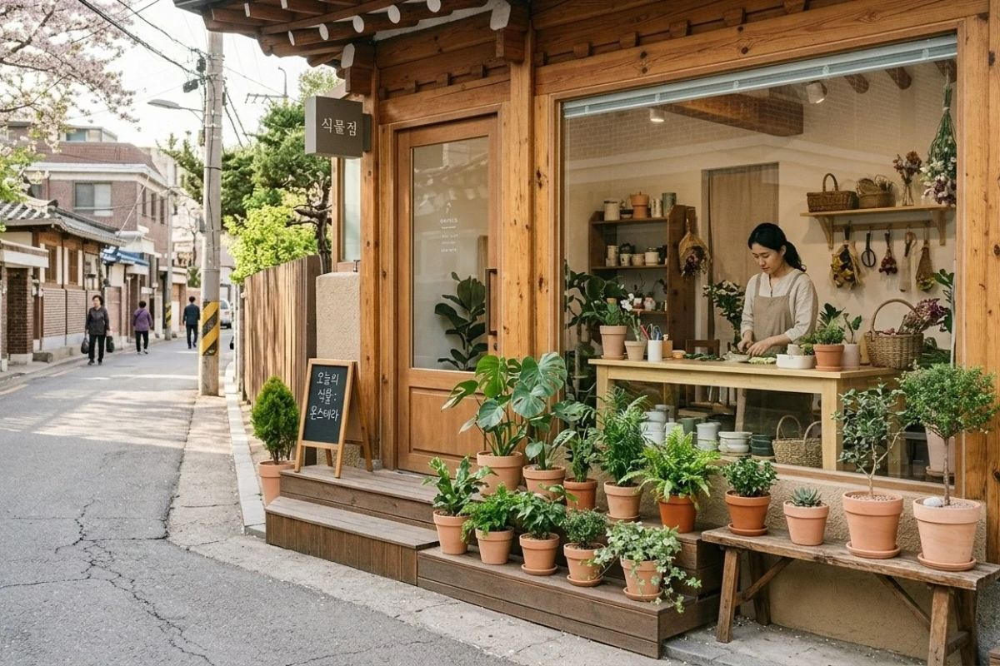
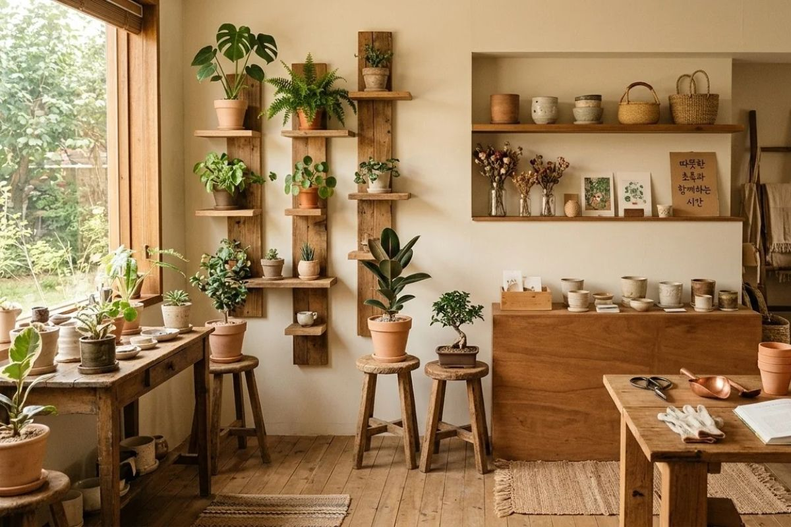

## 목차
1. [[관찰의 화두] "똑같은 골목길에서 유독 발걸음을 멈추게 만드는 동네 꽃집·식물샵·공방의 비밀"](#master-insight)
2. [[골목 현장 해부] 화려한 인테리어보다 '입구의 온기와 한눈에 들어오는 구성'이 시선을 붙잡은 동네 매장 사례](#shop-cases)
3. [[눈에 띄는 공간의 3대 단서] 입구 첫인상·높낮이 진열·머물고 싶은 분위기에서 읽는 현실적 매력](#observation-clues)
4. [[동네 산책 관찰 프로토콜] 길을 걷다 만난 식물 공간을 내 아이디어와 리뉴얼 감각으로 옮기는 3단계 루틴](#observation-protocol)
5. [[현장 메모] "예쁜 가게를 부러워하는 시선에서 '왜 편하고 끌리는지'를 읽어 내는 시선으로"](#master-note)
6. [[실전 적용 가이드] 동네 매장 관찰을 소규모 창업·매장 리뉴얼 구상으로 연결하는 3대 필수 수칙](#solution)
7. [연재 시리즈 안내 & 다음 예고](#series)
8. [자주 묻는 질문 (FAQ)](#faq)

---

## 1. [관찰의 화두] "똑같은 골목길에서 유독 발걸음을 멈추게 만드는 동네 꽃집·식물샵·공방의 비밀"

"식물에 관심이 생긴 뒤로 동네 골목이나 상가를 걸을 때 **예전에는 무심코 지나쳤던 작은 꽃집, 식물샵, 원예 공방이 유독 눈에 들어오고 발걸음이 멈추던 경험**이 없으십니까?"

"수많은 입문자와 예비 창업자, 매장 리뉴얼을 고민하는 분들이 **눈에 띄는 동네 가게들의 비결을 비싼 인테리어나 넓은 평수에서만 찾으려 하지만, 실제로 사람들의 시선을 붙잡는 힘은 문턱의 분위기, 화분의 높낮이 배치, 그리고 부담 없이 들여다볼 수 있는 소소한 디테일에 있다는 점**을 놓치고 계시지 않습니까?"

주변 상권과 골목의 작은 식물 공간들을 살펴보며 확인한 현실적인 공통점은 **'주변에서 흔히 보는 동네 꽃집·식물샵·공방이 눈에 띄는 이유는 거창한 화려함이 아니라, 지나가는 사람의 걸음을 자연스럽게 늦추고 안을 들여다보고 싶게 만드는 친근한 장면과 정돈된 흐름에 있다'**는 사실입니다.

이번 [기획 연재: 식물 창업·전업 & 매장 리뉴얼 마스터 클래스 시즌 1] 제4부에서는 주변에서 흔히 보는 동네 꽃집·식물샵·공방이 눈에 띄는 이유를 생활 속 관찰의 시선으로 풀어봅니다.

<figure style="text-align: center; margin: 32px 0;">
  
  <figcaption style="font-size: 0.9rem; color: #6C7A72; margin-top: 12px; font-style: normal;">골목의 온도를 바꾸는 동네 작은 식물샵의 입구 풍경</figcaption>
</figure>

---

## 2. [골목 현장 해부] 화려한 인테리어보다 '입구의 온기와 한눈에 들어오는 구성'이 시선을 붙잡은 동네 매장 사례

동네에서 오래 사랑받거나 최근 눈에 띄기 시작한 작은 식물 공간들을 가만히 들여다보면 몇 가지 닮은 장면이 있습니다.

한 골목 어귀의 작은 꽃집은 매장 규모가 크지 않지만, 출입문 옆 낮은 나무 벤치와 계단식 받침 위에 계절 화분 몇 개를 군더더기 없이 놓아두었습니다. 빽빽하게 화분을 쌓아 두지 않고 여백을 남긴 덕분에, 길을 지나던 사람들이 자연스럽게 걸음을 늦추고 화분 이름과 가격표를 부담 없이 훑어봅니다.

또 다른 소규모 식물 공방은 통유리 너머로 깔끔하게 정돈된 작업대와 분갈이 도구, 완성된 작은 테라리움 몇 점이 한눈에 보이도록 배치했습니다. 닫힌 문 뒤에 숨겨진 공간이 아니라 **무엇을 하는 곳인지, 들어가면 어떤 경험을 할 수 있는지 밖에서도 직관적으로 읽히는 구성**이 방문 문턱을 크게 낮춘 사례입니다.

> #### 🏪 동네 꽃집·식물샵·공방의 시선 집중 포인트 비교 매트릭스
>
> | 관찰 영역 | 지나치기 쉬운 매장의 특징 | 눈에 띄고 들어가고 싶은 매장의 특징 |
> | :--- | :--- | :--- |
> | **매장 입구·외관** | 화분이 뒤섞여 답답하거나 시선이 분산됨 | **대표 식물과 계절감이 정돈된 여백 속에 드러남** |
> | **진열 높이와 동선** | 바닥에만 빼곡히 놓여 허리를 숙여야 보임 | **눈높이·허리 높이·바닥 높낮이를 나눠 한눈에 들어옴** |
> | **정보와 안내 방식** | 가격이나 특징을 일일이 물어봐야 해서 망설여짐 | **짧고 친절한 메모·가격 표기로 혼자서도 편히 구경 가능** |
> | **공간의 분위기** | 어둡거나 어수선해 들어가기 조심스러움 | **정돈된 작업대와 따뜻한 조명으로 머물기 편안함** |

---

## 3. [눈에 띄는 공간의 3대 단서] 입구 첫인상·높낮이 진열·머물고 싶은 분위기에서 읽는 현실적 매력

주변의 동네 꽃집·식물샵·공방이 유독 눈에 띄는 이유는 크게 세 가지 현실적인 단서로 정리해 볼 수 있습니다.

<figure style="text-align: center; margin: 32px 0;">
  
  <figcaption style="font-size: 0.9rem; color: #6C7A72; margin-top: 12px; font-style: normal;">높낮이와 여백을 살려 시선이 편안하게 머무는 진열 구성</figcaption>
</figure>

> #### 💡 식물 창업·전업 & 매장 리뉴얼 시즌 1 제4부 핵심 3대 관찰 단서
> 

> 
> 1. **[제1단서: 회색 골목 속에서 살아 있는 계절감을 전하는 '입구 첫인상']**  
>    * 간판이나 유리창이 어수선한 상가 거리에서 싱그러운 초록 잎과 정돈된 화분 몇 개는 그 자체로 시선을 쉬게 만듭니다. 특히 입구 앞 1-2미터 구역이 깔끔하게 정돈되어 있으면 지나는 사람의 시선이 자연스럽게 매장 안쪽으로 이어집니다.

> 2. **[제2단서: 좁은 공간도 답답하지 않게 만드는 '높낮이와 여백의 리듬']**  
>    * 눈에 띄는 작은 가게들은 스툴, 원목 상자, 행잉(걸이형) 화분 등을 활용해 시선의 높이를 다양하게 나눕니다. 물건을 가득 채우기보다 화분 사이에 숨 쉴 틈을 남겨 두어 각 식물의 수형과 화분 질감이 또렷하게 살아납니다.

> 3. **[제3단서: "안 사도 편하게 구경할 수 있겠다"는 '심리적 문턱 낮추기']**  
>    * 소규모 공방이나 식물샵이 사랑받는 또 다른 이유는 부담 없는 분위기입니다. 식물 이름과 물주기 힌트가 적힌 작은 팻말, 정돈된 포장·작업 공간이 보이면 처음 들르는 손님도 긴장하지 않고 문을 열게 됩니다.

---

## 4. [동네 산책 관찰 프로토콜] 길을 걷다 만난 식물 공간을 내 아이디어와 리뉴얼 감각으로 옮기는 3단계 루틴

동네 꽃집·식물샵·공방을 지나칠 때 단순히 "예쁘다"에서 멈추지 않고, 아래 세 가지 질문을 가볍게 떠올려 보면 내 아이디어나 기존 매장 리뉴얼에 바로 쓸 수 있는 현실적인 감각이 쌓입니다.

> #### ⚙️ 동네 식물 공간 관찰 3단계 루틴
> 

> 
> 1. **[1단계: 멈춰 선 이유 한 줄 찾기]**  
>    * 매장 앞을 지나다 걸음이 느려졌다면 가장 먼저 시선이 닿은 요소가 무엇인지 짚어 보세요. 입구 앞 큰 화분 하나인지, 유리창 너머 작업대 풍경인지, 혹은 아기자기한 화분 진열인지 확인합니다.

> 2. **[2단계: 손님 입장에서 동선과 시선 따라가 보기]**  
>    * 문을 열고 들어갔을 때 첫 발걸음이 어디로 향하는지, 화분 사이를 걸을 때 가방이나 옷이 스치지 않을 만큼 여유가 있는지, 가격과 안내가 한눈에 들어오는지 살펴봅니다.

> 3. **[3단계: 내 공간·아이디어에 적용할 한 가지 메모하기]**  
>    * 그 매장의 모든 것을 따라 하려 하지 말고, "우리 집 베란다나 내 작업대, 혹은 기존 가게 입구에도 이 배치 하나는 해볼 수 있겠다" 싶은 아이디어 한 가지만 메모해 두세요.

---

## 5. [현장 메모] "예쁜 가게를 부러워하는 시선에서 '왜 편하고 끌리는지'를 읽어 내는 시선으로"

> #### 📝 [현장 노트] 동네 꽃집·식물샵·공방을 관찰하며 얻게 되는 세 가지 현실 힌트
>
> * **첫 번째 메모: "작은 매장이 눈에 띄는 힘은 화려한 장식보다 '정돈된 밀도와 여백'에서 나온다"**  
>   ➔ 화분 수를 줄이고 배치와 높낮이만 정리해도 공간의 인상은 훨씬 또렷해집니다.

> * **두 번째 메모: "사람들은 물건만 보러 들어오는 것이 아니라 그 공간이 주는 차분한 온기를 함께 경험한다"**  
>   ➔ 깔끔한 작업대와 부담 없는 안내 문구 하나가 손님의 마음을 열게 만듭니다.

> * **세 번째 메모: "가장 좋은 공부는 멀리 있는 유명 매장보다 내가 매일 걷는 동네 골목의 가게를 유심히 보는 것이다"**  
>   ➔ 생활권 안의 공간들을 관찰할수록 내 현실과 예산에 맞는 아이디어가 선명해집니다.

---

## 6. [실전 적용 가이드] 동네 매장 관찰을 소규모 창업·매장 리뉴얼 구상으로 연결하는 3대 필수 수칙

1. **입구와 창가 1~2미터 구역의 첫인상부터 단순하고 정갈하게 정리하기**  
   지나는 사람의 시선이 가장 먼저 닿는 곳에 대표 식물과 계절감을 집중 배치하기.
2. **바닥·선반·걸이 등 높낮이를 나누고 화분 사이 여백 확보하기**  
   작은 공간일수록 빽빽하게 채우기보다 각 식물의 개성이 보이도록 시선 높이 조절하기.
3. **초보 방문자도 편하게 살펴볼 수 있는 짧은 안내 표기와 정돈된 동선 유지하기**  
   묻지 않아도 기본 정보와 가격을 알 수 있게 배려해 머무는 시간을 편안하게 만들기.

---

## 7. 연재 시리즈 안내 & 다음 예고

* **[기획 연재: 식물 창업·전업 & 매장 리뉴얼 마스터 클래스 시즌 1. ①] [작은 시작 편] \"식물 몇 화분에서 시작해 부업·창업까지 떠올리게 된 계기: 초록 취미가 현실의 아이디어가 되는 순간\"**  
  ➔ [소소한 화분 취미가 부업·창업·매장 리뉴얼 아이디어로 이어지는 일상 속 출발점과 현실 체크포인트](https://floraldays.com/biz-season1-from-few-pots-to-plant-side-hustle-and-startup-part1)

* **[기획 연재: 식물 창업·전업 & 매장 리뉴얼 마스터 클래스 시즌 1. ②] [생각의 차이 편] \"'식물 잘 키우는 사람'과 '식물로 돈 버는 사람'의 생각 차이: 초록 애정의 감각을 일의 관점으로 넓히는 법\"**  
  ➔ [취미로 식물을 돌볼 때와 누군가에게 가치와 경험을 전하며 일로 이어갈 때 달라지는 관점 정리](https://floraldays.com/biz-season1-plant-lover-vs-plant-business-mindset-part2)

* **[기획 연재: 식물 창업·전업 & 매장 리뉴얼 마스터 클래스 시즌 1. ③] [적성·흥미 테스트 편] \"큰돈 들이지 않고 내 적성과 흥미부터 가볍게 테스트해 보는 법: 지출과 부담을 줄이며 나에게 맞는 식물 일 찾기\"**  
  ➔ [지출과 부담을 줄이면서 나에게 맞는 식물 부업·클래스·리뉴얼 방향을 미리 가늠해 보는 현실적인 방법](https://floraldays.com/biz-season1-low-cost-aptitude-interest-test-part3)

* **[기획 연재: 식물 창업·전업 & 매장 리뉴얼 마스터 클래스 시즌 1. ④] [동네 공간 관찰 편] \"주변에서 흔히 보는 동네 꽃집·식물샵·공방이 눈에 띄는 이유: 길을 걷다 발걸음이 멈추는 공간의 현실적 단서\"**  
  ➔ [동네 매장과 공방이 시선을 끄는 입구·진열·분위기 요소와 내 아이디어에 적용하는 관찰법](https://floraldays.com/biz-season1-why-neighborhood-flower-plant-shops-stand-out-part4)

* **[다음 예고 — 시즌 1. ⑤] [낭만적 착각 점검 편] \"시작 전에 가장 먼저 내려놓아야 할 낭만적인 착각 3가지\"**  
  ➔ 예쁜 공간과 좋아하는 식물만 떠올리다 놓치기 쉬운 현실적인 수고와 시행착오 예방법

---

## 8. 자주 묻는 질문 (FAQ)

**Q1. 동네 꽃집이나 식물샵을 둘러볼 때 구매하지 않고 구경만 해도 괜찮을까요?**  

A1. '물론입니다. 

가볍게 인사하고 조심스럽게 둘러보며 진열 방식이나 화분 조합, 분위기 흐름을 살펴보는 것만으로도 좋은 관찰이 됩니다. 

마음에 드는 작은 소품이나 흙·화분 하나 정도를 가볍게 구입하며 사장님과 짧은 대화를 나누어 보면 현장 분위기를 이해하는 데 더욱 도움이 됩니다'.

> 💡 소상공인 상권 및 점포 운영 관련 공공 정보는 <a href="https://www.semas.or.kr" target="_blank" rel="noopener noreferrer">소상공인시장진흥공단 공식 홈페이지</a>를 참고하시기 바랍니다.

**Q2. 작은 작업실이나 기존 매장을 리뉴얼할 때 가장 먼저 손보면 효과가 큰 곳은 어디인가요?**  

A2. '출입문 주변과 밖에서 가장 먼저 보이는 시선 구역입니다. 

전체 인테리어를 바꾸지 않더라도 입구 앞 정돈, 화분 받침을 활용한 높낮이 배치, 그리고 깔끔한 안내 표기만 정비해도 매장의 첫인상과 방문 문턱이 크게 달라집니다'.

> 💡 생활 속 원예 및 실내 공간 활용 관련 공공 정보는 <a href="https://www.modunong.or.kr" target="_blank" rel="noopener noreferrer">농림축산식품부 모두가 도시농부 포털</a>을 참고하시기 바랍니다.

---

