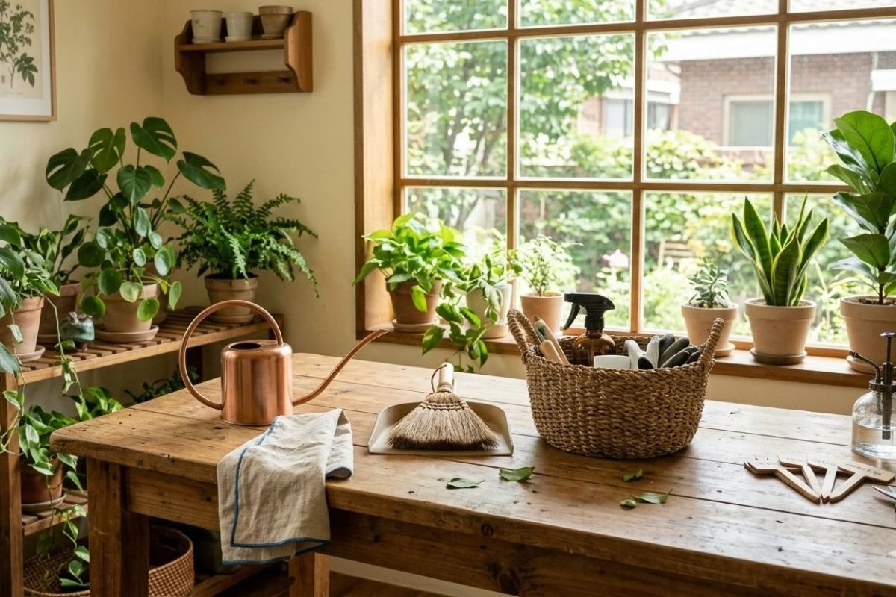

## 목차
1. [[점검의 화두] "햇살 드는 작업실에서 커피 한 잔과 함께 식물을 돌보는 풍경, 그 뒤편에 놓인 실제 하루"](#master-insight)
2. [[현실 대조 해부] 머릿속으로 그리던 여유로운 식물 일과 실제 현장에서 마주하는 체력·시간·변수 이야기](#reality-contrast)
3. [[내려놓아야 할 낭만적 착각 3가지] 좋아하는 일의 여유·예쁜 공간만 꾸미는 재미·알아서 찾아오는 손님에 대한 현실 점검](#three-illusions)
4. [[현실 적응 프로토콜] 낭만을 지우고 현실을 받아들인 뒤에도 즐거움을 지키는 3단계 균형 루틴](#balance-protocol)
5. [[현장 메모] "환상을 내려놓았을 때 비로소 보이기 시작한 작지만 단단한 재미"](#master-note)
6. [[실전 시작 가이드] 시행착오와 실망을 줄이고 나만의 속도로 첫걸음을 떼는 3대 필수 수칙](#solution)
7. [연재 시리즈 안내 & 다음 예고](#series)
8. [자주 묻는 질문 (FAQ)](#faq)

---

## 1. [점검의 화두] "햇살 드는 작업실에서 커피 한 잔과 함께 식물을 돌보는 풍경, 그 뒤편에 놓인 실제 하루"

"식물 공방이나 작은 식물샵, 매장 식물 리뉴얼을 떠올릴 때 **따뜻한 햇살 아래 조용히 음악을 틀어 놓고 화분을 어루만지는 여유로운 장면부터 그려 보신 적**이 없으십니까?"

"수많은 입문자들이 **식물이 주는 차분하고 힐링되는 이미지를 그대로 '식물 일의 하루'와 겹쳐 생각하지만, 실제로는 흙과 물이 묻은 앞치마, 무거운 화분 이동, 꼼꼼한 청소와 정리, 그리고 예상치 못한 일정 조율이 하루의 상당 부분을 차지한다는 사실**을 시작 후에야 실감하곤 한다는 점을 떠올려 보신 적이 있습니까?"

작은 작업실과 매장 리뉴얼, 소규모 식물 판매 현장을 가까이서 살피며 확인한 현실적인 기준은 **'식물 일을 오래, 기분 좋게 이어가는 사람들은 막연한 낭만을 품고 버티는 사람들이 아니라, 시작 전에 낭만적인 착각을 먼저 내려놓고 실제 수고까지 기꺼이 감당할 마음의 준비를 마친 사람들'**이라는 사실입니다.

이번 [기획 연재: 식물 창업·전업 & 매장 리뉴얼 마스터 클래스 시즌 1] 제5부에서는 시작 전에 가장 먼저 내려놓아야 할 낭만적인 착각 3가지를 솔직하게 짚어 봅니다.

<figure style="text-align: center; margin: 32px 0;">
  
  <figcaption style="font-size: 0.9rem; color: #6C7A72; margin-top: 12px; font-style: normal;">예쁜 화분 뒤편에서 매일 이어지는 흙 작업과 정리의 시간</figcaption>
</figure>

---

## 2. [현실 대조 해부] 머릿속으로 그리던 여유로운 식물 일과 실제 현장에서 마주하는 체력·시간·변수 이야기

처음 식물 부업이나 작은 매장을 준비할 때 가장 크게 놀라는 부분은 식물을 다루는 감각보다 **몸을 쓰고 뒷정리하는 시간의 비중**입니다.

예를 들어 원데이 클래스를 한 번 열거나 소규모 매장 입구를 리뉴얼할 때도, 사람들이 사진으로 보는 예쁜 완성 장면은 전체 시간의 일부에 불과합니다. 

그 앞뒤로는 화분과 흙을 나르고, 물빠짐과 바닥 오염을 정리하고, 남은 부자재를 분류하며, 방문자와 일정을 맞추는 현실적인 과정이 촘촘히 이어집니다.

또 하나 자주 겪는 장면은 **모든 식물이 언제나 최상의 컨디션을 유지하지는 않는다는 점**입니다. 계절이 바뀌거나 실내 통풍·온도가 달라지면 어제까지 싱싱하던 잎 끝이 마르기도 하고, 이동 중 작은 상처가 생기기도 합니다. 

낭만적인 기대만 앞세우면 이런 자연스러운 변수 앞에서 금세 당황하거나 의욕을 잃기 쉽지만, 미리 현실을 알고 시작하면 차분하게 수습할 여유가 생깁니다.

> #### ⚖️ 시작 전 낭만적 기대 대 실제 현장 리듬 비교 매트릭스
>
> | 구분 | 시작 전에 품기 쉬운 낭만적 이미지 | 실제 현장에서 마주하는 현실적 모습 |
> | :--- | :--- | :--- |
> | **하루의 풍경** | 조용히 식물을 감상하며 여유롭게 보내는 시간 | **물주기·바닥 닦기·흙 정리·화분 이동 등 부지런한 손작업** |
> | **작업의 비중** | 예쁜 화분을 고르고 배치하는 즐거운 순간 중심 | **사전 준비, 포장·자재 정리, 응대·일정 조율이 절반 이상** |
> | **식물과 손님 반응** | 좋은 식물을 놓으면 자연스럽게 알아봐 줄 것이라는 기대 | **계절 변수·관리 안내·친절한 설명과 꾸준한 소통이 필요** |
> | **피로의 성격** | 좋아하는 일이니 몸도 마음도 늘 가벼울 것이라는 생각 | **허리·손목 피로와 시간 분배를 챙겨야 오래가는 현실 노동** |

---

## 3. [내려놓아야 할 낭만적 착각 3가지] 좋아하는 일의 여유·예쁜 공간만 꾸미는 재미·알아서 찾아오는 손님에 대한 현실 점검

시작 전에 아래 세 가지 착각을 먼저 내려놓으면, 막상 첫걸음을 뗐을 때 실망이나 번아웃을 크게 줄일 수 있습니다.

<figure style="text-align: center; margin: 32px 0;">
  
  <figcaption style="font-size: 0.9rem; color: #6C7A72; margin-top: 12px; font-style: normal;">완성된 공간만큼 중요한 청소·정리·자재 관리의 루틴</figcaption>
</figure>

> #### 💡 식물 창업·전업 & 매장 리뉴얼 시즌 1 제5부 핵심 3대 착각 점검
> 

> 
> 1. **[첫 번째 착각: "식물을 좋아하니까 일도 늘 여유롭고 힐링될 것이다"]**  
>    * 취미는 내가 쉬고 싶을 때 화분을 들여다보는 자유가 있지만, 부업·창업·리뉴얼은 정해진 시간과 약속 안에서 움직이는 일입니다. 물받침 닦기, 떨어진 흙 쓸기, 무거운 흙 포대 옮기기처럼 땀이 나는 순간도 엄연한 일상의 일부라는 점을 받아들여야 합니다.

> 2. **[두 번째 착각: "예쁜 화분을 고르고 꾸미는 시간이 전부일 것이다"]**  
>    * 현장에서 많은 초보자가 놀라는 대목은 '꾸미는 시간'보다 '준비하고 정리하고 설명하는 시간'이 훨씬 길다는 사실입니다. 자재와 화분을 미리 챙기고, 손님이 집에 가져간 뒤에도 잘 키울 수 있도록 안내를 정리하며, 작업 뒤 공간을 원상 복구하는 루틴이 탄탄해야 전체 흐름이 매끄럽게 돌아갑니다.

> 3. **[세 번째 착각: "정성껏 잘 만들어 놓으면 사람들이 알아서 찾아올 것이다"]**  
>    * 동네 작은 공방이든 기존 매장의 리뉴얼 코너든, 좋은 식물을 두는 것만으로 저절로 입소문이 나지는 않습니다. 지나가는 사람이 한눈에 알아볼 수 있는 진열, 부담 없이 말을 걸 수 있는 분위기, 그리고 작은 후기와 안내를 꾸준히 쌓아 가는 성실함이 함께 따라와야 합니다.

---

## 4. [현실 적응 프로토콜] 낭만을 지우고 현실을 받아들인 뒤에도 즐거움을 지키는 3단계 균형 루틴

낭만적인 착각을 내려놓는다는 것은 의욕을 꺾는 일이 아니라, **현실적인 기준 위에서 나만의 즐거움을 지키는 일**입니다. 아래 세 가지 루틴으로 작업 리듬을 다듬어 보세요.

> #### ⚙️ 현실 감각과 즐거움을 함께 지키는 3단계 루틴
> 

> 
> 1. **[1단계: '준비 40 · 작업 30 · 정리 30' 시간 배분 습관]**  
>    * 클래스나 분갈이, 매장 배치 작업을 계획할 때 실제 화분을 만지는 시간만 잡지 말고 앞뒤 준비와 청소 시간을 함께 넣어 보세요. 일정에 여유가 생기면 서두르지 않아 피로가 훨씬 줄어듭니다.

> 2. **[2단계: 체력과 허리·손목을 아끼는 작업 동선 만들기]**  
>    * 흙 포대나 무거운 화분을 바닥에서 바로 들지 않도록 작업대 높이를 맞추고, 자주 쓰는 도구와 수건을 한 바구니에 모아 두세요. 작은 동선 정리가 하루의 피로도를 크게 바꿉니다.

> 3. **[3단계: 오늘 해낸 현실적인 한 가지를 기록하며 성취감 채우기]**  
>    * 화려한 결과만 바라보기보다 "오늘 작업대 정리가 깔끔했다", "손님이 관리 설명을 반가워했다"처럼 소소한 현실 성취를 메모해 두면 낭만이 걷힌 자리에도 단단한 보람이 남습니다.

---

## 5. [현장 메모] "환상을 내려놓았을 때 비로소 보이기 시작한 작지만 단단한 재미"

> #### 📝 [현장 노트] 낭만적인 기대 대신 현실적인 태도를 택할 때 얻게 되는 세 가지 힘
>
> * **첫 번째 메모: "흙이 묻고 땀이 나는 과정을 알고 시작하면 작은 수고에도 쉽게 흔들리지 않는다"**  
>   ➔ 미리 각오한 수고는 스트레스가 아니라 일의 자연스러운 리듬이 됩니다.

> * **두 번째 메모: "완벽한 분위기가 아니라 정돈된 루틴이 작은 공간과 부업을 오래 지탱한다"**  
>   ➔ 청소·재고·일정 관리 같은 기본기가 잡혀 있을 때 식물의 매력도 더 빛납니다.

> * **세 번째 메모: "환상을 걷어낸 뒤에 남는 즐거움이야말로 내가 진짜로 좋아하는 일의 증거다"**  
>   ➔ 번거로움까지 포함해 미소가 지어진다면 그 길은 충분히 해볼 만한 가치가 있습니다.

---

## 6. [실전 시작 가이드] 시행착오와 실망을 줄이고 나만의 속도로 첫걸음을 떼는 3대 필수 수칙

1. **화분 만지는 시간 외에 준비·청소·응대 시간까지 일정에 포함하기**  
   보이는 작업 시간의 두 배 정도 여유를 두어 조급함과 체력 소모를 줄이기.
2. **가볍게 감당할 수 있는 물량과 범위부터 정해 몸과 공간의 한계 지키기**  
   처음부터 무리한 수량이나 복잡한 구성을 욕심내지 않고 내 리듬에 맞추기.
3. **잘 꾸며진 결과물뿐 아니라 손님·방문자가 이해하기 쉬운 안내와 정돈 유지하기**  
   작은 메모, 깔끔한 마감, 꾸준한 소통으로 신뢰와 재방문의 기반 다지기.

---

## 7. 연재 시리즈 안내 & 다음 예고

* **[기획 연재: 식물 창업·전업 & 매장 리뉴얼 마스터 클래스 시즌 1. ①] [작은 시작 편] \"식물 몇 화분에서 시작해 부업·창업까지 떠올리게 된 계기: 초록 취미가 현실의 아이디어가 되는 순간\"**  
  ➔ [소소한 화분 취미가 부업·창업·매장 리뉴얼 아이디어로 이어지는 일상 속 출발점과 현실 체크포인트](https://floraldays.com/biz-season1-from-few-pots-to-plant-side-hustle-and-startup-part1)

* **[기획 연재: 식물 창업·전업 & 매장 리뉴얼 마스터 클래스 시즌 1. ②] [생각의 차이 편] \"'식물 잘 키우는 사람'과 '식물로 돈 버는 사람'의 생각 차이: 초록 애정의 감각을 일의 관점으로 넓히는 법\"**  
  ➔ [취미로 식물을 돌볼 때와 누군가에게 가치와 경험을 전하며 일로 이어갈 때 달라지는 관점 정리](https://floraldays.com/biz-season1-plant-lover-vs-plant-business-mindset-part2)

* **[기획 연재: 식물 창업·전업 & 매장 리뉴얼 마스터 클래스 시즌 1. ③] [적성·흥미 테스트 편] \"큰돈 들이지 않고 내 적성과 흥미부터 가볍게 테스트해 보는 법: 지출과 부담을 줄이며 나에게 맞는 식물 일 찾기\"**  
  ➔ [지출과 부담을 줄이면서 나에게 맞는 식물 부업·클래스·리뉴얼 방향을 미리 가늠해 보는 현실적인 방법](https://floraldays.com/biz-season1-low-cost-aptitude-interest-test-part3)

* **[기획 연재: 식물 창업·전업 & 매장 리뉴얼 마스터 클래스 시즌 1. ④] [동네 공간 관찰 편] \"주변에서 흔히 보는 동네 꽃집·식물샵·공방이 눈에 띄는 이유: 길을 걷다 발걸음이 멈추는 공간의 현실적 단서\"**  
  ➔ [동네 매장과 공방이 시선을 끄는 입구·진열·분위기 요소와 내 아이디어에 적용하는 관찰법](https://floraldays.com/biz-season1-why-neighborhood-flower-plant-shops-stand-out-part4)

* **[기획 연재: 식물 창업·전업 & 매장 리뉴얼 마스터 클래스 시즌 1. ⑤] [낭만적 착각 점검 편] \"시작 전에 가장 먼저 내려놓아야 할 낭만적인 착각 3가지: 초록 힐링의 환상을 걷어내고 오래가는 리듬을 만드는 현실 점검\"**  
  ➔ [식물 일을 시작하기 전 내려놓아야 할 낭만적인 기대 3가지와 현장의 실제 작업·시간·소통 균형법](https://floraldays.com/biz-season1-three-romantic-illusions-to-let-go-before-starting-part5)

* **[다음 예고 — 시즌 2. ①] [1인 공방·클래스 입문 편] \"큰 매장 없이 작은 작업실이나 원데이 클래스로 시작할 때의 현실\"**  
  ➔ 본격적인 두 번째 대주제로 넘어가, 점포 부담을 줄이면서 작은 작업실과 원데이 클래스로 첫 발을 내딛는 현실적인 과정을 살펴봅니다.

---

## 8. 자주 묻는 질문 (FAQ)

**Q1. 낭만적인 기대를 내려놓고 나니 오히려 시작하기가 망설여지는데, 어떻게 마음을 다잡으면 좋을까요?**  

A1. '망설여지는 것은 아주 자연스러운 반응입니다. 

처음부터 큰 규모나 전업을 결정하지 말고, 주말 반나절이나 소규모 체험·나눔처럼 내가 기분 좋게 감당할 수 있는 작은 단위부터 경험해 보세요. 

현실적인 수고를 알고도 즐거운 지점이 보인다면 그때 한 걸음씩 넓혀 가면 됩니다'.

> 💡 소규모 창업 준비 및 점포 운영 교육 정보는 <a href="https://www.semas.or.kr" target="_blank" rel="noopener noreferrer">소상공인시장진흥공단 공식 홈페이지</a>를 참고하시기 바랍니다.

**Q2. 작업 뒤 청소나 정리, 화분 이동 때문에 금방 지치지 않으려면 어떤 습관이 가장 도움이 될까요?**  

A2. '작업을 시작하기 전에 자재와 청소 도구를 손 닿는 곳에 미리 세팅해 두고, 물량을 한 번에 욕심내지 않고 내가 정한 시간 안에 정리까지 마칠 수 있는 양만 다루는 습관이 가장 효과적입니다. 

몸이 덜 지쳐야 식물을 대하는 즐거움도 오래 유지됩니다'.

> 💡 생활 속 원예 활동 및 실내 가드닝 기본 안내는 <a href="https://www.modunong.or.kr" target="_blank" rel="noopener noreferrer">농림축산식품부 모두가 도시농부 포털</a>을 참고하시기 바랍니다.

---

