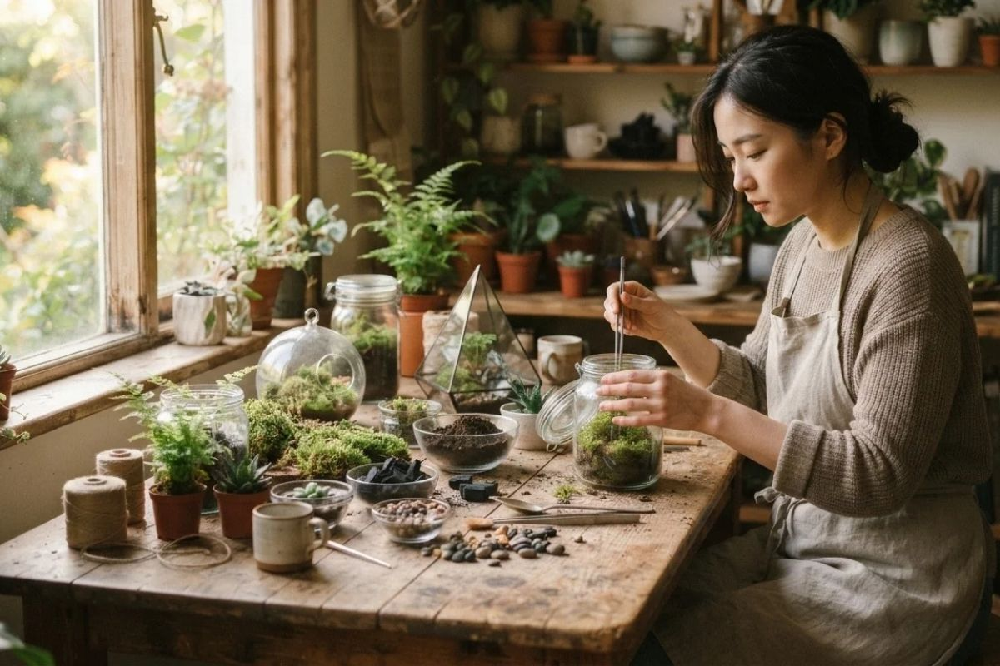
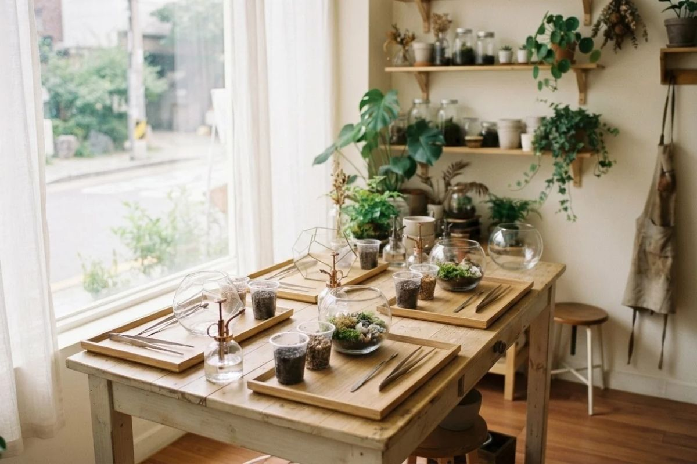

## 목차
1. [[첫걸음 포인트] "1층 대로변 가게부터 열어야 식물 일을 시작할 수 있을까: 작은 작업실과 원데이 클래스가 현실적인 출발점이 되는 이유"](#master-insight)
2. [[현실 비교 해부] 큰 점포 오픈과 1인 작업실·원데이 클래스 시작 방식의 실제 차이](#comparison-cases)
3. [[작은 시작의 3대 핵심] 공간 고르기·예약제 운영·소모품과 동선 관리의 현실 포인트](#three-pillars)
4. [[현장 준비 프로토콜] 첫 1인 작업실·원데이 클래스를 무리 없이 열기 위한 3단계 점검 루틴](#prep-protocol)
5. [[현장 메모] "작은 공간에서 한 팀씩 만나며 깨달은 '고정비가 가벼워야 마음이 단단하다'는 사실"](#master-note)
6. [[실전 시작 가이드] 점포 부담을 줄이고 1인 공방·클래스로 안착하기 위한 3대 필수 수칙](#solution)
7. [연재 시리즈 안내 & 다음 예고](#series)
8. [자주 묻는 질문 (FAQ)](#faq)

---

## 1. [첫걸음 포인트] "1층 대로변 가게부터 열어야 식물 일을 시작할 수 있을까: 작은 작업실과 원데이 클래스가 현실적인 출발점이 되는 이유"

"식물 공방이나 반려식물·테라리움 클래스를 떠올릴 때 **처음부터 1층 상가를 얻어 간판을 달아야 하나 고민하다가 높은 보증금과 월세 앞에서 발걸음이 멈췄던 경험**이 없으십니까?"

"수많은 입문자들이 **지나가는 불특정 손님을 기다리는 로드샵과, 사전 예약제로 운영되는 작은 작업실·원데이 클래스는 공간 조건부터 준비 방식, 하루의 리듬까지 전혀 다르다는 점**을 놓친 채 처음부터 무리한 점포 계약을 고민하곤 한다는 사실을 체감하고 계시지 않습니까?"

소규모 식물 공방과 1인 클래스 운영 현장을 살펴보며 확인한 현실적인 출발점은 **'큰 매장 없이 작은 작업실이나 원데이 클래스로 시작하면 초기 자금과 고정비 부담을 크게 낮출 수 있을 뿐 아니라, 수강생 한 명 한 명과 호흡하며 나만의 수업 방식과 아이템을 차분히 다듬을 수 있다'**는 사실입니다.

이번 [기획 연재: 식물 창업·전업 & 매장 리뉴얼 마스터 클래스 시즌 2] 제1부에서는 큰 매장 없이 작은 작업실이나 원데이 클래스로 시작할 때의 현실을 솔직하게 정리합니다.

<figure style="text-align: center; margin: 32px 0;">
  
  <figcaption style="font-size: 0.9rem; color: #6C7A72; margin-top: 12px; font-style: normal;">큰 매장 대신 작은 작업실과 테이블 하나로 시작하는 1인 클래스 공간</figcaption>
</figure>

---

## 2. [현실 비교 해부] 큰 점포 오픈과 1인 작업실·원데이 클래스 시작 방식의 실제 차이

1인 작업실이나 원데이 클래스로 시작할 때 가장 먼저 체감되는 변화는 **'기다리는 시간'이 줄고 '약속된 시간'에 집중할 수 있다는 점**입니다.

일반 매장은 손님이 언제 들어올지 몰라 매일 정해진 시간 내내 문을 열어 두고, 쇼윈도와 진열을 채우기 위해 많은 식물 재고를 유지해야 합니다. 반면 작은 작업실이나 공유 공방, 혹은 카페·문화 공간과 연계한 원데이 클래스는 **예약 인원에 맞춰 식물과 유리 용기, 흙과 부자재를 준비**할 수 있어 버려지는 재고와 고정 지출이 훨씬 적습니다.

물론 작은 작업실만의 현실적인 고민도 있습니다. 1층 로드샵이 아니다 보니 길을 걷다 우연히 들어오는 손님은 거의 없고, 사진과 후기, 클래스 안내 글을 통해 직접 찾아오게 만드는 소통이 필요합니다. 또한 좁은 공간일수록 수돗가 위치, 환기, 주차나 대중교통 접근성 같은 생활 편의 요소가 수강생 만족도에 바로 영향을 줍니다.

> #### 🏡 큰 매장 오픈 대 1인 작업실·원데이 클래스 시작 비교 매트릭스
>
> | 구분 | 1층 로드샵·큰 매장 오픈 | 작은 작업실·원데이 클래스 시작 |
> | :--- | :--- | :--- |
> | **초기 비용·고정비** | 보증금·인테리어·월세·상시 재고 부담이 큼 | **소규모 공간·공유 작업실·예약제 자재 준비로 부담이 낮음** |
> | **시간 운영 방식** | 영업시간 내내 상주하며 방문 손님 대기 | **예약 일정 중심으로 준비·진행·정리 리듬 조절 가능** |
> | **재고와 식물 관리** | 진열을 채우기 위한 다량 식물 상시 관리 필요 | **수업·주문 일정에 맞춘 소량 입출고로 관리 수월** |
> | **손님 유입 방식** | 길거리 유동 인구 노출에 강점 | **사전 안내·후기·소모임·협업 공간을 통한 예약 유입 중심** |

---

## 3. [작은 시작의 3대 핵심] 공간 고르기·예약제 운영·소모품과 동선 관리의 현실 포인트

큰 매장 없이 1인 공방이나 원데이 클래스로 첫 발을 내딛을 때는 아래 세 가지 현실 포인트를 미리 맞춰 두는 것이 좋습니다.

<figure style="text-align: center; margin: 32px 0;">
  
  <figcaption style="font-size: 0.9rem; color: #6C7A72; margin-top: 12px; font-style: normal;">수강생 동선과 뒷정리까지 고려한 1인 클래스 테이블 세팅</figcaption>
</figure>

> #### 💡 식물 창업·전업 & 매장 리뉴얼 시즌 2 제1부 핵심 3대 포인트
> 

> 
> 1. **[제1포인트: 화려한 상권보다 '물 사용·환기·접근성'이 편한 작은 공간 고르기]**  
>    * 작업실이나 공유 공간을 고를 때는 예쁜 조명보다 먼저 확인해야 할 것이 있습니다. 화분을 씻고 물을 채울 수 있는 개수대 동선, 흙 먼지와 습기를 뺄 수 있는 창문 환기, 그리고 초행길 수강생이 찾아오기 쉬운 역·정류장 거리가 실제 만족도를 좌우합니다.

> 2. **[제2포인트: 한 번에 많이 받기보다 '2~4명 소규모 예약제'로 호흡 익히기]**  
>    * 혼자 진행하는 1인 클래스에서는 처음부터 6-8명을 한꺼번에 받으면 설명과 마무리 포장이 쫓기기 쉽습니다. 2~4명 정도의 소규모로 시작하면 한 사람씩 눈을 맞추며 도와줄 수 있어 완성도와 후기 만족도가 자연스럽게 높아집니다.

> 3. **[제3포인트: 트레이·소분 용기·포장 가방을 한 세트로 묶는 '작업 동선 단순화']**  
>    * 좁은 공간일수록 흙과 자갈, 이끼가 테이블 위에 흩어지면 금방 어수선해집니다. 수강생 1인당 넓은 트레이 하나씩을 내어 주고, 재료를 작은 컵에 미리 소분해 두면 진행이 매끄러울 뿐 아니라 수업 후 청소 시간도 절반으로 줄어듭니다.

---

## 4. [현장 준비 프로토콜] 첫 1인 작업실·원데이 클래스를 무리 없이 열기 위한 3단계 점검 루틴

작은 작업실이나 외부 공유 공간에서 첫 클래스를 열기 전에는 아래 세 단계로 준비 흐름을 점검해 보세요.

> #### ⚙️ 1인 공방·클래스 오픈 전 3단계 점검 루틴
> 

> 
> 1. **[1단계: 내 일정에 맞는 '주간 운영 틀' 먼저 정하기]**  
>    * 매일 열려고 애쓰지 말고 "주말 오후 2타임" 또는 "평일 저녁 1타임, 토요일 2타임"처럼 내가 지치지 않고 꾸준히 열 수 있는 요일과 시간대부터 고정해 보세요.

> 2. **[2단계: 시작부터 끝까지 직접 60분 리허설 해보기]**  
>    * 실제 수강생이 앉는 자리에 앉아 재료를 꺼내고, 만들고, 물을 주고, 포장 가방에 담는 과정까지 시간 재며 한 번 직접 해보세요. 어디서 설명이 막히고 어떤 도구가 더 필요한지 바로 보입니다.

> 3. **[3단계: 완성 후 이동 안전과 사후 관리 메모 챙기기]**  
>    * 수강생이 만든 테라리움이나 반려식물 화분을 들고 집까지 이동할 때 흔들리지 않도록 완충 포장재와 튼튼한 쇼핑백을 준비하고, 물주기와 빛 위치를 적은 작은 안내 카드를 함께 건네세요.

---

## 5. [현장 메모] "작은 공간에서 한 팀씩 만나며 깨달은 '고정비가 가벼워야 마음이 단단하다'는 사실"

> #### 📝 [현장 노트] 1인 공방과 원데이 클래스로 시작할 때 기억해 두면 좋은 세 가지 현실 감각
>
> * **첫 번째 메모: "작은 작업실의 가장 큰 무기는 매달 나가는 고정비가 가볍다는 점이다"**  
>   ➔ 임대료 압박이 적어야 조급하게 무리한 일정을 잡지 않고 수업의 질과 식물 상태에 집중할 수 있습니다.

> * **두 번째 메모: "수강생은 거창한 인테리어보다 정돈된 테이블과 친절하고 차분한 안내를 오래 기억한다"**  
>   ➔ 깔끔하게 소분된 재료와 막히는 부분을 편하게 물어볼 수 있는 분위기가 작은 공방의 진짜 경쟁력입니다.

> * **세 번째 메모: "처음부터 내 공간 계약이 부담스럽다면 시간제 공유 공방이나 카페·동네 공간 협업부터 시작해도 충분하다"**  
>   ➔ 실제 클래스를 몇 차례 운영해 보며 수요와 내 체력을 확인한 뒤 전용 작업실로 옮겨 가도 늦지 않습니다.

---

## 6. [실전 시작 가이드] 점포 부담을 줄이고 1인 공방·클래스로 안착하기 위한 3대 필수 수칙

1. **초기에는 보증금·월세 부담이 적은 소형 작업실 또는 공유 공간·협업 수업부터 시작하기**  
   고정비를 낮춰 마음의 여유를 확보하고 예약 흐름과 적성을 먼저 검증하기.
2. **수강생 2~4명 규모의 소수정예 예약제로 진행하며 설명·포장·정리 리듬 익히기**  
   혼자서도 여유 있게 챙길 수 있는 인원으로 만족도와 완성도를 함께 높이기.
3. **개인 트레이·소분 자재·이동용 포장·관리 안내 카드를 기본 세트로 표준화하기**  
   좁은 공간에서도 깔끔한 진행과 빠른 뒷정리를 유지해 피로도를 줄이기.

---

## 7. 연재 시리즈 안내 & 다음 예고

* **[기획 연재: 식물 창업·전업 & 매장 리뉴얼 마스터 클래스 시즌 1. ⑤] [낭만적 착각 점검 편] \"시작 전에 가장 먼저 내려놓아야 할 낭만적인 착각 3가지: 초록 힐링의 환상을 걷어내고 오래가는 리듬을 만드는 현실 점검\"**  
  ➔ [식물 일을 시작하기 전 내려놓아야 할 낭만적인 기대 3가지와 현장의 실제 작업·시간·소통 균형법](https://floraldays.com/biz-season1-three-romantic-illusions-to-let-go-before-starting-part5)

* **[기획 연재: 식물 창업·전업 & 매장 리뉴얼 마스터 클래스 시즌 2. ①] [1인 공방·클래스 입문 편] \"큰 매장 없이 작은 작업실이나 원데이 클래스로 시작할 때의 현실: 임대료와 고정비 부담을 줄이며 첫 발을 떼는 법\"**  
  ➔ [큰 점포 없이 작은 작업실과 소규모 원데이 클래스로 시작할 때의 장단점과 현장 준비 루틴](https://floraldays.com/biz-season2-starting-with-small-studio-or-oneday-class-part1)

* **[다음 예고 — 시즌 2. ②] [인기 체험 아이템 편] \"초보자도 금방 결과물을 만들 수 있는 인기 체험 아이템 구성법\"**  
  ➔ 식물을 처음 만지는 수강생도 1시간 내외로 뿌듯한 완성품을 들고 갈 수 있는 테라리움·반려식물 체험 구성 요령

---

## 8. 자주 묻는 질문 (FAQ)

**Q1. 전용 작업실 없이 카페 테이블이나 공유 공간을 빌려서 원데이 클래스를 시작해도 괜찮을까요?**  

A1. '네, 아주 현실적이고 부담이 적은 출발 방법입니다. 초기 보증금이나 월세 없이 수업이 열리는 날에만 공간 이용료를 지불하면 되므로 고정비 위험을 크게 줄일 수 있습니다. 

다만 물 사용이 가능한지, 작업 후 흙과 물기를 깔끔히 정리할 수 있는 조건인지 사전에 공간 운영자와 미리 조율해 두는 것이 좋습니다'.

> 💡 소상공인 창업 공간 지원 및 공유 오피스·교육 정보는 <a href="https://www.semas.or.kr" target="_blank" rel="noopener noreferrer">소상공인시장진흥공단 공식 홈페이지</a>를 참고하시기 바랍니다.

**Q2. 1인 작업실을 구할 때 평수는 어느 정도가 적당할까요?**  

A2. '2~4명 규모의 소규모 원데이 클래스와 자재 보관을 기준으로 한다면 5=8평 내외의 아담한 공간으로도 충분히 시작할 수 있습니다. 

평수를 넓히기보다 테이블 배치 후 의자 뒤 통로 여유가 있는지, 자재 수납 선반과 개수대·환기 창문이 확보되는지를 우선 확인해 보세요'.

> 💡 생활 속 원예 및 실내 가드닝 기본 정보는 <a href="https://www.modunong.or.kr" target="_blank" rel="noopener noreferrer">농림축산식품부 모두가 도시농부 포털</a>을 참고하시기 바랍니다.

---

