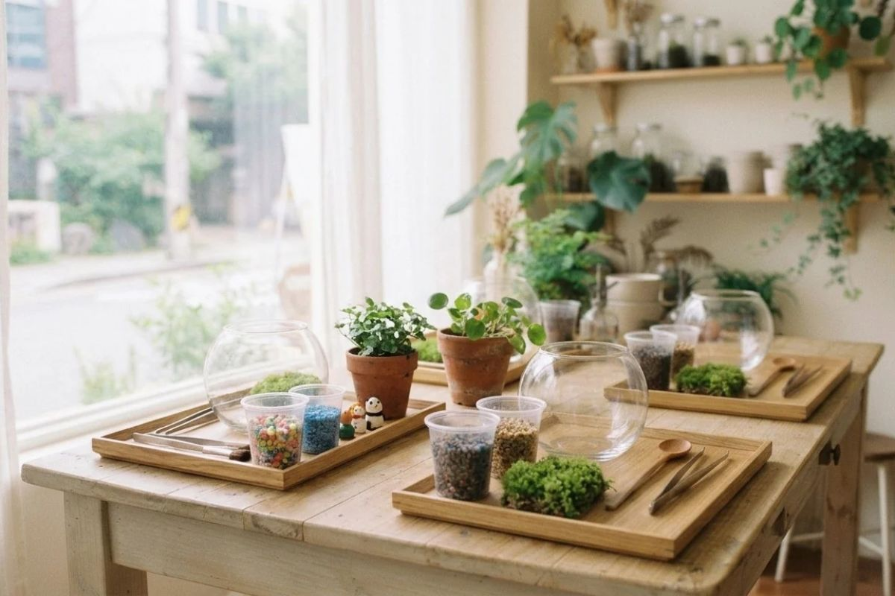
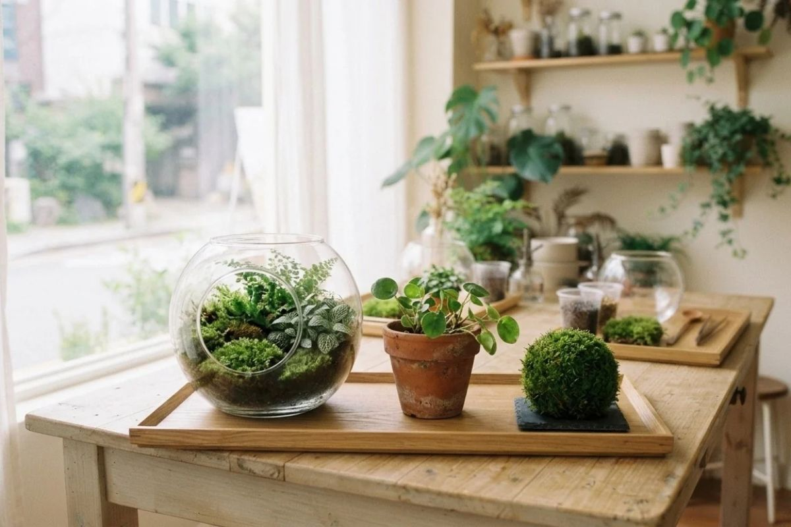

## 목차
1. [[첫걸음 포인트] "손재주가 없어도 예쁘게 완성되는 체험이 인기 있는 이유: 초보자의 성취감을 설계하는 아이템 구성의 비밀"](#master-insight)
2. [[현장 수업 해부] 흙 만지기를 어려워하던 첫 방문 수강생들이 60분 만에 만족스러운 결과물을 들고 나간 체험 구성 사례](#class-cases)
3. [[인기 체험 아이템 3대 구성] 유리 테라리움·이끼볼(코케다마)·반려식물 분갈이 세트의 난이도·소요시간·매력 비교](#three-items)
4. [[실전 수업 설계 프로토콜] 초보자도 실패 없이 완성하도록 돕는 3단계 클래스 세팅 루틴](#design-protocol)
5. [[현장 메모] "수강생이 사진을 찍어 지인에게 자랑하고 싶어지는 순간은 '깔끔한 마감'에서 결정된다"](#master-note)
6. [[실전 적용 가이드] 1인 공방·클래스의 재방문과 입소문을 부르는 체험 아이템 구성 3대 필수 수칙](#solution)
7. [연재 시리즈 안내 & 다음 예고](#series)
8. [자주 묻는 질문 (FAQ)](#faq)

---

## 1. [첫걸음 포인트] "손재주가 없어도 예쁘게 완성되는 체험이 인기 있는 이유: 초보자의 성취감을 설계하는 아이템 구성의 비밀"

"원데이 클래스를 준비하면서 **어떤 품목을 골라야 식물을 처음 만지는 수강생도 시간 안에 당황하지 않고 만족스러운 결과물을 완성할 수 있을지 고민해 보신 적**이 없으십니까?"

"수많은 1인 공방과 클래스 초보 운영자들이 **강사 본인이 만들기 재미있는 복잡한 작품을 수업 아이템으로 잡았다가, 수강생의 손이 따라오지 못해 수업 시간이 길어지고 결국 강사가 대신 다 만들어 주게 되는 상황을 겪곤 한다는 사실**을 체감하고 계시지 않습니까?"

소규모 식물 공방과 원데이 클래스 현장을 살피며 확인한 현실적인 핵심은 **'초보자 대상 인기 체험 아이템의 비결은 화려한 기교가 아니라, 60분 내외의 시간 안에 순서대로 쌓고 심기만 해도 균형 잡힌 형태가 나오도록 재료의 크기·비율·마감 포인트를 미리 맞춰 두는 구성에 있다'**는 사실입니다.

이번 [기획 연재: 식물 창업·전업 & 매장 리뉴얼 마스터 클래스 시즌 2] 제2부에서는 초보자도 금방 결과물을 만들 수 있는 인기 체험 아이템 구성법을 정리합니다.

<figure style="text-align: center; margin: 32px 0;">
  
  <figcaption style="font-size: 0.9rem; color: #6C7A72; margin-top: 12px; font-style: normal;">초보자도 순서대로 따라 하면 완성도가 살아나는 클래스 재료 세팅</figcaption>
</figure>

---

## 2. [현장 수업 해부] 흙 만지기를 어려워하던 첫 방문 수강생들이 60분 만에 만족스러운 결과물을 들고 나간 체험 구성 사례

원데이 클래스를 찾는 수강생의 상당수는 "집에서 화분 몇 개를 죽여 본 경험이 있어서 자신 없다"거나 "손재주가 없어서 망칠까 봐 걱정된다"는 마음을 안고 문을 엽니다.

실제로 반응이 좋은 소규모 공방들은 이 걱정을 수업 시작 전 재료 준비 단계에서부터 덜어 줍니다. 예를 들어 유리 테라리움 클래스에서는 층층이 쌓이는 배수층 자갈과 배양토, 이끼의 양을 투명 컵에 1인분씩 미리 담아 둡니다. 수강생은 계량에 신경 쓰지 않고 **층을 쌓는 순서와 돌·이끼의 위치 배치에만 집중**할 수 있어 40-50분 만에 깔끔한 숲속 풍경을 완성합니다.

또 다른 인기 구성인 반려식물 분갈이·화분 스타일링 체험에서는 뿌리 정리가 까다로운 대형 식물 대신, 병해충에 강하고 실내 적응력이 좋은 소형 관엽식물 3-4종 중 취향껏 고르게 합니다. 여기에 토분이나 세라믹 화분, 마감용 마사토·화산석까지 세트로 연결해 두면 초보자도 흙이 넘치지 않게 단정한 화분을 완성하고 뿌듯한 표정으로 사진을 남깁니다.

> #### 🌿 초보자 인기 식물 체험 아이템 3종 비교 매트릭스
>
> | 체험 아이템 | 권장 소요 시간 | 초보자가 느끼는 매력 포인트 | 운영자 준비·진행 난이도 |
> | :--- | :--- | :--- | :--- |
> | **유리 테라리움 만들기** | 50-70분 | 층층이 쌓이는 시각적 재미와 미니어처 풍경 완성감 | **소분 자재 준비 시 진행이 매우 깔끔하고 실패율이 낮음** |
> | **반려식물 분갈이·화분 매칭** | 45-60분 | 내 취향 화분과 식물을 고르고 실생활 관리법까지 습득 | **소형 식물·화분 규격만 맞추면 준비와 뒷정리가 단순함** |
> | **이끼볼(코케다마)·행잉 식물** | 60-80분 | 화분 없이 흙을 빚고 실로 감는 색다른 손작업 경험 | **흙 반죽 점도와 물기 조절 사전 세팅이 완성도를 좌우함** |

---

## 3. [인기 체험 아이템 3대 구성] 유리 테라리움·이끼볼(코케다마)·반려식물 분갈이 세트의 난이도·소요시간·매력 비교

1인 공방이나 공유 공간에서 처음 클래스를 열 때는 아래 세 가지 대표 아이템 가운데 공간 여건(물 사용·환기·테이블 크기)에 맞는 1~2가지부터 시작하는 것이 안정적입니다.

<figure style="text-align: center; margin: 32px 0;">
  
  <figcaption style="font-size: 0.9rem; color: #6C7A72; margin-top: 12px; font-style: normal;">60분 내외로 완성 가능한 대표 초보자 체험 결과물 구성</figcaption>
</figure>

> #### 💡 식물 창업·전업 & 매장 리뉴얼 시즌 2 제2부 핵심 3대 아이템 구성법
> 

> 
> 1. **[제1구성: 실패 확률이 낮고 사진 만족도가 높은 '오픈·밀폐형 유리 테라리움']**  
>    * 유리 용기 입구가 너무 좁으면 핀셋 조작이 어려워 초보자가 금방 지칩니다. 손이나 긴 핀셋이 편하게 들어가는 지름 12-16cm 내외의 유리 볼을 선택하고, 배수층 자갈·활성탄·테라리움 전용 흙·비단이끼·포인트 돌 2-3개를 기본 키트로 묶으면 누구나 1시간 안에 밀도 높은 풍경을 완성할 수 있습니다.

> 2. **[제2구성: 집으로 가져간 뒤에도 오래 키우는 '내 취향 반려식물 분갈이 세트']**  
>    * 스킨답서스, 테이블야자, 몬스테라 아단소니, 페페로미아처럼 실내에서 순하게 자라는 소형 포트 식물 3-4종을 준비하고, 배수 구멍이 있는 토분·도자기 화분과 물받침을 짝지어 줍니다. 분갈이 후 윗흙을 세척 마사토나 화산석으로 깔끔히 덮어 주는 '멀칭 마감' 단계를 넣으면 초보자의 결과물도 매장 판매품처럼 단정해집니다.

> 3. **[제3구성: 계절감과 손작업 재미를 살린 '이끼볼(코케다마) & 행잉 스타일링']**  
>    * 물 사용이 가능하고 손 씻는 동선이 가까운 작업실이라면 이끼볼 클래스도 인기가 높습니다. 흙 배합을 미리 촉촉하게 반죽해 1인분씩 뭉쳐 두면 수강생은 식물을 감싸고 비단이끼를 입혀 실로 고정하는 과정에 집중할 수 있어 시간 초과 없이 깔끔하게 마무리됩니다.

---

## 4. [실전 수업 설계 프로토콜] 초보자도 실패 없이 완성하도록 돕는 3단계 클래스 세팅 루틴

같은 아이템이라도 수강생이 느끼는 난이도는 **재료 세팅과 단계 분할**에 따라 크게 달라집니다. 아래 세 가지 루틴으로 수업을 구성해 보세요.

> #### ⚙️ 초보자 맞춤 체험 클래스 설계 3단계 루틴
> 

> 
> 1. **[1단계: 선택지는 '3가지 내외'로 좁혀 결정 피로 줄이기]**  
>    * 화분이나 식물, 피규어 종류가 너무 많으면 고르는 데만 20분이 지나갑니다. "식물 3종 중 택 1, 화분 2색 중 택 1"처럼 조화로운 조합 안에서 고르게 하면 시간이 절약되고 어떤 조합을 골라도 예쁘게 어울립니다.

> 2. **[2단계: '바닥층 15분 · 식재 및 배치 25분 · 마감 및 관리 안내 15분' 시간 블록 나누기]**  
>    * 전체 수업을 세 구간으로 나누어 안내하면 수강생도 속도를 조절하기 쉽고, 마지막 15분 동안 흙 털기·분무·포장·관리법 설명까지 여유 있게 마칠 수 있습니다.

> 3. **[3단계: 완성 직후 '포토 스팟 3분'과 '관리 카드 1장' 챙기기]**  
>    * 수업이 끝나기 직전 자연광이 잘 드는 테이블 한쪽에서 완성품을 찍을 수 있게 안내하고, 물주기 주기와 햇빛 위치를 적은 관리 카드를 쇼핑백에 함께 넣어 주면 체험 만족도와 후기 공유율이 자연스럽게 올라갑니다.

---

## 5. [현장 메모] "수강생이 사진을 찍어 지인에게 자랑하고 싶어지는 순간은 '깔끔한 마감'에서 결정된다"

> #### 📝 [현장 노트] 초보자 체험 아이템을 구성할 때 놓치지 말아야 할 세 가지 실무 감각
>
> * **첫 번째 메모: "초보자는 복잡한 기술보다 '내 손으로 흙을 만져 단정한 하나를 완성했다'는 감각에 기뻐한다"**  
>   ➔ 어려운 과정을 넣기보다 기본 구조를 탄탄하게 잡고 마감 디테일을 살려 주는 편이 훨씬 만족도가 높습니다.

> * **두 번째 메모: "수업 중 강사가 대신 고쳐 주는 시간이 길어질수록 수강생의 성취감은 줄어든다"**  
>   ➔ 강사가 손을 대지 않아도 잘 나오도록 용기 크기와 식물 규격을 미리 맞추는 것이 진짜 수업 설계입니다.

> * **세 번째 메모: "집에 돌아가서 2주 뒤에도 싱싱해야 그 공방의 클래스가 오래 기억된다"**  
>   ➔ 보기만 예쁜 조합보다 실내 환경에서 관리하기 수월한 식물로 구성해야 재방문과 지인 추천으로 이어집니다.

---

## 6. [실전 적용 가이드] 1인 공방·클래스의 재방문과 입소문을 부르는 체험 아이템 구성 3대 필수 수칙

1. **소요 시간 60분 내외, 입구가 넓고 규격이 안정된 용기·식물로 실패 가능성 낮추기**  
   초보자의 손이 편하게 움직일 수 있는 크기와 순한 실내 식물을 중심으로 키트 구성하기.
2. **1인분 소분 자재와 3가지 내외의 조화로운 선택지로 진행 속도 유지하기**  
   고민 시간과 계량 부담을 줄여 배치와 마감의 즐거움에 집중할 수 있도록 돕기.
3. **윗흙 마감, 포토 스팟, 사후 관리 카드까지 수업의 한 세트로 포함하기**  
   결과물의 완성도를 높이고 집으로 돌아간 뒤의 관리 불안까지 함께 덜어 주기.

---

## 7. 연재 시리즈 안내 & 다음 예고

* **[기획 연재: 식물 창업·전업 & 매장 리뉴얼 마스터 클래스 시즌 2. ①] [1인 공방·클래스 입문 편] \"큰 매장 없이 작은 작업실이나 원데이 클래스로 시작할 때의 현실: 임대료와 고정비 부담을 줄이며 첫 발을 떼는 법\"**  
  ➔ [큰 점포 없이 작은 작업실과 소규모 원데이 클래스로 시작할 때의 장단점과 현장 준비 루틴](https://floraldays.com/biz-season2-starting-with-small-studio-or-oneday-class-part1)

* **[기획 연재: 식물 창업·전업 & 매장 리뉴얼 마스터 클래스 시즌 2. ②] (현재글) [인기 체험 아이템 편] \"초보자도 금방 결과물을 만들 수 있는 인기 체험 아이템 구성법: 60분 안에 완성도와 만족도를 함께 끌어올리는 클래스 설계\"**  
  ➔ [식물을 처음 다루는 수강생도 1시간 내외로 뿌듯한 완성품을 만들 수 있는 테라리움·반려식물 체험 구성 요령](https://floraldays.com/biz-season2-popular-diy-plant-class-items-for-beginners-part2)

* **[다음 예고 — 시즌 2. ③] [재료비·가격·마진 계산 편] \"재료비·포장비·시간까지 넣어서 클래스 가격과 마진 계산하기\"**  
  ➔ 화분과 식물 값만 계산했다가 남는 게 없어지는 실수를 막는 현실적인 수강료·원가 산정 기준

---

## 8. 자주 묻는 질문 (FAQ)

**Q1. 처음 원데이 클래스를 열 때 체험 아이템을 몇 가지 정도 준비하는 것이 좋을까요?**  

A1. '처음부터 여러 품목을 한꺼번에 열기보다, 가장 자신 있고 준비 동선이 깔끔한 대표 아이템 1-2가지로 시작하는 것이 좋습니다. 품목이 단순해야 자재 재고 부담이 줄고, 수업을 반복하면서 설명 순서와 시간 배분을 빠르게 다듬을 수 있습니다'.

> 💡 생활 속 원예 및 반려식물 관리 기본 정보는 <a href="https://www.modunong.or.kr" target="_blank" rel="noopener noreferrer">농림축산식품부 모두가 도시농부 포털</a>을 참고하시기 바랍니다.

**Q2. 수강생이 만든 테라리움이나 화분이 집에 가져간 뒤 금방 시들까 봐 걱정되는데 어떻게 예방할 수 있나요?**  

A2. '수업용 식물을 들이기 며칠 전 미리 작업실 환경에 적응시켜 상태를 점검하고, 배수층과 물빠짐 구조를 단순하고 안정적으로 구성하는 것이 중요합니다. 또한 수업 마지막 5분 동안 물주는 양과 통풍·빛 조건을 쉽게 설명해 주고 요약 카드를 함께 건네면 초보자도 훨씬 안정적으로 키울 수 있습니다'.

> 💡 실내 식물 생육 및 관리 참고 자료는 <a href="https://www.nihhs.go.kr" target="_blank" rel="noopener noreferrer">농촌진흥청 국립원예특작과학원</a>을 참고하시기 바랍니다.

---

