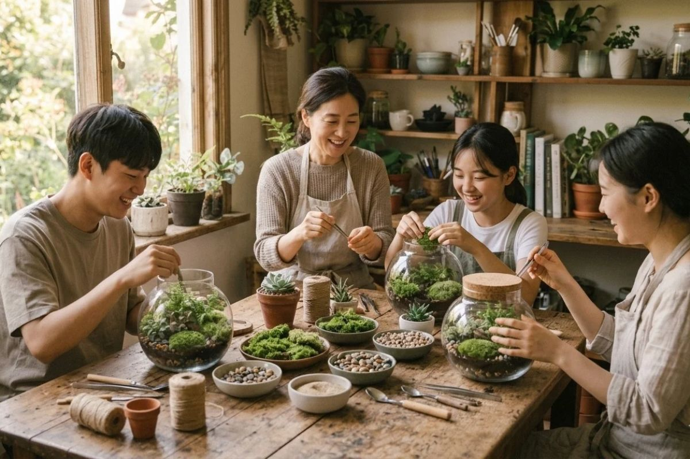
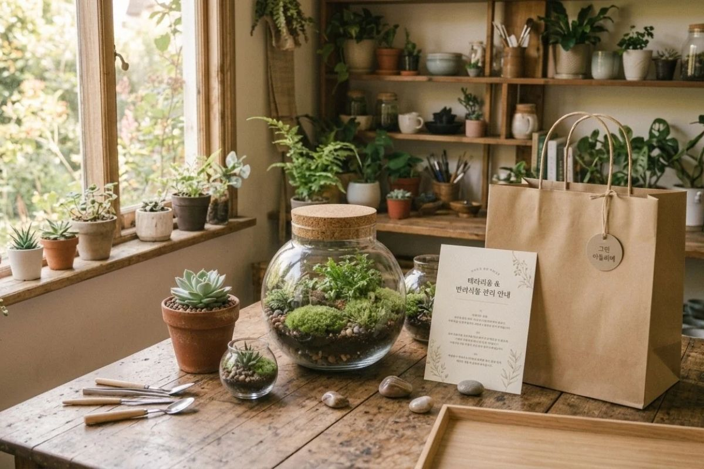

## 목차
1. [[첫걸음 포인트] "똑같은 테라리움·화분 만들기인데 왜 어떤 공방은 '한 번 체험으로 끝나고' 어떤 공방은 '다음 클래스까지 이어질까'"](#master-insight)
2. [[현장 진행 해부] 설명이 길어 지루해지던 초보 강사의 수업과 수강생의 손이 자연스럽게 움직이던 수업의 결정적 차이](#flow-cases)
3. [[60분 몰입 진행 3대 구간] 첫 10분 긴장 풀기·중간 35분 선택과 몰입·마지막 15분 마무리와 여운의 구조](#three-stages)
4. [[현장 진행 프로토콜] 수강생의 표정과 속도를 살피며 매끄럽게 수업을 이끄는 3단계 운영 루틴](#hosting-protocol)
5. [[현장 메모] "수강생이 집에 돌아가서도 기분 좋게 떠올리는 것은 강사의 지식이 아니라 '함께 웃으며 완성한 시간의 온도'다"](#master-note)
6. [[실전 적용 가이드] 재방문과 지인 추천을 부르는 체험 진행 흐름 3대 필수 수칙](#solution)
7. [연재 시리즈 안내 & 다음 예고](#series)
8. [자주 묻는 질문 (FAQ)](#faq)

---

## 1. [첫걸음 포인트] "똑같은 테라리움·화분 만들기인데 왜 어떤 공방은 '한 번 체험으로 끝나고' 어떤 공방은 '다음 클래스까지 이어질까'"

"원데이 클래스를 진행하면서 **재료와 샘플은 열심히 준비했는데 막상 수업이 시작되면 수강생들이 조용히 눈치만 보거나, 설명이 길어져 어색한 침묵이 흘렀던 순간**을 떠올려 보신 적이 없으십니까?"

"수많은 1인 공방과 초보 클래스 진행자들이 **'무엇을 만들지(아이템)'에는 많은 공을 들이면서도, 수강생이 문을 열고 들어선 첫 10분부터 완성 후 사진을 찍고 나가는 마지막 15분까지 '어떤 리듬과 대화로 시간을 흐르게 할지'는 즉흥에 맡기는 경우가 많다는 사실**을 체감하고 계시지 않습니까?"

소규모 반려식물·테라리움 공방과 원데이 클래스 현장을 살피며 확인한 현실적인 차이는 **'수강생이 "재밌다, 또 오고 싶다"고 느끼는 수업은 강사가 혼자 길게 강의하는 자리가 아니라, 초반에 긴장을 부드럽게 풀어 주고 중간에는 수강생 스스로 고르고 꾸미는 재미에 몰입하게 하며 마지막에 성취감과 여운을 또렷하게 남겨 주는 흐름이 설계된 수업'**이라는 사실입니다.

이번 [기획 연재: 식물 창업·전업 & 매장 리뉴얼 마스터 클래스 시즌 2] 제3부에서는 수강생이 "재밌다, 또 오고 싶다"고 느끼는 체험 진행 흐름을 시간 순서대로 정리합니다.

<figure style="text-align: center; margin: 32px 0;">
  
  <figcaption style="font-size: 0.9rem; color: #6C7A72; margin-top: 12px; font-style: normal;">설명은 짧고 명료하게, 손으로 꾸미는 시간은 여유롭게 흐르는 클래스 풍경</figcaption>
</figure>

---

## 2. [현장 진행 해부] 설명이 길어 지루해지던 초보 강사의 수업과 수강생의 손이 자연스럽게 움직이던 수업의 결정적 차이

처음 클래스를 여는 진행자가 가장 흔히 하는 실수는 **"이왕 오셨으니 최대한 많이 알려 드려야지"라는 선의 때문에 시작부터 20분 넘게 식물 학명과 흙 배합 이론을 한꺼번에 설명하는 것**입니다. 수강생 입장에서는 아직 흙을 만져 보지도 못했는데 정보가 쏟아지면 수업이 아니라 강의처럼 느껴져 손이 굳기 쉽습니다.

반대로 재방문율이 높은 작은 공방의 진행 흐름은 훨씬 가볍고 리듬감이 있습니다. 문을 열고 들어오면 먼저 가방과 겉옷을 둘 자리를 안내하고, 완성 샘플을 눈앞에 보여 주며 **"오늘 딱 세 단계만 따라 하시면 이 모습이 완성됩니다"**라고 전체 그림을 3분 안에 짚어 줍니다.

그다음에는 한 단계씩 짧게 시범을 보이고 바로 수강생이 직접 해보는 시간을 줍니다. 작업 중간에는 강사가 계속 말을 이어 가기보다 한 발 물러나 수강생이 집중할 여백을 두고, 손이 멈춘 분에게만 다가가 **"이쪽 돌 높이를 살짝만 올리면 앞쪽 이끼가 훨씬 시원하게 보여요"**처럼 구체적인 한 줄 힌트를 건넵니다.

> #### ⏱️ 지루해지기 쉬운 진행 대 몰입과 재방문을 부르는 진행 비교 매트릭스
>
> | 구간 | 지루하거나 어색해지기 쉬운 진행 | "재밌다, 또 오고 싶다"를 만드는 진행 |
> | :--- | :--- | :--- |
> | **도입 (0~10분)** | 자리에 앉자마자 긴 이론 설명부터 시작 | **짐 정리·웰컴 안내 후 완성 샘플과 3단계 흐름만 3분 요약** |
> | **전개 (10~45분)** | 모든 과정을 한꺼번에 설명하거나 강사가 자꾸 손댐 | **단계별 1분 시범 후 수강생이 직접 고르고 꾸미는 시간 확보** |
> | **개입 타이밍** | 잘하고 있는데도 끊임없이 말 걸어 집중을 깸 | **막혀서 멈출 때만 다가가 선택지 2가지로 방향 제안** |
> | **마무리 (45~60분)** | 시간 쫓겨 급히 봉투에 담아 인사하고 종료 | **포토 타임·결과물 칭찬 포인트·쉬운 관리 카드 안내로 여운 형성** |

---

## 3. [60분 몰입 진행 3대 구간] 첫 10분 긴장 풀기·중간 35분 선택과 몰입·마지막 15분 마무리와 여운의 구조

60분 원데이 클래스를 기준으로 수강생의 감정 곡선이 가장 편안하고 즐겁게 올라가는 3단계 진행 구조는 다음과 같습니다.

<figure style="text-align: center; margin: 32px 0;">
  
  <figcaption style="font-size: 0.9rem; color: #6C7A72; margin-top: 12px; font-style: normal;">수업 마지막 15분의 포토 타임과 사후 관리 안내가 재방문의 여운을 만듭니다</figcaption>
</figure>

> #### 💡 식물 창업·전업 & 매장 리뉴얼 시즌 2 제3부 핵심 3대 진행 구간
> 

> 
> 1. **[제1구간(0~10분): '긴장 해제와 기대감 형성' — 정답이 없다는 안심 주기]**  
>    * 처음 온 수강생은 "망치면 어쩌지"라는 긴장을 안고 있습니다. 가벼운 인사와 함께 테이블 위 재료를 소개한 뒤 **"오늘 만드는 작품에는 정답이 없고, 놓는 위치에 따라 모두 다른 숲이 됩니다"**라고 먼저 안심시켜 주세요. 시작 5분 안에 첫 흙이나 자갈을 직접 부어 보게 하면 어색함이 순식간에 사라집니다.

> 2. **[제2구간(10~45분): '작은 선택의 연속과 몰입' — 지시 대신 질문으로 방향 잡기]**  
>    * 수강생이 가장 재미를 느끼는 순간은 강사의 손을 그대로 복제할 때가 아니라 **"내가 고른 돌과 이끼로 나만의 구도를 만들 때"**입니다. 배수층과 기본 식재는 정확히 안내하되, 메인 돌의 방향이나 피규어 위치는 **"탁 트인 들판 느낌이 좋으세요, 아늑한 숲속 오솔길 느낌이 좋으세요?"**처럼 질문으로 선택하게 하면 몰입도가 크게 높아집니다.

> 3. **[제3구간(45~60분): '성취감 고정과 다음 계절 예고' — 사진 한 장과 관리 안심 건네기]**  
>    * 윗흙을 정리하고 유리 벽면을 닦아 주면 작품이 한결 반짝입니다. 이때 강사가 먼저 결과물의 장점 한 가지를 구체적으로 짚어 칭찬해 주고, 창가 밝은 자리에서 사진 찍을 시간을 3분 정도 내어 주세요. 마지막으로 물주기 안내 카드를 건네며 **"다음 달에는 계절 식물로 행잉 수업도 열리니 키우시다 궁금한 점 있으면 언제든 사진 보내 주세요"**라고 인사하면 자연스러운 재방문 연결고리가 생깁니다.

---

## 4. [현장 진행 프로토콜] 수강생의 표정과 속도를 살피며 매끄럽게 수업을 이끄는 3단계 운영 루틴

수강생마다 손의 속도와 성격이 다르기 때문에, 진행자가 아래 세 가지 루틴만 지켜도 수업 분위기가 한결 안정됩니다.

> #### ⚙️ 매끄러운 클래스 진행을 위한 3단계 운영 루틴
> 

> 
> 1. **[1단계: '1단계 시범 → 1단계 실습' 쪼개기 원칙]**  
>    * 한 번에 3-4단계를 연달아 설명하지 말고, "배수층 자갈 깔기"만 30초 보여 준 뒤 다 같이 깔고, 그다음 "흙 올리기"로 넘어가는 방식으로 호흡을 맞추세요. 앞서가는 수강생은 조금 더 다듬을 여유를 주고, 느린 수강생은 눈을 맞추며 보조해 줄 수 있습니다.

> 2. **[2단계: 강사의 손은 '거들기'만 하고 마지막 터치는 수강생에게 맡기기]**  
>    * 각도가 기울었거나 이끼가 떴을 때 강사가 전부 고쳐 버리면 수강생은 "선생님이 다 해 주셨네"라고 느끼게 됩니다. 핀셋으로 위치만 살짝 짚어 주고 **"이 부분을 손가락으로 꾹 눌러 주시면 딱 자리 잡아요"**라며 마무리를 수강생 손에 맡기세요.

> 3. **[3단계: 물주기·통풍 설명은 '숫자 2개'로 단순화하기]**  
>    * 수업 막바지에는 손과 머리가 모두 피곤한 상태이므로 긴 관리 이론은 기억에 남지 않습니다. **"일주일에 한 번 분무기 5번, 직사광선 피한 밝은 창가"**처럼 딱 기억하기 쉬운 기준 두 가지만 말로 짚고 나머지는 카드에 적어 건네세요.

---

## 5. [현장 메모] "수강생이 집에 돌아가서도 기분 좋게 떠올리는 것은 강사의 지식이 아니라 '함께 웃으며 완성한 시간의 온도'다"

> #### 📝 [현장 노트] 수강생의 마음을 여는 체험 진행에서 꼭 기억해야 할 세 가지 문장
>
> * **첫 번째 메모: "원데이 클래스에 오는 사람은 공부를 하러 오는 것이 아니라, 기분 좋은 한 시간을 보내러 온다"**  
>   ➔ 가르치려는 마음보다 함께 만드는 즐거움을 나눈다는 태도가 수업을 훨씬 따뜻하게 만듭니다.

> * **두 번째 메모: "침묵이 흐르는 시간은 어색한 시간이 아니라 수강생이 가장 깊이 몰입하는 시간이다"**  
>   ➔ 모두가 조용히 핀셋을 움직일 때는 억지로 말을 채우지 말고 잔잔한 배경음악과 함께 몰입을 지켜 주세요.

> * **세 번째 메모: "마지막 5분의 포토 타임과 진심 어린 한마디 칭찬이 가장 강력한 후기가 된다"**  
>   ➔ 내가 만든 작품이 예쁘게 찍히고 인정받는 순간, 수강생은 다음 모임이나 다른 계절 클래스도 자연스럽게 떠올립니다.

---

## 6. [실전 적용 가이드] 재방문과 지인 추천을 부르는 체험 진행 흐름 3대 필수 수칙

1. **도입 설명은 3분 이내로 압축하고 시작 5분 안에 수강생이 직접 재료를 만지게 하기**  
   긴 이론 대신 완성 샘플과 3단계 흐름만 먼저 보여 주어 긴장을 풀고 몰입을 앞당기기.
2. **단계별 짧은 시범과 질문형 선택 유도로 수강생 스스로 만드는 성취감 지키기**  
   강사가 대신 고쳐 주기보다 구도와 분위기 선택권을 수강생에게 건네 내 작품이라는 애정 심어 주기.
3. **마무리 포토 타임, 구체적인 칭찬 한마디, 초간단 관리 카드로 기분 좋은 여운 남기기**  
   수업이 끝난 뒤에도 사진과 식물을 보며 공방의 따뜻한 경험을 오래 떠올릴 수 있게 연결하기.

---

## 7. 연재 시리즈 안내 & 다음 예고

* **[기획 연재: 식물 창업·전업 & 매장 리뉴얼 마스터 클래스 시즌 2. ①] [1인 공방·클래스 입문 편] \"큰 매장 없이 작은 작업실이나 원데이 클래스로 시작할 때의 현실: 임대료와 고정비 부담을 줄이며 첫 발을 떼는 법\"**  
  ➔ [큰 점포 없이 작은 작업실과 소규모 원데이 클래스로 시작할 때의 장단점과 현장 준비 루틴](https://floraldays.com/biz-season2-starting-with-small-studio-or-oneday-class-part1)

* **[기획 연재: 식물 창업·전업 & 매장 리뉴얼 마스터 클래스 시즌 2. ②] [인기 체험 아이템 편] \"초보자도 금방 결과물을 만들 수 있는 인기 체험 아이템 구성법: 60분 안에 완성도와 만족도를 함께 끌어올리는 클래스 설계\"**  
  ➔ [식물을 처음 다루는 수강생도 1시간 내외로 뿌듯한 완성품을 만들 수 있는 테라리움·반려식물 체험 구성 요령](https://floraldays.com/biz-season2-popular-diy-plant-class-items-for-beginners-part2)

* **[기획 연재: 식물 창업·전업 & 매장 리뉴얼 마스터 클래스 시즌 2. ③] (현재글) [체험 진행 흐름 편] \"수강생이 '재밌다, 또 오고 싶다'고 느끼는 체험 진행 흐름: 긴장은 낮추고 몰입과 여운은 높이는 60분 클래스 운영법\"**  
  ➔ [수강생이 어색함 없이 몰입하고 재방문까지 떠올리게 만드는 시간대별 체험 진행 흐름과 안내 노하우](https://floraldays.com/biz-season2-engaging-plant-workshop-flow-for-repeat-visitors-part3)

* **[다음 예고 — 시즌 2. ④] [재료비·수강료·마진 계산 편] \"재료비·포장비·시간까지 넣어서 클래스 가격과 마진 계산하기\"**  
  ➔ 화분과 식물 값만 계산했다가 남는 게 없어지는 실수를 막는 현실적인 수강료·원가 산정 기준

---

## 8. 자주 묻는 질문 (FAQ)

**Q1. 수강생들 사이에 손이 빠른 사람과 느린 사람이 섞여 있을 때는 진행 속도를 어떻게 맞추나요?**  

A1. '가장 먼저 마친 분에게는 윗흙 정리나 돌 위치 미세 조정, 여분 이끼 배치 같은 디테일 옵션을 한 가지 더 안내해 드리고, 그사이 속도가 느린 분 곁에서 순서를 함께 짚어 주면 전체 종료 시간을 무리 없이 맞출 수 있습니다'.

> 💡 생활 속 원예 체험 및 반려식물 기본 관리 정보는 <a href="https://www.modunong.or.kr" target="_blank" rel="noopener noreferrer">농림축산식품부 모두가 도시농부 포털</a>을 참고하시기 바랍니다.

**Q2. 말을 많이 하는 성격이 아니라도 원데이 클래스를 재미있게 진행할 수 있을까요?**  

A2. '네, 오히려 식물·테라리움 클래스는 강사가 계속 말을 이어 가는 것보다 차분하고 안정된 톤으로 핵심만 짚어 주고 수강생이 흙과 식물에 집중할 수 있는 분위기를 만들어 줄 때 만족도가 높습니다. 

미리 단계별 안내 멘트 세 줄과 마무리 인사만 정리해 두시면 말이 많지 않아도 충분히 따뜻한 수업을 이끌 수 있습니다'.

> 💡 소상공인 공방 창업 및 운영 교육 안내는 <a href="https://www.semas.or.kr" target="_blank" rel="noopener noreferrer">소상공인시장진흥공단 공식 홈페이지</a>를 참고하시기 바랍니다.

---

