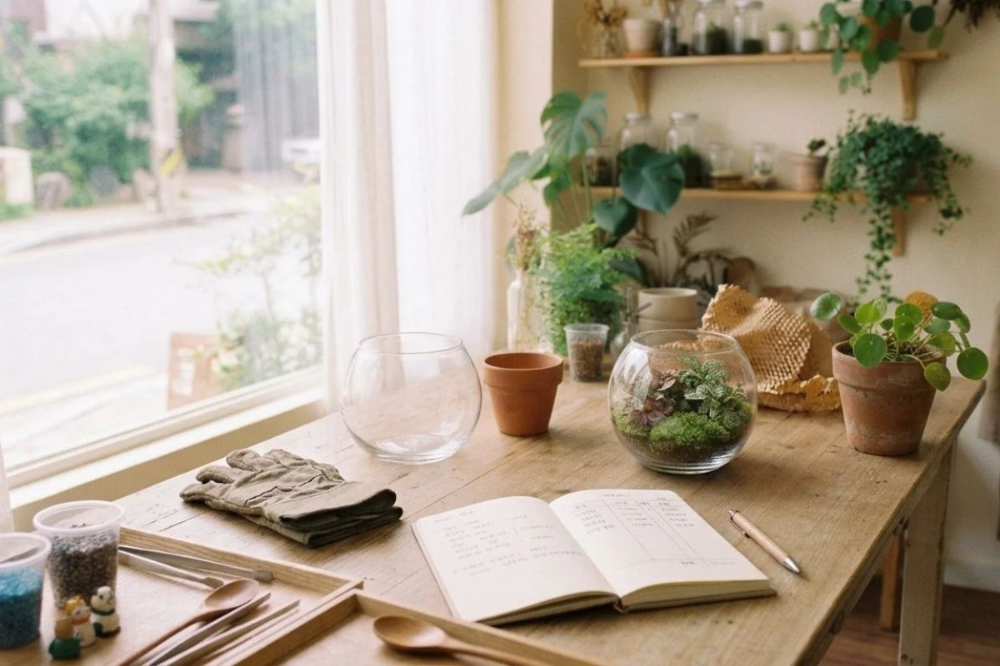
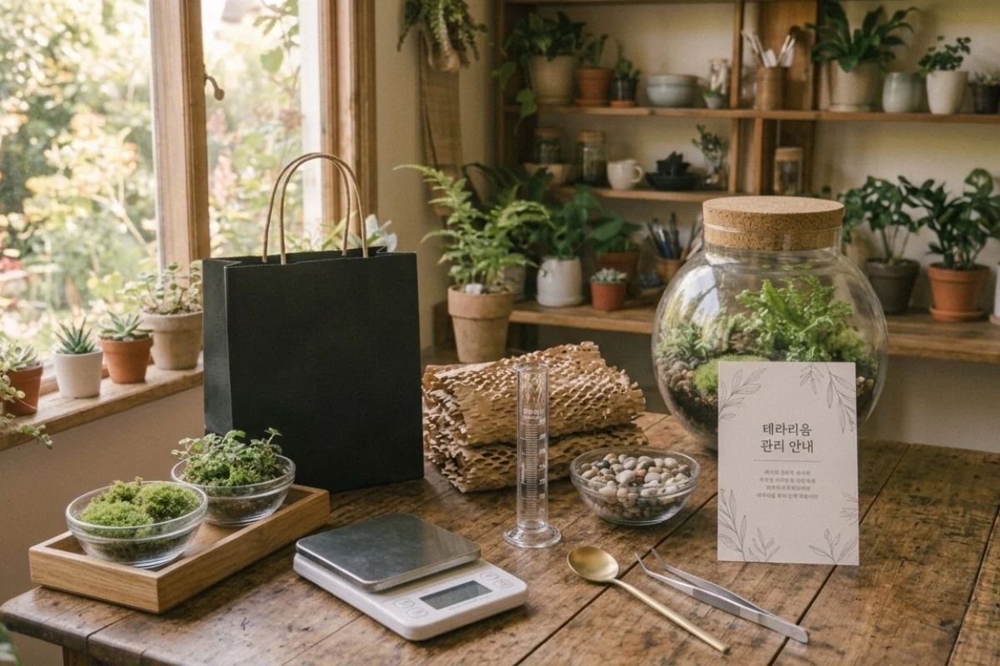

## 목차
1. [[첫걸음 포인트] "식물과 화분 값만 더했는데 왜 수업을 열수록 손에 남는 게 줄어들까: 정가 계산에서 빠지기 쉬운 숨은 비용의 정체"](#master-insight)
2. [[현장 정산 해부] '재료비 빼고 수강료 받으면 남겠지'라고 계산했다가 소모품·로스·시간에 발목 잡혔던 현실 사례](#cost-cases)
3. [[놓치기 쉬운 실제 비용 3대 축] 눈에 안 띄는 소모품과 포장재·식물/자재 로스·준비와 정리 시간 및 공간 비용](#three-hidden-costs)
4. [[실전 정가 산정 프로토콜] 초보 1인 공방도 무리 없이 정가를 잡는 3단계 계산 루틴](#pricing-protocol)
5. [[현장 메모] "제값을 받겠다는 것은 욕심이 아니라, 다음 수업과 식물을 기분 좋게 이어가기 위한 최소한의 체력이다"](#master-note)
6. [[실전 적용 가이드] 남는 게 없는 클래스를 피하고 지속 가능한 정가를 세우는 3대 필수 수칙](#solution)
7. [연재 시리즈 안내 & 다음 예고](#series)
8. [자주 묻는 질문 (FAQ)](#faq)

---

## 1. [첫걸음 포인트] "식물과 화분 값만 더했는데 왜 수업을 열수록 손에 남는 게 줄어들까: 정가 계산에서 빠지기 쉬운 숨은 비용의 정체"

"원데이 클래스 수강료를 정할 때 **화분과 식물, 흙 값만 대충 합산한 뒤 '이 정도면 괜찮겠지' 하고 가격을 책정했다가, 막상 수업을 마치고 나면 남은 금액이 생각보다 너무 적어 당황했던 경험**이 없으십니까?"

"수많은 1인 공방과 초보 클래스 운영자들이 **수업 중에 직접 쓰이는 메인 자재만 머릿속으로 계산할 뿐, 포장재·물티슈·장갑·여분 식물 로스·앞뒤 준비와 청소 시간 같은 비용은 '원래 들어가는 것'으로 뭉뚱그려 빼먹곤 한다는 사실**을 체감하고 계시지 않습니까?"

소규모 공방과 클래스 운영 현장을 살펴보며 확인한 현실적인 핵심은 **'클래스 정가를 잡을 때 놓치기 쉬운 실제 비용을 미리 항목별로 떼어내어 살펴봐야, 수업을 할수록 지치거나 손해 보는 구조를 막고 다음 클래스를 준비할 여력을 남길 수 있다'**는 사실입니다.

이번 [기획 연재: 식물 창업·전업 & 매장 리뉴얼 마스터 클래스 시즌 2] 제4부에서는 재료비·소모품·클래스 정가를 잡을 때 놓치기 쉬운 실제 비용을 차분히 정리합니다.

<figure style="text-align: center; margin: 32px 0;">
  
  <figcaption style="font-size: 0.9rem; color: #6C7A72; margin-top: 12px; font-style: normal;">눈에 보이는 재료뿐 아니라 포장·소모품·시간까지 함께 적어 보는 정가 점검</figcaption>
</figure>

---

## 2. [현장 정산 해부] '재료비 빼고 수강료 받으면 남겠지'라고 계산했다가 소모품·로스·시간에 발목 잡혔던 현실 사례

처음 클래스를 설계할 때는 보통 *"화분과 식물에 이 정도 들고, 흙이랑 돌 조금 쓰니까 수강료에서 그만큼 빼면 꽤 남겠네"*라고 가볍게 어림잡기 쉽습니다.

하지만 막상 수업을 몇 번 치러 보면 **잘게 쪼개져 나가는 돈과 시간**이 생각보다 큽니다. 예를 들어 수강생이 작품을 들고 갈 때 쓸 쇼핑백과 바닥이 꺼지지 않게 받쳐 주는 종이·완충재, 관리 안내 카드 인쇄비, 작업 중 흙과 물기를 닦아 내는 물티슈·키친타월·일회용 장갑 등은 한 건당 금액이 작아 보여도 회차가 쌓이면 무시할 수 없는 비용이 됩니다.

여기에 **식물과 자재 로스(손실)**도 현실적인 변수입니다. 수업용으로 넉넉히 들여온 식물 중 잎이 상하거나 상태가 고르지 못해 쓰지 못하는 개체가 생길 수 있고, 흙이나 돌도 소분 과정에서 바닥에 떨어지거나 남는 양이 발생합니다. 여기에 수업 전후 세팅·청소·응대 시간까지 더해지면, 겉으로 보던 수익과 실제 체감 남는 몫 사이에 큰 차이가 생기게 됩니다.

> #### 🧾 클래스 정가 산정 시 놓치기 쉬운 비용 영역 비교 매트릭스
>
> | 비용 구분 | 흔히 떠올리는 항목 | 현장에서 자주 빠뜨리는 실제 항목 |
> | :--- | :--- | :--- |
> | **재료 및 로스** | 식물, 화분·유리 용기, 기본 흙·자갈 | **상태 불량·잎 손상 등으로 못 쓰는 로스, 소분 여유분, 마감재** |
> | **소모품 및 포장** | 눈에 띄는 메인 소품 | **쇼핑백, 완충지, 안내 카드, 물티슈·행주·장갑·청소용품** |
> | **시간 및 공간** | 수강생과 함께 있는 60분 수업 시간 | **사전 준비·뒷정리·문의 응대 시간, 작업실·공유 공간 이용료** |
> | **운영 변수** | 별도 지출로 보지 않는 경우가 많음 | **결제 수수료, 샘플 제작비, 파손·재준비 대비 여유분** |

---

## 3. [놓치기 쉬운 실제 비용 3대 축] 눈에 안 띄는 소모품과 포장재·식물/자재 로스·준비와 정리 시간 및 공간 비용

수강료를 책정할 때 특히 꼼꼼히 짚어 보아야 할 실제 비용은 크게 세 가지 축으로 나뉩니다.

<figure style="text-align: center; margin: 32px 0;">
  
  <figcaption style="font-size: 0.9rem; color: #6C7A72; margin-top: 12px; font-style: normal;">수강생이 안전하게 들고 가도록 돕는 포장재와 안내물도 실제 원가 요소입니다</figcaption>
</figure>

> #### 💡 식물 창업·전업 & 매장 리뉴얼 시즌 2 제4부 핵심 3대 비용 축
> 

> 
> 1. **[제1축: '작지만 매번 나가는' 포장재·소모품·마감 자재 비용]**  
>    * 완성품을 안전하게 들고 가게 하는 쇼핑백, 쏠림을 막는 완충재, 물주기 주의사항을 적은 카드, 그리고 테이블과 손을 닦는 소모품은 수강생 만족도를 지키는 필수 요소입니다. 단품 가격만 계산하고 이 항목들을 빼면 결국 내 주머니에서 메꾸게 됩니다.

> 2. **[제2축: 살아 있는 식물을 다루기에 생기는 '자연스러운 로스(손실) 여유분']**  
>    * 식물은 공산품이 아니어서 입고 상태나 보관 환경에 따라 컨디션 차이가 생깁니다. "수강생 4명분이니 딱 4개만 사자"로 맞추면 당일 상태가 아쉬운 한 그루 때문에 급히 다른 걸 구해야 하는 상황이 생길 수 있으므로, 약간의 로스 여유를 감안해 계산하는 편이 안전합니다.

> 3. **[제3축: 수업 시간 바깥에 흐르는 '준비·정리·공간·응대 비용']**  
>    * 60분 수업 뒤에는 자재를 치우고 바닥을 닦고 다음 수업을 준비하는 시간이 반드시 따라옵니다. 공유 공간이나 작업실을 쓴다면 공간 비용도 함께 반영해야 하며, 내 시간과 체력 역시 소모되는 자원이라는 점을 정가 구조에 담아야 오래 갈 수 있습니다.

---

## 4. [실전 정가 산정 프로토콜] 초보 1인 공방도 무리 없이 정가를 잡는 3단계 계산 루틴

복잡한 회계 공식이 없더라도, 아래 세 단계 루틴으로 한 번만 적어 보면 정가가 훨씬 현실적으로 잡힙니다.

> #### ⚙️ 초보 1인 공방용 3단계 정가 점검 루틴
> 

> 
> 1. **[1단계: 1인분 기준 '직접 재료 + 포장·소모품' 합산하기]**  
>    * 식물·화분·흙·마감재 가격에 더해, 1인당 들어가는 쇼핑백·완충재·안내 카드·청소/위생 소모품 몫까지 한 줄씩 적어 합계를 내 보세요.

> 2. **[2단계: 로스 여유와 공간·운영 비용을 얹어 '실질 원가선' 잡기]**  
>    * 식물 컨디션 변수나 자재 여유분을 감안한 로스 몫과, 회차당 공간비·결제/홍보 소모 비용을 더해 실제 들어가는 비용선을 확인합니다.

> 3. **[3단계: 내 시간과 수고(준비·진행·정리)를 고려해 정가와 최소 모집 인원 맞추기]**  
>    * 정가를 정한 뒤에는 "이 가격이면 2명이 와도 수지가 맞는지, 아니면 3-4명 이상일 때 여유가 생기는지"를 역산해 보아야 합니다. 수강료가 너무 낮으면 적은 인원이 신청했을 때 힘이 빠지기 쉽습니다.

---

## 5. [현장 메모] "제값을 받겠다는 것은 욕심이 아니라, 다음 수업과 식물을 기분 좋게 이어가기 위한 최소한의 체력이다"

> #### 📝 [현장 노트] 가격과 비용을 바라볼 때 기억해 두면 좋은 세 가지 현실 감각
>
> * **첫 번째 메모: "초보일수록 가격을 싸게 잡아야 사람이 올 것 같지만, 남는 게 없으면 오래 버티기 어렵다"**  
>   ➔ 처음부터 무리하게 가격을 낮추기보다 재료와 시간, 포장 완성도에 걸맞은 합리적인 기준을 세우는 편이 좋습니다.

> * **두 번째 메모: "숨은 비용을 미리 계산해 두면 수강생에게도 더 여유롭고 친절하게 집중할 수 있다"**  
>   ➔ 비용 압박이 줄어들어야 수업 중 설명과 응대, 마무리까지 마음이 조급하지 않습니다.

> * **세 번째 메모: "가격은 한 번 정해 두고 끝나는 숫자가 아니라, 첫 2~3회 운영 뒤 실제 소모량을 보고 다듬어 가는 기준이다"**  
>   ➔ 직접 해본 뒤 예상보다 많이 든 항목과 덜 든 항목을 기록하며 내 공방에 맞게 조정해 나가면 됩니다.

---

## 6. [실전 적용 가이드] 남는 게 없는 클래스를 피하고 지속 가능한 정가를 세우는 3대 필수 수칙

1. **식물·화분 외에 포장재, 청소·위생 소모품, 안내물 비용까지 항목별로 적어 합산하기**  
   눈에 잘 안 띄는 소모 비용을 빠뜨리지 않고 1인분 기준 비용을 현실화하기.
2. **식물 상태 변수와 자재 여유분을 반영한 로스 기준과 공간 비용을 함께 살피기**  
   딱 맞춰 사서 당황하는 일을 줄이고 회차당 지출 구조를 명확히 파악하기.
3. **수업 60분뿐 아니라 준비·정리·응대 시간과 최소 인원 기준까지 함께 맞춰 정가 결정하기**  
   내 시간과 체력이 소진되지 않는 가격과 운영 단위를 세워 오래 이어가기.

---

## 7. 연재 시리즈 안내 & 다음 예고

* **[기획 연재: 식물 창업·전업 & 매장 리뉴얼 마스터 클래스 시즌 2. ①] [1인 공방·클래스 입문 편] \"큰 매장 없이 작은 작업실이나 원데이 클래스로 시작할 때의 현실: 임대료와 고정비 부담을 줄이며 첫 발을 떼는 법\"**  
  ➔ [큰 점포 없이 작은 작업실과 소규모 원데이 클래스로 시작할 때의 장단점과 현장 준비 루틴](https://floraldays.com/biz-season2-starting-with-small-studio-or-oneday-class-part1)

* **[기획 연재: 식물 창업·전업 & 매장 리뉴얼 마스터 클래스 시즌 2. ②] [인기 체험 아이템 편] \"초보자도 금방 결과물을 만들 수 있는 인기 체험 아이템 구성법: 60분 안에 완성도와 만족도를 함께 끌어올리는 클래스 설계\"**  
  ➔ [식물을 처음 다루는 수강생도 1시간 내외로 뿌듯한 완성품을 만들 수 있는 테라리움·반려식물 체험 구성 요령](https://floraldays.com/biz-season2-popular-diy-plant-class-items-for-beginners-part2)

* **[기획 연재: 식물 창업·전업 & 매장 리뉴얼 마스터 클래스 시즌 2. ③] [체험 진행 흐름 편] \"수강생이 '재밌다, 또 오고 싶다'고 느끼는 체험 진행 흐름: 긴장은 낮추고 몰입과 여운은 높이는 60분 클래스 운영법\"**  
  ➔ [수강생이 어색함 없이 몰입하고 재방문까지 떠올리게 만드는 시간대별 체험 진행 흐름과 안내 노하우](https://floraldays.com/biz-season2-engaging-plant-workshop-flow-for-repeat-visitors-part3)

* **[기획 연재: 식물 창업·전업 & 매장 리뉴얼 마스터 클래스 시즌 2. ④] (현재글) [재료비·가격·마진 계산 편] \"재료비·소모품·클래스 정가 잡을 때 놓치기 쉬운 실제 비용: 화분·식물 값만 계산했다가 남는 게 없어지는 실수 막기\"**  
  ➔ [원데이 클래스와 소규모 식물 공방 정가를 정할 때 흔히 빠뜨리는 소모품·포장재·로스·시간과 공간 비용 점검법](https://floraldays.com/biz-season2-hidden-costs-when-pricing-plant-classes-part4)

* **[다음 예고 — 시즌 2. ⑤] [수강생 모집·재방문 연결 편] \"첫 수강생을 모으고 재방문·지인 추천으로 이어지게 만드는 현실적인 방법\"**  
  ➔ 광고비 부담을 키우지 않고 동네·지인·후기·계절 테마를 통해 차분히 첫 신청자를 모으고 단골로 연결하는 방법

---

## 8. 자주 묻는 질문 (FAQ)

**Q1. 처음 시작할 때는 수강료를 낮게 책정해서 우선 신청자를 많이 모으는 것이 유리할까요?**  

A1. '무조건 낮게 잡기보다, 내가 감당할 수 있는 재료·소모품·시간 기준에 맞는 적정 정가를 먼저 세우는 것이 안전합니다. 

가격을 지나치게 낮추면 한 번 수업을 치르고 나서 피로감과 허탈감이 커져 다음 회차를 열기 어려워질 수 있으므로, 무리 없는 기준선에서 시작해 체험 구성이나 혜택으로 가치를 더하는 방향을 권장합니다'.

> 💡 소상공인 원가 관리 및 손익 점검 기초 자료는 <a href="https://www.semas.or.kr" target="_blank" rel="noopener noreferrer">소상공인시장진흥공단 공식 홈페이지</a>를 참고하시기 바랍니다.

**Q2. 재료비와 소모품 비용을 매번 장부에 세세하게 적는 게 어렵다면 어떻게 시작하면 좋을까요?**  

A2. '거창한 가계부부터 쓰려 하지 마시고, 클래스 1회분을 기준으로 "직접 자재 합계 + 포장·소모품 묶음 + 로스·공간 여유" 딱 세 줄만 메모해 보세요. 한두 번만 기록해 보면 내 수업에서 돈이 어디로 흘러가는지 큰 윤곽이 금방 잡힙니다'.

> 💡 생활 속 원예 활동 및 실내 가드닝 참고 자료는 <a href="https://www.modunong.or.kr" target="_blank" rel="noopener noreferrer">농림축산식품부 모두가 도시농부 포털</a>을 참고하시기 바랍니다.

---

