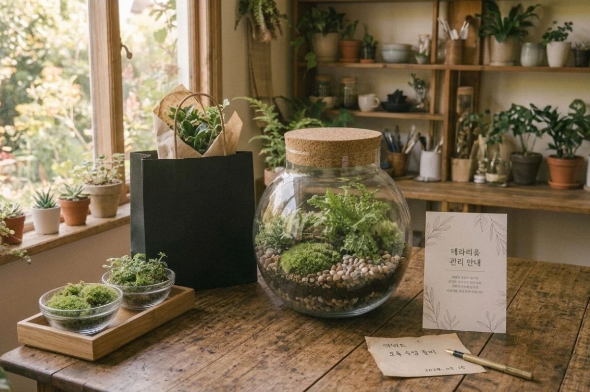
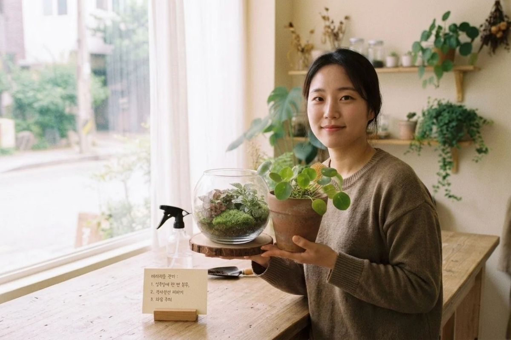

## 목차
1. [[첫걸음 포인트] "게시글을 올렸는데 신청 알림이 울리지 않던 첫날 밤, '10명 모으기' 대신 '딱 2명 만나기'로 시선을 바꾼 이유"](#master-insight)
2. [[현장 모집 해부] 막연한 홍보 문구만 올리다 조용히 지나가던 모집 글과, 실제 신청 문의로 이어졌던 소소한 접점 사례](#recruitment-cases)
3. [[입소문 연결 3대 단계] 첫 1-2명 소규모 오픈·수업 후 사진과 안부 한 줄·지인 동반과 계절 클래스 연결](#three-steps)
4. [[실전 홍보 루틴 프로토콜] 광고비 부담 없이 첫 모집부터 재방문까지 차분히 쌓아 가는 3단계 루틴](#promotion-protocol)
5. [[현장 메모] "입소문은 화려한 이벤트에서 나오지 않고, '내 화분이 집에 와서도 잘 자란다'는 작은 안심에서 시작된다"](#master-note)
6. [[실전 적용 가이드] 1인 공방·클래스의 첫 모집과 자연스러운 입소문을 부르는 3대 필수 수칙](#solution)
7. [연재 시리즈 안내 & 다음 예고](#series)
8. [자주 묻는 질문 (FAQ)](#faq)

---

## 1. [첫걸음 포인트] "게시글을 올렸는데 신청 알림이 울리지 않던 첫날 밤, '10명 모으기' 대신 '딱 2명 만나기'로 시선을 바꾼 이유"

"첫 원데이 클래스 모집 공지를 정성껏 써서 올린 뒤 **핸드폰 화면만 몇 번씩 새로고침하다가 조용한 알림창을 보며 '역시 아무도 안 오려나' 하고 마음이 작아졌던 순간**을 떠올려 보신 적이 없으십니까?"

"수많은 1인 공방과 초보 클래스 운영자들이 **처음부터 많은 인원을 한꺼번에 채우려고 막연한 전체 홍보에만 매달리다가 쉽게 지치곤 하지만, 실제로 소규모 공방의 첫 흐름은 동네와 지인, 작은 모임에서 만난 첫 1~2명의 진심 어린 후기와 사진에서 시작된다는 사실**을 체감하고 계시지 않습니까?"

작은 작업실과 공유 공간에서 첫 수업을 연 분들의 경험을 살피며 확인한 현실적인 답은 **'첫 클래스 모집은 거창한 마케팅 경쟁이 아니라, 가까운 생활권 안에서 딱 1~2명의 첫 수강생을 정성껏 맞이하고 그분들이 남긴 진솔한 사진과 기분 좋은 기억이 다음 사람에게 자연스럽게 건너가게 만드는 과정'**이라는 사실입니다.

이번 [기획 연재: 식물 창업·전업 & 매장 리뉴얼 마스터 클래스 시즌 2] 제5부에서는 첫 클래스 모집부터 입소문 나기까지의 소소한 홍보 경험담을 현실적으로 풀어봅니다.

<figure style="text-align: center; margin: 32px 0;">
  
  <figcaption style="font-size: 0.9rem; color: #6C7A72; margin-top: 12px; font-style: normal;">첫 1~2명의 수강생을 맞이하기 위해 단정히 준비한 소규모 클래스 자리</figcaption>
</figure>

---

## 2. [현장 모집 해부] 막연한 홍보 문구만 올리다 조용히 지나가던 모집 글과, 실제 신청 문의로 이어졌던 소소한 접점 사례

처음 모집 글을 올릴 때 흔히 쓰는 표현은 "힐링 테라리움 원데이 클래스 모집합니다, 초보자 환영"처럼 어디서나 볼 수 있는 추상적인 문장입니다. 읽는 사람 입장에서는 내가 가면 무엇을 만드는지, 시간과 장소가 내 생활 동선에 맞는지 선명하게 그려지지 않아 쉽게 지나치게 됩니다.

반대로 첫 신청으로 이어졌던 소소한 사례들은 훨씬 구체적이고 생활과 맞닿아 있었습니다. 예를 들어 동네 생활 플랫폼이나 지역 모임 게시판에 **"토요일 오후 2시, ○○역 도보 5분 작은 작업실에서 60분 동안 책상 위 유리 테라리움 하나를 완성해 가져가는 2인 소규모 모임"**처럼 요일·위치·소요 시간·완성품 크기를 또렷하게 적어 올렸을 때 첫 문의가 들어왔습니다.

또 다른 경험담으로는 처음부터 낯선 불특정 다수만 기다리지 않고, 평소에 화분 이야기에 관심을 보이던 지인이나 동네 단골 가게 사장님께 **"이번 주말에 첫 시범 수업을 여는데, 재료비만 받고 두 분만 모셔서 진행해 보려 한다"**고 가볍게 건넨 시도가 있습니다. 이 첫 자리에 참여한 분들이 직접 찍은 완성 사진과 솔직한 소감을 주변에 공유하면서, 그다음 회차부터는 제값을 내고 신청하는 첫 일반 수강생이 연결되었습니다.

> #### 📣 막연한 홍보 방식 대 첫 수강생과 입소문을 부르는 소소한 홍보 비교 매트릭스
>
> | 구분 | 반응이 밋밋했던 초기 방식 | 실제 문의와 입소문으로 이어진 방식 |
> | :--- | :--- | :--- |
> | **모집 안내 문구** | "힐링 클래스 모집, 초보 환영" 등 추상적 표현 | **요일·시간·역 거리·완성품 크기·정원(2~3명)을 구체적으로 명시** |
> | **첫 접점 채널** | 불특정 다수 대상의 일회성 홍보 글만 게시 | **동네 생활권 게시판, 지인·동네 상점 연계 소규모 오픈 수업 활용** |
> | **후기와 사진 확보** | 수업 끝나면 인사하고 헤어져 기록이 남지 않음 | **포토 스팟 촬영 후 수강생 동의하에 사진 공유 및 솔직 후기 요청** |
> | **수업 이후 연결** | 다음 일정 안내 없이 단발성 만남으로 종료 | **일주일 뒤 식물 안부 확인과 다음 계절·테마 클래스 소식 전달** |

---

## 3. [입소문 연결 3대 단계] 첫 1-2명 소규모 오픈·수업 후 사진과 안부 한 줄·지인 동반과 계절 클래스 연결

작은 공방의 입소문은 한 번에 폭발하기보다 아래 세 단계를 거치며 잔잔하고 단단하게 번져 나갑니다.

<figure style="text-align: center; margin: 32px 0;">
  
  <figcaption style="font-size: 0.9rem; color: #6C7A72; margin-top: 12px; font-style: normal;">수강생이 직접 찍어 지인에게 보여 주는 완성 사진 한 장이 가장 자연스러운 홍보가 됩니다</figcaption>
</figure>

> #### 💡 식물 창업·전업 & 매장 리뉴얼 시즌 2 제5부 핵심 3대 입소문 단계
> 

> 
> 1. **[제1단계: '첫 1~2명'만 채워져도 예정대로 열며 실제 수업 장면 남기기]**  
>    * 정원이 다 차지 않았다고 수업을 자꾸 취소하면 공방이 아직 준비되지 않은 인상을 주기 쉽습니다. 첫 1-2명이 신청했을 때 기쁘게 수업을 열고, 테이블 세팅과 완성 과정 사진을 차곡차곡 쌓아 두면 다음 모집 글에 실제 현장감이 살아납니다.

> 2. **[제2단계: 수업 직후 '예쁜 완성 사진 전송'과 1주일 뒤 '식물 안부 한 줄' 건네기]**  
>    * 수업 마지막에 자연광 아래서 찍어 준 완성 사진을 당일 저녁에 깔끔하게 보내 주면, 수강생은 고마운 마음에 메신저 프로필이나 소모임에 자연스럽게 사진을 올립니다. 여기에 일주일 뒤 **"데려가신 이끼와 화분은 새 자리에 잘 적응했나요?"**라는 짧은 안부를 건네면 세심한 공방이라는 인상이 깊게 남습니다.

> 3. **[제3단계: '다음엔 친구랑 같이 올게요'를 연결하는 계절·동반 테마 제안하기]**  
>    * 혼자 와서 즐거웠던 수강생은 다음번에 친구나 가족과 함께 오고 싶어 합니다. <em>"다음 달에는 봄맞이 반려식물 분갈이 수업도 열리는데, 두 분 함께 오시면 작은 화분 받침을 챙겨 드려요"</em>처럼 부담 없는 계절 테마를 안내하면 자연스럽게 지인 동반 재방문으로 이어집니다.

---

## 4. [실전 홍보 루틴 프로토콜] 광고비 부담 없이 첫 모집부터 재방문까지 차분히 쌓아 가는 3단계 루틴

거창한 마케팅 도구가 없어도 매주 아래 세 가지 작은 루틴만 꾸준히 반복하면 공방의 존재감이 조금씩 쌓입니다.

> #### ⚙️ 소규모 공방의 첫 모집·입소문 3단계 루틴
> 

> 
> 1. **[1단계: 주 2회 '작업실 준비와 식물 돌봄 일상' 짧은 기록 올리기]**  
>    * 매번 <em>"수강생 모집합니다"</em>라는 글만 올리면 읽는 사람도 피로해집니다. 평소 흙을 배합하거나 햇살 아래 화분 상태를 살피는 소소한 일상을 짧은 글과 사진으로 올리면, 이 공방이 성실하게 운영되고 있다는 신뢰가 쌓입니다.

> 2. **[2단계: 모집 공지에는 '누구에게 좋은지'와 '돌아갈 때 손에 들리는 것'을 첫 줄에 적기]**  
>    * <em>"식물을 처음 키워 보는 분도 1시간 만에 책상 위 미니 정원 1개를 완성해 전용 쇼핑백에 담아 가시는 수업입니다"</em>처럼 구체적인 장면을 첫 문장에 두면 망설이던 초보자가 편하게 문의합니다.

> 3. **[3단계: 다녀간 수강생의 한 줄 소감을 다음 안내 글의 근거로 활용하기]**  
>    * <em>"똥손이라 걱정했는데 설명이 차분해서 시간 가는 줄 몰랐어요"</em> 같은 실제 참여자의 짧은 한마디는 운영자가 백 마디 자랑하는 것보다 훨씬 큰 설득력을 가집니다.

---

## 5. [현장 메모] "입소문은 화려한 이벤트에서 나오지 않고, '내 화분이 집에 와서도 잘 자란다'는 작은 안심에서 시작된다"

> #### 📝 [현장 노트] 첫 모집과 입소문을 경험하며 깨닫게 되는 세 가지 현실 진실
>
> * **첫 번째 메모: "처음부터 열 명을 모으려 하면 조급해지지만, 첫 한 명에게 집중하면 수업의 결이 단단해진다"**  
>   ➔ 한 명의 수강생이 만족하며 돌아가면 그 한 명이 다음 두 명을 데려오는 시작점이 됩니다.

> * **두 번째 메모: "가장 좋은 홍보 문구는 운영자의 미사여구가 아니라, 수강생이 집 책상 위에 올려둔 화분을 보며 느끼는 뿌듯함이다"**  
>   ➔ 수업의 완성도와 쉬운 관리 안내가 결국 가장 오래가는 홍보 수단이 됩니다.

> * **세 번째 메모: "동네에서 작게 시작할수록 '가깝고 편하게 들를 수 있는 이웃 공방'이라는 친근함이 무기가 된다"**  
>   ➔ 멀리 있는 유명 매장보다 집 근처에서 기분 좋게 한 시간을 보낼 수 있는 공간이라는 점이 생활권 입소문을 만듭니다.

---

## 6. [실전 적용 가이드] 1인 공방·클래스의 첫 모집과 자연스러운 입소문을 부르는 3대 필수 수칙

1. **첫 모집 글에는 요일·역 거리·소요 시간·정원(2~3명)·완성품 모습을 구체적으로 적기**  
   초보자도 머릿속으로 수업 장면을 쉽게 떠올리고 부담 없이 문의할 수 있도록 돕기.
2. **첫 1~2명이 신청해도 성실히 수업을 열고 완성 사진과 1주일 뒤 안부 메시지로 여운 잇기**  
   한 번의 체험으로 끝내지 않고 기분 좋은 기억과 사후 관리 신뢰를 남겨 재방문 기반 다지기.
3. **일상 작업 기록과 실제 수강생의 한 줄 소감을 꾸준히 쌓아 생활권 신뢰 넓히기**  
   큰 광고비 대신 성실한 기록과 계절 테마 안내로 지인 소개와 동반 방문 연결하기.

---

## 7. 연재 시리즈 안내 & 다음 예고

* **[기획 연재: 식물 창업·전업 & 매장 리뉴얼 마스터 클래스 시즌 2. ①] [1인 공방·클래스 입문 편] \"큰 매장 없이 작은 작업실이나 원데이 클래스로 시작할 때의 현실: 임대료와 고정비 부담을 줄이며 첫 발을 떼는 법\"**  
  ➔ [큰 점포 없이 작은 작업실과 소규모 원데이 클래스로 시작할 때의 장단점과 현장 준비 루틴](https://floraldays.com/biz-season2-starting-with-small-studio-or-oneday-class-part1)

* **[기획 연재: 식물 창업·전업 & 매장 리뉴얼 마스터 클래스 시즌 2. ②] [인기 체험 아이템 편] \"초보자도 금방 결과물을 만들 수 있는 인기 체험 아이템 구성법: 60분 안에 완성도와 만족도를 함께 끌어올리는 클래스 설계\"**  
  ➔ [식물을 처음 다루는 수강생도 1시간 내외로 뿌듯한 완성품을 만들 수 있는 테라리움·반려식물 체험 구성 요령](https://floraldays.com/biz-season2-popular-diy-plant-class-items-for-beginners-part2)

* **[기획 연재: 식물 창업·전업 & 매장 리뉴얼 마스터 클래스 시즌 2. ③] [체험 진행 흐름 편] \"수강생이 '재밌다, 또 오고 싶다'고 느끼는 체험 진행 흐름: 긴장은 낮추고 몰입과 여운은 높이는 60분 클래스 운영법\"**  
  ➔ [수강생이 어색함 없이 몰입하고 재방문까지 떠올리게 만드는 시간대별 체험 진행 흐름과 안내 노하우](https://floraldays.com/biz-season2-engaging-plant-workshop-flow-for-repeat-visitors-part3)

* **[기획 연재: 식물 창업·전업 & 매장 리뉴얼 마스터 클래스 시즌 2. ④] [재료비·가격·마진 계산 편] \"재료비·소모품·클래스 정가 잡을 때 놓치기 쉬운 실제 비용: 화분·식물 값만 계산했다가 남는 게 없어지는 실수 막기\"**  
  ➔ [원데이 클래스와 소규모 식물 공방 정가를 정할 때 흔히 빠뜨리는 소모품·포장재·로스·시간과 공간 비용 점검법](https://floraldays.com/biz-season2-hidden-costs-when-pricing-plant-classes-part4)

* **[기획 연재: 식물 창업·전업 & 매장 리뉴얼 마스터 클래스 시즌 2. ⑤] (현재글) [수강생 모집·입소문 편] \"첫 클래스 모집부터 입소문 나기까지의 소소한 홍보 경험담: 큰 광고비 없이 첫 1~2명을 만나 단골과 지인 추천으로 이어지는 현실 기록\"**  
  ➔ [큰 광고비를 쓰지 않고도 첫 원데이 클래스 수강생을 모집하고, 사진 후기와 지인 소개로 자연스럽게 번져 나가는 과정](https://floraldays.com/biz-season2-first-class-recruitment-and-word-of-mouth-story-part5)

* **[다음 예고 — 시즌 3. ①] [소규모 홈가드닝·식물 구독·정기 관리 모델 편] \"큰 매장 없이 단골 고객의 집과 사무실 식물을 정기적으로 돌봐주는 소규모 구독·관리 모델의 현실\"**  
  ➔ 시즌 2의 1인 공방·클래스 운영을 마치고, 시즌 3에서는 단골 기반의 소규모 식물 정기 관리 및 홈가드닝 서비스 모델을 살펴봅니다.

---

## 8. 자주 묻는 질문 (FAQ)

**Q1. 첫 클래스를 열었을 때 신청자가 1명뿐이면 수업을 취소하고 다음 주로 미루는 게 나을까요?**  

A1. '특별한 사정이 없다면 1명이라도 예정대로 진행하는 편을 권장합니다. 

첫 수강생 한 분을 1:1처럼 세심하게 챙겨 드리면 만족도가 매우 높아져 정성스러운 후기와 지인 소개로 이어지는 경우가 많고, 운영자 입장에서도 실제 동선과 시간 배분을 실전처럼 점검하는 값진 기회가 됩니다'.

> 💡 소상공인 온라인 홍보 기초 및 지역 상권 활성화 안내는 <a href="https://www.semas.or.kr" target="_blank" rel="noopener noreferrer">소상공인시장진흥공단 공식 홈페이지</a>를 참고하시기 바랍니다.

**Q2. 수강생에게 후기나 사진 공유를 부탁할 때 부담스럽지 않게 건네는 요령이 있을까요?**  

A2. '수업 직후 자연광 자리에서 예쁘게 찍어 드린 완성 사진을 당일 메시지로 보내 드리면서, "오늘 만드신 작품이 너무 예쁘게 나와서 보내 드려요. 

혹시 괜찮으시면 이 사진 공방 기록용으로만 사용해도 될까요?"라고 가볍게 여쭤보면 대부분 기분 좋게 동의해 주시고 자연스럽게 소감도 남겨 주십니다'.

> 💡 생활 속 원예 문화 및 반려식물 가꾸기 정보는 <a href="https://www.modunong.or.kr" target="_blank" rel="noopener noreferrer">농림축산식품부 모두가 도시농부 포털</a>을 참고하시기 바랍니다.

---

