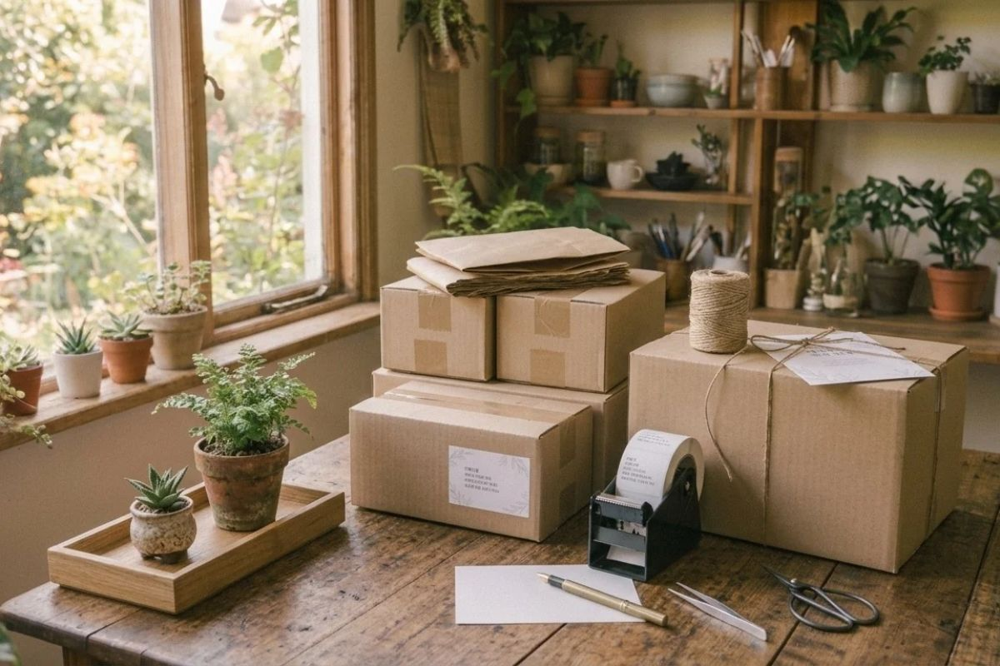
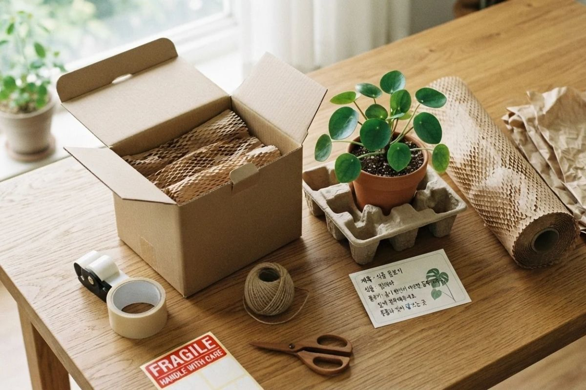

## 목차
1. [[첫걸음 포인트] "상가 임대료부터 내야 할까, 집이나 작은 창고에서 조용히 시작해도 될까: 고정비 없는 출발이 주는 현실적인 힘"](#master-insight)
2. [[현실 비교 해부] 집·작은 창고 기반 온라인·동네 거래를 해 보며 마주한 편리함과 번거로움의 실제 장면](#trade-cases)
3. [[장단점 3대 포인트] 고정비 절감·공간/동선 제약·직거래와 택배 포장 수고의 현실 점검](#three-points)
4. [[실전 준비 프로토콜] 집이나 작은 창고에서 무리 없이 거래를 시작하기 위한 3단계 점검 루틴](#prep-protocol)
5. [[현장 메모] "임대료가 없는 대신 '내 생활 공간과의 경계'와 '꼼꼼한 포장·약속'이 신뢰를 만든다"](#master-note)
6. [[실전 적용 가이드] 집·작은 창고 기반 온라인·동네 거래를 안정적으로 이어가기 위한 3대 필수 수칙](#solution)
7. [연재 시리즈 안내 & 다음 예고](#series)
8. [자주 묻는 질문 (FAQ)](#faq)

---

## 1. [첫걸음 포인트] "상가 임대료부터 내야 할까, 집이나 작은 창고에서 조용히 시작해도 될까: 고정비 없는 출발이 주는 현실적인 힘"

"식물 판매나 소규모 거래를 떠올릴 때 **처음부터 점포를 계약하지 않으면 어딘가 허술해 보일까 봐 걱정하면서도, 매달 빠져나가는 월세와 관리비를 생각하면 쉽게 결심이 서지 않던 경험**이 없으십니까?"

"수많은 입문자들이 **온라인 주문이나 동네 직거래로 첫 발을 떼는 방식은 초기 자금과 고정 지출을 크게 줄일 수 있지만, 집 공간의 햇빛·통풍·보관 여건과 포장·픽업 동선을 미리 챙기지 않으면 일상과 일이 뒤섞여 금세 피곤해질 수 있다는 점**을 놓치곤 한다는 사실을 체감하고 계시지 않습니까?"

소규모 식물 판매와 생활권 직거래 현장을 살펴보며 확인한 현실적인 기준은 **'임대료 부담 없이 집이나 작은 창고에서 시작하는 온라인·동네 거래는 리스크를 낮추며 시장을 익히기에 매우 유리하지만, 공간의 한계와 포장·만남의 수고를 미리 알고 준비해야 오래 기분 좋게 이어갈 수 있다'**는 사실입니다.

이번 [기획 연재: 식물 창업·전업 & 매장 리뉴얼 마스터 클래스 시즌 3] 제1부에서는 임대료 부담 없이 집·작은 창고에서 시작하는 온라인·동네 거래의 장단점을 차분히 정리합니다.

<figure style="text-align: center; margin: 32px 0;">
  
  <figcaption style="font-size: 0.9rem; color: #6C7A72; margin-top: 12px; font-style: normal;">작은 공간과 선반, 포장 자재만으로 시작하는 저비용 거래 세팅</figcaption>
</figure>

---

## 2. [현실 비교 해부] 집·작은 창고 기반 온라인·동네 거래를 해 보며 마주한 편리함과 번거로움의 실제 장면

집이나 작은 창고에서 시작하는 거래의 가장 큰 매력은 **매달 고정으로 나가는 점포 임대료와 인테리어 초기 비용이 없다는 점**입니다. 주문이 들어오거나 동네 거래 약속이 잡힌 날에 맞춰 움직일 수 있고, 어떤 식물이 반응이 좋은지, 어떤 크기와 가격이 손님에게 잘 맞는지 작은 단위로 실험해 볼 수 있습니다.

반면 현장에서 부딪히는 현실적인 단점도 분명합니다. 집의 한쪽이나 작은 창고를 활용하다 보면 <em>식물이 자라기에 빛과 통풍이 충분한지</em>, <em>흙이나 물기가 떨어졌을 때 가족이나 주변에 불편을 주지 않는지</em>를 늘 신경 써야 합니다.

또한 온라인 택배 발송이나 동네 직거래는 매장에서 손님을 기다리는 것과 다른 수고가 따릅니다. 택배로 보낼 때는 화분이 흔들리거나 흙이 쏟아지지 않도록 고정·완충 포장에 시간과 손이 가고, 동네 직거래를 할 때는 서로의 이동 시간과 약속 장소를 조율해야 합니다.

> #### 📦 집·작은 창고 기반 온라인·동네 거래 장점 대 단점 비교 매트릭스
>
> | 구분 | 현실적인 장점 | 현실적인 단점 및 주의점 |
> | :--- | :--- | :--- |
> | **비용 구조** | 보증금·월세·간판·인테리어 부담이 없음 | **포장재·완충재·소모품·이동 비용은 별도로 발생** |
> | **공간 조건** | 집·소형 창고 활용으로 시작 문턱이 낮음 | **빛·통풍·온도 한계와 보관 공간 부족 가능성** |
> | **시간·운영** | 내 일정에 맞춰 유연하게 준비하고 발송 가능 | **포장·발송·직거래 약속 조율에 시간 소요** |
> | **고객 접점** | 온라인 문의 및 동네 생활권 단골 형성 가능 | **간판·오프라인 매장 부재로 신뢰 형성에 정성 필요** |

---

## 3. [장단점 3대 포인트] 고정비 절감·공간/동선 제약·직거래와 택배 포장 수고의 현실 점검

집이나 작은 창고에서 온라인·동네 거래를 시작할 때는 아래 세 가지 장단점 포인트를 균형 있게 살펴보아야 합니다.

<figure style="text-align: center; margin: 32px 0;">
  
  <figcaption style="font-size: 0.9rem; color: #6C7A72; margin-top: 12px; font-style: normal;">배송 파손과 직거래 약속 차질을 줄이는 포장·준비 동선</figcaption>
</figure>

> #### 💡 식물 창업·전업 & 매장 리뉴얼 시즌 3 제1부 핵심 3대 포인트
> 

> 
> 1. **[제1포인트: 임대료 압박이 없는 '가벼운 출발' vs 식물을 오래 두기 어려운 '환경 제약']**  
>    * 고정비가 낮아 마음이 조급하지 않은 것은 큰 장점입니다. 다만 집이나 작은 창고는 매장처럼 환기 설비나 넓은 진열 공간이 갖춰져 있지 않은 경우가 많으므로, 재고를 무리하게 많이 쌓아 두지 않고 <em>돌볼 수 있는 수량만 들여 놓는 것</em>이 안전합니다.

> 2. **[제2포인트: 내 일정대로 움직이는 '자율성' vs 포장·발송·약속 조율에 드는 '손품']**  
>    * 정해진 영업시간에 묶이지 않는 것은 편하지만, 주문이 생기면 포장재를 자르고 고정하고 송장을 붙이는 손작업과 직거래 시간 맞추기가 따라옵니다. 특히 식물은 계절 온도 변화에 민감하므로 <em>발송 요일과 날씨</em>를 살피는 세심함이 필요합니다.

> 3. **[제3포인트: 동네 이웃과 가까워지는 '친근한 연결' vs 집 주소·생활 공간 노출에 대한 '경계 설정']**  
>    * 동네 거래는 배송비 부담 없이 식물을 건네고 짧은 관리 이야기를 나눌 수 있어 단골로 이어지기 좋습니다. 다만 집 내부를 곧바로 노출하기보다는 <em>동네의 정해진 만남 장소나 현관 앞 픽업 규칙</em>처럼 나만의 안전한 경계를 미리 정해 두어야 마음이 편합니다.

---

## 4. [실전 준비 프로토콜] 집이나 작은 창고에서 무리 없이 거래를 시작하기 위한 3단계 점검 루틴

집이나 작은 창고에서 거래를 시작하기 전에는 아래 세 가지 루틴으로 현실 여건을 먼저 점검해 보세요.

> #### ⚙️ 집·작은 창고 거래 시작 전 3단계 점검 루틴
> 

> 
> 1. **[1단계: '식물 보관 구역'과 '포장·작업 구역' 분리하기]**  
>    * 햇빛과 통풍이 드는 자리에는 식물을 두고, 흙과 박스를 다루는 자리에는 방수 매트나 트레이를 깔아 두세요. 공간이 작을수록 <em>식물 두는 곳</em>과 <em>포장하는 곳</em>만 구분해도 일과 일상의 피로가 줄어듭니다.

> 2. **[2단계: 택배 포장 테스트 1회 먼저 해 보기]**  
>    * 실제 판매할 화분 크기에 맞는 박스와 완충재를 구해 화분을 넣고 흔들어 보세요. 흙이 쏟아지지는 않는지, 잎이 박스에 눌려 상처가 나지는 않는지 미리 확인하면 첫 발송 때 당황하지 않습니다.

> 3. **[3단계: 동네 직거래 시간대·장소·안내 문구 미리 정해 두기]**  
>    * "평일 저녁 ○시 이후나 주말 ○시~○시, ○○역 출구 앞"처럼 내가 편한 시간과 장소를 기준선으로 잡아 두면, 매번 일정 조율에 에너지를 쓰지 않고 차분히 응대할 수 있습니다.

---

## 5. [현장 메모] "임대료가 없는 대신 '내 생활 공간과의 경계'와 '꼼꼼한 포장·약속'이 신뢰를 만든다"

> #### 📝 [현장 노트] 집·작은 창고 기반 거래에서 꼭 챙겨야 할 세 가지 현실 감각
>
> * **첫 번째 메모: "고정비가 적은 만큼 조급해하지 않고, 내 공간이 감당할 수 있는 크기만큼만 키우는 것이 지혜롭다"**  
>   ➔ 작은 시작의 장점은 <em>무리하지 않고 천천히 배울 수 있다</em>는 점에 있습니다.

> * **두 번째 메모: "매장이 없는 대신 '사진과 실물의 차이 없음·안전한 포장·약속 시간 준수'가 신뢰를 대신한다"**  
>   ➔ 작은 디테일이 지켜질 때 온라인·동네 거래에서도 재구매와 소개가 이어집니다.

> * **세 번째 메모: "생활 공간과 일 공간의 경계가 흐려지면 쉽게 지칠 수 있으니, 끝내는 시간과 정리 기준을 분명히 두자"**  
>   ➔ 집에서 시작할수록 <em>마감과 정리</em>가 일상의 평온을 지키는 핵심입니다.

---

## 6. [실전 적용 가이드] 집·작은 창고 기반 온라인·동네 거래를 안정적으로 이어가기 위한 3대 필수 수칙

1. **고정비 절감의 장점을 살리되, 빛·통풍·보관 여건에 맞는 소량 순환 위주로 운영하기**  
   창고나 집 공간의 한계를 넘어서는 과도한 재고를 피하고 식물 컨디션을 안정적으로 유지하기.
2. **택배 포장 고정 테스트와 동네 직거래 시간·장소 기준을 사전에 표준화하기**  
   배송 중 흔들림·파손과 일정 조율 피로를 줄여 거래 만족도와 신뢰 높이기.
3. **생활 공간과 작업 구역·시간의 경계를 정해 무리 없이 오래 이어갈 리듬 만들기**  
   정리 루틴과 안전한 만남 기준을 지켜 번아웃 없이 작은 거래를 축적하기.

---

## 7. 연재 시리즈 안내 & 다음 예고

* **[기획 연재: 식물 창업·전업 & 매장 리뉴얼 마스터 클래스 시즌 2. ⑤] [수강생 모집·입소문 편] \"첫 클래스 모집부터 입소문 나기까지의 소소한 홍보 경험담: 큰 광고비 없이 첫 1~2명을 만나 단골과 지인 추천으로 이어지는 현실 기록\"**  
  ➔ [큰 광고비를 쓰지 않고도 첫 원데이 클래스 수강생을 모집하고, 사진 후기와 지인 소개로 자연스럽게 번져 나가는 과정](https://floraldays.com/biz-season2-first-class-recruitment-and-word-of-mouth-story-part5)

* **[기획 연재: 식물 창업·전업 & 매장 리뉴얼 마스터 클래스 시즌 3. ①] (현재글) [집·작은 창고 시작 편] \"임대료 부담 없이 집·작은 창고에서 시작하는 온라인·동네 거래의 장단점: 고정비를 낮추고 실전 감각을 익히는 현실 가이드\"**  
  ➔ [보증금과 월세 부담 없이 집 공간이나 작은 창고를 활용해 온라인 판매와 동네 직거래를 시작할 때의 장단점과 점검 루틴](https://floraldays.com/biz-season3-starting-from-home-or-small-storage-online-local-trade-part1)

* **[다음 예고 — 시즌 3. ②] [반려식물·홈가드닝 정기 관리 편] \"단골 고객의 집과 사무실 식물을 정기적으로 돌봐주는 소규모 관리 모델의 현실\"**  
  ➔ 일회성 판매를 넘어 계절별 분갈이·물주기·상태 점검으로 이어지는 소규모 홈가드닝·오피스 관리 모델의 실제 모습

---

## 8. 자주 묻는 질문 (FAQ)

**Q1. 집에서 시작할 때 가장 먼저 신경 써야 할 현실적인 불편함은 무엇인가요?**  

A1. '흙과 물기 정리, 그리고 가족이나 이웃과의 생활 동선 충돌입니다. 

작업용 방수 매트와 쓰레기·흙 수거 기준을 미리 만들어 두고, 거래 약속이나 포장 작업은 내가 정한 시간대에만 몰아서 처리하면 생활 공간의 불편함을 크게 줄일 수 있습니다'.

> 💡 소상공인 통신판매 및 소규모 사업 준비 기초 정보는 <a href="https://www.semas.or.kr" target="_blank" rel="noopener noreferrer">소상공인시장진흥공단 공식 홈페이지</a>를 참고하시기 바랍니다.

**Q2. 식물을 택배로 보낼 때 가장 주의해야 할 점은 무엇인가요?**  

A2. '화분 속에서 흙이 흔들려 뿌리가 들뜨지 않도록 윗흙을 고정하고, 박스 안에서 화분이 좌우로 쏠리지 않게 완충재로 빈틈을 채우는 것이 중요합니다. 

또한 한겨울이나 한여름처럼 기온 편차가 큰 시기에는 식물 상태와 배송 일정을 한 번 더 점검하는 세심함이 필요합니다'.

> 💡 실내 식물 관리 및 계절별 생육 참고 정보는 <a href="https://www.modunong.or.kr" target="_blank" rel="noopener noreferrer">농림축산식품부 모두가 도시농부 포털</a>을 참고하시기 바랍니다.

---

